<!-- _class: title -->
<!-- _paginate: false -->

# Welcome to tsmap

## Lesson 00

Learn tsmap

---

# In this lesson

A wafer map is a picture of how a semiconductor wafer tested. This lesson gives you the few words you need to read one, then shows you where everything is on the screen.

- The words used in wafer testing: die, lot, test, bin, yield (the [glossary](https://wafertools.github.io/tsmap/learn/glossary/) lists them all)
- What tsmap is, the two ways to run it, and the library it is built on
- A tour of the screen, one area at a time

---

# What you will be using

This is where you will end up: a lot of 25 wafers open in tsmap, with the bin legend, one map per wafer and a summary of what stands out. The rest of the lesson explains each part.

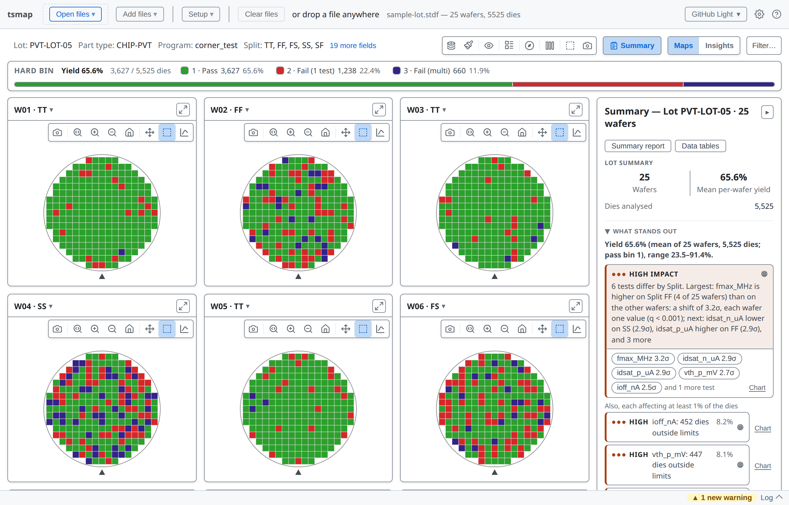

---

<!-- covers: glossary › Wafer; glossary › Die; glossary › Lot; glossary › Prober; glossary › ATE -->

# Wafers, dies and lots

Four words come up on every screen.

- A **wafer** carries tens, hundreds or thousands of usually identical chips, called **dies**
- Wafers are made and tested in batches called **lots**, often of 25
- A **tester** measures each die while a **prober** steps from die to die

A simple wafer map draws one rectangle for each die, so you can see where on the wafer the results are good or bad.

---
<!-- covers: glossary › Test value; glossary › Functional test; glossary › STDF; tsmap guide › Supported file formats -->

# What a test records

The tester records two kinds of test result for every die.

- A **test value**: a measurement, such as a threshold voltage or a leakage current
- A **functional test**: only a pass or a fail, such as a scan chain

Testers usually write **STDF** (binary) or **ATDF** (text) files. Data can also arrive as CSV, JSON or Parquet files. tsmap reads all of these file formats, compressed or not.

---

<!-- covers: glossary › Hard bin (hbin); glossary › Soft bin (sbin) -->

# Bins and yield

After testing, every die is classed into a **bin** (a category), and the bins are what colour the map. There are two kinds of bin:

- **Hard bin**: the sort result. Bin 1 is a pass bin in this example, in green, often known as the *production bin*.
- **Soft bin**: the test program's reason, usually finer than the hard bin, often known as the *engineering bin*.

---

<!-- covers: Bin legend entry; glossary › Yield; chart › Bin map -->

# Yield and reading the colours

**Yield** is the share of dies in a pass bin: 66.2% for this lot, shown in the legend.

A map that is mostly green is a healthy wafer. The other colours show where the rest of the dies failed, and how.

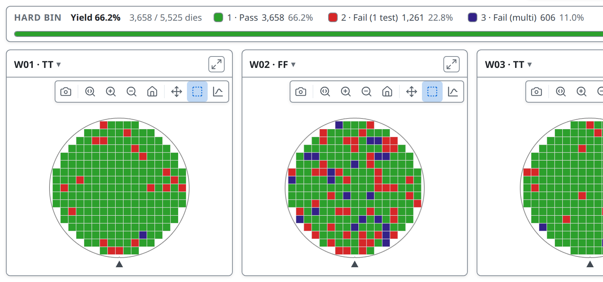

---

<!-- _class: divider -->

# What tsmap is

---

<!-- covers: tsmap guide › The wafer map view -->

# A viewer for wafer test data

Open STDF, ATDF, CSV, JSON or Parquet files and get interactive wafer maps, findings, charts and tables. You can start looking at your data straight away, with nothing to program.

---

<!-- covers: tsmap guide › Installing past security warnings -->

# Two ways to run tsmap

- **In the browser** at [wafertools.github.io/tsmap/app](https://wafertools.github.io/tsmap/app/): nothing to install, and it works offline after the first visit
- **As a desktop app** for Linux, macOS and Windows, from the [releases page](https://github.com/wafertools/tsmap/releases/latest).
  *The installers are not code-signed, so the first run may show a warning: [what to click](../user-guide.md#installing-past-security-warnings)*

---

<!-- covers: tsmap guide › Desktop vs browser differences -->

<!-- _class: split -->

# Desktop only

The same test data parser, maps and charts run in both. Only the desktop app has:

- 1 dropping a whole folder
- 2 recent files
- the command line, `tsmap://` links and file associations (lesson 12)

More about this in the [user guide](../user-guide.md#desktop-vs-browser-differences)

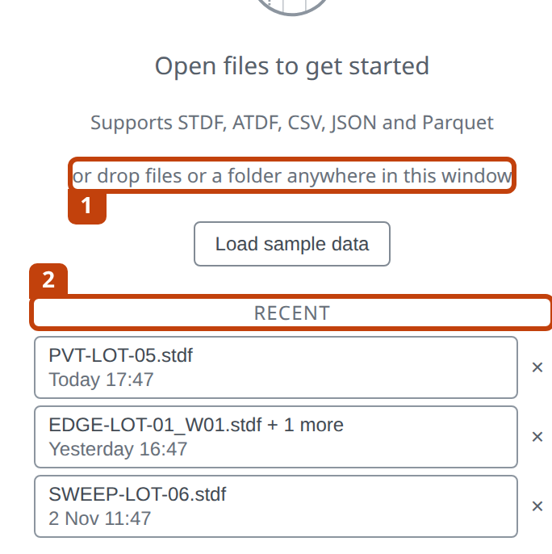

---

# Built on wafermap

tsmap is built on **wafermap**, our own fast open-source library that draws the maps and charts and finds the patterns.

You do not need to know anything about **wafermap** to use tsmap.

These lessons link to two guides:
- tsmap's user guide, which mostly covers loading data and configuration files
- The [wafer map guide](https://wafertools.github.io/wafermap/user-guide/), which covers the maps and charts.

---

# Your files and data stay with you

- Files are read on your own computer, in the browser or in the app
- Nothing is uploaded to a server, so your data stays with you

---

<!-- _class: divider -->

# Finding your way round tsmap

The main screen has eight areas. You will see them all numbered once, then described one at a time.

---

<!-- covers: Load sample data; tsmap guide › Loading sample data -->

# Everything starts here

**Load sample data** opens a synthetic lot of 25 wafers, so you can follow along without any files of your own. Most labs in these lessons use it.

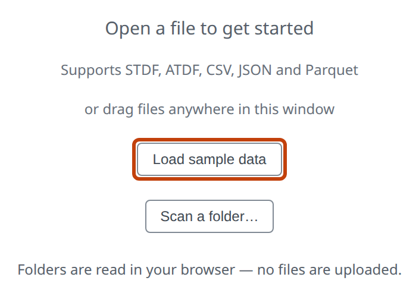

---

# The screen at a glance

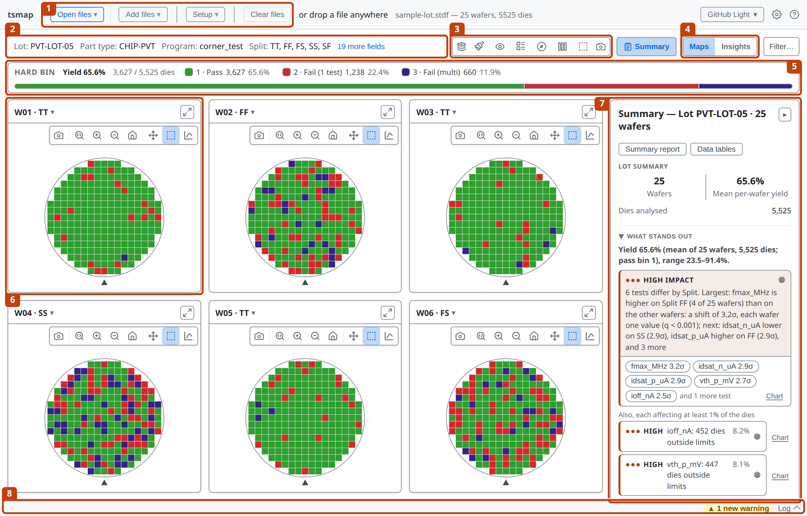

---

<!-- covers: Open files ▾; Add files ▾; Setup ▾; Clear files; tsmap guide › Clearing data -->

# 1 The app toolbar

The app toolbar opens and adds files, sets up the lot and clears it. Lesson 01 covers loading.

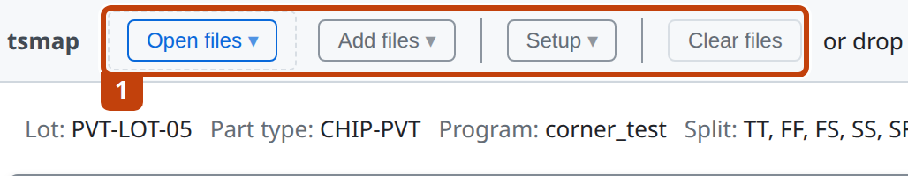

---

<!-- covers: More fields -->

# 2 The lot header

The lot header shows the lot, part type, program and other fields read from the file.

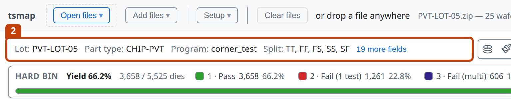

---

# 3 The map toolbar

The map toolbar controls what the maps show and how they look. Lesson 02 takes it button by button.

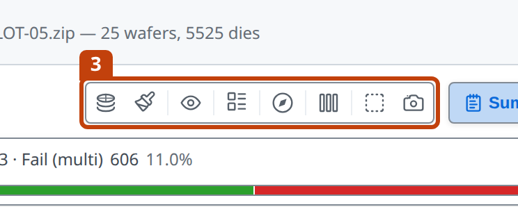

---

<!-- covers: Maps; Insights -->

# 4 Maps and Insights

**Maps** and **Insights** switch between the wafer maps and the charts and statistics for the lot.

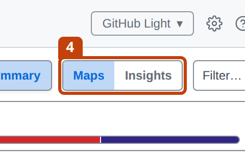

---

# 5 The bin legend

The bin legend shows how many dies fell into each bin, with the lot's yield first. Click any bin to display just that bin on the maps.

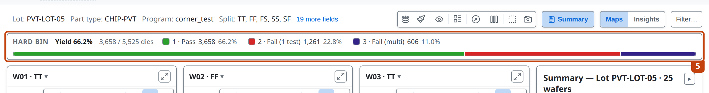

---

<!-- covers: Wafer chip (one per wafer) -->

# 6 One card per wafer

Each wafer gets its own wafer map. Click the ▾ beside its name to show the wafer's details.

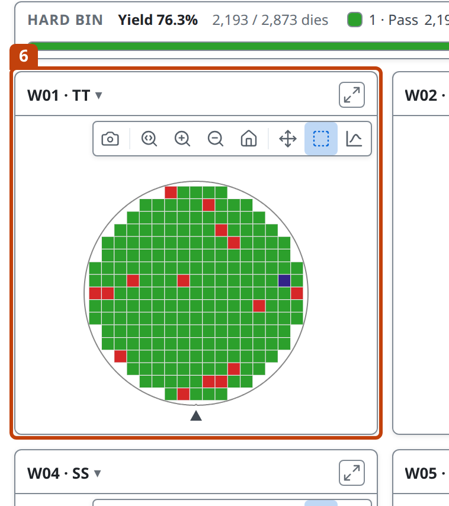

---

<!-- _class: side -->
<!-- covers: Summary; Close the Summary panel -->

# 7 The Summary panel

The Summary panel shows what stands out in the lot, the findings, and the yield of every wafer.

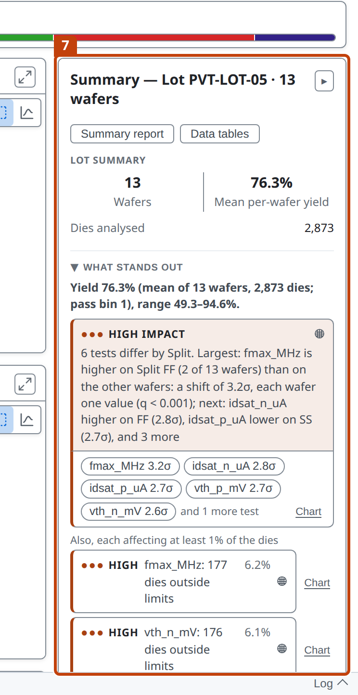

---

<!-- covers: Log -->

# 8 The log

The log records each data load, with any warnings. Click **Log** to open it.

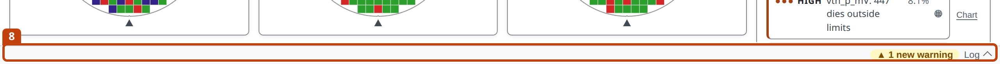

---

<!-- covers: Help -->

# Help is one click away

The **?** button opens the Help menu. **User guide** opens the full guide.

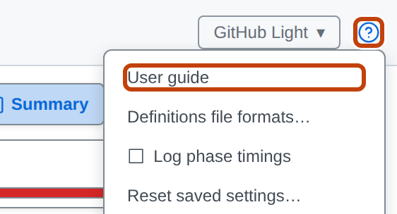

---

<!-- covers: Dialog › Maximize (F); Dialog › Close (Esc) -->

# Every dialog

**Maximize (F)** and **Close (Esc)**, top right, are on every dialog.

Press **F** to fill the window, and **Esc** to close it.

---

<!-- _class: divider -->

# How the lessons work

---

# Thirteen short lessons

tsmap is quick to pick up. Load a file and you can start looking at it straight away, so you do not have to finish the lessons before using the app. They are there for when you want to go further.

- Each lesson is a few slides, then a short lab in the web app
- Use the arrow keys to move through the slides, and press **F** for full screen.
- New to tsmap? Go in order: lessons 00 to 06 are the core path. Otherwise pick the lesson you need
- For the detail behind a slide, follow the link to the [user guide](../user-guide.md)

---

<!-- _class: lab -->

# Try it yourself

1. Open the web app: [wafertools.github.io/tsmap/app](https://wafertools.github.io/tsmap/app/), or install the desktop app from the [releases page](https://github.com/wafertools/tsmap/releases/latest)
2. Click **Load sample data**
3. Find all eight areas from the tour
4. Click **Insights**, then **Maps** to come back

---

# Recap

- A wafer map shows every die of a wafer, coloured by its bin or a test value; yield is the share that pass
- tsmap runs in the browser or as a desktop app, and keeps your files local
- The screen has eight areas: toolbar, lot header, map toolbar, views, legend, wafers, Summary and log

You now know the words and where things are. The next lesson is about getting your own data in.

---

<!-- _class: next -->
<!-- _paginate: false -->

# Next lesson

[01 · Getting data in →](01-getting-data-in.md)

Opening your own files, choosing tests and mapping columns.
