<!-- _class: title -->
<!-- _paginate: false -->

# Welcome to tsmap

## Lesson 00

Learn tsmap

---

# In this lesson

- The words used in wafer testing: die, lot, test, bin, yield (the [glossary](https://wafertools.github.io/tsmap/learn/glossary/) lists them all)
- What tsmap is, the two ways to run it, and the library it is built on
- A tour of the screen, one area at a time

---

# What you will be using

A lot of 13 wafers open in tsmap: the bin legend, one map per wafer and a summary of what stands out.

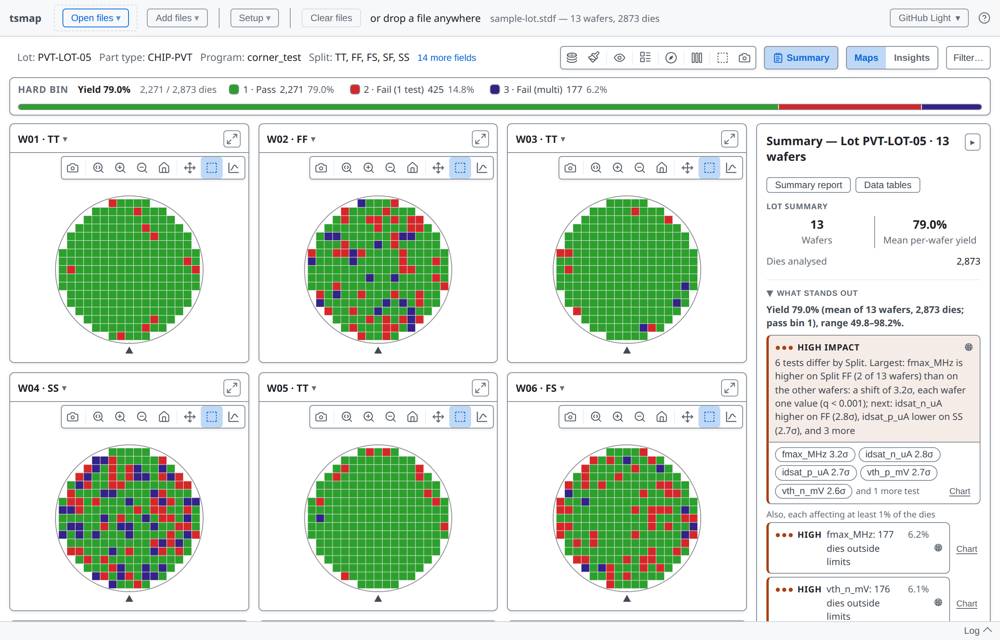

---

<!-- covers: glossary › Wafer; glossary › Die; glossary › Lot; glossary › Prober; glossary › ATE -->

# Wafers, dies and lots

- A **wafer** carries hundreds or thousands of identical chips, called **dies**
- Wafers are made and tested in batches called **lots**, often of 25
- A **tester** measures each die while a **prober** steps from die to die

---
<!-- covers: glossary › Test value; glossary › Functional test; glossary › STDF; tsmap guide › Supported file formats -->

# What a test records

- A **test value**: a measurement, such as a threshold voltage or a leakage current
- A **functional test**: only a pass or a fail, such as a scan chain
- Testers usually write **STDF** (binary) or **ATDF** (text); some other formats used are CSV, JSON or Parquet. tsmap can read all these formats.

---

<!-- _class: split -->
<!-- covers: Bin legend entry; glossary › Hard bin (hbin); glossary › Soft bin (sbin); glossary › Yield; chart › Bin map -->

# Bins and yield

- **Hard bin**: the sort result. Bin 1 is a pass bin here, in green
- **Soft bin**: the test program's reason, finer than the hard bin
- **Yield**: the share of dies in a pass bin, 79.0% for this lot, shown in the legend

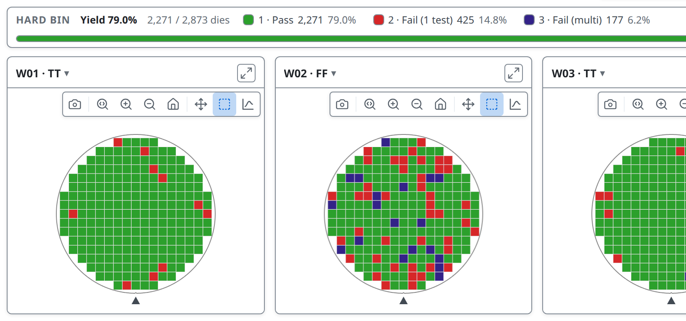

---

<!-- _class: divider -->

# What tsmap is

---

<!-- covers: tsmap guide › The wafer map view -->

# A viewer for wafer test data

Open STDF, ATDF, CSV, JSON or Parquet files and get interactive wafer maps, findings, charts and tables.

---

<!-- covers: tsmap guide › Installing past security warnings -->

# Two ways to run it

- **In the browser** at [wafertools.github.io/tsmap/app](https://wafertools.github.io/tsmap/app/): nothing to install, and it works offline after the first visit
- **As a desktop app** for Linux, macOS and Windows, from the [releases page](https://github.com/wafertools/tsmap/releases/latest). The installers are not code-signed, so the first run shows a warning: [what to click](../user-guide.md#installing-past-security-warnings)

---

<!-- covers: tsmap guide › Desktop vs browser differences -->

# Desktop only

The same data parser, maps and charts run in both. Only the desktop app has:

- recent files, and dropping a whole folder
- the command line, `tsmap://` links and file associations (lesson 12)

More in the [user guide](../user-guide.md#desktop-vs-browser-differences)

---

# Built on wafermap

tsmap is built on **wafermap**, our own open-source library that draws the maps and charts and finds the patterns. tsmap's user guide covers loading data; the [wafer map guide](https://wafertools.github.io/wafermap/user-guide/) covers the maps and charts. These lessons link to both.

---

# Your files stay with you

- Files are read on your own computer, in the browser or the app
- Nothing is uploaded

---

<!-- _class: divider -->

# Finding your way round

Eight screen areas, numbered once, then one at a time

---

<!-- covers: Load sample data; tsmap guide › Loading sample data -->

# Everything starts here

**Load sample data** opens a synthetic lot of 13 wafers. Most labs use it.

---

# The screen at a glance

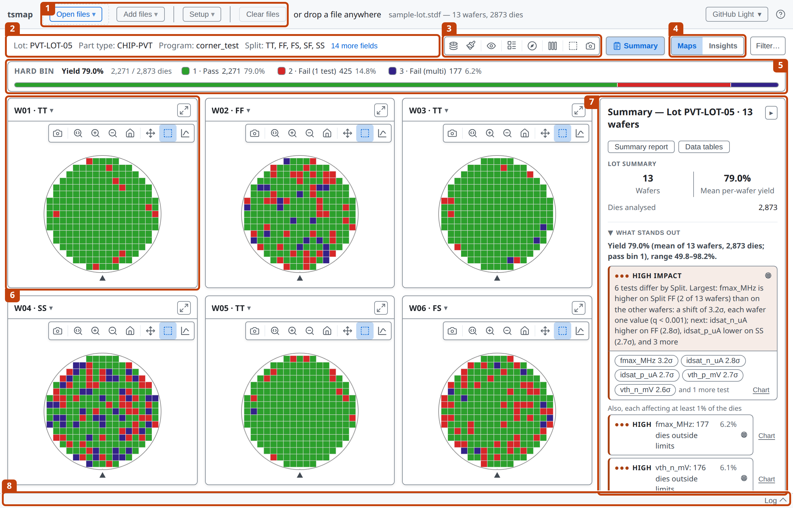

---

<!-- covers: Open files ▾; Add files ▾; Setup ▾; Clear files; tsmap guide › Clearing data -->

# 1 The app toolbar

Open and add files, set up the lot, and clear it. Lesson 01 covers loading.

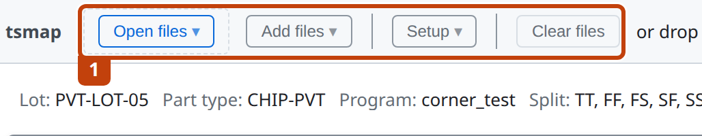

---

<!-- covers: More fields -->

# 2 The lot header

The lot, part type, program and other fields read from the file.

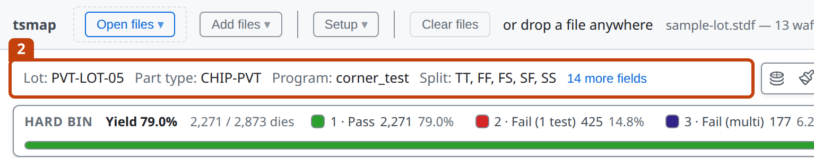

---

# 3 The map toolbar

What the maps show and how they look. Lesson 02 takes it button by button.

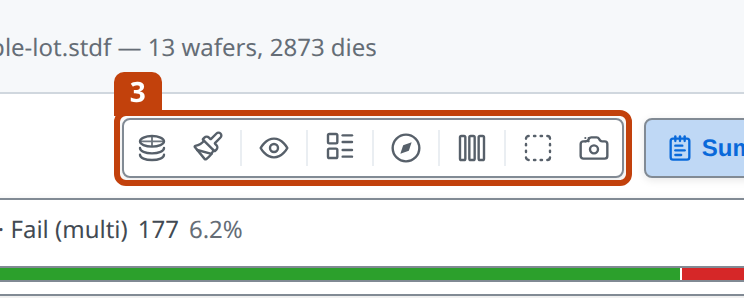

---

<!-- covers: Maps; Insights -->

# 4 Maps and Insights

Switch between the wafer maps and the charts and statistics for the lot.

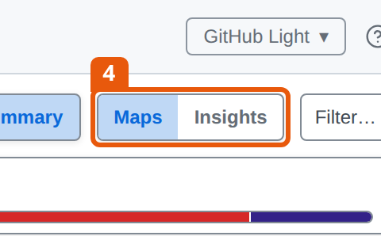

---

# 5 The bin legend

How many dies fell into each bin, with the lot's yield first. Click any bin to display just that bin on the maps.

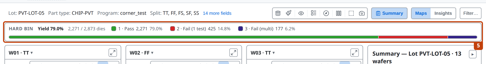

---

<!-- covers: Wafer chip (one per wafer) -->

# 6 One card per wafer

Each wafer gets its own map. The ▾ beside its name shows the wafer's details.

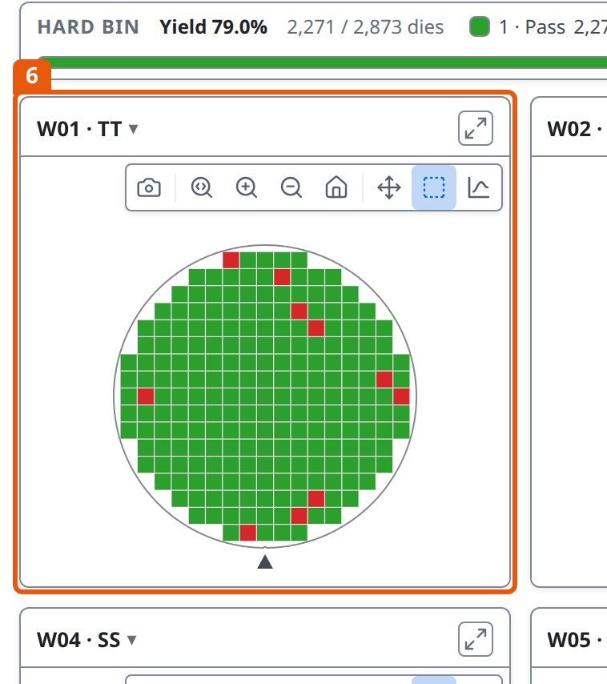

---

<!-- _class: side -->
<!-- covers: Summary; Close the Summary panel -->

# 7 The Summary panel

What stands out in the lot, the findings, and the yield of every wafer.

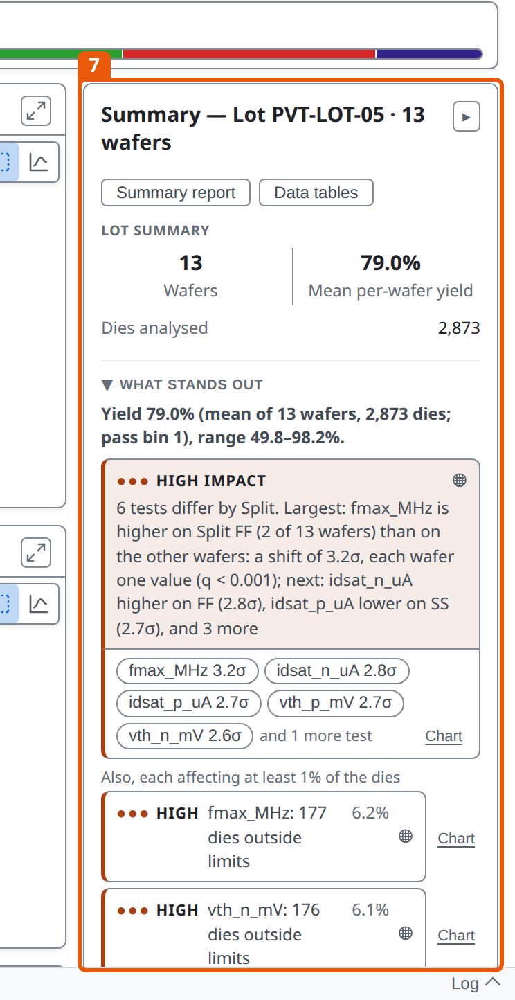

---

<!-- covers: Log -->

# 8 The log

What each load did, with any warnings. Click **Log** to open it.

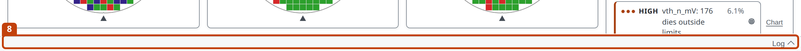

---

<!-- covers: Help -->

# Help is one click away

The **?** button opens the Help menu. **User guide** opens the full guide.

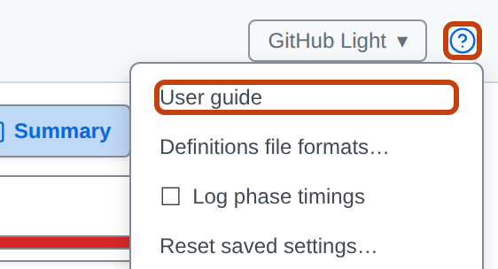

---

<!-- covers: Dialog › Maximize (F); Dialog › Close (Esc) -->

# Every dialog

**Maximize (F)** and **Close (Esc)**, top right, are on every dialog. Press **F** to fill the window, and **Esc** to close it.

---

<!-- _class: divider -->

# How the lessons work

---

# Thirteen short lessons

- Each is a few minutes of slides, then a short lab in the web app
- Use the arrow keys to move through the slides, and press **F** for full screen. It comes back with the next key press in the next lesson
- New to tsmap? Go in order: lessons 00 to 06 are the core path. Otherwise pick the lesson you need
- For the detail behind a slide, follow the link to the [user guide](../user-guide.md)

---

<!-- _class: lab -->

# Try it yourself

1. Open the web app: [wafertools.github.io/tsmap/app](https://wafertools.github.io/tsmap/app/), or install the desktop app from the [releases page](https://github.com/wafertools/tsmap/releases/latest)
2. Click **Load sample data**
3. Find all eight areas from the tour
4. Click **Insights**, then **Maps** to come back

---

# Recap

- A wafer map shows every die of a wafer, coloured by its bin or a test value; yield is the share that pass
- tsmap runs in the browser or as a desktop app, and keeps your files local
- Toolbar, lot header, map toolbar, views, legend, wafers, Summary, log

---

<!-- _class: next -->
<!-- _paginate: false -->

# Next lesson

[01 · Getting data in →](01-getting-data-in.md)

Opening your own files, choosing tests and mapping columns.
