<!-- _class: title -->
<!-- _paginate: false -->

# Getting data in

## Lesson 01

Learn tsmap

---

# In this lesson

- Open files from inside the app, and build one lot from several files
- Choose and rename tests in the test selector
- Map the columns of a CSV, JSON or Parquet file

---

<!-- _class: divider -->

# Opening files

---

<!-- covers: Load sample data; tsmap guide › Sample files -->

# The quickest start

**Load sample data** opens an example lot: 13 wafers from five process corners. More sample lots, one per feature, are listed in the [user guide](../user-guide.md#sample-files).

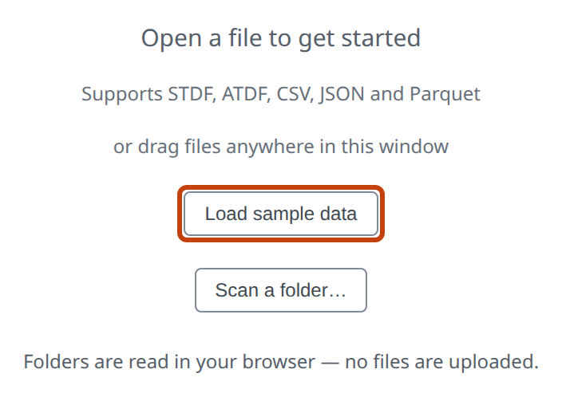

---

# What tsmap reads

- **STDF** and **ATDF**: tester files, read directly
- **CSV**, **JSON** and **Parquet**: tables, after a column mapping step
- **.gz**, **.bz2** and **.zip**: compressed files are read without unpacking first

---

<!-- covers: tsmap guide › Drag and drop -->

# Drag and drop

Drop one or more files anywhere in the window. It is the same as picking them. In the desktop app, dropping a folder scans it.

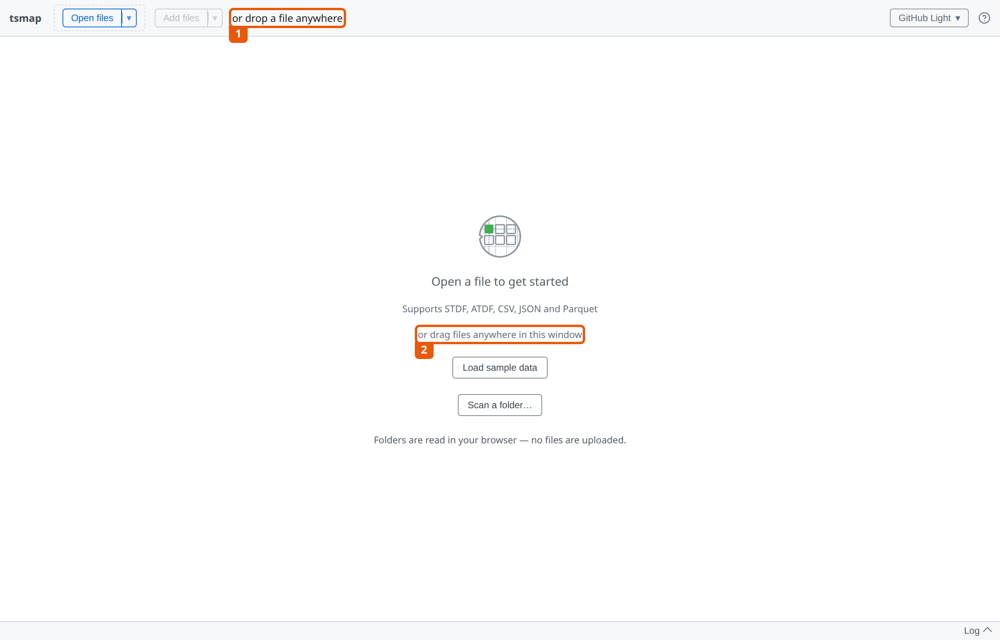

---

<!-- covers: tsmap guide › Open files; Open files; Choose how to pick files to open; Choose how to pick files to open › Choose files…; Choose how to pick files to open › Scan a folder… -->

# Open files ▾

**Open files** picks files. The **▾** beside it offers **Choose files…** or **Scan a folder…**

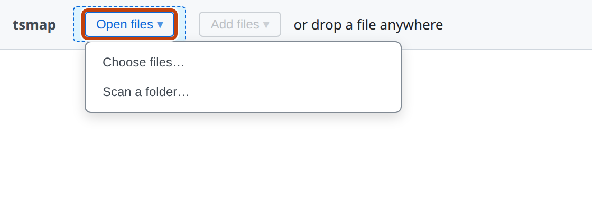

---

<!-- covers: tsmap guide › Recent files -->

# Recent files

*Desktop app only.* The last 8 file sets you opened are listed under **Open files ▾** and on the start screen.

---

<!-- _class: divider -->

# Scanning a folder

Hundreds of files? Let tsmap tell you what is in them.

---

<!-- _class: split -->
<!-- covers: tsmap guide › Scanning a folder; Scan a folder…; Filter files › Sort by column; Filter files › Filter by column; Columns ▾; Clear filters -->

# The file filter

- Scanning a folder reads only each file's header: quick, even for big batches
- Click a heading to sort; **▾** to filter that column
- Search across every column

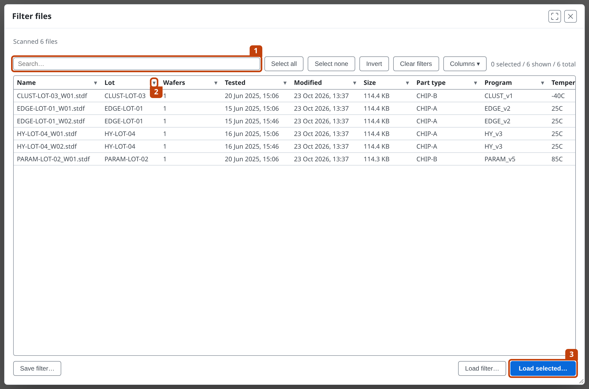

---

<!-- covers: Select all; Select none; Invert; Load selected…; Save filter…; Load filter… -->

# Pick, then load

Search for **EDGE**, **Select all** of what is shown, then **Load selected…**

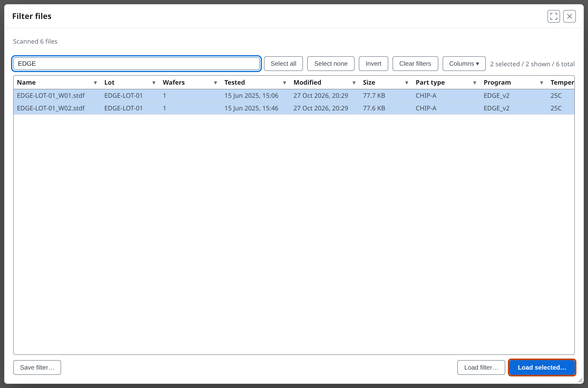

---

# Filters you use again

- **Save filter…** keeps the filters in a file; **Load filter…** reselects matching rows
- A mixed folder: buttons above the table pick which kind of file to load
- Pick more than five files with **Open files** and tsmap offers this table

---

<!-- covers: tsmap guide › Wafer rename overlay -->

# Naming the wafers

Several files at once ask for a label per wafer. A plain ID such as W01 gets its lot in front, so two lots' W01 stay apart. Edit any label, then **Continue →**

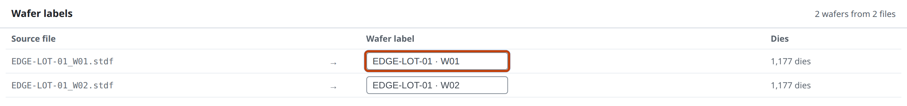

---

# One lot from separate files

The two files hold one wafer each. They load as one lot, EDGE-LOT-01.

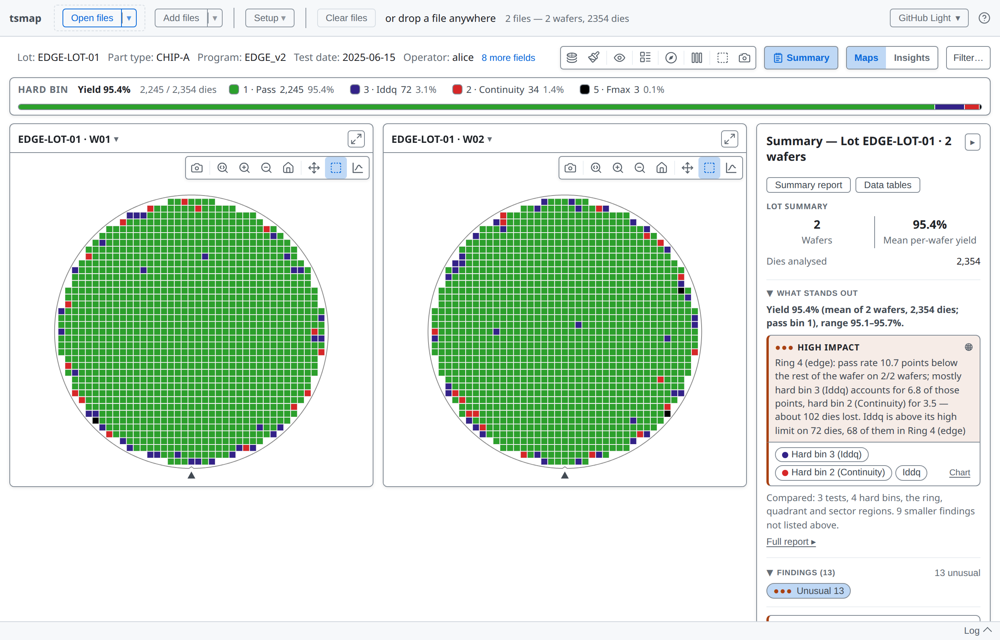

---

<!-- covers: Add files; Choose how to pick files to add; Choose how to pick files to add › * -->

<!-- covers: tsmap guide › Adding files to an existing lot -->

# Add files

**Add files** appends wafers to what is already loaded. The confirmation warns when they differ: another die count, other bins, or a wafer ID already loaded.

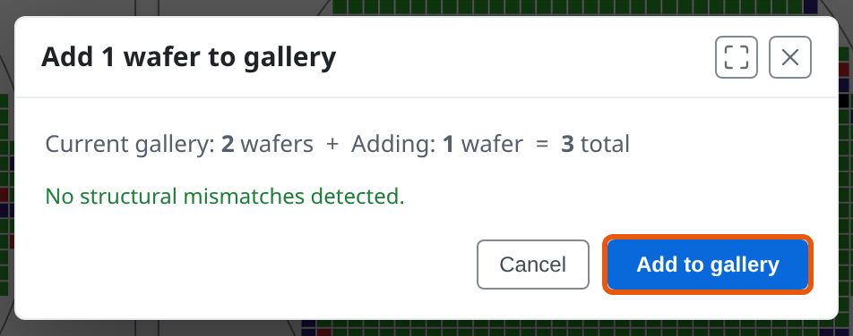

---

# The lot grows

The third wafer joins the same gallery, Summary and yield.

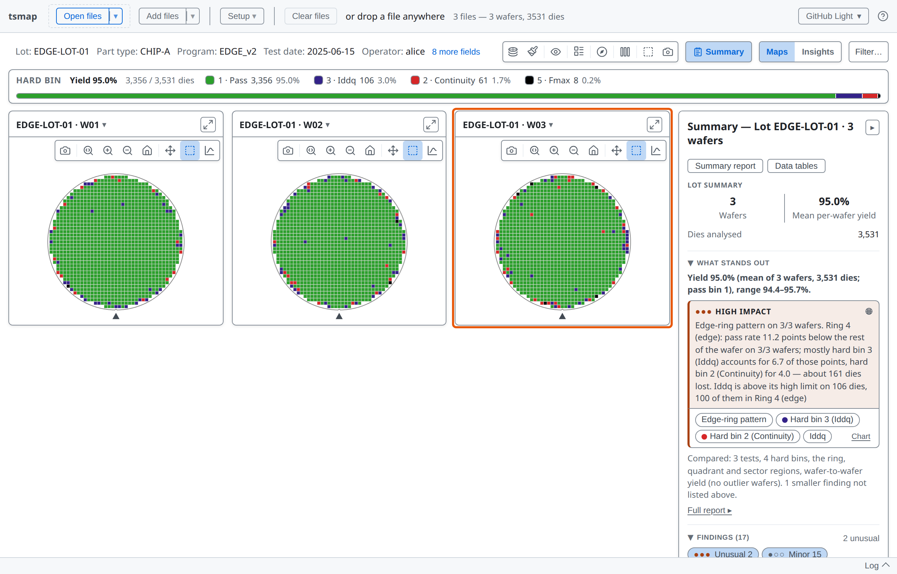

---

# Units across files

- One file in mV and another in V? tsmap converts the later file to the first file's unit, and the log says so
- Any other difference, `mV` against `MV` included, may be another measurement: that test is left out of the views that compare wafers

---

# Two more ways to open data

- **A link** that tells the web app which file to load
- **The command line**, which opens the files you name in the desktop app

Both are in [lesson 10](10-automation.md).

---

<!-- _class: divider -->

# Choosing tests

---

<!-- covers: Setup ▾; Setup ▾ › Tests…; tsmap guide › Test selector (STDF and ATDF) -->

# The test selector

A small lot imports every test. **Setup ▾ → Tests…** opens the selector at any time.

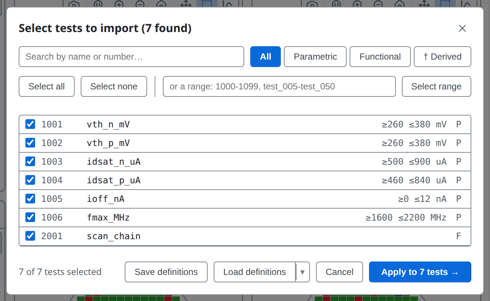

---

<!-- _class: split -->
<!-- covers: All; Parametric; Functional; Select range; Test selector › test row; tsmap guide › Controls -->

# Narrow, then select

- 1 Search by name or number
- 2 Show one type of test
- 3 Select a range, such as `1001-1004`

---

<!-- covers: tsmap guide › Memory advisory; tsmap guide › Changing the selection after load -->

# Big lots start empty

- A lot with many tests opens the selector first, nothing ticked
- The footer estimates memory: amber is slow, red asks first
- Several files: **Scan all N files** lists tests from every file
- Later, removing a test applies at once; adding one rereads the files

---

<!-- covers: Apply to N tests →; Close; tsmap guide › Renaming a test -->

# Rename a test

Click into a name and type. **Enter** keeps it; only the displayed name changes.

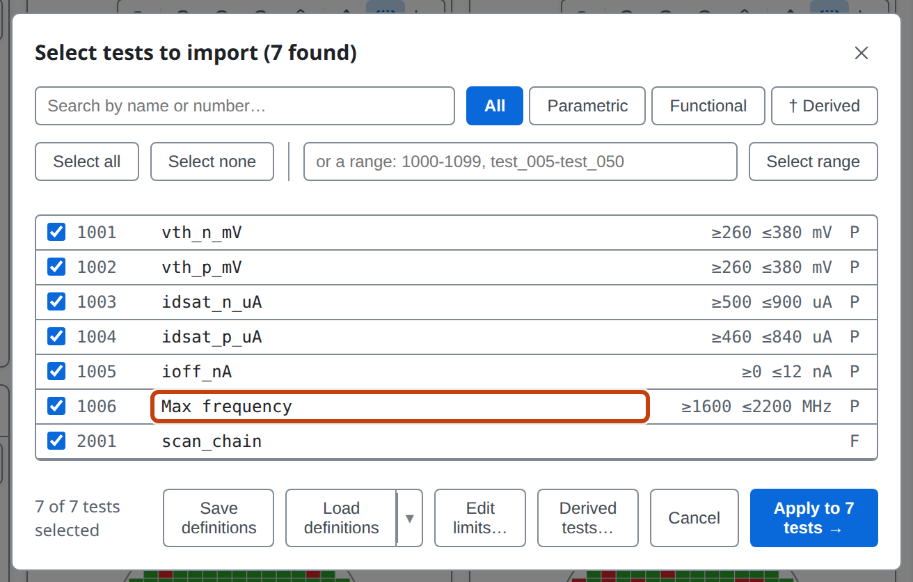

---

<!-- covers: Save definitions; Load definitions; Load a recently used definitions file; tsmap guide › Saving and loading test definitions -->

# Save and load definitions

4 **Save definitions** writes the selection, names, limits, units and test type to a CSV. 5 **Load definitions** reapplies it, which also gives limits to a program that shipped without them.

---

<!-- _class: divider -->

# Mapping columns

CSV, JSON and Parquet only

---

<!-- covers: tsmap guide › What happens next -->

# Not for STDF or ATDF

STDF and ATDF name every field in their records, so they go straight to the test selector without any need for column mapping.

A CSV, JSON or Parquet table can lay its columns out any way, so tsmap asks which column is which.

---

<!-- covers: Column mapping › Role; Continue →; tsmap guide › Column mapping (CSV, JSON, and Parquet) -->

# Column mapping

Every column gets a role. Common names are detected for you; check, then **Continue →**

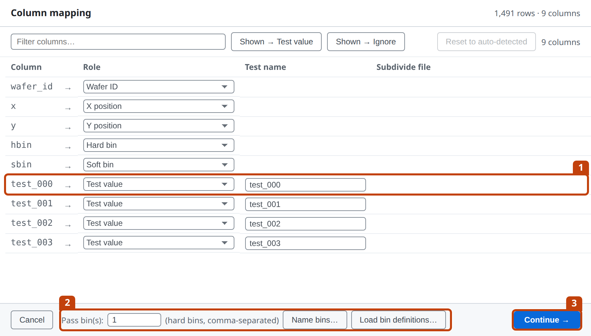

---

<!-- covers: tsmap guide › Wide vs long format -->

# Wide format

One column per test. Each test column takes the **Test value** role 1.

---

# Long format

One row per die per test: a test number or name column, and a result column.

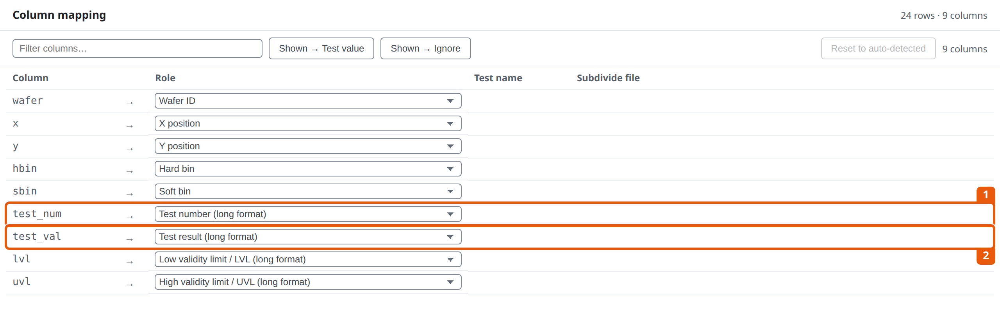

---

<!-- covers: tsmap guide › Role reference; tsmap guide › Dies with no position -->

# Roles worth knowing

- **Lot ID**: map it so two lots' W01 stay two separate wafers
- **Pass/fail test**: a PASS/FAIL column, chosen for you
- **Display info**: a wafer fact, such as temperature, to group by
- **X** and **Y** are optional: without them, dies have no position

---

<!-- covers: Shown → Test value; Shown → Ignore -->

# Many columns at once

1 Filter the columns by name, then give every shown column one role: 2 **Test value** or 3 **Ignore**.

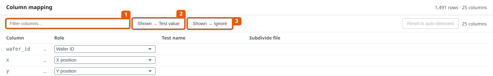

---

<!-- covers: tsmap guide › Pass bins; glossary › Pass bin / passBins -->

# Pass bins

**Pass bin(s)** says which hard bins count as a pass. The default is 1; list several with commas, such as `1,7`.

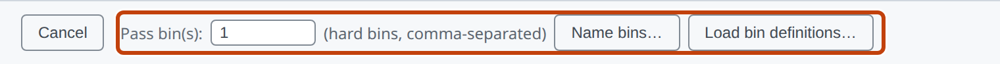

---

<!-- covers: Reset to auto-detected; tsmap guide › Saved mappings -->

# Saved mappings

The roles you confirm are remembered for that set of columns. **Reset to auto-detected** forgets them.

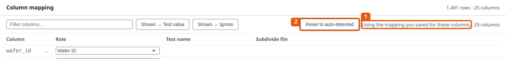

---

<!-- _class: divider -->

# Making it yours

---

<!-- _class: side -->
<!-- covers: Colour theme; tsmap guide › The toolbar and colour theme -->

# Colour theme

Auto follows your system. Or pick a light or dark theme: it is remembered.

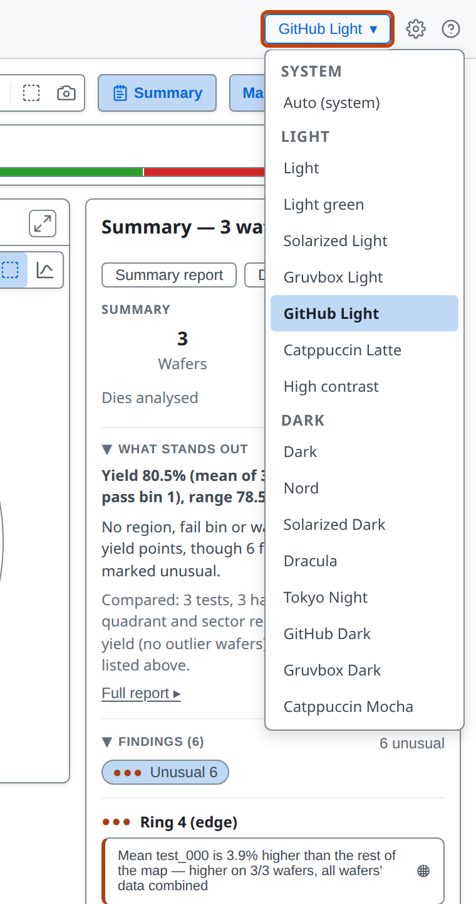

---

# The whole app follows

Maps, charts and panels all take the theme's colours.

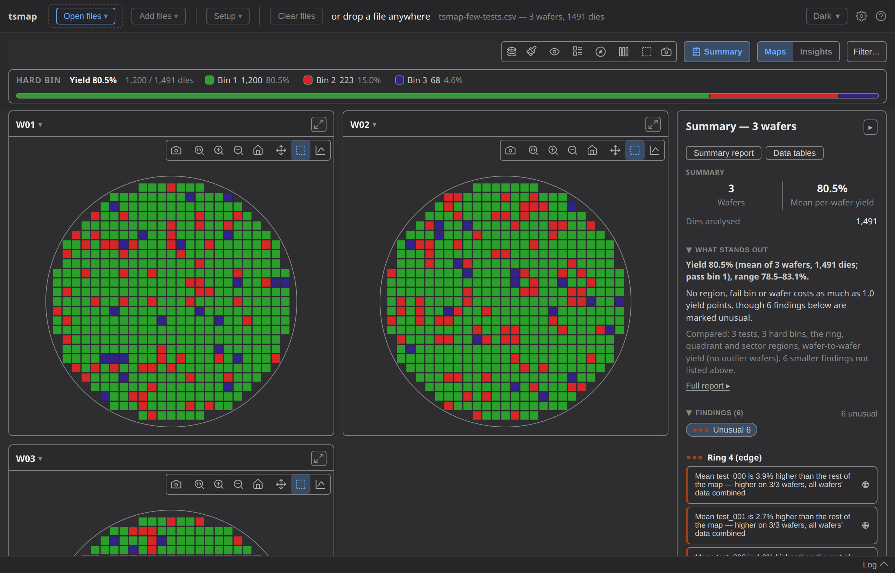

---

<!-- covers: Log; Log (with new-warning count); tsmap guide › The log panel -->

# The log panel

What each load did. Warnings are counted on the **Log** button until you open it.

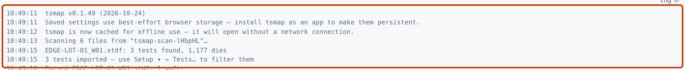

---

<!-- _class: lab -->

# Try it yourself

1. Open the [sample CSV in the web app](https://wafertools.github.io/tsmap/app/?dataUrl=https%3A%2F%2Fwafertools.github.io%2Ftsmap%2Fsamples%2Ftsmap-sample.csv&dataFormat=csv): check the roles, then **Continue →**
2. **Clear files**, then **Load sample data**
3. **Setup ▾ → Tests…**: rename a test, then apply
4. Switch to a dark theme, then open the log

---

# Recap

- Drop files, **Open files**, or scan a folder and filter by lot
- **Add files** grows the lot; **Setup ▾ → Tests…** chooses and renames tests
- Tables need a column mapping, and tsmap remembers it

More in the user guide: [Loading your data](../user-guide.md#loading-your-data)

---

<!-- _class: next -->
<!-- _paginate: false -->

# Next lesson

[02 · Reading a map and the toolbar →](02-reading-a-map.md)

Plot modes, colours, overlays and zoom.
