<!-- _class: title -->
<!-- _paginate: false -->

# Reading a map and the toolbar

## Lesson 02

Learn tsmap

---

# In this lesson

A map only helps if you know what its colours mean and can change them to answer your question. This lesson covers what the toolbar changes and how to look closely at a single wafer.

- Open one wafer, then a whole lot
- Change what the maps show: bins or a test's values
- Add overlays, turn the wafer, zoom in and read a single die

---

<!-- _class: divider -->

# One wafer on its own

A file that holds a single wafer

---

# One map

A file with one wafer opens as one full-size map, with the Summary panel open beside it. This is [`EDGE-LOT-01`](https://wafertools.github.io/tsmap/app/?dataUrl=https%3A%2F%2Fwafertools.github.io%2Ftsmap%2Fsamples%2Ftsmap-single-wafer.stdf&dataFormat=stdf)'s first wafer.

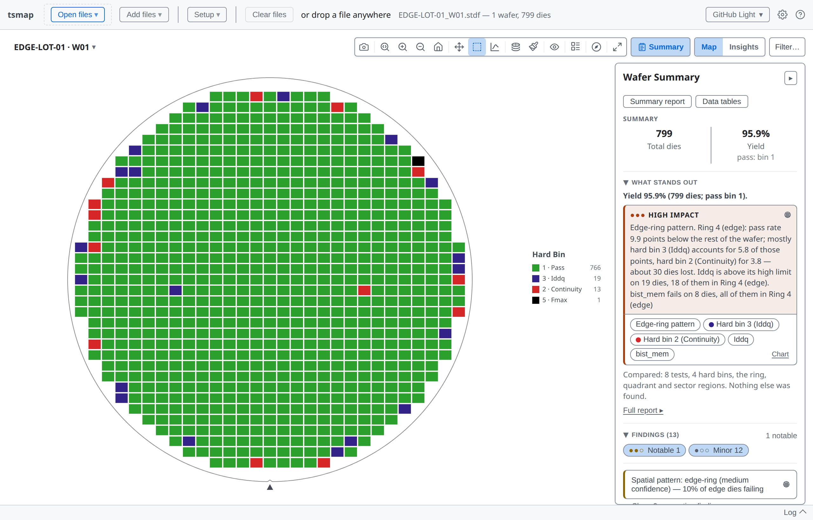

---

<!-- covers: Map; Expand (E) -->

# One toolbar

The toolbar has four groups, and each does one job.

- 1 Save, zoom, pan, select and chart this map
- 2 What it shows and how it looks
- 3 **Expand (E)**: **F** maximises, **Esc** closes
- 4 **Map | Insights**

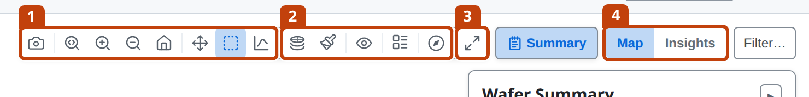

---

# Insights for one wafer

Insights on a single wafer has the same tabs, over this wafer's dies. There is no **Group by**: one wafer has nothing to group.

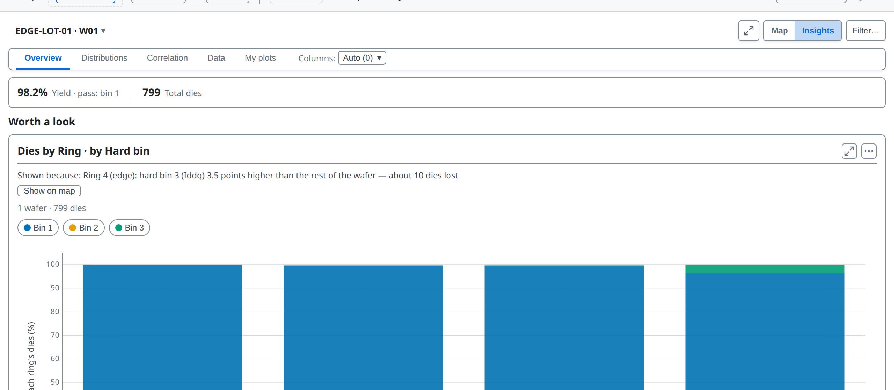

---

# What needs several wafers

One wafer has nothing to stack, group or compare, so these appear only for a lot:

- the stacked plot modes, **Columns** and **Select the same dies** (lesson 04)
- the Summary panel's **Wafer Yield** list (lesson 03)
- in Insights, **Group by**, What divides yield and the comparisons (lessons 05 and 06)

---

<!-- _class: divider -->

# What the map shows

---

<!-- covers: Download gallery PNG; wmap guide › Gallery; wmap guide › Toolbar controls -->

# The gallery toolbar

Several wafers open as a gallery, one card per wafer. Every button here acts on all of them at once, so the wafers stay comparable. The camera saves the whole gallery as one PNG.

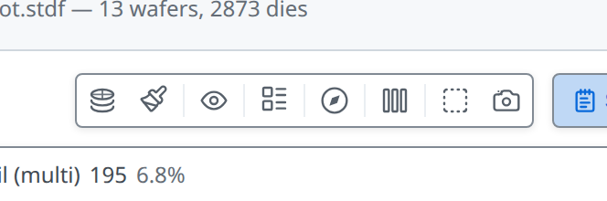

---

<!-- _class: side -->
<!-- covers: Plot mode; Plot mode › Test Value ▶; Plot mode › Hard Bin; Plot mode › Soft Bin; wmap guide › Plot modes -->

# Plot mode

This is the button you will use most. It decides what the colours mean: each die's hard bin, its soft bin, or one test's value. The stacked modes come in lesson 04, PAT verdict in lesson 05.

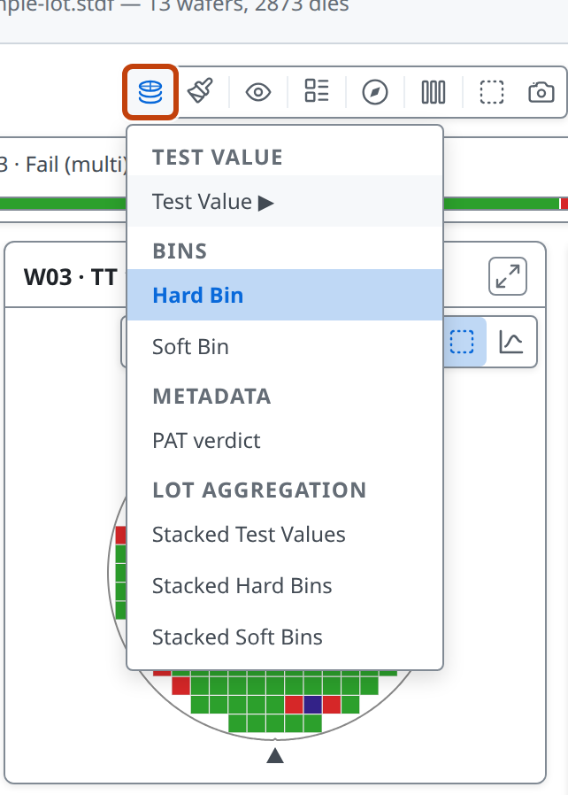

---

# Soft Bin

Soft Bin colours each die by the test program's failure category, with its own legend. Use it when a hard bin is too coarse to tell you why dies failed.

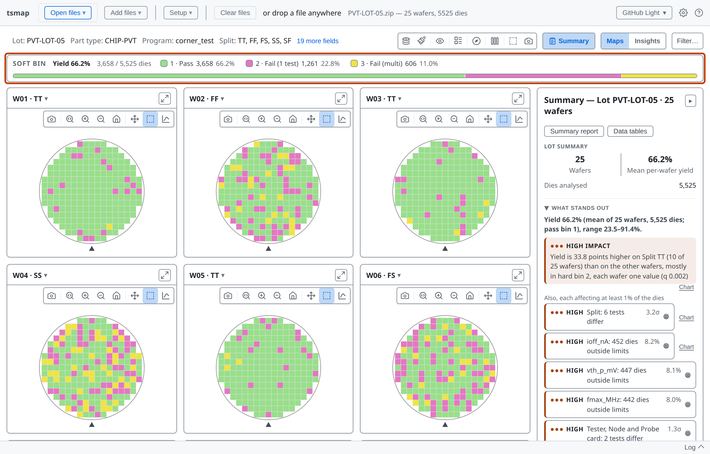

---

<!-- covers: chart › Test value map -->

# Test Value

Test Value colours each die by its reading, so you see how a measurement varies across the wafer. ▽ and △ mark dies below and above the test limits.

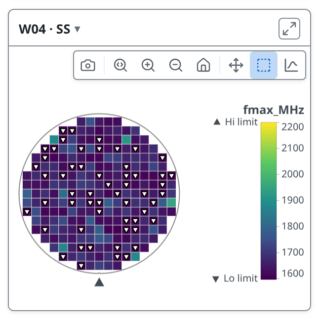

---

<!-- covers: Toggle log scale; Colour bar range: test limits (click for data range); wmap guide › Test Value mode — colour bar range and test limits -->

# Two more buttons for values

In Test Value mode two more buttons appear: 1 Log scale. 2 Colour bar range: the test limits, the same on every wafer, or the data's own range.

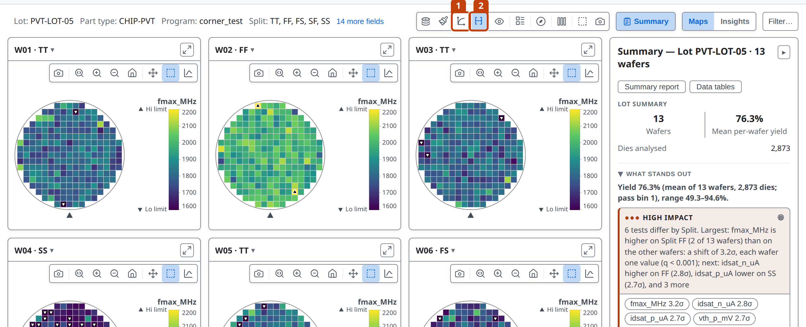

---

<!-- covers: glossary › Test limit; glossary › Spec limit -->

# Two kinds of limit

A test can have two sets of limits, and they answer different questions.

- **Test limits** are what the tester judged each die by: they decide pass or fail
- **Spec limits** are the process specification: capability is measured against them when a test has both
- Charts draw test limits with short dashes and spec limits with long ones

---

<!-- _class: side -->
<!-- covers: chart › Limit pass/fail map; chart › Test pass/fail map; glossary › Pass/fail display -->

# Pass or fail, two ways

Sometimes you want to see which dies passed a test rather than its raw reading. In Test Value mode **Overlays** adds 1 **Limit pass/fail**, judged by the test limits, and 2 **Test pass/fail**, the verdict the tester recorded.

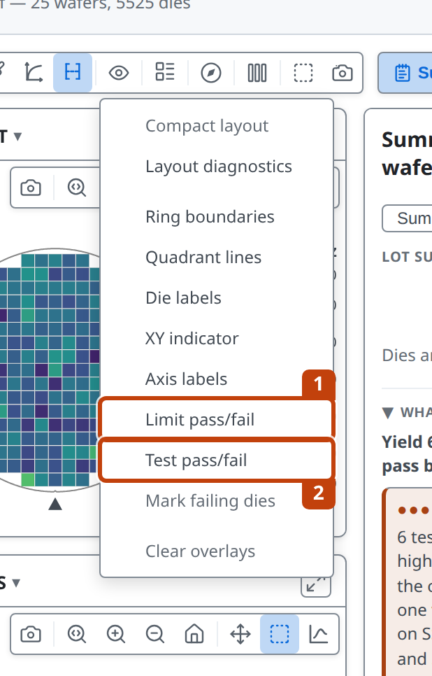

---

<!-- _class: split -->

# Limit pass/fail

Limit pass/fail shows dies inside the limits in green, below the low limit in blue and above the high limit in red, each with its count.

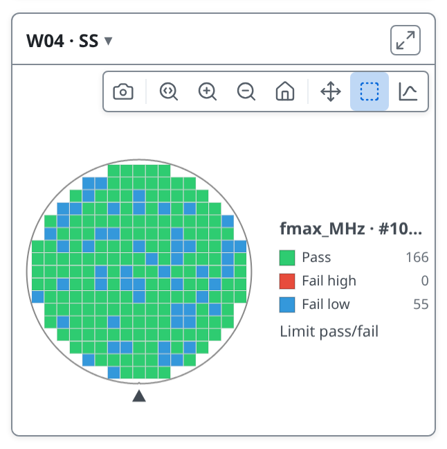

---

<!-- _class: split -->

# Test pass/fail

Test pass/fail shows the tester's own verdict. It can differ from the limits, and guard bands are one reason, so it is worth a look when the two maps disagree. A functional test always shows this way.

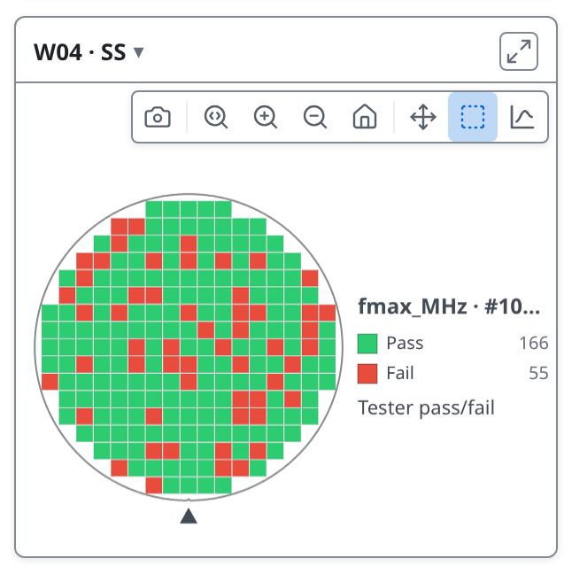

---

<!-- covers: Edit limits…; tsmap guide › Editing limits, units and type -->

# Setting limits yourself

Some test programs ship without limits, or with limits that are not the ones you want to judge by. In the test selector (**Setup ▾ → Tests…**), **Edit limits…** opens a table of every test: its name, test limits, spec limits, validity limits, units and type.

Validity limits mark a reading as a tester clamp rather than a measurement. [Lesson 11](11-unusual-wafers.md) uses them.

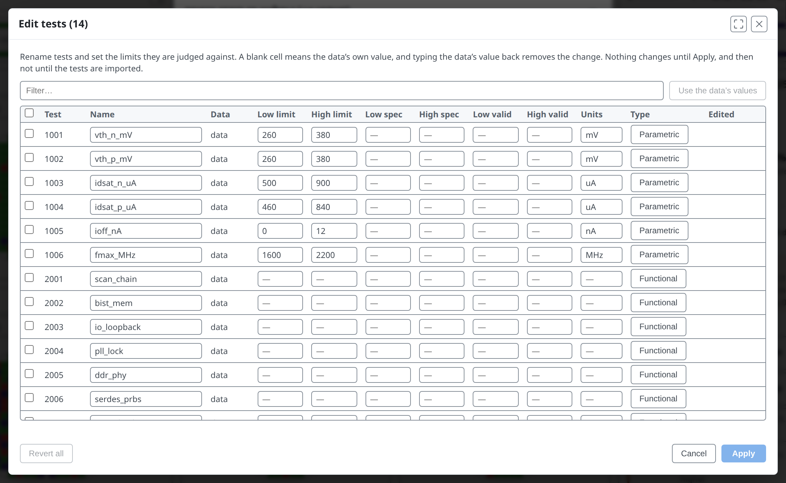

---

<!-- _class: split -->

# Change a limit

Type into a cell to change it. 1 The **Data** column then reads *changed* and the row gets a **Revert** button. 2 **Apply** counts the edited rows.

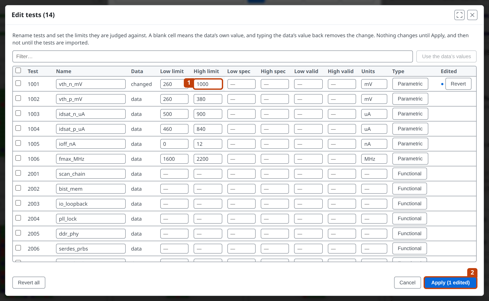

---

# The rules of the table

- A **blank cell** means the data's own value: an edit can change a limit but cannot remove one the data states
- **Use the data's values** discards the changes on the rows you have ticked, and **Revert all** discards every change
- Units that differ only by an SI prefix, such as mV for V, convert the limits you give to the data's unit
- Functional tests are pass/fail only, so their limits are ignored

---

<!-- _class: split -->

# A limit that cannot be right

A low limit above its high limit is refused when you press **Apply**, with the test named.

Nothing changes in the lot until you press **Apply to N tests →** in the selector and the tests are imported. **Save definitions** then keeps your limits in a file for the next lot of the same program.

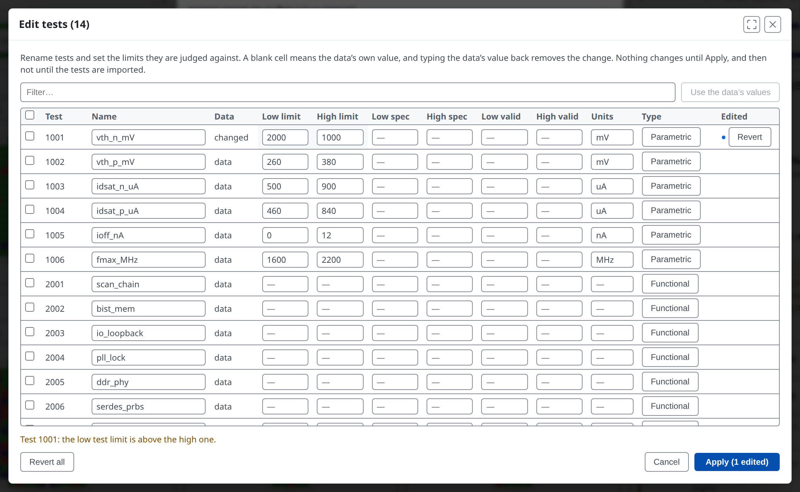

---

<!-- covers: Colour scheme; Colour scheme › ✓Default; Colour scheme › ✓Colour-blind safe -->

# Colour scheme

Choose default or colour-blind safe bin colours. Passing bins are always shades of green, so a pass looks like a pass whichever you pick. In Test Value mode the same menu picks the value colours, and **Reverse gradient** flips them.

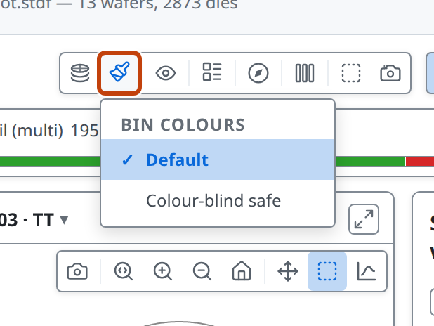

---

# Highlight a bin

To follow one bin across the whole lot, click it in the legend. The others grey out, so you see at once whether it sits at the edge, in a corner or everywhere. **Ctrl** or **Cmd** + click adds more bins. Click the bin again to clear it.

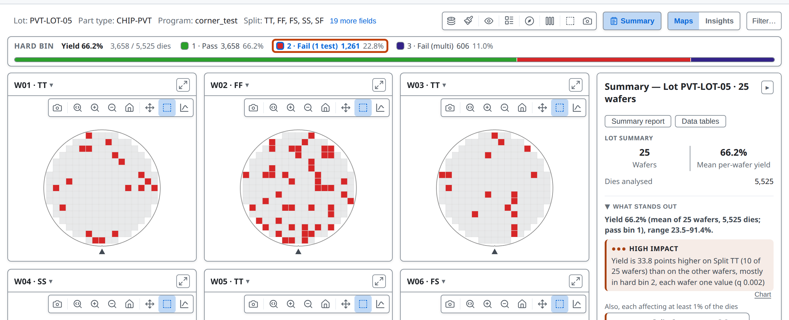

---

<!-- _class: divider -->

# Overlays and orientation

---

<!-- _class: side -->
<!-- covers: Overlays; Overlays › ✓Ring boundaries; Overlays › ✓Quadrant lines; Overlays › ✓Die labels; Overlays › ✓XY indicator; Overlays › ✓Axis labels; Overlays › ✓Mark failing dies; Overlays › Clear overlays -->

# Overlays

Overlays are layers drawn over every map, to help you read position. **Clear overlays** turns them all off, and is greyed when none are on.

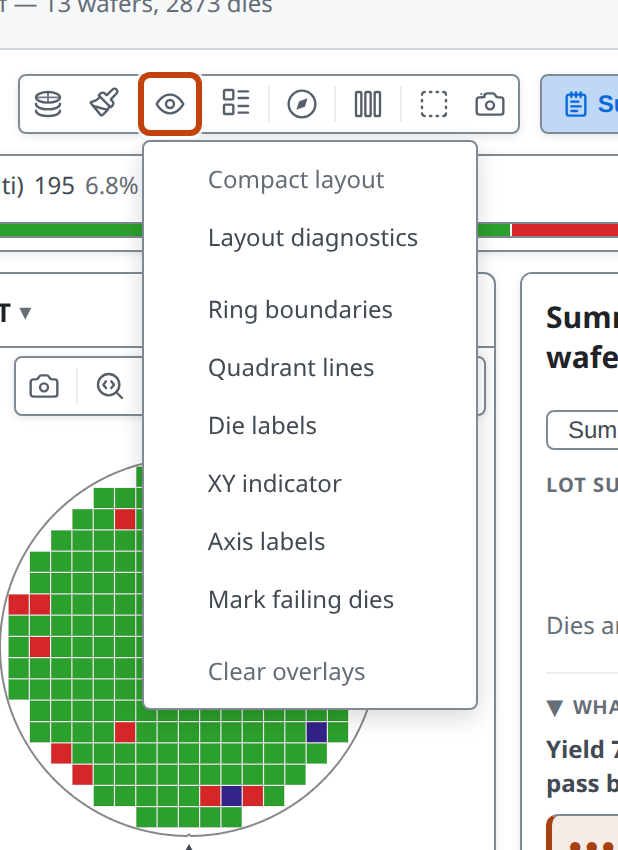

---

<!-- covers: wmap guide › Overlays -->

# Rings and quadrants

Ring boundaries match the zones the findings use, so you can see what a finding such as "outer ring" refers to. Quadrant lines split the wafer into NE, NW, SE and SW.

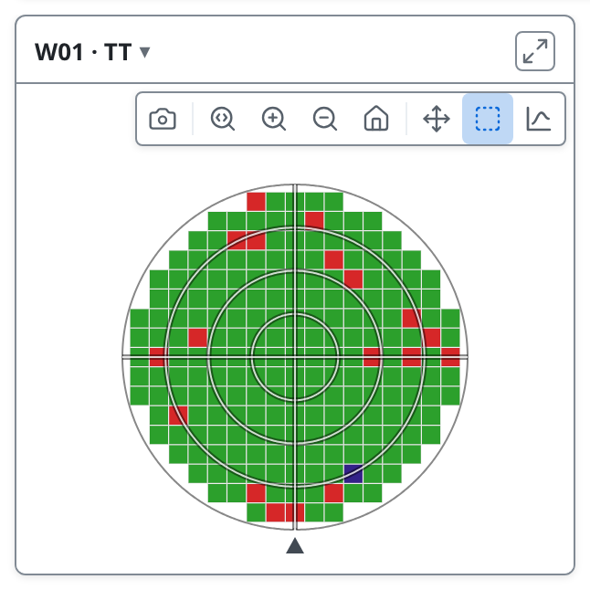

---

<!-- covers: Orientation; Orientation › *; wmap guide › Wafer orientation; glossary › Notch / flat -->

# Orientation

Rotate or flip how the wafer is drawn, to match the way you are used to seeing it, such as with the notch at the bottom. Die coordinates never change, so a die keeps its address however the wafer is turned.

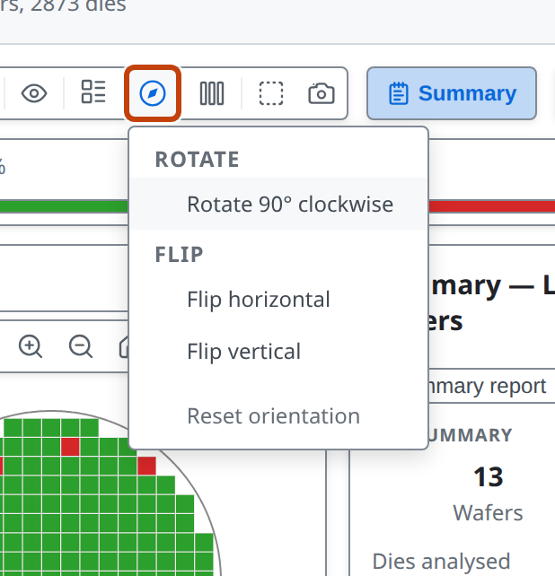

---

# Turned to your convention

Once the wafer is turned, the XY indicator is shown too. **Reset orientation** goes back to the start.

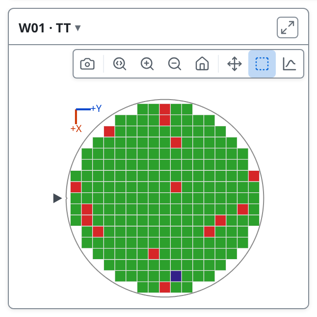

---

<!-- covers: Legend style; Legend style › * -->

# Legend style

**Legend on each map** adds a legend to every card, then lets you choose where it sits.

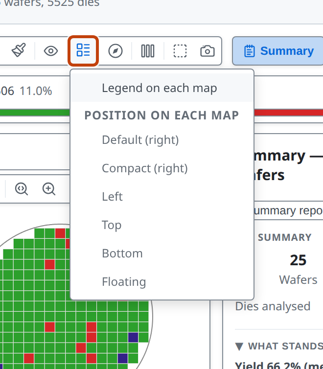

---

<!-- covers: Columns; Columns › * -->

# Columns

**Auto** fits as many cards as keep each die at least 6 pixels across, so a dense wafer gets a wider card. A number divides the width between that many cards. With the pointer over the gallery, the keys **1** to **5** set the columns and **0** returns to Auto.

Try it on [`PARAM-LOT-02`](https://wafertools.github.io/tsmap/app/?dataUrl=https%3A%2F%2Fwafertools.github.io%2Ftsmap%2Fsamples%2Ftsmap-dense-lot.zip&dataFormat=zip), twelve wafers of 2,709 dies each: with few columns the dies are big enough to aim at; with five they are not.

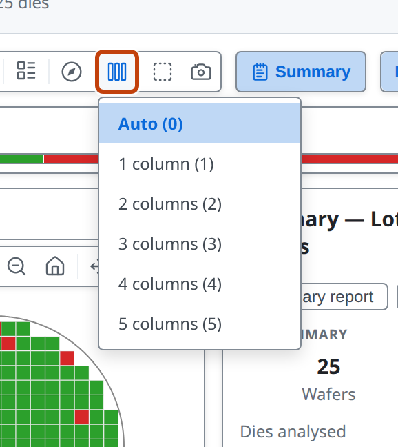

---

<!-- _class: divider -->

# One wafer close up

---

<!-- _class: split -->
<!-- covers: wmap guide › Zoom and pan; Download PNG; Zoom (drag to zoom region); Zoom in; Zoom out; Reset zoom (double-click); Pan (drag to move); Select (drag to select dies) -->

# Each wafer's toolbar

- 1 Save this map as a PNG
- 2 Zoom to a region, in, out, reset
- 3 Pan &nbsp;4 Select dies (lesson 08)

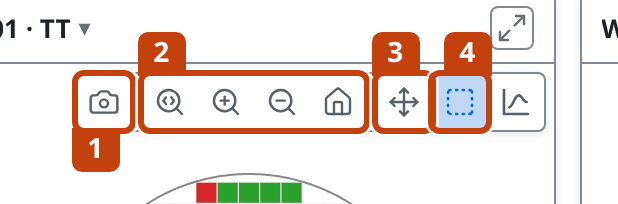

---

<!-- covers: wmap guide › Keyboard shortcuts; tsmap guide › Zooming the interface -->

# Zoom in

The wheel zooms at the cursor; hold **Space** and drag to pan. Click a map first and **Ctrl + / − / 0** zoom it; anywhere else they scale the whole window.

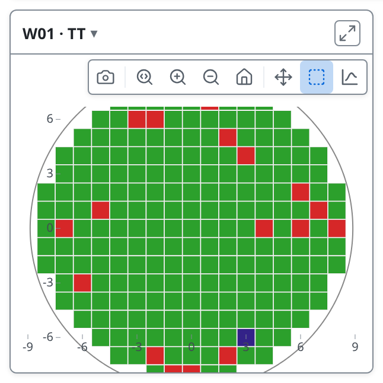

---

<!-- covers: wmap guide › Hover; wmap guide › Die grid and coordinates; glossary › Prober step coordinates -->

# Read one die

Hover a die for its coordinates, bins, site and part ID. Coordinates are the prober's grid steps, the same however the wafer is turned.

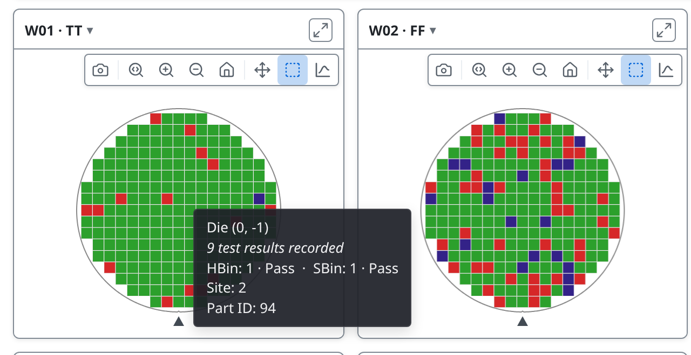

---

# The wafer's details

The **▾** beside a wafer's name lists everything the file says about that wafer.

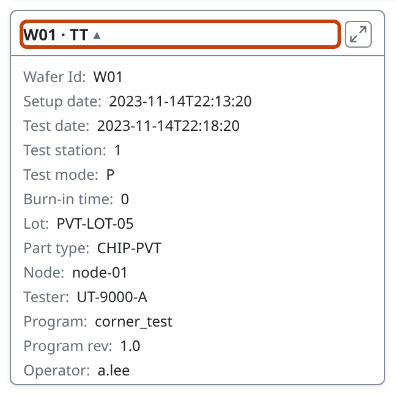

---

<!-- covers: wmap guide › Die appearance; wmap guide › Legend and colour bar -->

# Reading the colours

Not every unusual colour means a failure.

- **Grey** is no result for that die: not a fail
- **Dimmed** at the rim is the edge exclusion; **faded** is a die a filter drops (lessons 08 and 11)
- The legend lists pass bins first, then failing bins from the most dies down

---

<!-- covers: wmap guide › Single map -->

# When the map warns you

tsmap tells you when something about a map needs care. A **⚠** or **⛔** button appears in the toolbar only when there is something to report. ⛔ means dies may not sit where they appear, usually because the wafer size was guessed. ⚠ means something was skipped, but what is drawn is right. Click it to read why.

---

<!-- _class: lab -->

# Try it yourself

1. Open the [single wafer](https://wafertools.github.io/tsmap/app/?dataUrl=https%3A%2F%2Fwafertools.github.io%2Ftsmap%2Fsamples%2Ftsmap-single-wafer.stdf&dataFormat=stdf) and find the toolbar's four groups
2. **Clear files**, then **Load sample data**
3. **Plot mode → Test Value → fmax_MHz**: which split reads lowest?
4. **Overlays → Ring boundaries**, then back to **Hard Bin**
5. Zoom into W04 · SS and hover a failing die

---

<!-- _class: answers -->

# Check your results

3. **SS** reads lowest: its mean `fmax_MHz` is about 1630 MHz, against about 1800 for TT and 1970 for FF. SS is the slow corner.

---

# Recap

- **Plot mode** picks bins or a test; the legend highlights one bin
- **Overlays** and **Orientation** change how every map is drawn
- Each card zooms, pans and saves on its own

You can now ask the map a question by choosing what it colours, and read the answer die by die. Next, see what tsmap finds without being asked.

More in the [wafer map guide](https://wafertools.github.io/wafermap/user-guide/#3-toolbar-controls)

---

<!-- _class: next -->
<!-- _paginate: false -->

# Next lesson

[03 · Findings →](03-findings.md)

What tsmap noticed in the lot, and how to read it.
