<!-- _class: title -->
<!-- _paginate: false -->

# Reading a map and the toolbar

## Lesson 02

Learn tsmap

---

# In this lesson

- Open one wafer, then a whole lot
- Change what the maps show: bins or a test's values
- Add overlays, turn the wafer, zoom in and read a single die

---

<!-- _class: divider -->

# One wafer on its own

A file that holds a single wafer

---

# One map

A file with one wafer opens as one full-size map, with the Summary panel open beside it. This is EDGE-LOT-01's first wafer.

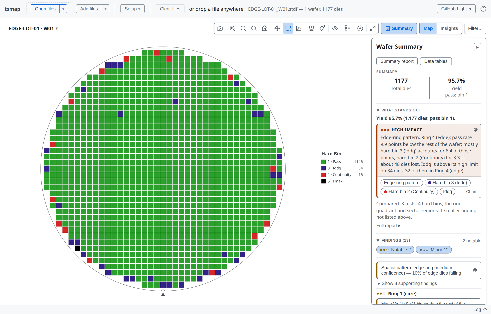

---

<!-- covers: Map; Expand (E) -->

# One toolbar

- 1 Save, zoom, pan, select and chart this map
- 2 What it shows and how it looks
- 3 **Expand (E)**: **F** maximises, **Esc** closes
- 4 **Map | Insights**

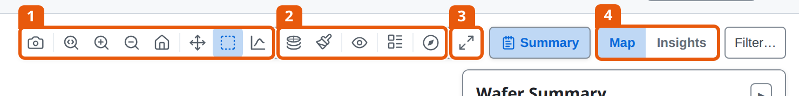

---

# Insights for one wafer

The same tabs, over this wafer's dies. There is no **Group by**: one wafer has nothing to group.

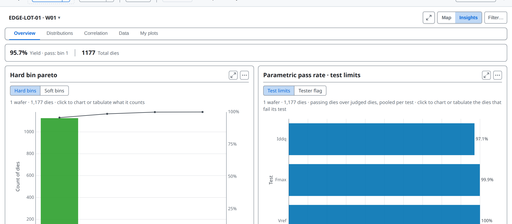

---

# What needs several wafers

One wafer has nothing to stack, group or compare, so these appear only for a lot:

- the stacked plot modes, **Columns** and **Select the same dies** (lesson 04)
- the Summary panel's **Wafer Yield** list (lesson 03)
- in Insights, **Group by**, What divides yield and the comparisons (lesson 05)

---

<!-- _class: divider -->

# What the map shows

---

<!-- covers: Download gallery PNG; wmap guide › Gallery; wmap guide › Toolbar controls -->

# The gallery toolbar

Several wafers open as a gallery, one card per wafer. Every button here acts on all of them at once. The camera saves the whole gallery as one PNG.

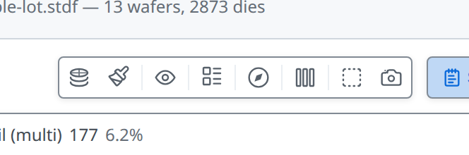

---

<!-- covers: Plot mode; Plot mode › Test Value ▶; Plot mode › Hard Bin; Plot mode › Soft Bin; wmap guide › Plot modes -->

# Plot mode

Colour each die by its hard bin, its soft bin, or one test's value. The stacked modes come in lesson 04, PAT verdict in lesson 05.

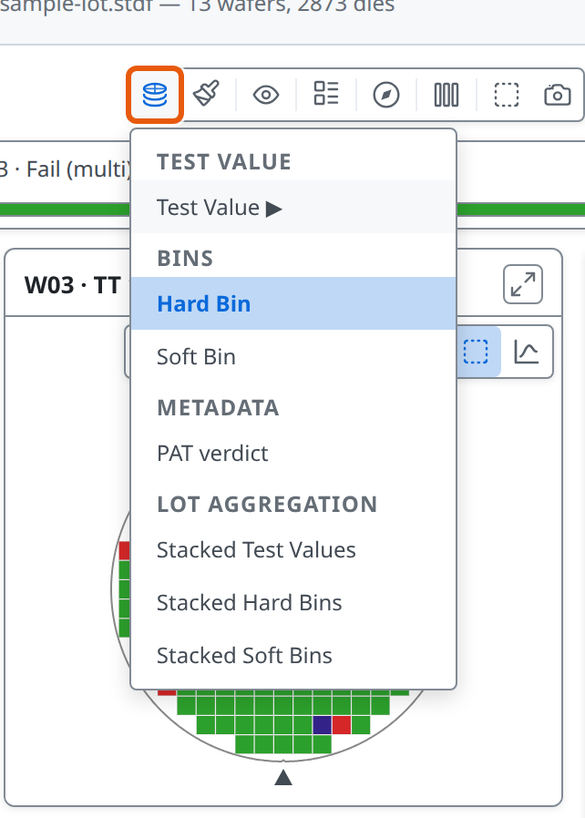

---

# Soft Bin

The test program's failure category for each die, with its own legend.

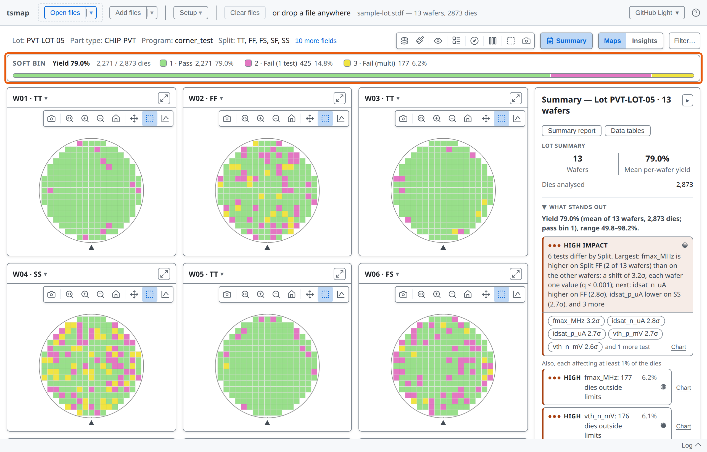

---

<!-- covers: chart › Test value map -->

# Test Value

Each die coloured by its reading. ▽ and △ mark dies below and above the test limits.

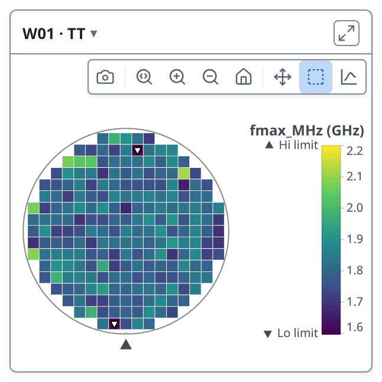

---

<!-- covers: Toggle log scale; Colorbar range: test limits (click for data range); wmap guide › Test Value mode — colorbar range and test limits -->

# Two more buttons for values

1 Log scale. 2 Colorbar range: the test limits, the same on every wafer, or the data's own range.

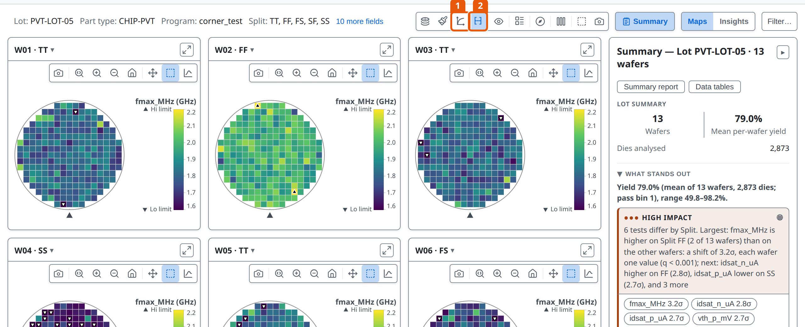

---

<!-- covers: glossary › Test limit; glossary › Spec limit -->

# Two kinds of limit

- **Test limits** are what the tester judged each die by: they decide pass or fail
- **Spec limits** are the process specification: capability is measured against them when a test has both
- Charts draw test limits with short dashes and spec limits with long ones

---

<!-- covers: chart › Limit pass/fail map; chart › Test pass/fail map; glossary › Pass/fail display -->

# Pass or fail, two ways

In Test Value mode **Overlays** adds 1 **Limit pass/fail**, judged by the test limits, and 2 **Test pass/fail**, the verdict the tester recorded.

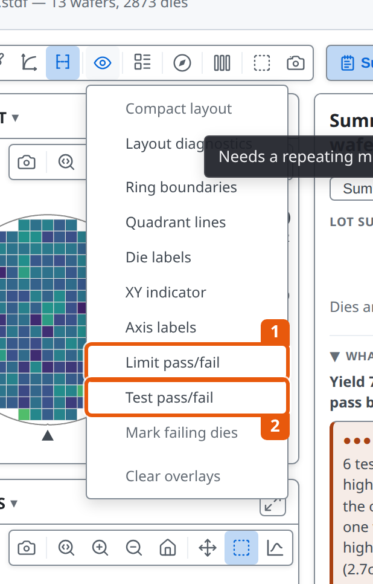

---

<!-- _class: split -->

# Limit pass/fail

Dies inside the limits in green, below the low limit in blue, above the high limit in red, each with its count.

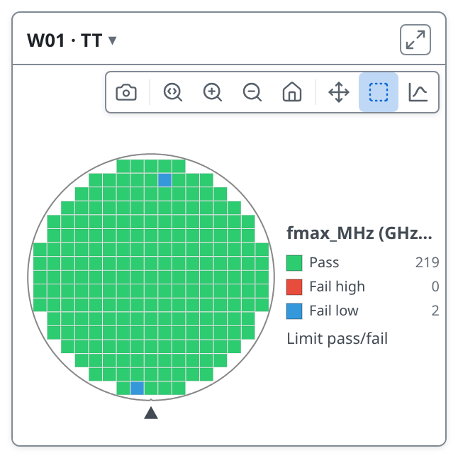

---

<!-- _class: split -->

# Test pass/fail

The tester's own verdict. It can differ from the limits: guard bands are one reason. A functional test always shows this way.

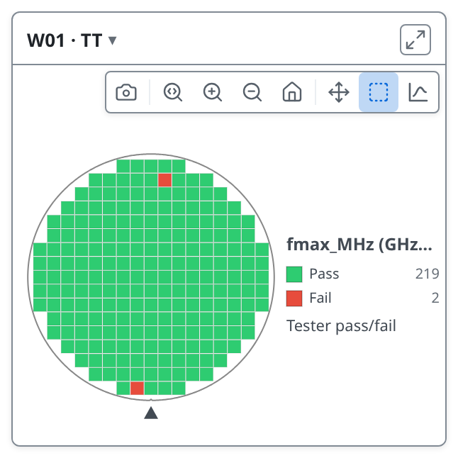

---

<!-- covers: Colour scheme; Colour scheme › ✓Default; Colour scheme › ✓Colour-blind safe -->

# Colour scheme

Default or colour-blind safe bin colours; passing bins are always shades of green. In Test Value mode the same menu picks the value colours, and **Reverse gradient** flips them.

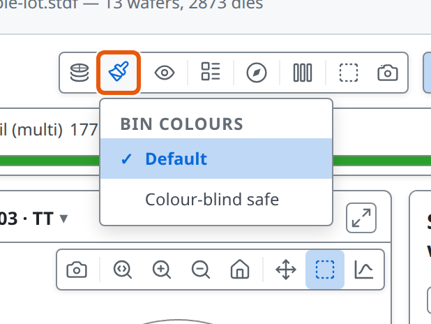

---

# Highlight a bin

Click a bin in the legend and the others grey out; **Ctrl** or **Cmd** + click adds more. Click it again to clear.

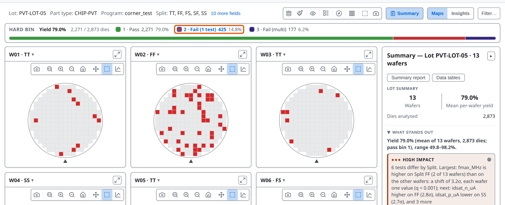

---

<!-- _class: divider -->

# Overlays and orientation

---

<!-- covers: Overlays; Overlays › ✓Ring boundaries; Overlays › ✓Quadrant lines; Overlays › ✓Die labels; Overlays › ✓XY indicator; Overlays › ✓Axis labels; Overlays › ✓Mark failing dies; Overlays › Clear overlays -->

# Overlays

Layers drawn over every map. **Clear overlays** turns them all off, and is greyed when none are on.

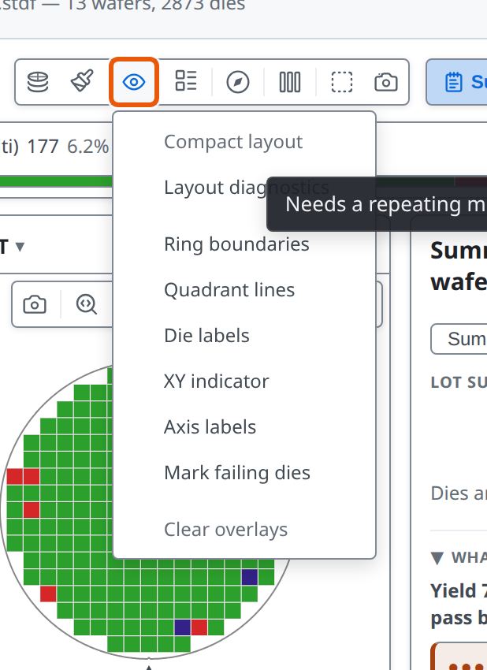

---

<!-- covers: wmap guide › Overlays -->

# Rings and quadrants

Ring boundaries match the zones the findings use. Quadrant lines split the wafer N, S, E and W.

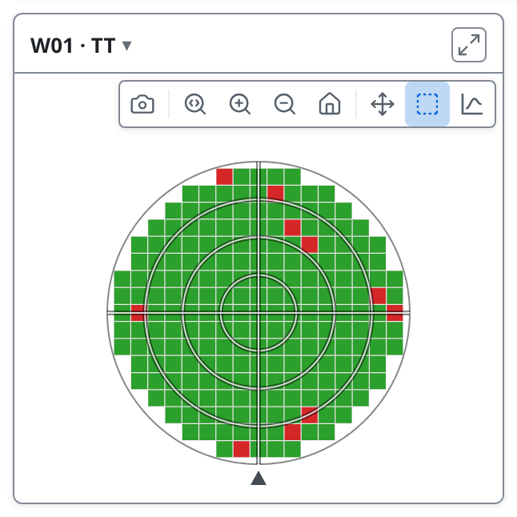

---

<!-- covers: Orientation; Orientation › *; wmap guide › Wafer orientation; glossary › Notch / flat -->

# Orientation

Rotate or flip how the wafer is drawn. Die coordinates never change.

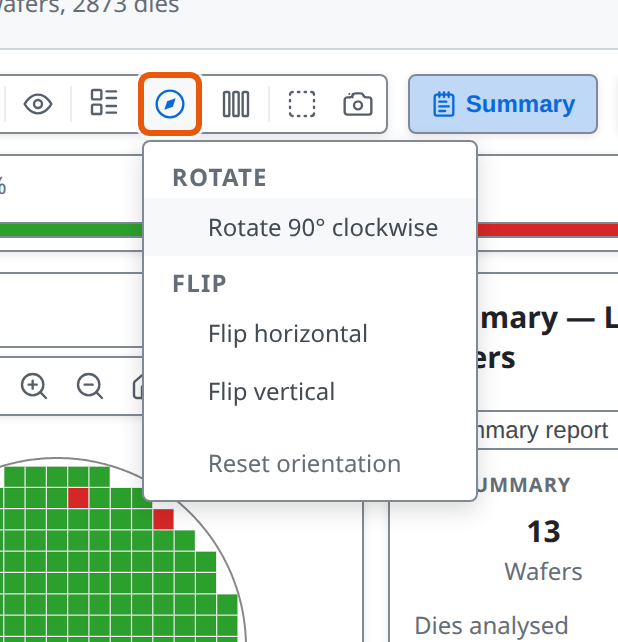

---

# Turned to your convention

The first turn also shows the XY indicator. **Reset orientation** goes back to the start.

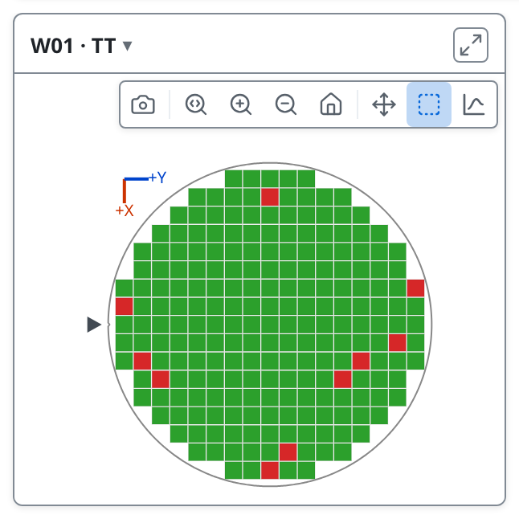

---

<!-- covers: Legend style; Legend style › * -->

# Legend style

**Legend on each map** adds a legend to every card, then lets you choose where it sits.

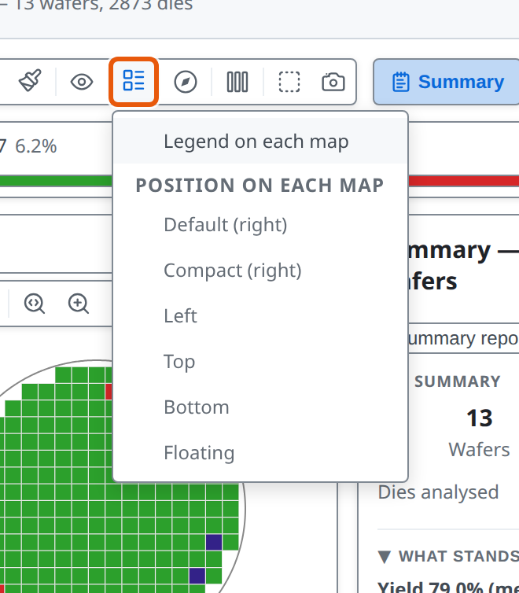

---

<!-- covers: Columns; Columns › * -->

# Columns

**Auto** fits as many readable cards as it can. A number shares the width between that many.

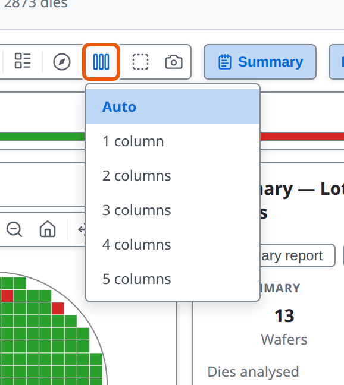

---

<!-- _class: divider -->

# One wafer close up

---

<!-- _class: split -->
<!-- covers: wmap guide › Zoom and pan; Download PNG; Zoom (drag to zoom region); Zoom in; Zoom out; Reset zoom (double-click); Pan (drag to move); Select (drag to select dies) -->

# Each wafer's toolbar

- 1 Save this map as a PNG
- 2 Zoom to a region, in, out, reset
- 3 Pan &nbsp;4 Select dies (lesson 07)

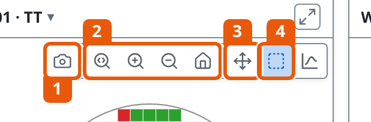

---

<!-- covers: wmap guide › Keyboard shortcuts; tsmap guide › Zooming the interface -->

# Zoom in

The wheel zooms at the cursor; hold **Space** and drag to pan. Click a map first and **Ctrl + / − / 0** zoom it; anywhere else they scale the whole window.

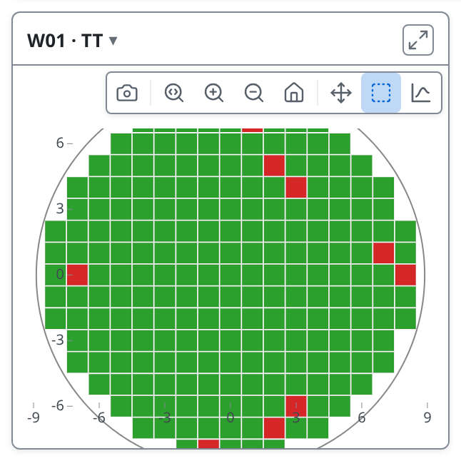

---

<!-- covers: wmap guide › Hover; wmap guide › Die grid and coordinates; glossary › Prober step coordinates -->

# Read one die

Hover a die for its coordinates, bins, site and part ID. Coordinates are the prober's grid steps, the same however the wafer is turned.

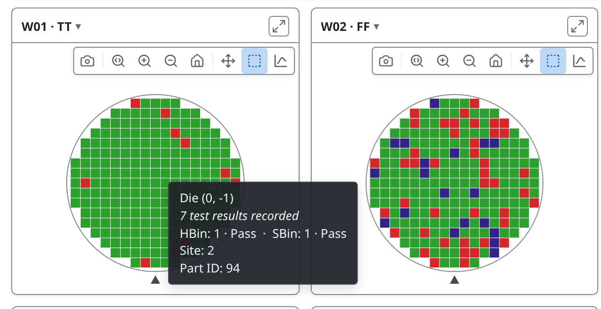

---

# The wafer's details

The **▾** beside a wafer's name lists everything the file says about that wafer.

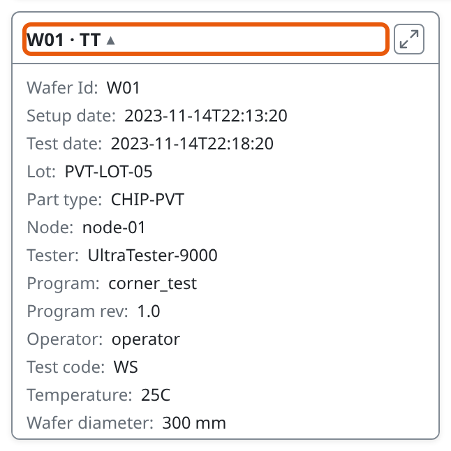

---

<!-- covers: wmap guide › Die appearance; wmap guide › Legend and colorbar -->

# Reading the colours

- **Grey** is no result for that die: not a fail
- **Dimmed** at the rim is the edge exclusion; **faded** is a die a filter drops (lessons 07 and 09)
- The legend lists pass bins first, then failing bins from the most dies down

---

<!-- covers: wmap guide › Single map -->

# When the map warns you

A **⚠** or **⛔** button appears in the toolbar only when there is something to report. ⛔ means dies may not sit where they appear, usually because the wafer size was guessed. ⚠ means something was skipped, but what is drawn is right. Click it to read why.

---

<!-- _class: lab -->

# Try it yourself

1. Open the [single wafer](https://wafertools.github.io/tsmap/app/?dataUrl=https%3A%2F%2Fwafertools.github.io%2Ftsmap%2Fsamples%2Ftsmap-single-wafer.stdf&dataFormat=stdf) and find the toolbar's four groups
2. **Clear files**, then **Load sample data**
3. **Plot mode → Test Value → fmax_MHz**: which corner reads lowest?
4. **Overlays → Ring boundaries**, then back to **Hard Bin**
5. Zoom into W04 · SS and hover a failing die

---

# Recap

- **Plot mode** picks bins or a test; the legend highlights one bin
- **Overlays** and **Orientation** change how every map is drawn
- Each card zooms, pans and saves on its own

More in the [wafer map guide](https://wafertools.github.io/wafermap/user-guide/#3-toolbar-controls)

---

<!-- _class: next -->
<!-- _paginate: false -->

# Next lesson

[03 · Findings →](03-findings.md)

What tsmap noticed in the lot, and how to read it.
