<!-- _class: title -->
<!-- _paginate: false -->

# Findings

## Lesson 03

Learn tsmap

---

# In this lesson

You have loaded a lot and want to know what is wrong with it. tsmap has already looked, and this lesson shows you how to read what it found.

- Read **What stands out**, and show any row on the map
- Read the **Findings** list and the patterns behind it
- Use the Summary panel's tables and reports

---

<!-- _class: divider -->

# The headline items

---

<!-- _class: split -->
<!-- covers: wmap guide › Summary panel -->

# The Summary panel
This is the best place to start. The panel docks beside the maps and describes the whole lot you are looking at, so you can see what stands out before you open a single wafer. Applying a **Filter…** narrows it to the dies that are kept.

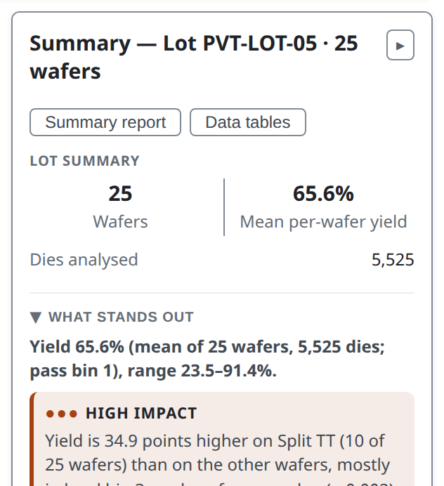

---

<!-- _class: split -->

# Open and close it

1 **Summary** opens and closes the panel. The **▸** at the end of the panel's title closes it too.

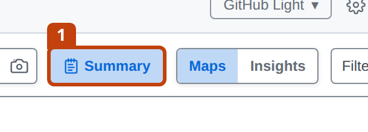

---

<!-- _class: split -->
<!-- covers: What stands out -->

# What stands out

The section opens with the yield as its headline. Below it are the items that cost the lot the most dies, largest first, so the top item is the first one worth looking into.

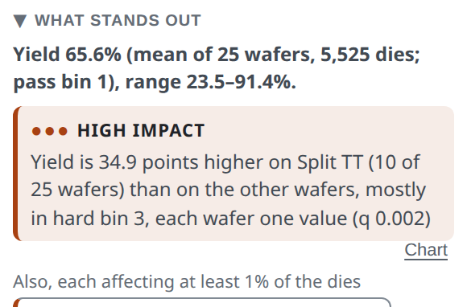

---

<!-- _class: split -->

# An item about groups of wafers

An item can compare groups of wafers, not just look at dies. 1 is the lot's yield. 2 says that wafers with split TT yield 34.9 points more than the other wafers, and that the loss is mostly in hard bin 3. Each wafer counts as one value, so the figure is about wafers, not dies.

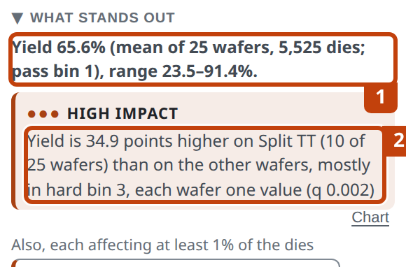

---

<!-- _class: split -->

# Why it has no buttons

An item about groups of wafers has no single place on the map, so it has no buttons, and clicking it shows nothing. Its **Chart** link opens a bar of yield for each group.

---

# Fields that move together

The lot's other fields are compared the same way. When two fields give the same groups, such as a tester and its probe card, tsmap names them together. It does not pick one for you; you choose which to follow.

---

<!-- covers: Finding row -->

# Every row shows the affected dies

Click a row and the map shows which dies it is about. You can then see for yourself whether the problem sits at the edge, in one corner or all over the wafer. Click the row again to clear it.

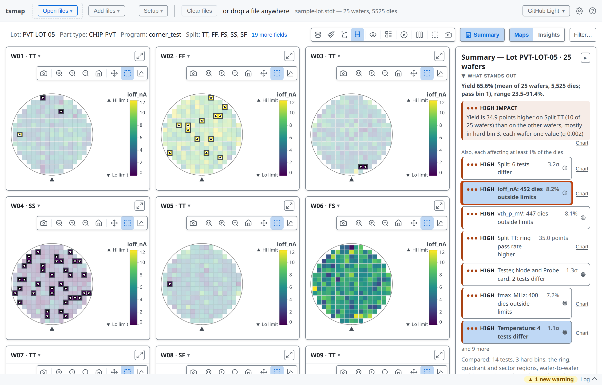

---

# Losses and signals

Each item is one of two kinds, and they call for different questions.

- A **loss** costs dies: a weak region, a low wafer, a failing test. Ask where the dies went.
- A **signal** moves values or compares groups, such as a split shift. A shift in a test will not show in yield, but it may still matter.

The dots and word beside an item are its **impact**: the share of the lot it affects. Read the impact first, to see how much an item matters.

---

<!-- _class: split -->
<!-- covers: Finding chart link -->

# Chart links

When you want the numbers behind an item, **Chart** opens Insights at this item's card, under **Worth a look**. For the top item that is the bar of yield by split. *(Insights is covered in lessons 05 and 06.)*

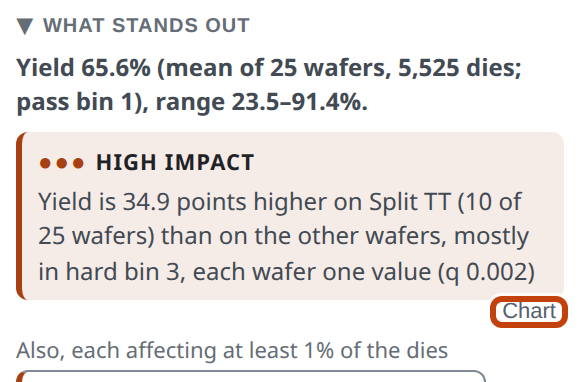

---

<!-- covers: Full report ▸ -->

# Full report

**Full report ▸** at the foot of the section opens the report, which begins with the same items. The **Summary report** button at the top of the panel opens the same report.

The sample lot mixes test programs, so its report has one section for each group. The first section holds only that group's wafers.

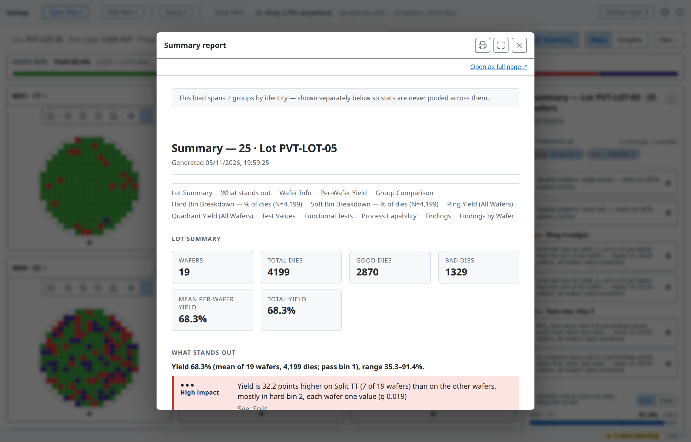

---

<!-- _class: split -->
# A lot with nothing to report

A lot with nothing to report is a result too. When no region, bin or wafer costs about a yield point, the panel says so and lists what it compared, so you know it looked. This is [`HY-LOT-04`](https://wafertools.github.io/tsmap/app/?dataUrl=https%3A%2F%2Fwafertools.github.io%2Ftsmap%2Fsamples%2Ftsmap-hy-lot.stdf&dataFormat=stdf).

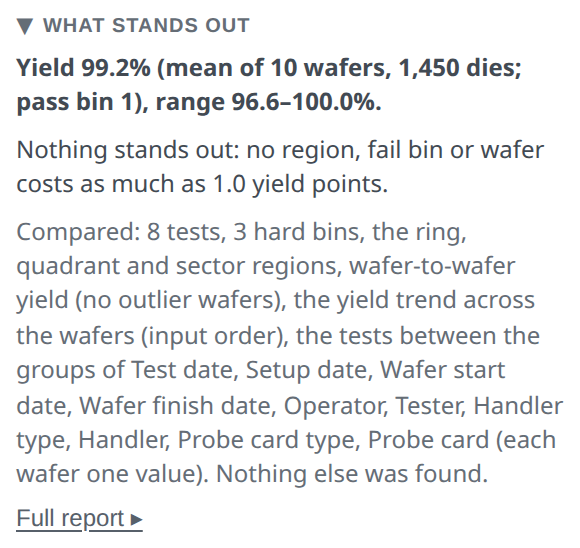

---

<!-- covers: tsmap guide › Test-value findings -->

# Bigger lots
Checks on test values, such as a region reading high, take longer, so they run on their own only for small loads. On a larger one the Findings list says so, and **Analyse** adds them for every wafer.

More in the [user guide](../user-guide.md#test-value-findings)

---

<!-- _class: divider -->

# The Findings list

---

<!-- _class: split -->
<!-- covers: Summary › Findings; Findings severity group; Finding detail row; wmap guide › Findings panel -->

# The Findings section

The list holds everything tsmap noticed, ranked by **severity**: Unusual, Notable or Minor. Severity is how strong the evidence is, not how many dies it costs. Use it to decide what to check first, and use impact to judge how much it matters.

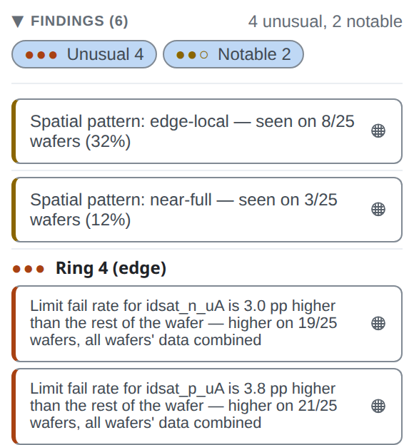

---

# Narrow the list

The **Unusual** and **Notable** buttons narrow the list. Click a finding to show it on the map.

---
<!-- covers: wmap guide › Finding types -->

# What tsmap looks for

tsmap compares each part of the lot with the rest, and checks the failing dies for shapes it recognises.

- **Regions**: rings, quadrants, finer sectors, and test sites that yield or read differently
- **Clusters** of failing dies, and **edge arcs** at the rim
- **Spatial patterns** such as a donut, scratch or centre spot
- **Reticle positions**, once a reticle is set (lesson 11)

---

<!-- _class: split -->
<!-- covers: Show supporting findings -->

# A pattern and what backs it

A spatial pattern is a shape tsmap recognises in the failing dies. It can have a **Show N supporting findings** line, which holds the smaller findings that add up to it. This is [`EDGE-LOT-01`](https://wafertools.github.io/tsmap/app/?dataUrl=https%3A%2F%2Fwafertools.github.io%2Ftsmap%2Fsamples%2Ftsmap-edge-ring-lot.stdf&dataFormat=stdf).

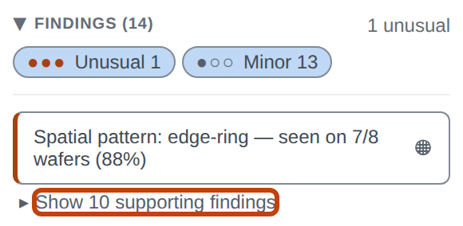

---

<!-- _class: split -->
# The supporting findings

When opened, the line lists the regional findings the pattern explains. You read one pattern instead of a dozen separate regions.

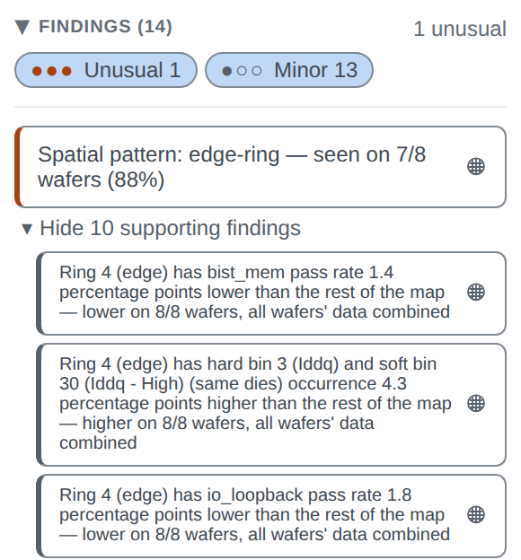

---

<!-- _class: split -->
# An edge ring

For an edge ring, the item names the pattern, the bins that make up the loss and the test behind it. Together they tell you what kind of problem to look for.

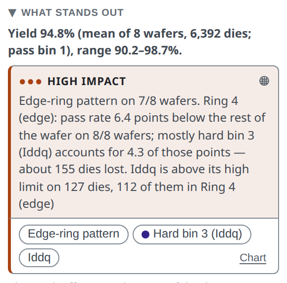

---

<!-- _class: split -->
<!-- covers: Finding chip (test); Finding chip (pattern) -->

# Buttons under an item

A pattern's item has small rounded buttons under it, and each names something behind it: the pattern, the bin and the test. 1 marks them. A bin's button carries its legend colour.

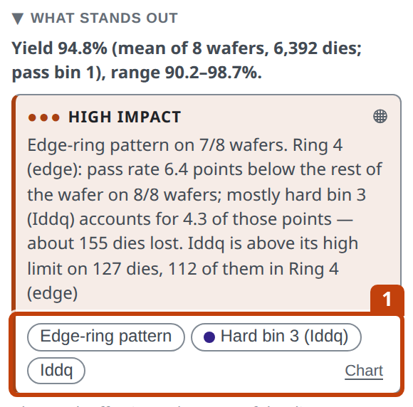

---

# Show one at a time

Click a button to show only that test, bin or pattern on the map. It is the quickest way to see where one thing happens. This is `Iddq`, with the dies outside its limits marked ▽ and △.

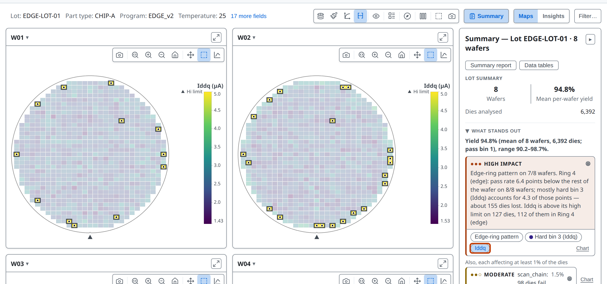

---

<!-- covers: Finding chip (bin) -->

# A bin button

A bin's button shows only the dies in that bin. This is hard bin 3.

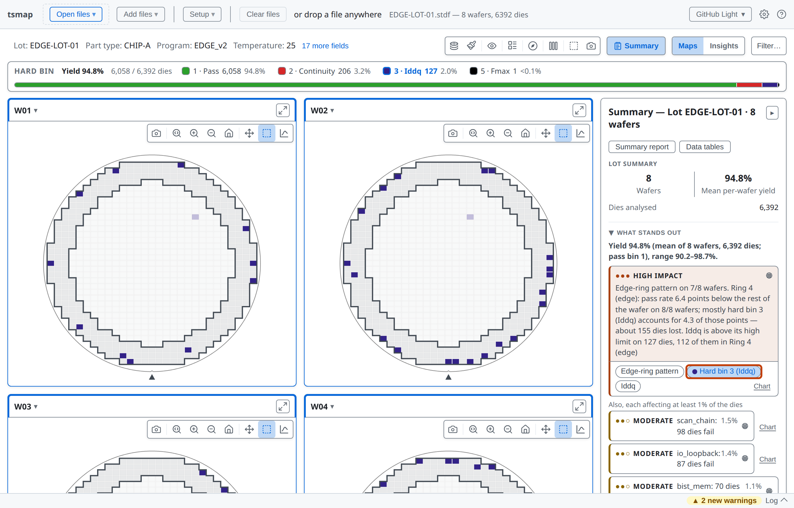

---

<!-- _class: split -->
<!-- covers: wmap guide › Why some findings name two bins -->

# One group, two bins

"Hard bin and soft bin 3 (same dies)" is one group of dies counted in both bin types. It is one problem, not two. A finding about the pass bin is folded into the yield finding for the same reason.

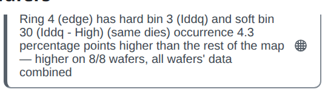

---

<!-- _class: split -->

# A cluster at the centre

Failing dies that sit together form a **cluster**. Here a small group fails near the centre of every wafer, in a different place on each. The item names the pattern and the bins behind it. This is `CLUST-LOT-03`, in the repository's `sample_data` folder.

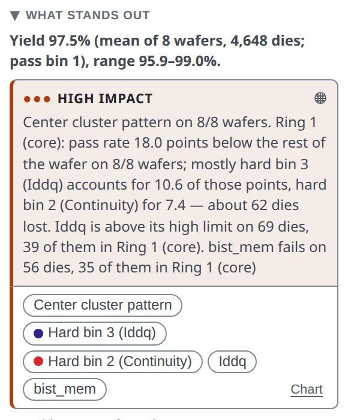

---

<!-- _class: split -->

# A shift with no defect

Not every item is a pattern of failing dies. In [`PARAM-LOT-02`](https://wafertools.github.io/tsmap/app/?dataUrl=https%3A%2F%2Fwafertools.github.io%2Ftsmap%2Fsamples%2Ftsmap-dense-lot.stdf&dataFormat=stdf) the top item is a test: `Iddq` is higher toward the edge on all twelve wafers, and many dies cross its high limit.

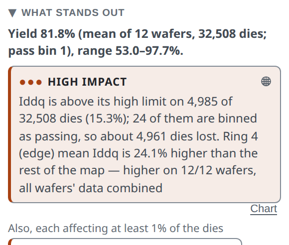

---

<!-- _class: divider -->

# The tables

---

<!-- _class: side -->
<!-- covers: Summary › Wafer Yield; Slot; Wafer yield row -->

# Wafer Yield

Wafer Yield draws one bar per wafer, in slot order, so a pattern that follows the slot order shows up. Use it to spot a wafer that sits apart from the rest: one far from the others is labelled a low or high outlier.

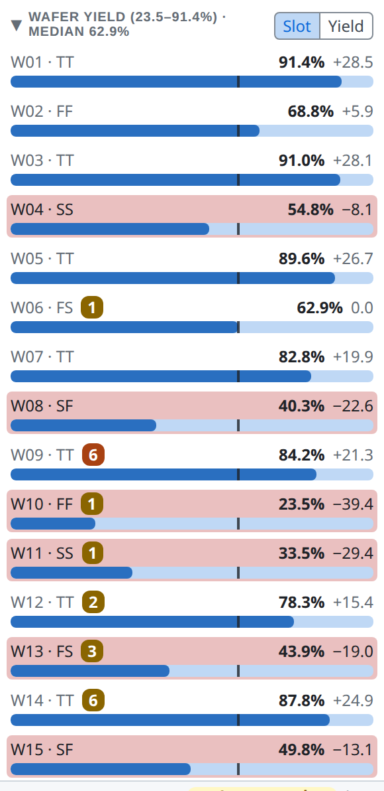

---

# Wafer Yield rows

A badge on a row counts that wafer's findings. Click a row to open the wafer. A single wafer has no such list.

---

<!-- _class: side -->
<!-- covers: Yield -->

# Sorted by yield

**Yield** re-sorts the wafers from lowest to highest, so the weakest come first. (The **Sort: yield** chart in lesson 05 goes the other way.) A row a point or more below the median is tinted, and darker as the gap grows.

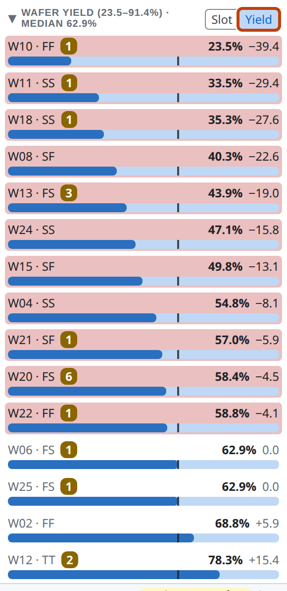

---

# Which yield?

The panel's **65.6% mean per-wafer yield** averages the 25 wafers' own yields, each wafer counting once. A pooled yield counts every die once, so big wafers weigh more. The label always says which. Check it before you compare the figure with one from somewhere else.

---

<!-- covers: Summary › Hard Bin Breakdown; Hard -->

# Hard Bin Breakdown

Hard Bin Breakdown shows where the lost dies went. Bars are a share of dies: pass bins first, then failing bins from the most dies to the fewest.

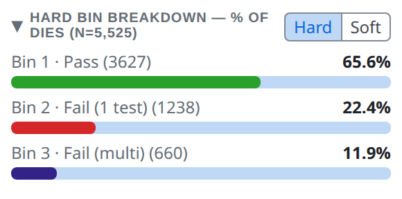

---

<!-- covers: Soft -->

# Soft bins

**Soft** switches the breakdown to soft bins, with their own colours. By default it follows the map's plot mode.

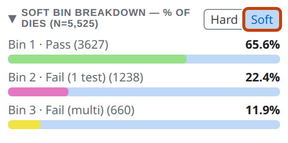

---

<!-- covers: Ring Yield; Ring -->

# Ring Yield

Ring Yield shows yield by ring from the centre out, each row with its difference from the wafer's yield. Ring is the default because edge roll-off dominates real wafer maps.

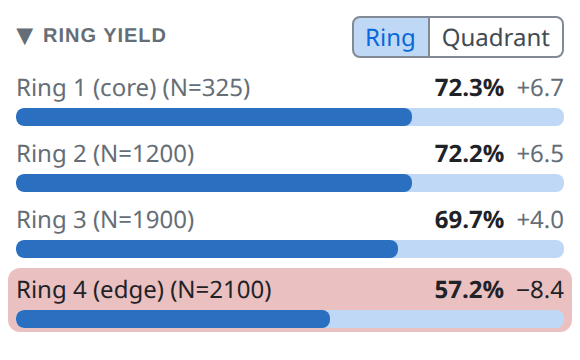

---

<!-- covers: Quadrant -->

# Quadrant

**Quadrant** splits the wafer into NE, NW, SE and SW instead of rings.

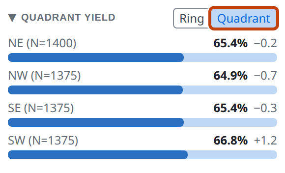

---

<!-- covers: Summary › Test Values -->

# Test Values

The Test Values table has one row per test: the mean, **Ppk** (lesson 06 explains it) and the share of dies within limits. Ppk uses the overall spread, wafer-to-wafer variation included.

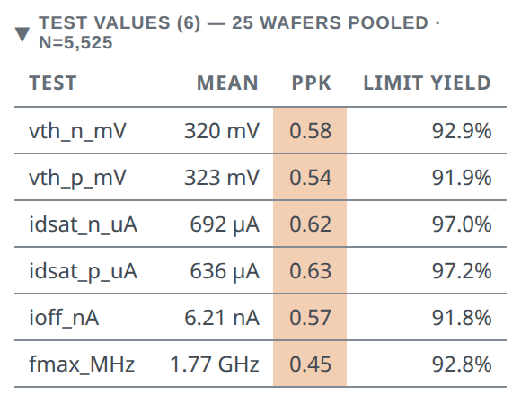

---

<!-- covers: Summary › Functional Tests -->

# Functional Tests

The Functional Tests table gives pass and fail counts and the pass rate for each functional test.

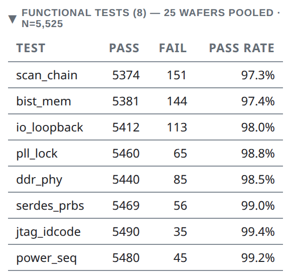

---

<!-- covers: Summary report -->

# Summary report

**Summary report** 1 opens a printable report: the findings, bins, regions and the full per-test table. It is the report **Full report ▸** opens. Save it as a PDF from the print dialog.

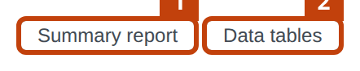

---

<!-- covers: Data tables -->

# Data tables

**Data tables** 2 opens the same tables as the **Data** tab in Insights (lesson 06): statistics, every die, and one row per wafer, each with **Copy** and **Export CSV**. Insights does not need to be on.

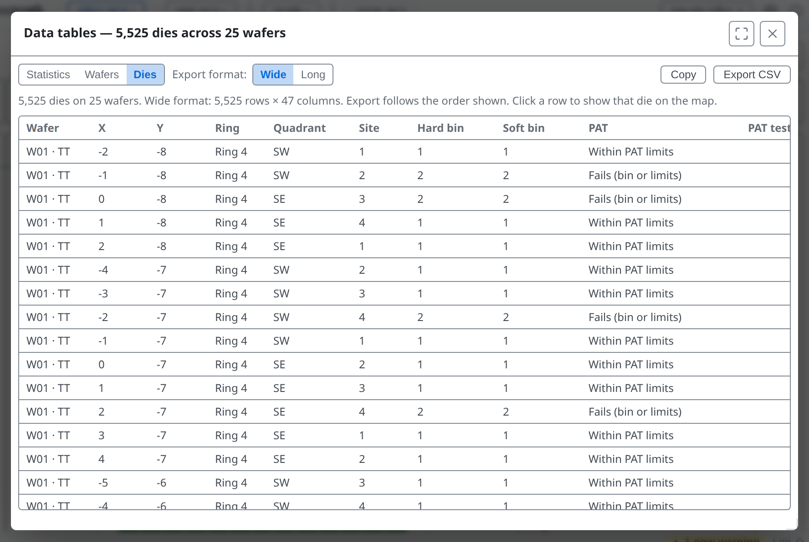

---

<!-- _class: lab -->

# Try it yourself

1. In the [web app](https://wafertools.github.io/tsmap/app/), **Load sample data**
2. Read the top item: which split yields most, and by how many points?
3. Click the **fmax_MHz** row under **Also**: which split's wafers carry the most marked dies?
4. Open **Findings** and click the **edge-local** spatial pattern: on how many wafers is it seen?
5. In **Wafer Yield**, choose **Yield**: which wafer is lowest?
6. Open **Data tables** and look at the **Wafers** table

---

<!-- _class: answers -->

# Check your results

2. **TT**: its wafers yield 34.9 points more than the other wafers, mostly because fewer dies fail hard bin 3.
3. The **SS** wafers, such as W04: SS is the slow corner, so many of its dies fall below the `fmax_MHz` low limit (▽). The TT wafers have only a few marked dies.
4. **8 of 25** wafers: the finding says so, and the map marks its dies on each of them.
5. **W10 · FF** is lowest, at 23.5% yield. W11 · SS is next, at 33.5%.

---

# Recap

- **What stands out** ranks losses and signals, largest first. Most rows show their affected dies on the map; an item about groups of wafers shows a chart instead.
- **Findings** lists what tsmap noticed by severity. Patterns carry the findings that support them.
- The tables, **Summary report** and **Data tables** carry the numbers behind all of it

When you open a new lot, read the headline and the top item first, click a row to see where it is, then use the Findings list for the rest.

More in the [wafer map guide](https://wafertools.github.io/wafermap/user-guide/#6-summary-panel)

---

<!-- _class: next -->
<!-- _paginate: false -->

# Next lesson

[04 · The lot view →](04-the-lot-view.md)

Stack a lot into one map, select the same dies on every wafer, name splits, and name and judge bins.
