<!-- _class: title -->
<!-- _paginate: false -->

# The lot view

## Lesson 04

Learn tsmap

---

# In this lesson

One wafer can mislead you: a pattern may be chance. A lot can show what repeats. This lesson shows how to look across all the wafers at once, and how to label wafers so you can compare them.

- Combine every wafer of a lot into one stacked map
- Select the same dies on every wafer
- Name wafer splits and show them on the maps
- Name bins and choose which ones count as a pass

---

<!-- _class: divider -->

# Gallery and stack

---

# One card per wafer

A gallery shows each wafer on its own card. This is [`EDGE-LOT-01`](https://wafertools.github.io/tsmap/app/?dataUrl=https%3A%2F%2Fwafertools.github.io%2Ftsmap%2Fsamples%2Ftsmap-edge-ring-lot.zip&dataFormat=zip), eight wafers with an edge-ring defect. The buttons above act on all the cards at once (lesson 02).

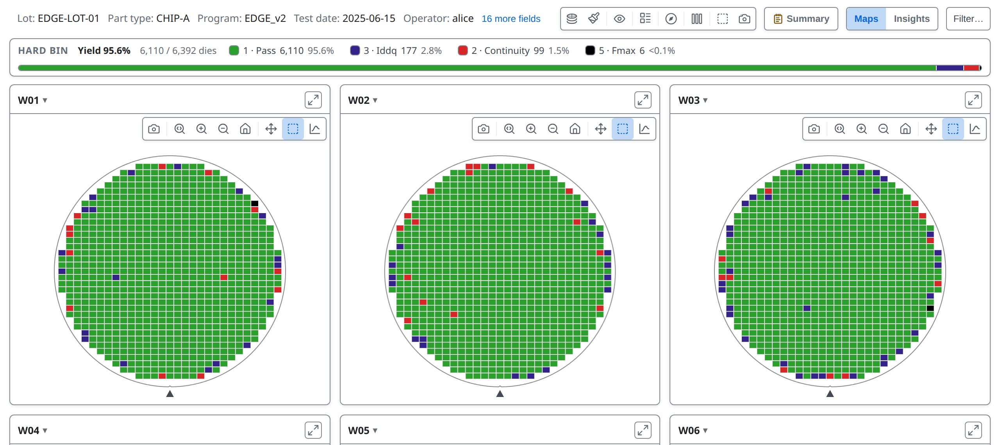

---

<!-- _class: side -->
<!-- covers: Plot mode › Stacked Test Values; Plot mode › Stacked Hard Bins; Plot mode › Stacked Soft Bins; wmap guide › Lot-stack maps; wmap guide › Gallery stacked modes; glossary › Lot stack -->

# Stack the lot

One wafer's pattern can be chance. The same die positions failing on many wafers is not. Under **Lot aggregation**, three plot modes lay the wafers over one another, so what repeats stands out.

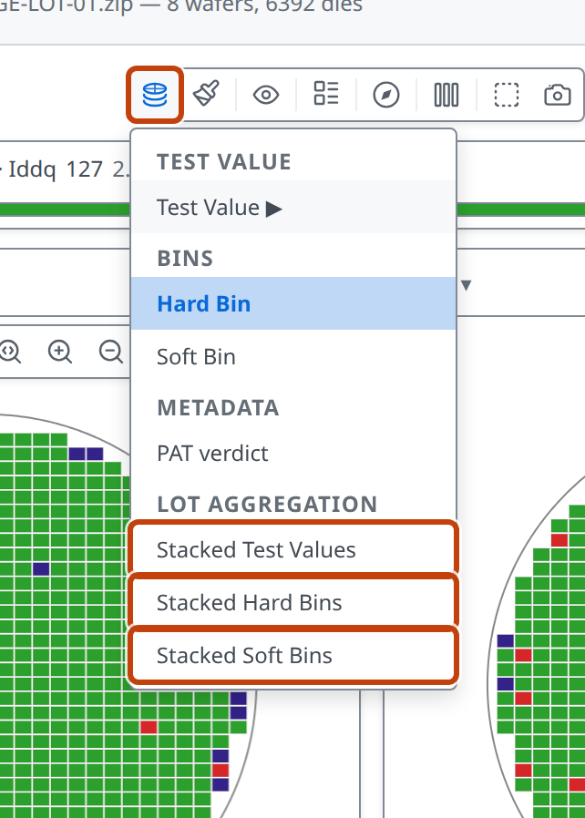

---

<!-- covers: wmap guide › Stacked plot modes; chart › Stacked map -->

# Stacked Hard Bins
Stacked Hard Bins draws one card per bin. Each die position is coloured by how many wafers had that bin there: 0 to 8 here. Pass is high everywhere except a ring at the edge, where the defect sits. A defect that repeats on every wafer is far easier to see here than on any single map.

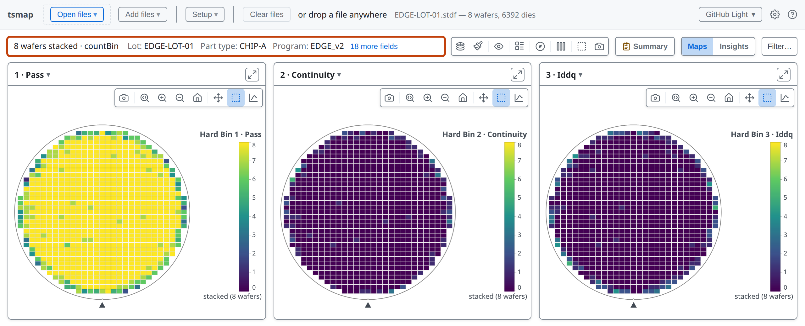

---

# Stacked Soft Bins

Stacked Soft Bins does the same for soft bins, so each lot-level failure mode shows as its own map.

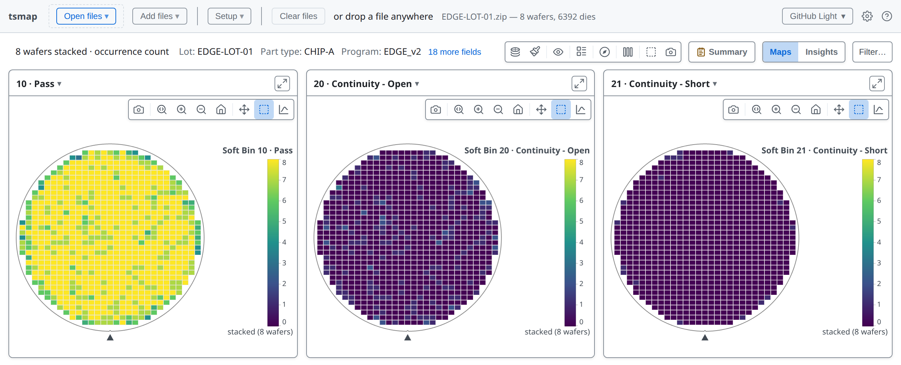

---

# Stacked Test Values

Stacked Test Values draws one card per measured test (three here), with the values combined across the wafers. The header says how many wafers were stacked and how they were combined, so you always know what you are looking at.

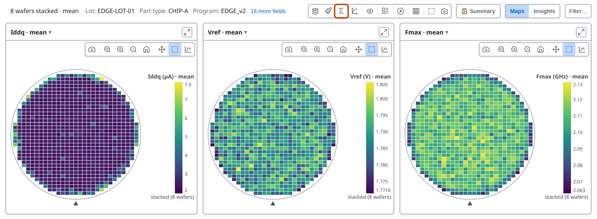

---

<!-- _class: split -->

<!-- covers: wmap guide › Aggregation method -->

# Aggregation method

The **Σ** button picks how the wafers combine at each position. Choose the one that answers your question. With **Std Dev**, a bright position is where wafers disagree; with **Mean**, where they agree on a high value.

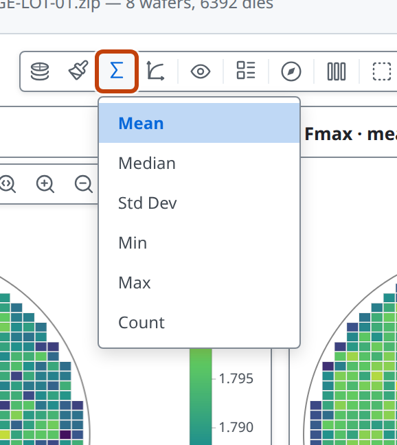

---

# Wafers that are not stacked

Wafers with other pass bins or ring counts are not stacked, because their results would not be comparable.

---

<!-- _class: divider -->

# Selecting across wafers

---

# Select dies on one wafer

Selecting dies is how you ask "what is going on here?" about part of a wafer. Drag a box on a map: the dies inside it are selected and the rest fade. **Ctrl** or **Cmd** + click adds or removes a die; a click outside the wafer clears it. Lesson 08 charts a selection.

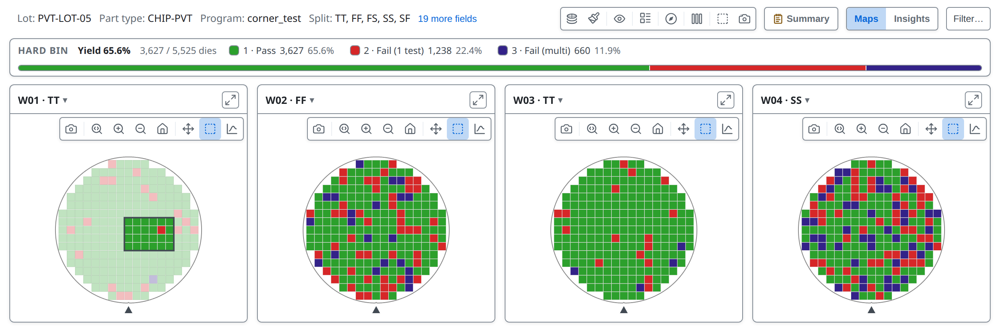

---

<!-- covers: Select the same dies on every wafer: off (click to turn on) -->

# Select the same dies on every wafer

By default each card selects on its own. Turn this on when you want to check whether a region behaves the same way on every wafer.

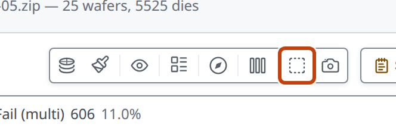

---

# One box, every wafer

Drag a box on one wafer and the same positions are selected on every wafer. The badge counts them, and the button clears them.

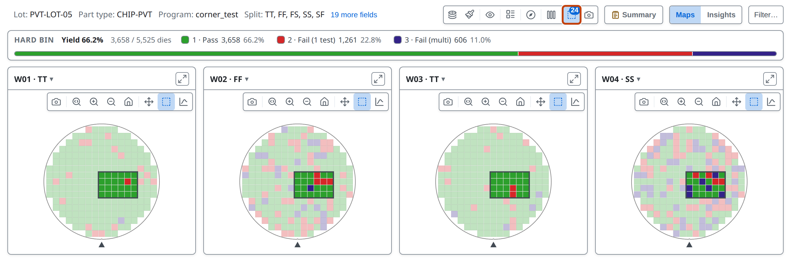

*(Charts of the selected dies are covered in lesson 08.)*

---

<!-- covers: wmap guide › Box select -->

# Pick whole wafers

To look at some wafers rather than some dies, **Ctrl** or **Cmd** + click a card's header to pick that wafer. The toolbar counts the picked wafers. Right-click a picked card and the charts and tables cover every die of every picked wafer.

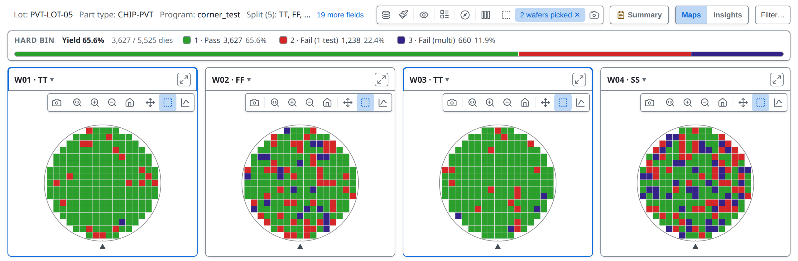

---

<!-- _class: divider -->

# Wafer splits

---

<!-- _class: split -->
<!-- covers: Setup ▾ › Splits…; tsmap guide › Wafer splits -->

# What a split is

A split is a name you give a wafer when the test data file doesn't include one, such as a process corner. It is how you tell tsmap which wafers belong together. Splits are what **Group by** compares in Insights (lesson 05). **Setup ▾ → Splits…** opens the dialog.

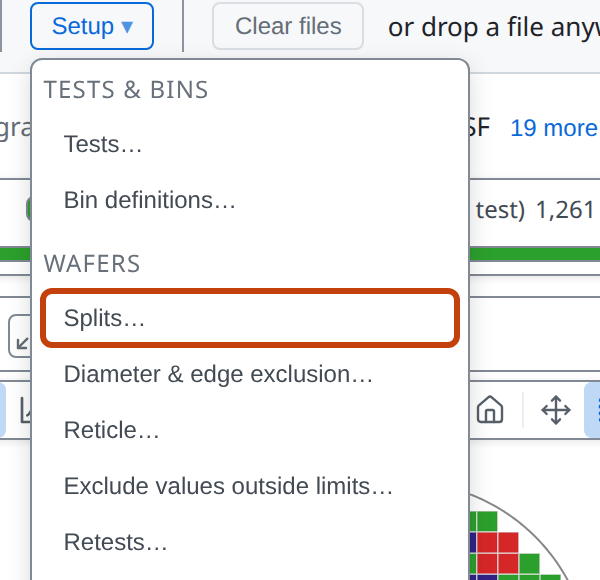

---

<!-- _class: split -->
<!-- covers: Splits… › wafer row; Splits… › Select all; Splits… › Select none -->

# The Splits dialog

The banner at the top says where things stand. The sample lot's corners are already assigned, so you can see what a finished assignment looks like.

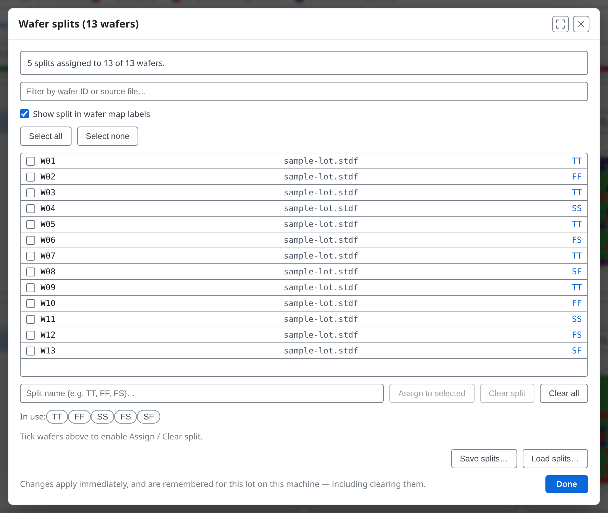

---

<!-- covers: Splits… › Show split in wafer map labels; tsmap guide › Showing splits on the wafer map -->

# Splits in the labels

With **Show split in wafer map labels** ticked, the split follows the wafer ID on every card.

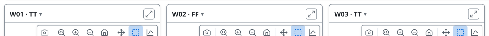

---

# Plain wafer IDs

Untick **Show split in wafer map labels** and the cards show plain wafer IDs. The assignments are unchanged either way. The option only changes what the labels say.

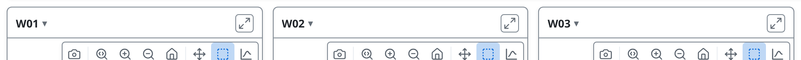

---

<!-- _class: split -->
<!-- covers: Splits… › Assign to selected; Splits… › Clear split; Splits… › Clear all; tsmap guide › Assigning splits -->

# Assign a split

Tick wafers and type a name 1, then **Assign to selected** 2. **Clear split** 3 clears the ticked wafers; **Clear all** clears every wafer.

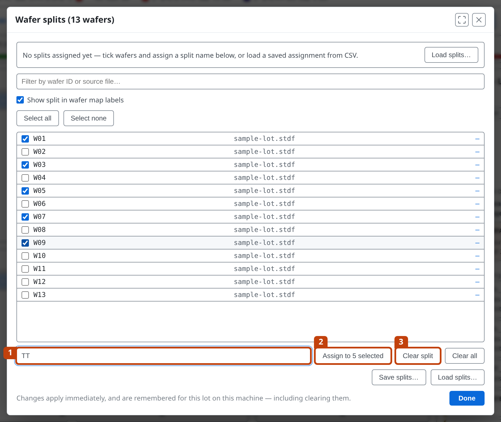

---

<!-- _class: split -->
<!-- covers: Splits… › split name suggestion -->

# Reuse a name

Every action applies at once. Names in use appear beside **In use**: click one to reuse it, so TT and tt don't drift apart into two groups.

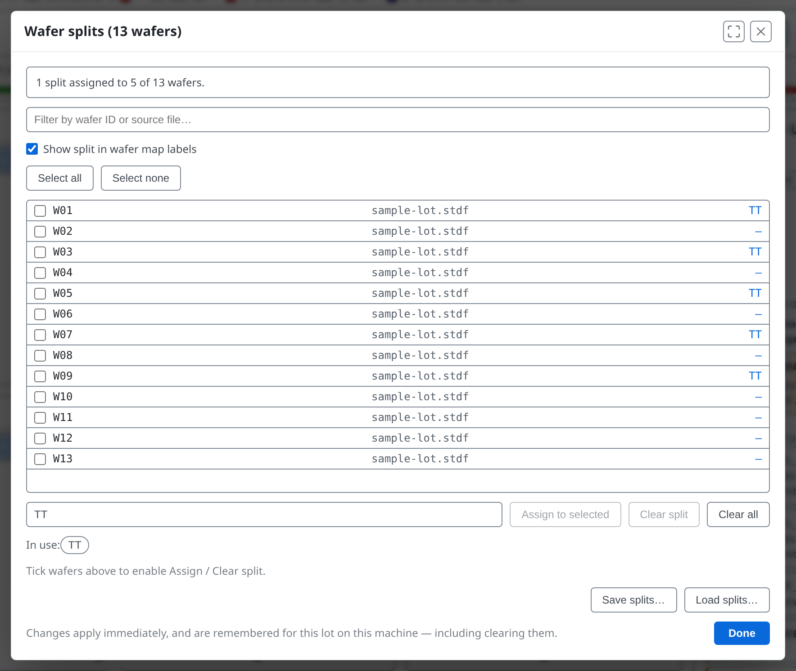

---

<!-- _class: split -->
<!-- covers: Splits… › Save splits…; Splits… › Load splits…; Splits… › Done; tsmap guide › Saving and loading splits -->

# Save, load, finish

**Save splits…** 1 writes every wafer's split to a CSV. **Load splits…** 2 reads one back, matching by lot and wafer ID. **Done** 3 closes the dialog.

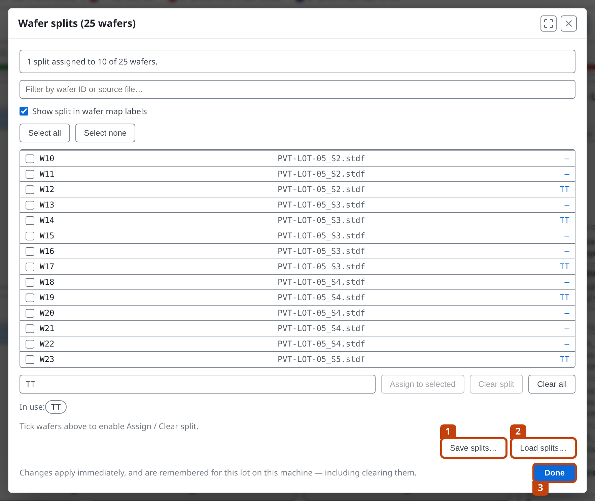

---

<!-- covers: tsmap guide › Restoring splits automatically -->

# Remembered for the lot
You do not have to assign splits again. Reopen the same lot and its splits come back, with the dialog open to show them. **Clear all** forgets them. A file with no lot ID cannot be matched, so save its splits to a CSV.

---

<!-- _class: divider -->

# Naming and judging bins

---

<!-- covers: tsmap guide › Bin definitions; Setup ▾ › Bin definitions… -->

# Bin definitions…

Bin numbers mean little until they have names, and which bins count as a pass decides the yield of every wafer. **Setup ▾ → Bin definitions…** opens a table of every hard and soft bin, with its die count, a name, whether a hard bin passes, and optionally the colour it is drawn in on the maps.

STDF and ATDF files carry names and pass flags of their own, so the table starts filled in. Edit a name or a colour in its cell. Nothing changes in the lot until you press **Apply**.

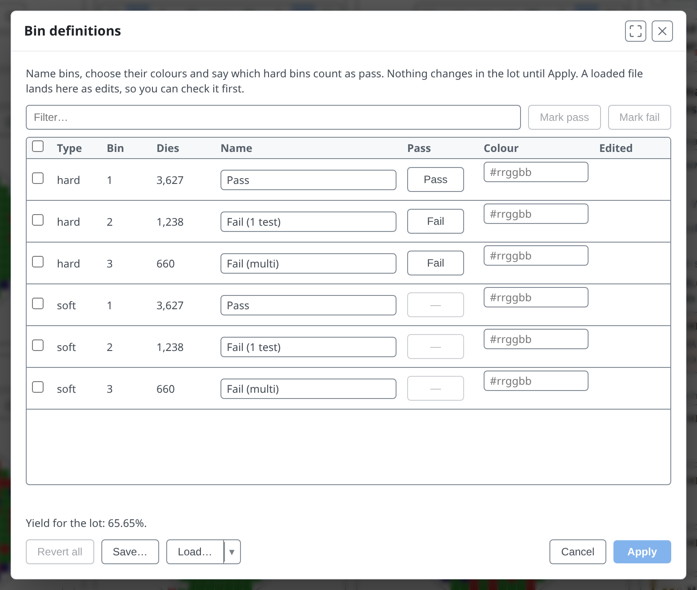

---

<!-- _class: split -->
<!-- covers: Bin definitions… › Mark pass; Bin definitions… › Mark fail; Bin definitions… › Tick every row that matches the filter; Bin definitions… › Revert all -->

# Change what passes

1 Tick hard bins, then 2 **Mark pass** or **Mark fail**. Soft bins have no pass flag.

3 The window shows the lot's yield now and with the new pass bins: here 65.65% becomes 88.05% if bin 2 counts as a pass.

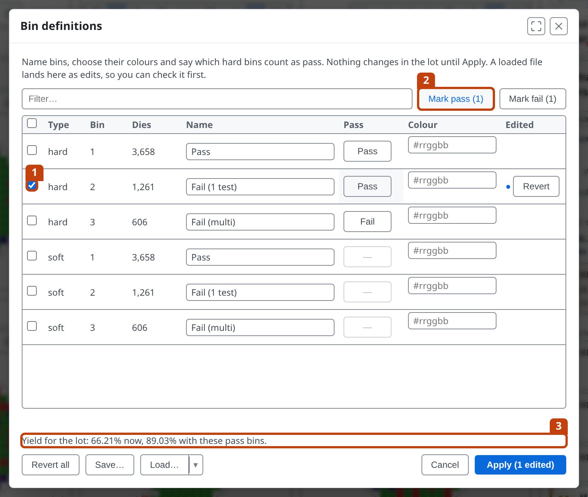

---

<!-- _class: split -->
<!-- covers: Bin definitions… › Cancel; Bin definitions… › Apply -->

# Confirm a pass change

A changed pass flag changes the lot's yield and every finding, so **Apply** asks first, with both figures. **Change pass bins** goes ahead, **Back** returns to the table, and **Cancel** leaves the lot untouched. Files of bin definitions are in [lesson 12](12-automation.md).

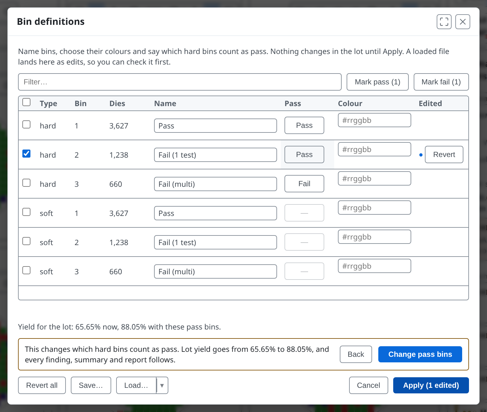

---

<!-- _class: divider -->

# One wafer in its own window

---

<!-- _class: split -->
<!-- covers: Open full view -->

# Detach a wafer

When one wafer needs a closer look, **Open full view**, the expand button in a card's header, detaches it into its own window with the full single-map toolbar.

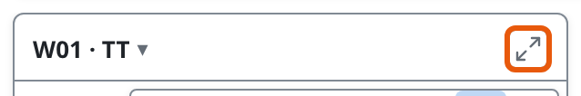

---

<!-- _class: split -->
<!-- covers: Reattach to gallery -->

# Bring it back

When a wafer is detached, its card becomes a placeholder. Its **Reattach to gallery** button puts the wafer back; closing the window does the same.

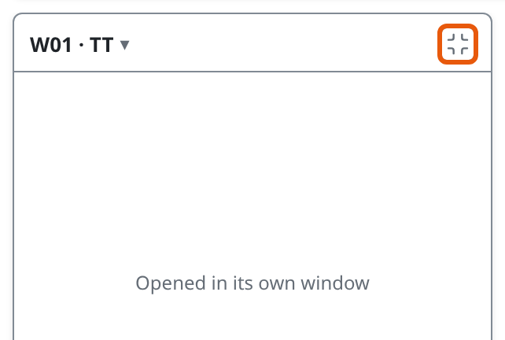

---

<!-- _class: lab -->

# Try it yourself

1. Open [`EDGE-LOT-01`](https://wafertools.github.io/tsmap/app/?dataUrl=https%3A%2F%2Fwafertools.github.io%2Ftsmap%2Fsamples%2Ftsmap-edge-ring-lot.zip&dataFormat=zip) in the web app
2. **Plot mode → Stacked Hard Bins**: on the **Pass** card, where is the count lower?
3. **Stacked Test Values**, then **Σ → Std Dev**
4. Back to **Hard Bin**: **Select the same dies on every wafer**, drag a box
5. **Setup ▾ → Splits…**: tick W01 and W03, assign a name, then **Clear all**
6. **Setup ▾ → Bin definitions…**: **Mark pass** on a bin, read the yield, **Cancel**

---

<!-- _class: answers -->

# Check your results

2. The Pass count drops in a **ring at the wafer's edge**, and the failing bins' cards show the same ring faintly. One wafer alone looks like scattered failures; stacked, the ring is plain.
6. The window shows the lot's yield now and with the new pass bins. **Cancel** leaves the lot as it was.

---

# Recap

- **Stacked modes** turn a lot into one map per bin or test, so what repeats stands out
- **Select the same dies** reads one region across every wafer
- **Splits** name wafers the file doesn't, and show on every label
- **Bin definitions…** names bins, colours them and chooses which hard bins pass, with the yield shown before you confirm

The next lesson moves from maps to charts, and compares groups of wafers such as these splits.

More in the [wafer map guide](https://wafertools.github.io/wafermap/user-guide/#7-lot-stack-maps)

---

<!-- _class: next -->
<!-- _paginate: false -->

# Next lesson

[05 · Insights: where yield is lost →](05-insights-yield.md)

Which wafers, bins and tests lose yield, and what divides it.
