<!-- _class: title -->
<!-- _paginate: false -->

# The lot view

## Lesson 04

Learn tsmap

---

# In this lesson

- Combine every wafer of a lot into one stacked map
- Select the same dies on every wafer
- Name wafer splits and show them on the maps

---

<!-- _class: divider -->

# Gallery and stack

---

# One card per wafer

A gallery shows each wafer on its own card. This is EDGE-LOT-01, eight wafers with an edge-ring defect. The buttons above act on all the cards at once (lesson 02).

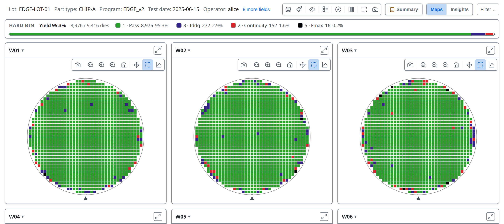

---

<!-- _class: split -->
<!-- covers: Plot mode › Stacked Test Values; Plot mode › Stacked Hard Bins; Plot mode › Stacked Soft Bins; wmap guide › Lot-stack maps; wmap guide › Gallery stacked modes; glossary › Lot stack -->

# Stack the lot

One wafer's pattern can be chance; the same die positions failing on many wafers is not. Under **Lot aggregation**, three plot modes lay the wafers over one another.

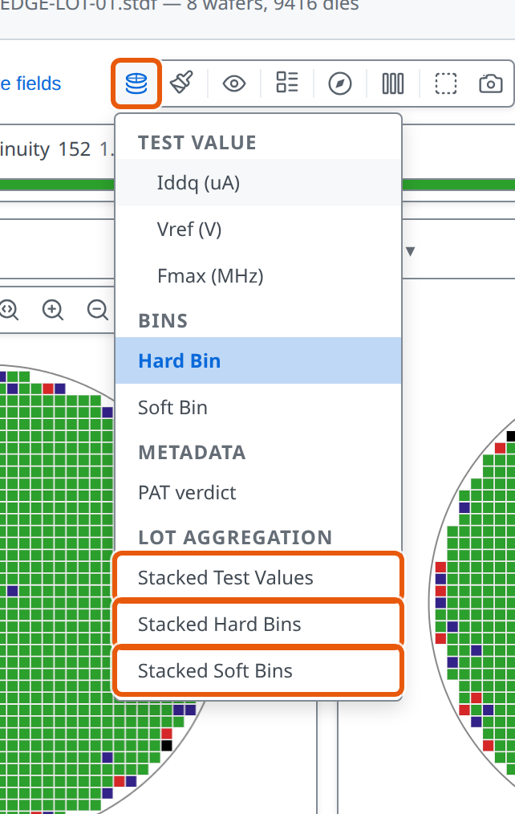

---

<!-- covers: wmap guide › Stacked plot modes; chart › Stacked map -->

# Stacked Hard Bins
One card per bin. Each die position is coloured by how many wafers had that bin there: 0 to 8 here. Pass is high everywhere except a ring at the edge, where the defect sits.

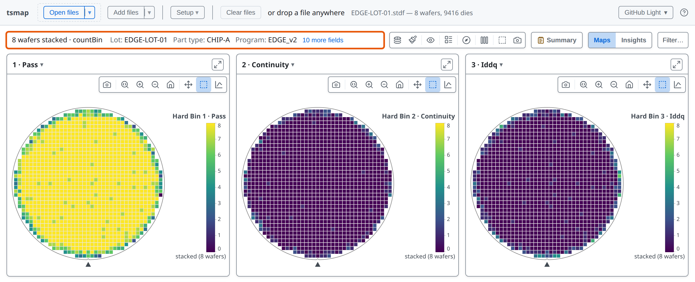

---

# Stacked Soft Bins

The same for soft bins, so lot-level failure modes show as one map per soft bin.

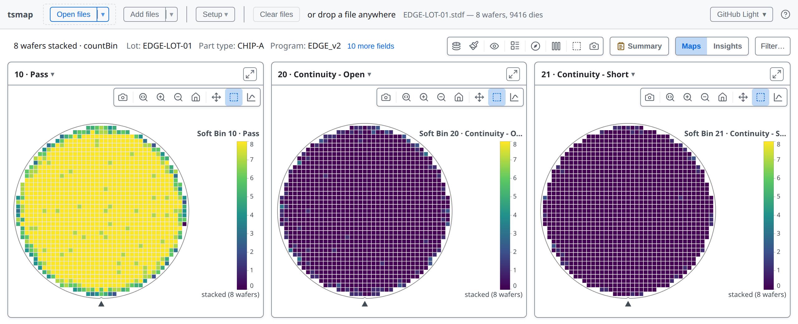

---

# Stacked Test Values

One card per test (three here), with the values combined across the wafers. The header says how many wafers were stacked and how they were combined.

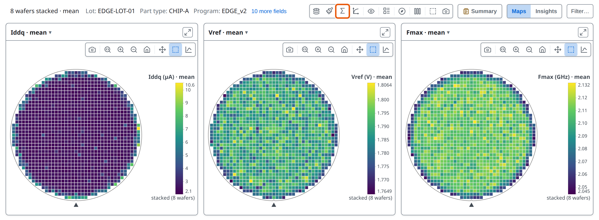

---

<!-- _class: split -->

<!-- covers: wmap guide › Aggregation method -->

# Aggregation method

The **Σ** button picks how the wafers combine at each position. With **Std Dev**, a bright position is where wafers disagree; with **Mean**, where they agree on a high value. Wafers with other pass bins or ring counts are not stacked.

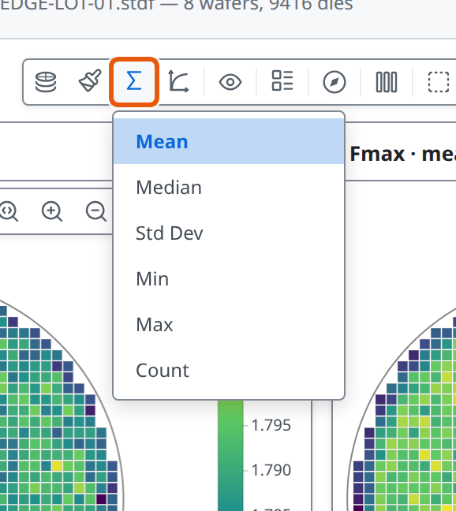

---

<!-- _class: divider -->

# Selecting across wafers

---

# Select dies on one wafer

Drag a box on a map: the dies inside it are selected and the rest fade. **Ctrl** or **Cmd** + click adds or removes a die; a click outside the wafer clears it. Lesson 07 charts a selection.

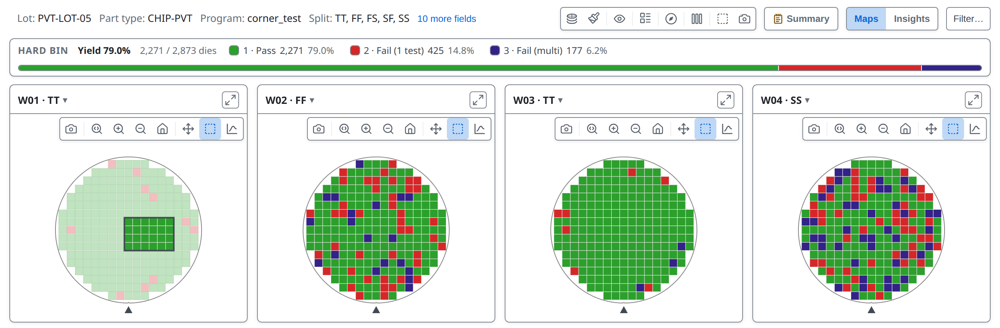

---

<!-- covers: Select the same dies on every wafer: off (click to turn on) -->

# Select the same dies on every wafer

Off by default, so each card selects on its own. Click the button to turn it on.

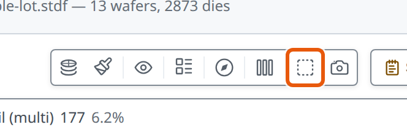

---

# One box, every wafer

Drag a box on one wafer and the same positions are selected on every wafer. The badge counts them; the button clears them.

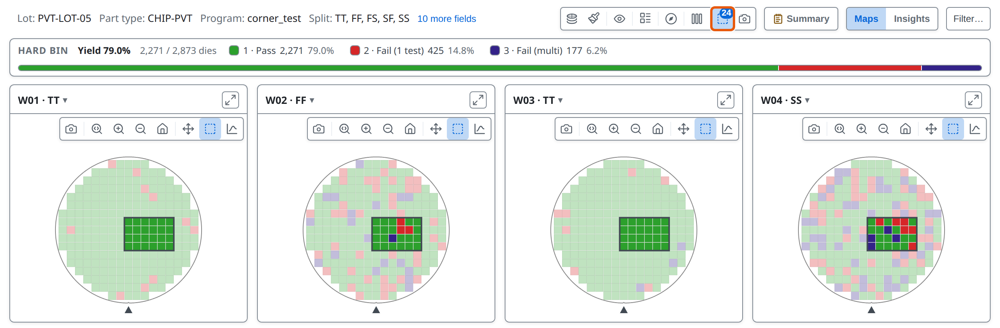

*(Charts of the selected dies are covered in lesson 07.)*

---

<!-- covers: wmap guide › Box select -->

# Pick whole wafers

**Ctrl** or **Cmd** + click a card's header to pick that wafer; the toolbar counts the picked wafers. Right-click a picked card and the charts and tables cover every die of every picked wafer.

---

<!-- _class: divider -->

# Wafer splits

---

<!-- _class: split -->
<!-- covers: Setup ▾ › Splits…; tsmap guide › Wafer splits -->

# What a split is

A split is a name you give a wafer that the test data file doesn't include, such as a process corner. Splits are what **Group by** compares in Insights (lesson 05). **Setup ▾ → Splits…** opens the dialog.

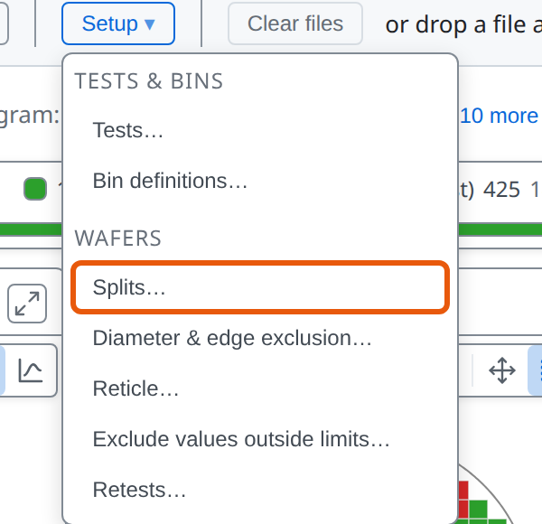

---

<!-- _class: split -->
<!-- covers: Splits… › wafer row; Splits… › Select all; Splits… › Select none; Dialog › Maximize (F); Dialog › Close (Esc) -->

# The Splits dialog

The banner says where things stand. The sample lot's corners are already assigned. **Maximize (F)** and **Close (Esc)**, top right, are on every dialog.

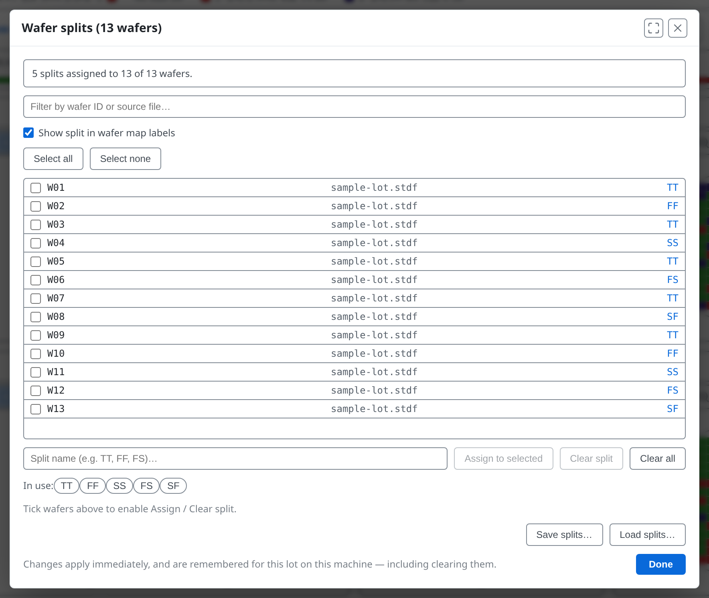

---

<!-- covers: Splits… › Show split in wafer map labels; tsmap guide › Showing splits on the wafer map -->

# Splits in the labels

With **Show split in wafer map labels** ticked, the split follows the wafer ID on every card.

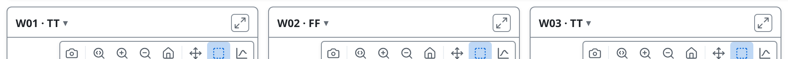

---

# Plain wafer IDs

Untick it and the cards show plain wafer IDs. The assignments are unchanged either way.

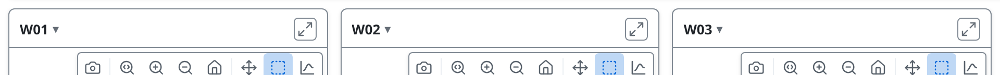

---

<!-- _class: split -->
<!-- covers: Splits… › Assign to selected; Splits… › Clear split; Splits… › Clear all; tsmap guide › Assigning splits -->

# Assign a split

Tick wafers and type a name 1, then **Assign to selected** 2. **Clear split** 3 clears the ticked wafers; **Clear all** clears every wafer.

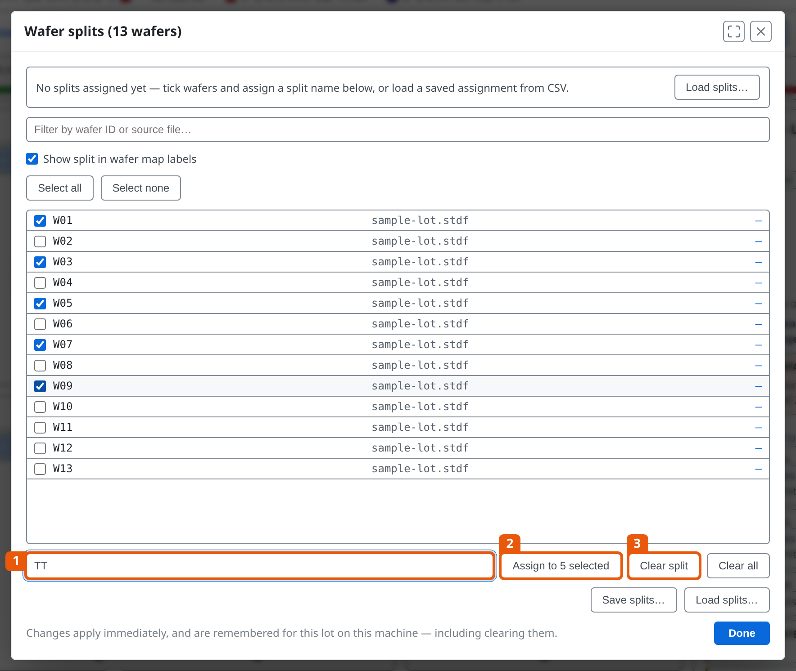

---

<!-- _class: split -->
<!-- covers: Splits… › split name suggestion -->

# Reuse a name

Every action applies at once. Names in use appear beside **In use**: click one to reuse it, so TT and tt don't drift apart.

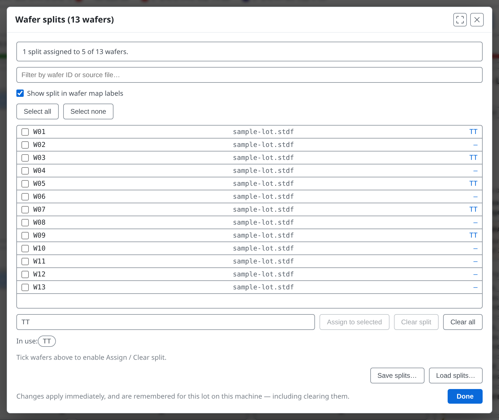

---

<!-- _class: split -->
<!-- covers: Splits… › Save splits…; Splits… › Load splits…; Splits… › Done; tsmap guide › Saving and loading splits -->

# Save, load, finish

1 writes every wafer's split to a CSV. 2 reads one back, matching by lot and wafer ID. 3 closes the dialog.

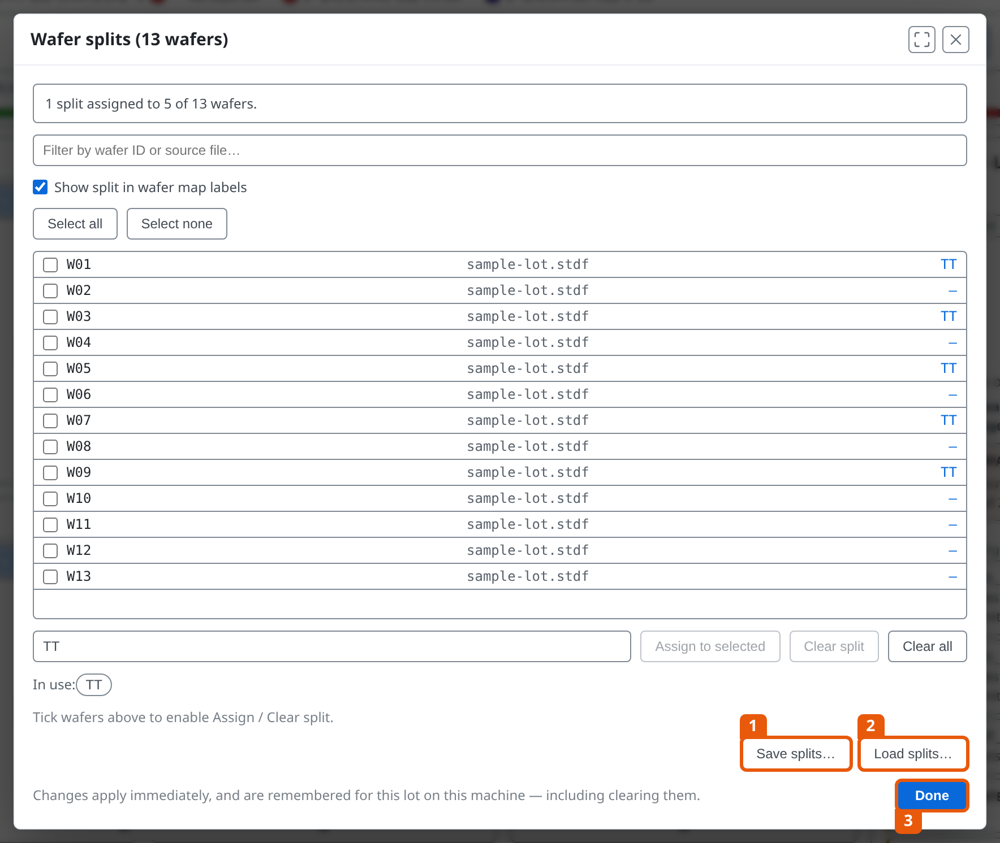

---

<!-- covers: tsmap guide › Restoring splits automatically -->

# Remembered for the lot
Reopen the same lot and its splits come back, with the dialog open to show them. **Clear all** forgets them. A file with no lot ID cannot be matched, so save its splits to a CSV.

---

<!-- _class: divider -->

# One wafer in its own window

---

<!-- _class: split -->
<!-- covers: Open full view -->

# Detach a wafer

**Open full view**, the expand button in a card's header, detaches that wafer into its own window with the full single-map toolbar.

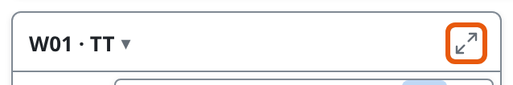

---

<!-- _class: split -->
<!-- covers: Reattach to gallery -->

# Bring it back

The vacated card becomes a placeholder. Its **Reattach to gallery** button puts the wafer back; closing the window does the same.

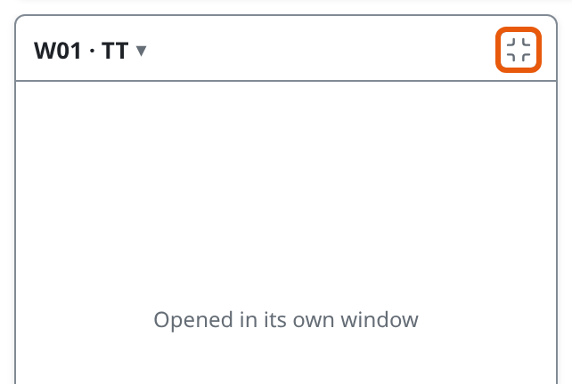

---

<!-- _class: lab -->

# Try it yourself

1. In the [web app](https://wafertools.github.io/tsmap/app/), **Load sample data**
2. **Plot mode → Stacked Hard Bins**: where do the failing bins gather?
3. **Stacked Test Values**, then **Σ → Std Dev**
4. Back to **Hard Bin**, turn on **Select the same dies on every wafer** and drag a box
5. **Setup ▾ → Splits…**: tick W01 and W03, then assign a new name

---

# Recap

- **Stacked modes** turn a lot into one map per bin or test
- **Select the same dies** reads one region across every wafer
- **Splits** name wafers the file doesn't, and show on every label

More in the [wafer map guide](https://wafertools.github.io/wafermap/user-guide/#7-lot-stack-maps)

---

<!-- _class: next -->
<!-- _paginate: false -->

# Next lesson

[05 · Insights →](05-insights.md)

Charts and statistics for the whole lot.
