<!-- _class: title -->
<!-- _paginate: false -->

# Insights: where yield is lost

## Lesson 05

Learn tsmap

---

# In this lesson

Maps show you where on a wafer dies fail. Charts show you which wafers, bins and tests are responsible. This lesson walks through the charts that answer "where is the yield going?"

- Find which wafers, bins and tests lose yield
- Use the buttons and menus every chart shares
- Compare groups of wafers, such as process splits

---

<!-- _class: divider -->

# Where yield is lost

---

<!-- covers: Insights; Overview; wmap guide › Insights tab -->

# From maps to charts

The **Maps | Insights** switch 1 swaps the wafer view for charts of the same dies. **Overview** 2 is the first tab. Its tiles state the population, so you know which dies the charts describe.

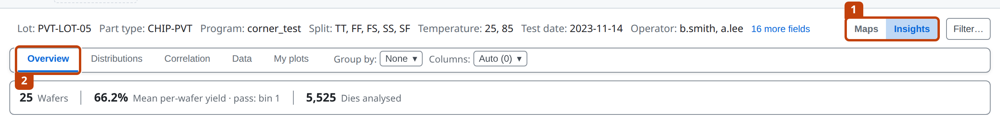

---

# The Overview

Read it from the top. **Worth a look** comes first when something stands out, then **What divides yield**, then the standing cards: yield, bins, pass rates and regions. Scroll down: every card is a chart you can click.

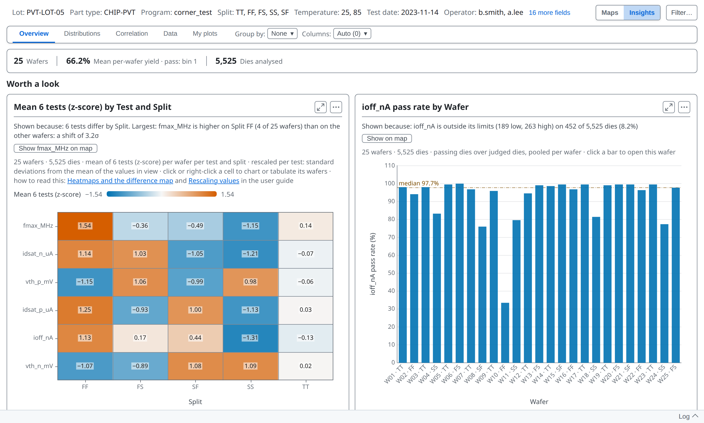

---

<!-- _class: split -->
<!-- covers: Show on map; Show * on map -->

# Worth a look

The same items as **What stands out** (lesson 03), each drawn as the chart that shows it. Each card starts with a line saying why it is shown. **Show on map** opens the map that shows that item. On a card about groups of wafers that leads with a test, the button names that test, such as **Show fmax_MHz on map**. A lot with nothing to show has no Worth a look, and its Overview starts with the standing cards.

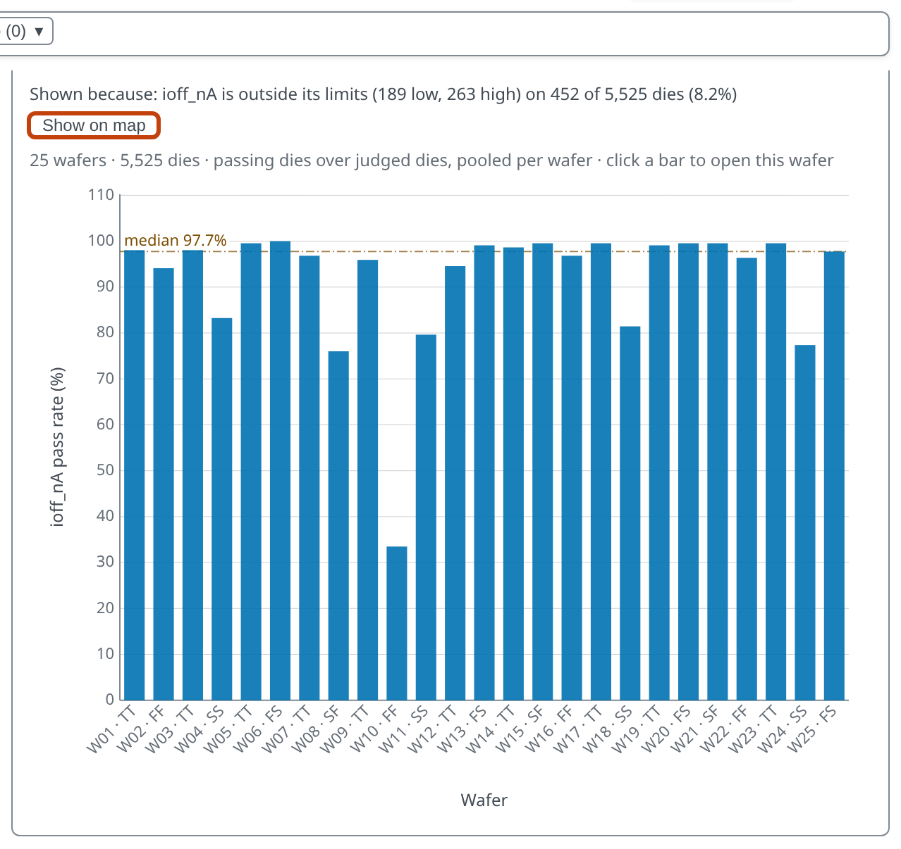

---

# Cards about groups of wafers

A card about groups of wafers has no **Show on map**, because it has no place on the map. It is a bar of yield for each group, such as each split. When Insights is already grouped by that field, the card is left out, because the yield card shows the same bars.

---

<!-- _class: split -->
<!-- covers: Sort: yield; Sort: wafer; chart › Yield by wafer -->

# Yield by wafer

Start here to see which wafers are weak. Each wafer is one bar, with the median as a line. **Sort: yield** 1 orders the bars from highest to lowest yield. Click a bar to open that wafer.

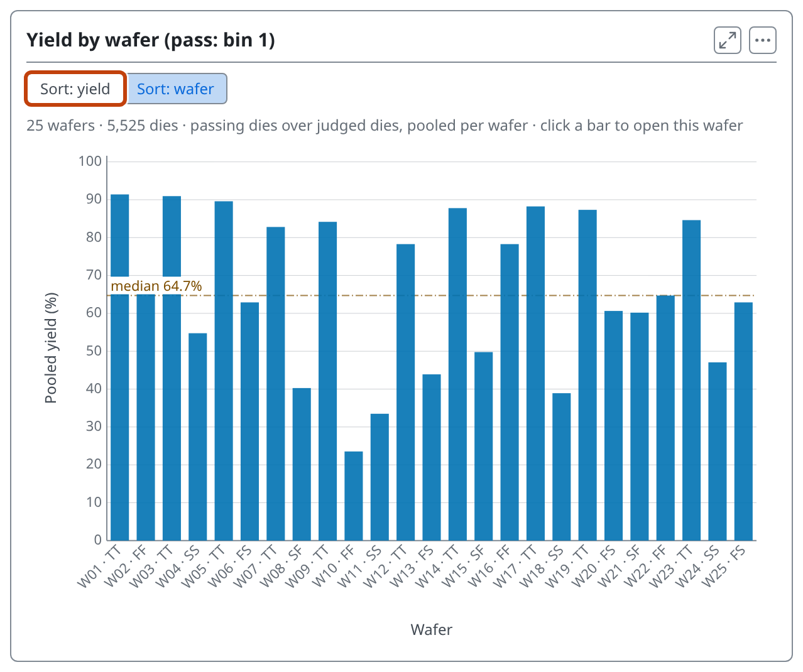

---

<!-- _class: split -->

# Sorted by yield

With **Sort: yield** on, the bars run from highest yield to lowest, so the weakest wafers are at the right: W10 (FF), then W11 and W18 (both SS). (The Wafer Yield list in lesson 03 sorts the other way, lowest first.)

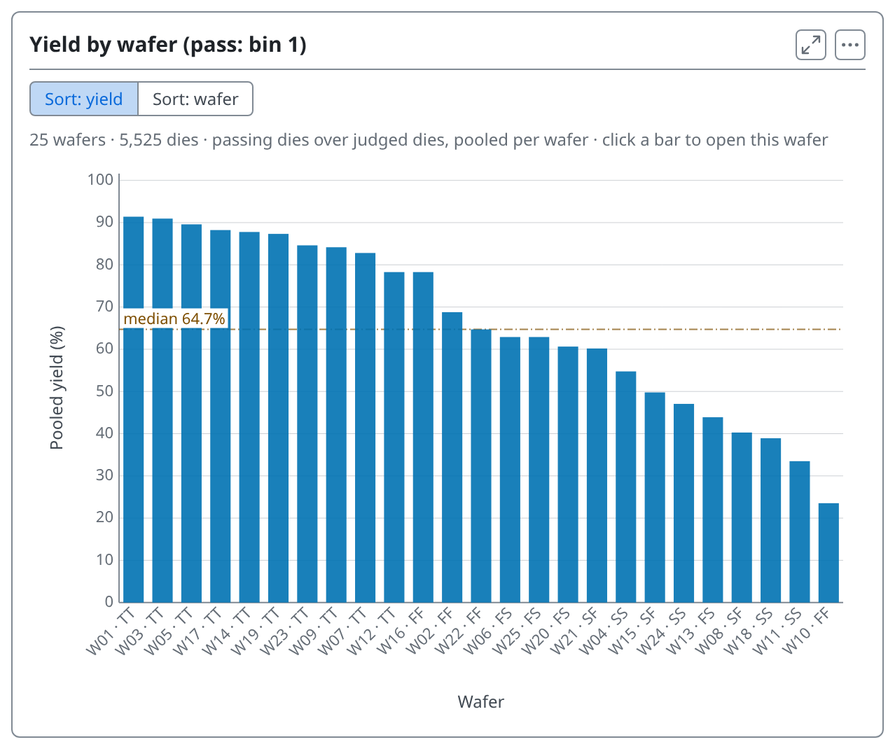

---

<!-- _class: split -->
<!-- covers: Hard bins; Soft bins; chart › Bin pareto -->

# Bin pareto

The bin pareto shows where the lost dies went. A pareto chart is one bar per bin, largest first, with the running share of all dies as a line. The biggest bars are the ones to chase first. **Hard bins** or **Soft bins** switches the bin type. Click a bar to chart or tabulate its dies.

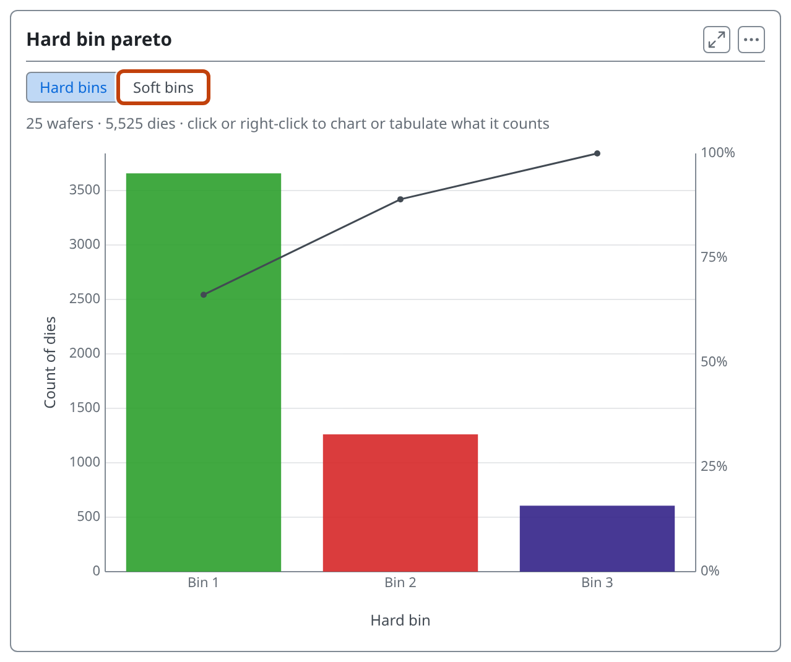

---

<!-- _class: split -->

# Soft bins

Soft bins (lesson 00) are numbered separately from hard bins, so the two charts can differ; in the sample lot they happen to match.

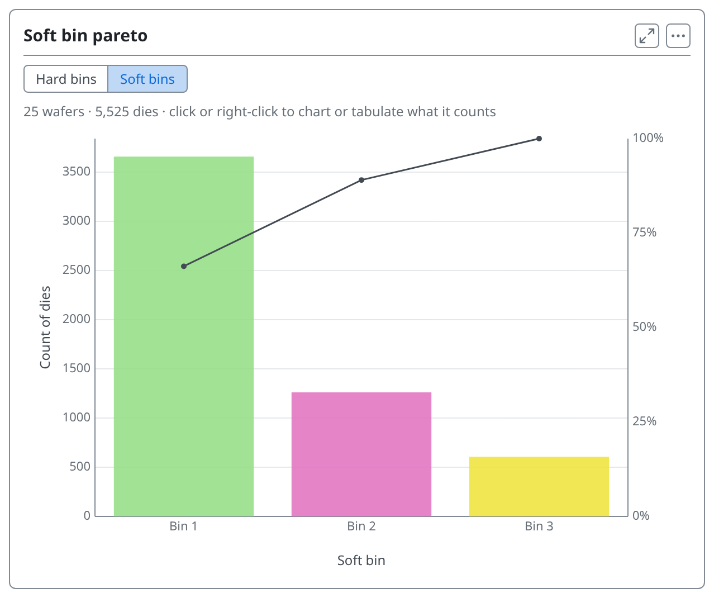

---

<!-- _class: split -->
<!-- covers: Test limits; Tester flag; Functional; chart › Pass rate by test -->

# Pass rate by test

The share of judged dies that pass each test, lowest first, so the tests that cost you most are at the top. The three buttons choose how a die is judged.

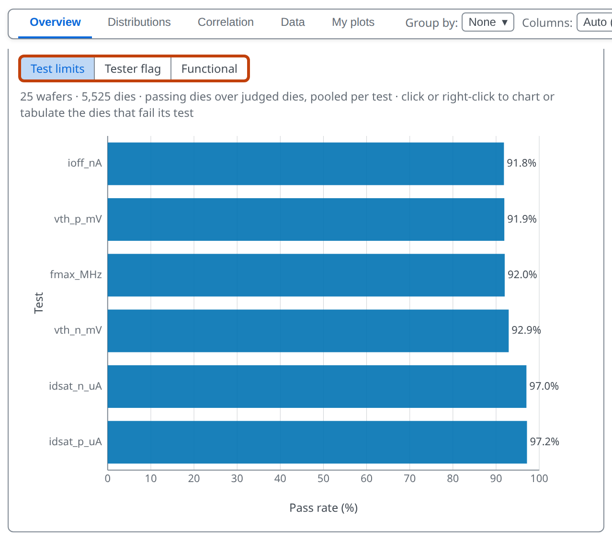

---

<!-- _class: split -->

# Tester flag

**Test limits** judges the measured value against the limits. **Tester flag** uses the pass or fail the tester recorded. When the two disagree the card counts the dies judged differently: 215 in the sample lot. A large count is worth raising with whoever owns the test program.

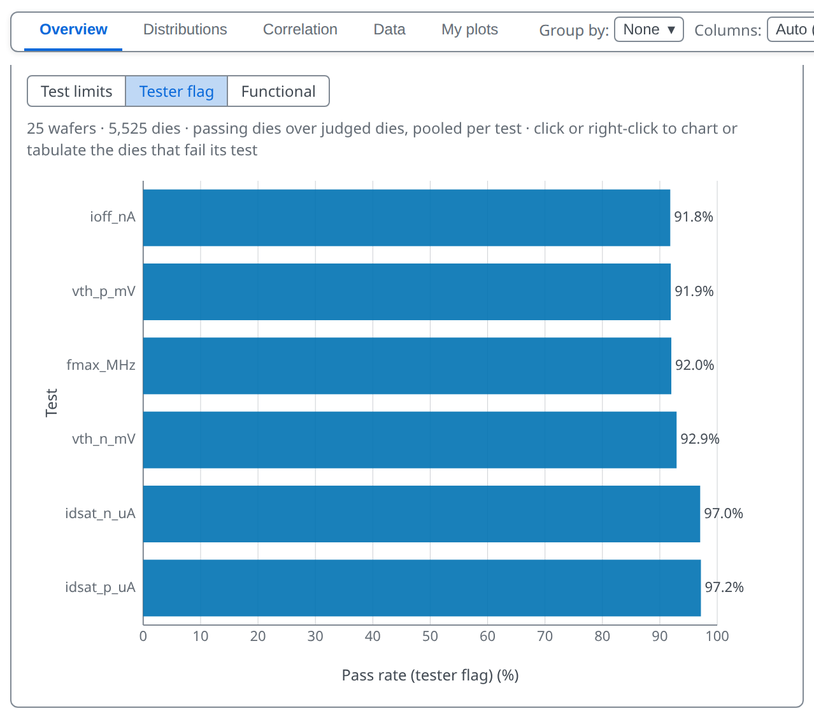

---

<!-- _class: split -->

# Functional tests

**Functional** covers tests that only pass or fail, such as a scan chain.

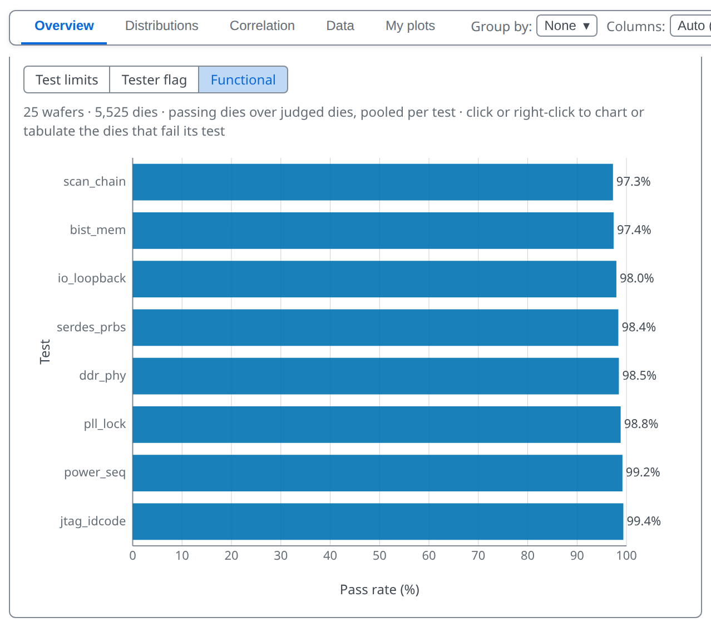

---

<!-- _class: split -->
<!-- covers: chart › Ring yield by wafer; wmap guide › Heatmaps and the difference map; Heatmap -->

# Ring yield by wafer

Is the loss at the edge on every wafer, or just on a few? This grid answers it: a row for each ring and a column for each wafer, each cell coloured by its yield. Ring 1 is the centre and the last ring the edge. **Heatmap | Diagram** 1 in the card's header chooses how the rings are drawn.

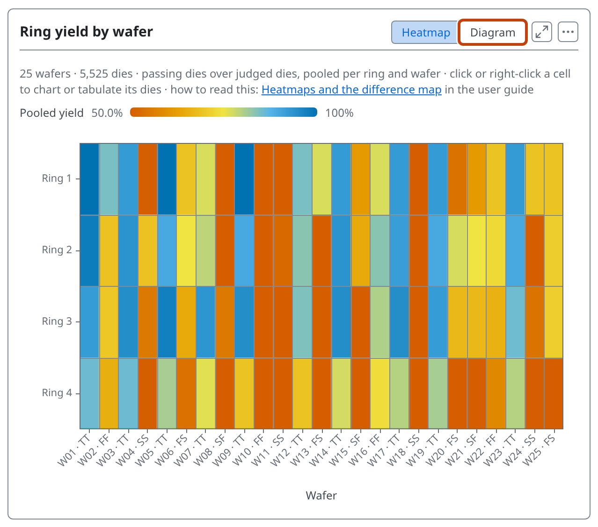

---

# Reading the ring grid

Look for the shape of the dark cells.

- A dark row across every column is a process pattern: that ring loses yield on every wafer
- A dark cell in one column is one wafer
- Click a cell for the dies in that ring on that wafer

---

<!-- _class: split -->
<!-- covers: Diagram; chart › Ring yield -->

# Ring yield as a diagram

**Diagram** draws the same rings as a wafer, pooled over every wafer, with each ring labelled with its yield. Use it to see the pattern across the wafer at a glance; use the heatmap to see which wafers it comes from. Click a region for its dies.

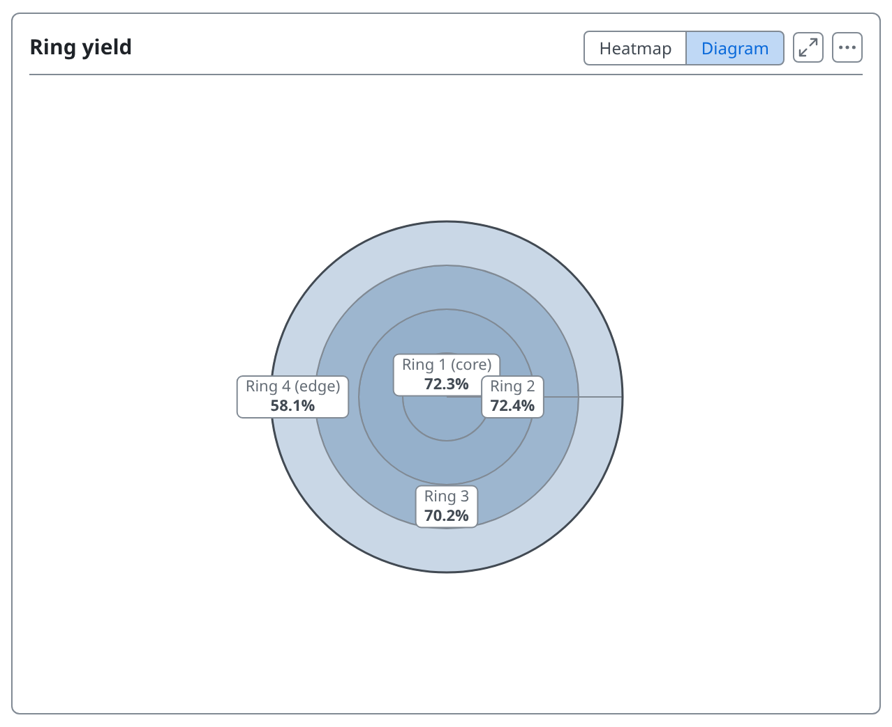

---

<!-- _class: split -->
<!-- covers: chart › Quadrant yield by wafer -->

# Quadrant yield by wafer

Quadrant yield by wafer is the same grid, for the four quadrants. A quadrant that is low on every wafer points at something one-sided in the process; one that is low on a single wafer points at that wafer.

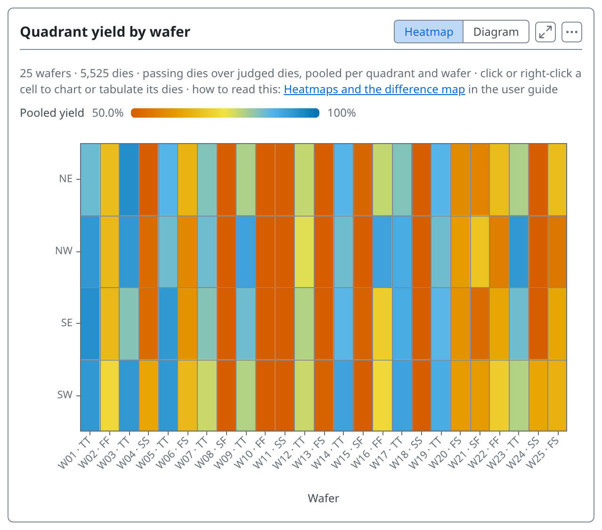

---

<!-- _class: split -->
<!-- covers: chart › Quadrant yield -->

# Quadrant yield as a diagram

With **Diagram** chosen, each quadrant is labelled with its yield, pooled over every wafer. A quadrant well below the rest shows a one-sided loss. Click a region for its dies.

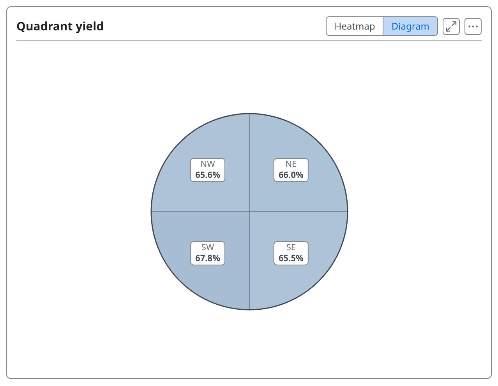

---

<!-- _class: split -->
<!-- covers: chart › Yield by site -->

# Yield by site

Many testers probe several dies at once, each through its own numbered **site**. When a lot's dies come from two or more sites, this card shows the yield of each site over every wafer, so you can tell a weak probe site from a weak wafer.

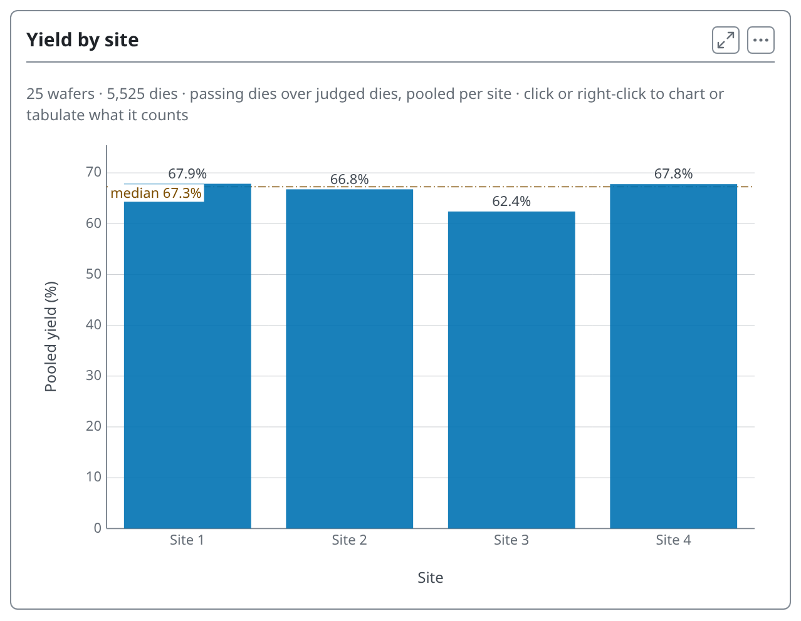

---

# Reading yield by site

- With three or more sites, the median is drawn as a line to compare each site against
- A site that is low on every wafer points at that site's probe card, not at the wafers

---

<!-- _class: divider -->

# Every chart's buttons

---

<!-- covers: Chart actions; Chart actions › Save as PNG; Chart actions › Save data as CSV; Chart actions › Copy data; Chart actions › Edit as plot; Chart actions › ✓About this chart; wmap guide › A chart's buttons -->

# The ⋯ menu

Every chart has the same ⋯ menu, so once you know it you know them all. **Save as PNG** saves the picture. **Save data as CSV** saves the numbers behind it, and **Copy data** puts them on the clipboard as tab-separated text to paste into a spreadsheet. **Edit as plot** opens the chart as a plot of your own (lesson 10), and **About this chart** adds a line saying what it shows.

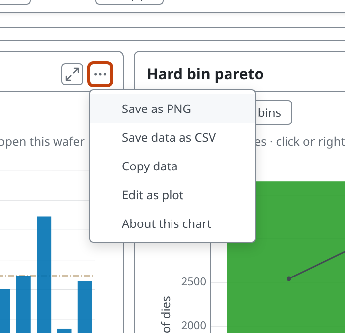

---

# About this chart

When you meet a chart you do not know, turn on **About this chart** in its ⋯ menu. A line then explains what the chart shows and how to read it.

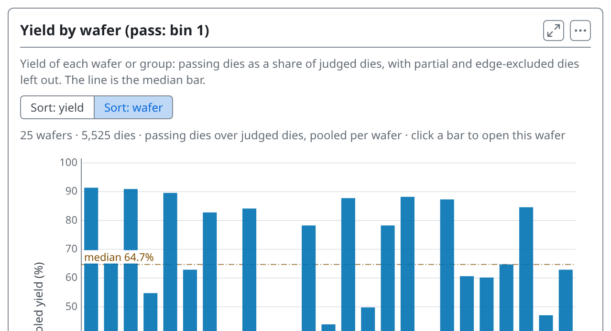

---

<!-- covers: Expand; wmap guide › Exporting a chart; wmap guide › Names of saved files -->

# Expand

The **Expand** button, to the left of the ⋯ button, opens a chart in its own large window. **Save as PNG** there gives a full-size image, headed with its settings and named for the lot and chart.

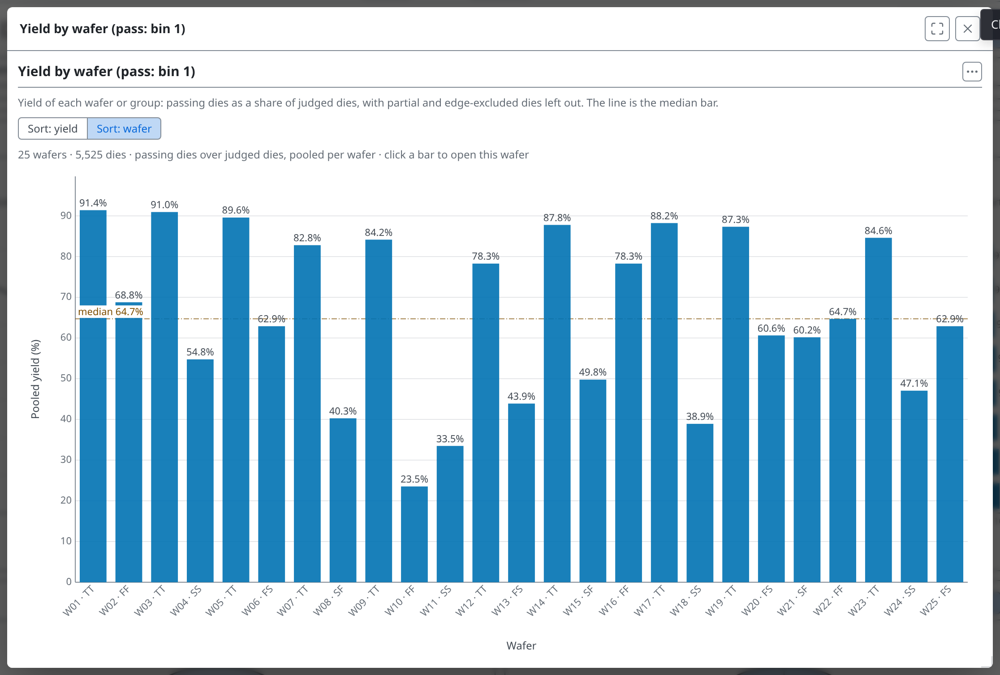

---

<!-- covers: wmap guide › What a click does -->

# Every mark opens something

Charts are not dead ends. Click a mark to go deeper.

- A wafer's bar, box or point opens that wafer's map
- A bin, a histogram bar or a ring opens the menu of charts and tables for those dies (lesson 08)
- A capability box or a correlation cell moves the other charts to that test

---

<!-- _class: divider -->

# Finding causes

---

<!-- covers: What divides yield; Show all N rows; * other measures; +* other measure* differ*; Group by; chart › What divides yield; wmap guide › What divides yield -->

# What divides yield

Yield differs between wafers. This card checks whether it differs along a line you know about: each wafer field, such as the split or the tester, is compared for yield and the top fail bins (four or more wafers). Each field is one row: two bars, the worst and the best group's mean yield, a sentence giving the gap in points, and a **Confidence** of **Clear**, **Possible** or **Not clear**. Clear means a low [**q**](https://wafertools.github.io/tsmap/learn/glossary/#q): the groups differ by more than noise, so it is where to look, not why. A button under a field opens its other measures. Fields that change together, such as the tester, node and probe card here, divide the wafers identically, so the card shows them as one row, since the wafers cannot tell them apart.

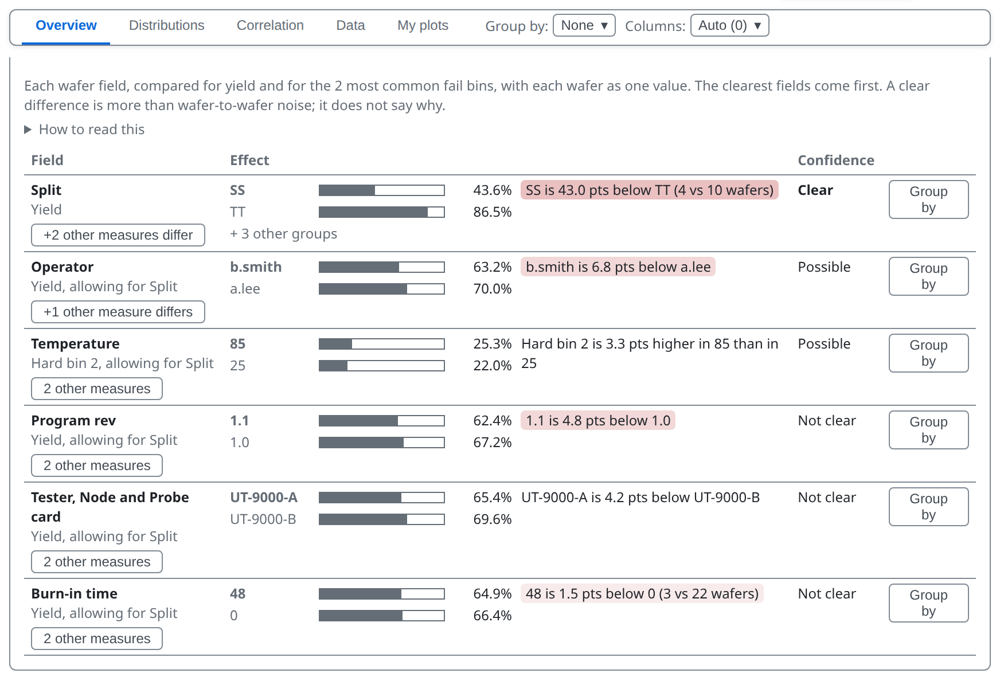

---

# Allowing for another field

Wafers differ in several fields at once, and a strong one can hide another. So each field is read after taking out the strongest other field. A row that says **allowing for Split** shows what is left once the split's effect is removed. Its bars and the gap in points are still the plain difference between the groups.

A field can also rank because it goes with a group that has an effect of its own. In this lot the operator follows the sessions, so its row shows what the sessions did, not what the operator did. Read a row as where to look, not as a cause.

---

<!-- covers: Part average testing (PAT); Show all 25 wafers; chart › Part average testing (PAT); glossary › Part average testing (PAT) -->

# Part average testing

Some dies pass every limit and still look wrong, because they sit far from the rest of their wafer. Part average testing (PAT) finds them. The card counts them per wafer; **Show all 25 wafers** lists every wafer.

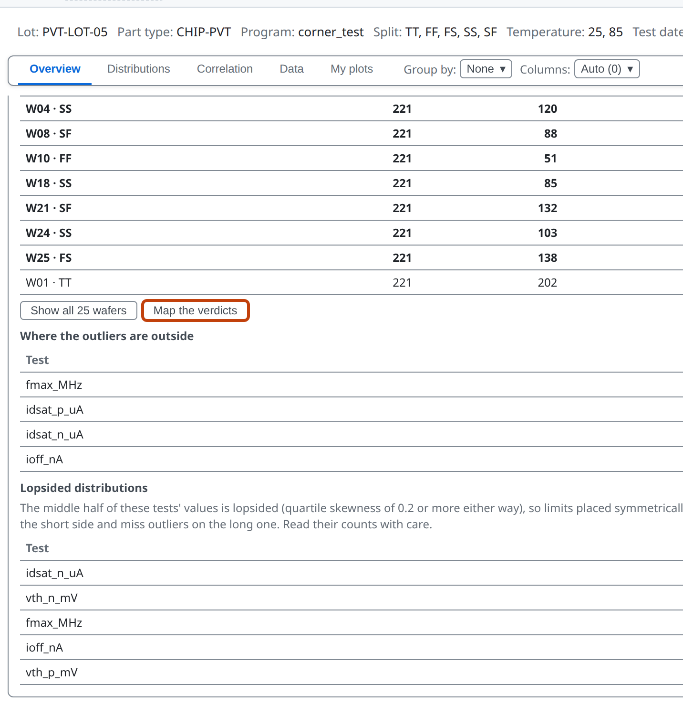

---

<!-- covers: Map the verdicts; Plot mode › PAT verdict; chart › PAT verdict map -->

# Map the verdicts

**Map the verdicts** returns to the maps coloured by PAT verdict: within the limits, outlier or fails its bin or limits. You can also choose **PAT verdict** in the **Plot mode** menu on the map toolbar.

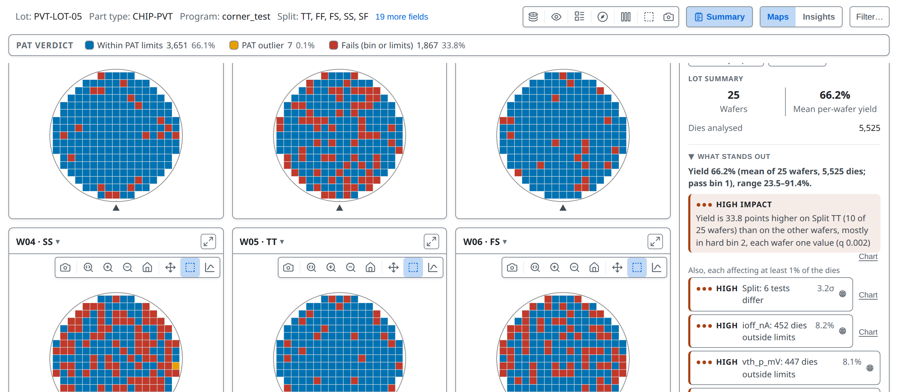

---

<!-- covers: wmap guide › Part average testing (PAT); glossary › Robust sigma -->

# How PAT limits are set

- Per wafer and test: the passing dies' median ± 6 [robust sigma](https://wafertools.github.io/tsmap/learn/glossary/#robust-sigma), never wider than the limits
- A wafer needs 30 passing values on a test
- It shows what PAT would flag; screening belongs in the test program

More in the [wafer map guide](https://wafertools.github.io/wafermap/user-guide/#1012-part-average-testing-pat)

---

<!-- covers: Group by › None; Group by › Split; Group by › Temperature (2); Group by › Operator (2); Group by › Tester (2); Group by › Node (2); Group by › Probe card (2); Group by › Burn-in time (2); Group by › Program rev (2); glossary › Group by; glossary › Wafer attribute; tsmap guide › Grouping data in the Insights tab -->

# Group by

Group by lets you compare groups of wafers instead of single wafers. When a wafer field varies across the lot, **Group by** offers it. **None** shows each wafer; a field such as **Split (5)** pools wafers into groups. The number is how many groups the field makes. One wafer has nothing to group, so it has no Group by.

---

<!-- _class: split -->

# Fields to group by

The sample lot was tested in five sessions, so the menu also offers **Temperature**, **Tester**, **Node**, **Probe card**, **Burn-in time**, **Program rev** and **Operator**.

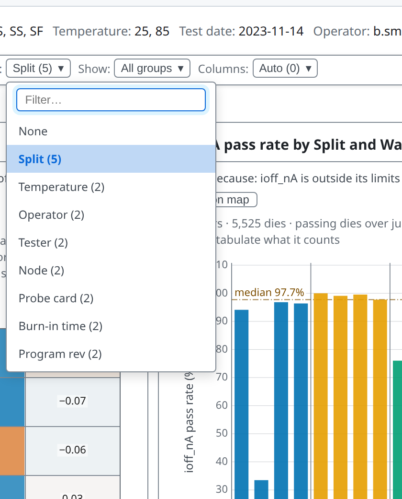

---

# Grouped by Split

Every card now reports per split instead of per wafer. SS is lowest at 43.6%, TT highest at 86.5%, so the process corners account for the differences in yield. Click a split's bar to see its wafers; **Back** returns.

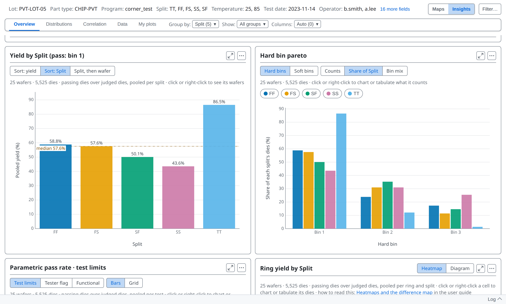

---

<!-- _class: split -->

# Wafers inside each split

With Group by on, **Yield by Split** also offers **Split, then wafer**. Every split's wafers sit inside it, so you see the spread between splits and the spread within each at once.

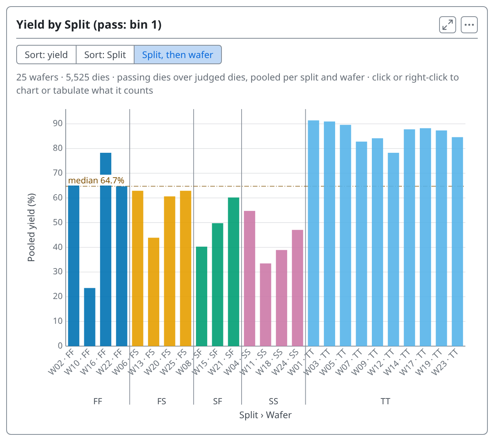

---

<!-- _class: split -->

# Bin mix

The bin pareto offers **Bin mix** when grouped: one bar per split, divided into its bins as a share of that split's dies. It shows what each split's loss is made of.

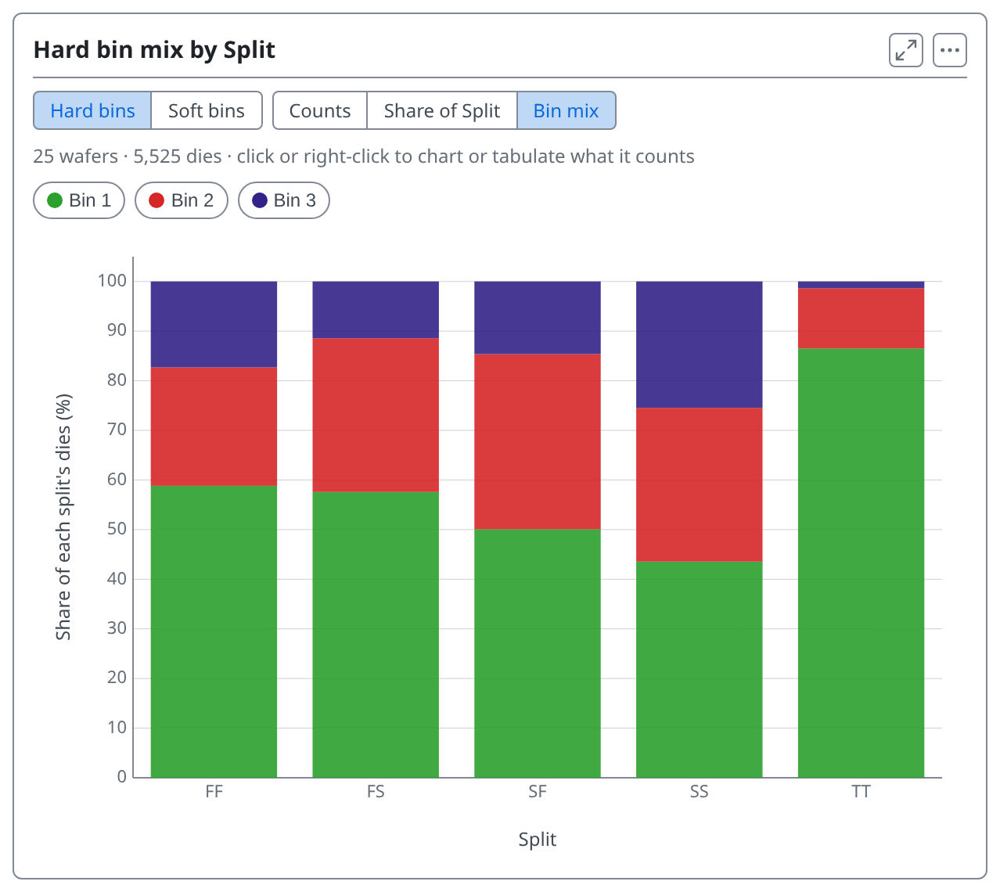

---

<!-- _class: split -->

# Pass rate as a grid

When grouped, **Pass rate by test** offers **Grid**: the worst 25 tests down the side and the splits across, each cell coloured by pass rate. A test that fails in one split stands out as one dark cell. With more than 25 tests the bar view also shows the worst 25; **All tests** shows the rest.

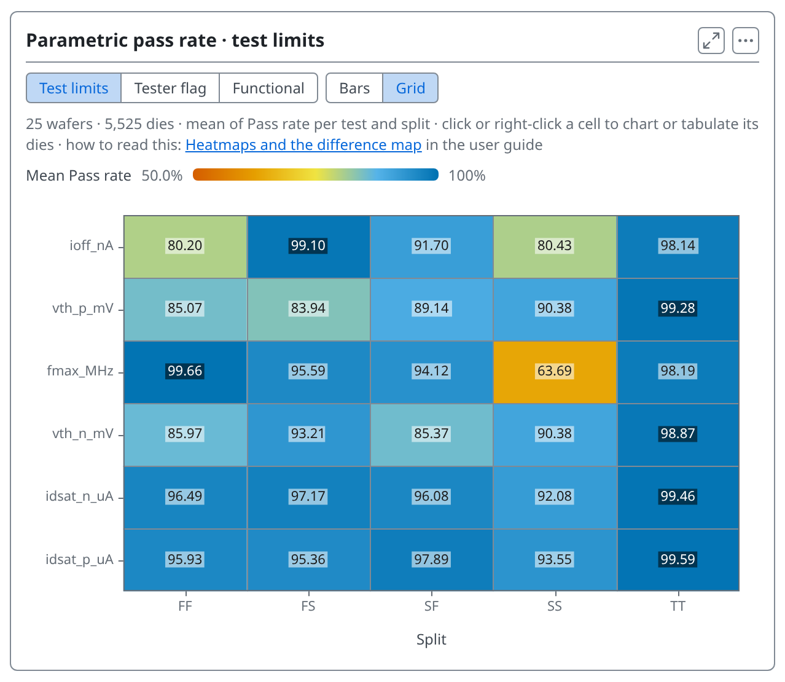

---

# Columns of cards

Beside **Group by** and **Show**, **Columns** sets how many columns of cards every section of Insights uses. **Auto** fits as many as the width holds; a number divides the width that many ways. The keys **1** to **5** do the same, and **0** returns to Auto, as in the gallery (lesson 02). The choice stays while you move between the tabs.

---

<!-- _class: lab -->

# Try it yourself

1. In the [web app](https://wafertools.github.io/tsmap/app/), **Load sample data**, then switch to **Insights**
2. **Sort: yield**, then open **Pass rate by test**: which test passes least often?
3. **Group by → Split**: which split has the lowest yield?

---

<!-- _class: answers -->

# Check your results

2. **`ioff_nA`** passes least often, at 91.8%. `vth_p_mV` is close behind at 91.9%.
3. **SS** has the lowest yield, at 43.6%. TT is highest, at 86.5%.

---

# Recap

- **Overview** shows where yield is lost: by wafer, by bin and by test
- Every chart has a **⋯** menu, and every mark opens something
- **What divides yield** and **Part average testing** point at causes; **Group by** compares groups

You now know where the yield is going. The next lesson looks at how test values behave, and at the tables behind every chart.

More in the [wafer map guide](https://wafertools.github.io/wafermap/user-guide/#8-insights-tab)

---

<!-- _class: next -->
<!-- _paginate: false -->

# Next lesson

[06 · Insights: distributions and data →](06-insights-distributions.md)

How values spread, how groups compare, and the tables behind every chart.
