<!-- _class: title -->
<!-- _paginate: false -->

# Insights

## Lesson 05

Learn tsmap

---

# In this lesson

- Find which wafers, bins and tests lose yield
- Compare groups of wafers, such as process splits
- Read distributions and export the numbers behind every chart

---

<!-- _class: divider -->

# Where yield is lost

---

<!-- covers: Insights; Overview; wmap guide › Insights tab -->

# From maps to charts

The **Maps | Insights** switch 1 swaps the wafer view for charts of the same dies. **Overview** 2 is the first tab; its tiles state the population.

---

# The Overview

Yield first, then bins, pass rates and regions, then what is worth a look. Scroll down: every card is a chart you can click.

---

<!-- _class: split -->
<!-- covers: Sort: yield; Sort: wafer; chart › Yield by wafer -->

# Yield by wafer

One bar per wafer, with the median as a line. **Sort: yield** 1 orders the bars from highest to lowest yield; click a bar to open that wafer.

---

<!-- _class: split -->

# Sorted by yield

Highest yield first, so the weakest wafers are at the right: W04 and W11, both SS.

---

<!-- _class: split -->
<!-- covers: Hard bins; Soft bins; chart › Bin pareto -->

# Bin pareto

A pareto chart: one bar per bin, largest first, with the running share of all dies as a line. **Hard bins** or **Soft bins** switches the bin type. Click a bar to chart or tabulate its dies.

---

<!-- _class: split -->

# Soft bins

Soft bins are the test program's own failure categories. They are numbered separately from hard bins, so the two charts can differ; in the sample lot they happen to match.

---

<!-- _class: split -->
<!-- covers: Test limits; Tester flag; Functional; chart › Pass rate by test -->

# Pass rate by test

The share of judged dies that pass each test, lowest first. The three buttons choose how a die is judged.

---

<!-- _class: split -->

# Tester flag

**Test limits** judges the measured value against the limits. **Tester flag** uses the pass or fail the tester recorded. When the two disagree the card says how many dies they judged differently. In the sample lot they agree, so no note appears.

---

<!-- _class: split -->

# Functional tests

**Functional** covers tests that only pass or fail, such as a scan chain.

---

<!-- covers: chart › Ring yield; chart › Quadrant yield -->

# Ring and quadrant yield

Two wafer diagrams, each region labelled with its yield. Ring 1 is the centre and the last ring the edge; quadrants show a one-sided loss. Click a region for its dies.

---

<!-- _class: split -->
<!-- covers: Show on map -->

# Worth a look

The same items as **What stands out** (lesson 03), each drawn as the chart that shows it. Each card starts with a line saying why it is shown. **Show on map** opens the map that shows that item.

---

<!-- _class: divider -->

# Every chart's buttons

---

<!-- covers: Chart actions; Chart actions › Save as PNG; Chart actions › Edit as plot; Chart actions › ✓About this chart; wmap guide › A chart's buttons -->

# The ⋯ menu

Every chart has a ⋯ menu. **Save as PNG** saves the chart, **Edit as plot** opens it as a plot of your own (lesson 08), and **About this chart** adds a line saying what it shows.

---

# About this chart

The line explains what the chart shows and how to read it. The **About this chart** entry turns it on or off.

---

<!-- covers: Expand; wmap guide › Exporting a chart; wmap guide › Names of saved files -->

# Expand

The **Expand** button, to the left of the ⋯ button, opens a chart in its own large window. **Save as PNG** there gives a full-size image, headed with its settings and named for the lot and chart.

---

<!-- covers: wmap guide › What a click does -->

# Every mark opens something

- A wafer's bar, box or point opens that wafer's map
- A bin, a histogram bar or a ring opens the menu of charts and tables for those dies (lesson 07)
- A capability box or a correlation cell moves the other charts to that test

---

<!-- _class: divider -->

# Finding causes

---

<!-- covers: What divides yield; Group by; chart › What divides yield; wmap guide › What divides yield -->

# What divides yield

Each wafer field, such as the split, compared for yield and the top fail bins (four or more wafers). A low **q** means the groups differ by more than noise: where to look, not why.

---

<!-- covers: Part average testing (PAT); Show all 13 wafers; chart › Part average testing (PAT); glossary › Part average testing (PAT) -->

# Part average testing

PAT finds dies that pass every limit but sit far from the rest of their wafer. The card counts them per wafer; **Show all 13 wafers** lists every wafer.

---

<!-- covers: Map the verdicts; Plot mode › PAT verdict; chart › PAT verdict map -->

# Map the verdicts

**Map the verdicts** returns to the maps coloured by PAT verdict: within the limits, outlier or fails its bin or limits. You can also choose **PAT verdict** in the **Plot mode** menu on the map toolbar.

---

<!-- covers: wmap guide › Part average testing (PAT); glossary › Robust sigma -->

# How PAT limits are set

- Per wafer and test: the passing dies' median ± 6 robust sigma, never wider than the limits
- A wafer needs 30 passing values on a test
- It shows what PAT would flag; screening belongs in the test program

More in the [wafer map guide](https://wafertools.github.io/wafermap/user-guide/#1012-part-average-testing-pat)

---

<!-- _class: split -->
<!-- covers: Group by › None; Group by › Split; glossary › Group by; glossary › Wafer attribute; tsmap guide › Grouping data in the Insights tab -->

# Group by

When a wafer field varies across the lot, **Group by** offers it. **None** shows each wafer; a field such as **Split (5)** pools wafers into groups. One wafer has nothing to group, so it has no Group by.

---

# Grouped by Split

One bar per split, and the pareto shows each split's share of each bin. SS is lowest at 54.1%, TT highest at 96.3%. Click a split's bar to see its wafers; **Back** returns.

---

<!-- _class: divider -->

# Distributions

---

<!-- covers: Distributions; Capability, Ppk and the goal plot; chart › Test value distribution; chart › Value histogram -->

# The Distributions tab

How values spread: process capability, a box plot per wafer, a histogram and the trend across wafers.

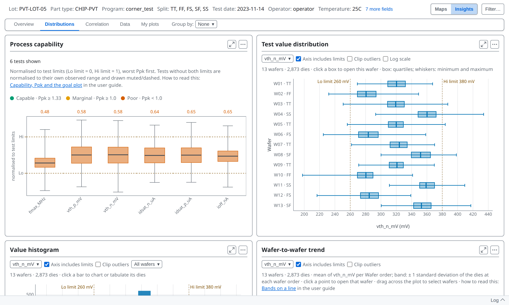

---

<!-- _class: split -->
<!-- covers: chart › Process capability; glossary › Process capability (Cp / Cpk / Pp / Ppk) -->

# Process capability

Each test is rescaled against its own limits: the low limit becomes 0 and the high limit becomes 1. That puts tests in different units on one scale.

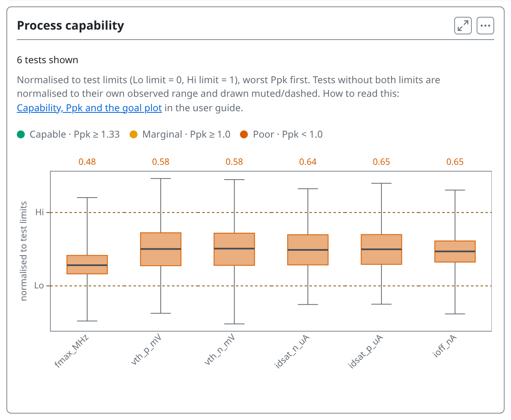

---

<!-- covers: wmap guide › Capability, Ppk and the goal plot -->

# Reading the colours

- A box centred between 0 and 1, whiskers inside, has room; one against 0 or 1 does not
- Lowest **Ppk** first: 1.33 or more is capable, under 1.0 poor
- Ppk is the gap from the mean to the nearest limit, in units of 3σ

---

# Tests with no limits

A test without both limits still appears, drawn muted and dashed on its own range, with no Ppk. Its place says how its values spread, not how near a limit they are.

---

<!-- _class: split -->
<!-- covers: Test; Test menu › (one per test) -->

# One test at a time

Each card has a **Test** menu, and changing it on one changes the box plot, the histogram and the trend together. Clicking a test in the capability chart does the same.

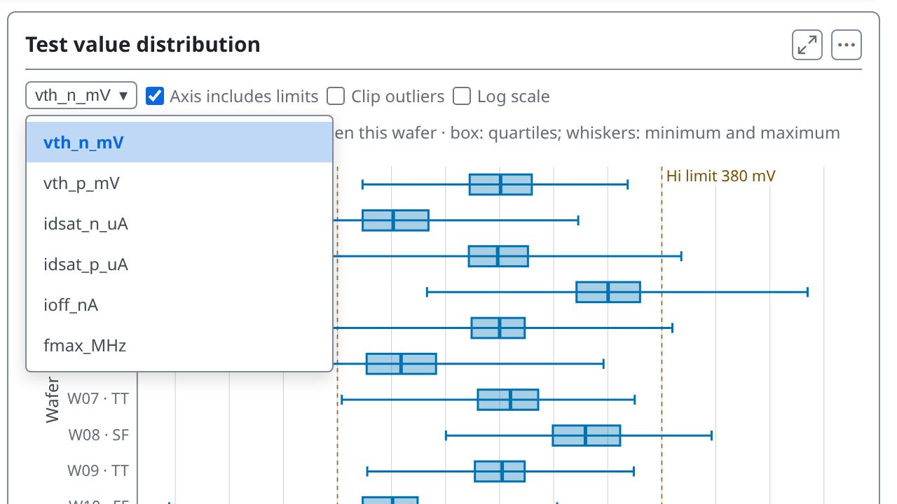

---

<!-- covers: Axis includes limits; Clip outliers; Log scale -->

# Axis controls

1 **Axis includes limits** widens the axis to the limits. 2 **Clip outliers** narrows it to the bulk of the data. 3 **Log scale**, on the box plot only, uses a log axis once every value is positive.

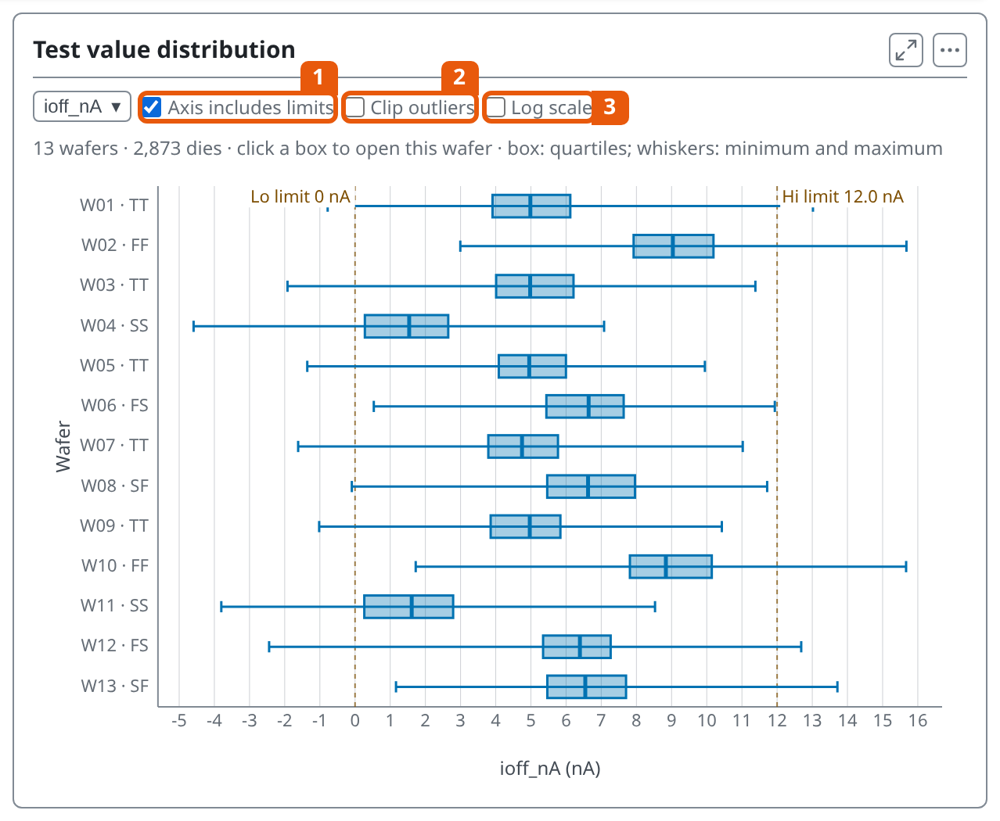

---

# Clipping changes only the axis

The chart states how many values fall outside the axis, and every statistic still includes them.

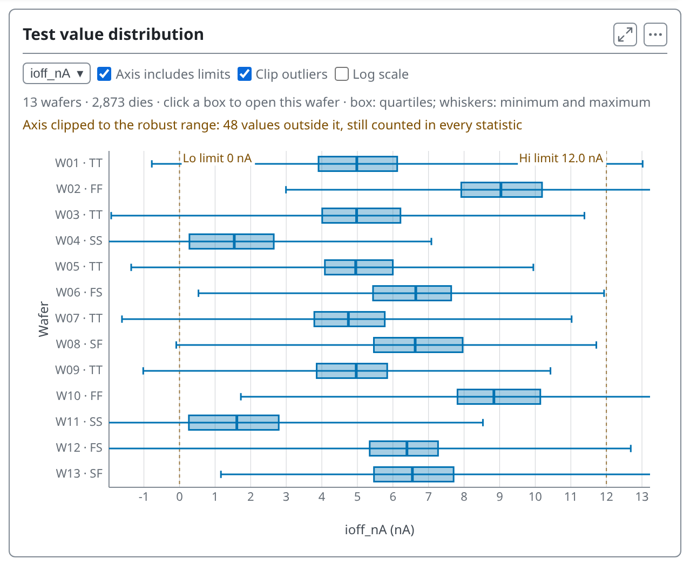

---

# Which limits are drawn

When a test has both kinds, a **Limits** choice appears on the box plot, histogram, trend and scatter: **Test + spec** (the default), **Test limits**, **Spec limits** or **None**. A limit off the edge of the axis is marked with an arrow.

---

<!-- _class: split -->
<!-- covers: Wafer; Wafer menu › (one per wafer) -->

# One wafer or all

The histogram has a **Wafer** menu: all wafers pooled, or one wafer. Type to filter the list.

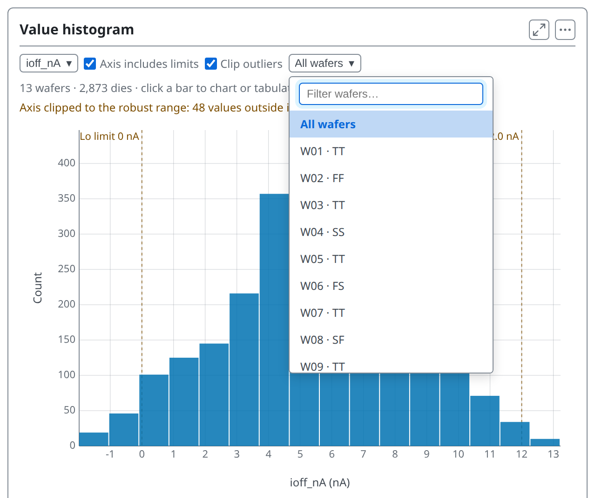

---

<!-- covers: Bands on a line; chart › Wafer-to-wafer trend; wmap guide › Bands on a line -->

# Wafer-to-wafer trend

Each wafer's mean in slot order, with a band of ±1 standard deviation. There is no sort: a drift only shows in sequence.

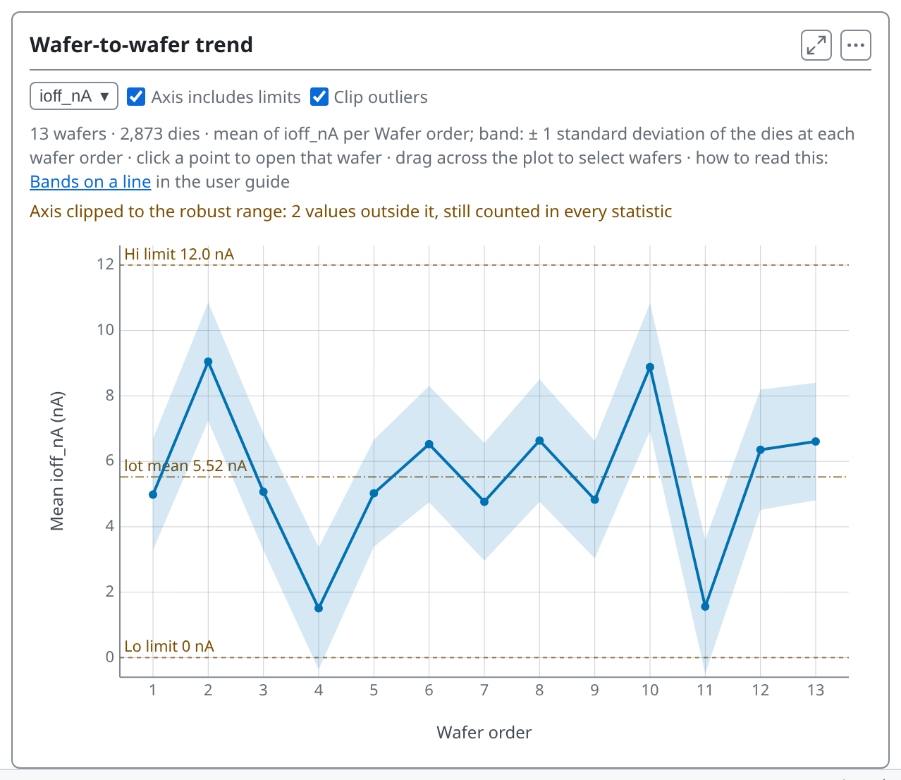

---

<!-- covers: wmap guide › Why wafers are counted, not dies; wmap guide › The statistics, explained -->

# Why each wafer counts once

Dies on one wafer went through the same processing, so they are not independent. Counted die by die, thousands of dies make a tiny difference between two wafers look certain. So a comparison of groups takes each wafer's mean as one value: n is wafers.

---

<!-- covers: Comparing groups of wafers; wmap guide › Comparing groups of wafers; chart › Comparison by group; glossary › Welch test, Kruskal–Wallis and q-value -->

# Comparing groups

- **Welch p**, **Rank p**: how likely a difference this large is by chance
- **q** corrects p for many tests: read q
- **Largest shift** is the size; **Control** compares each group with one

---

<!-- covers: chart › Difference map -->

# Where on the wafer

The difference map shows where on the wafer two groups differ, not whether the difference is significant.

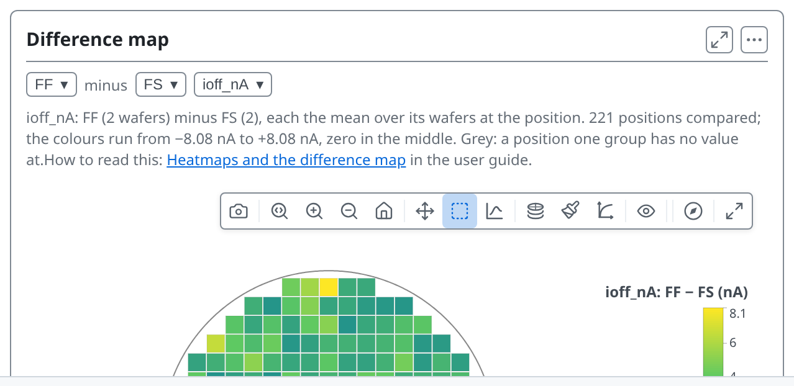

---

<!-- _class: divider -->

# The numbers behind it

---

<!-- covers: Data tab; wmap guide › Data tables; tsmap guide › Tables and exports -->

# The Data tab

**Data**, the tab after Correlation, holds every number behind the charts as tables. The foot of the Overview links to it too.

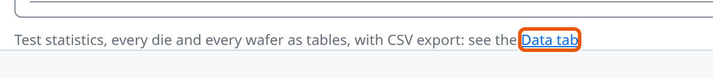

---

<!-- covers: Data; Statistics; Test values CSV; Functional CSV; chart › Statistics table -->

# Statistics

The **Data** tab holds the same numbers as tables, in three sub-tabs: Statistics, Wafers and Dies. Statistics has two tables, each with its own CSV button: 1 **Test values CSV** and 2 **Functional CSV**.

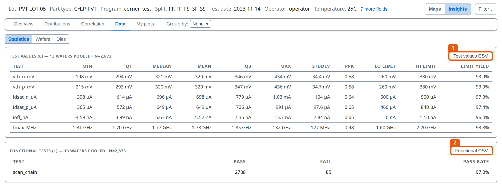

---

<!-- covers: Wafers; chart › Wafers table -->

# Wafers

One row per wafer: its lot fields, die counts, yield and the mean of each test.

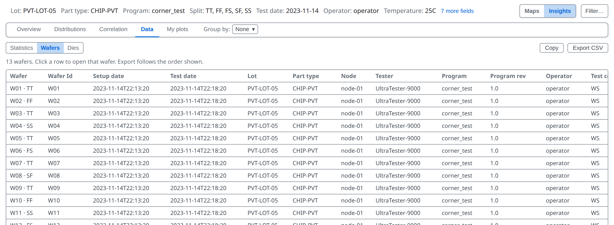

---

<!-- covers: Dies; chart › Dies table -->

# Dies

One row per die: position, ring, quadrant, site, bins, every test and the PAT verdict. **Copy** puts it on the clipboard and **Export CSV** saves a file; **Wide** has a column per test, **Long** a row per die and test.

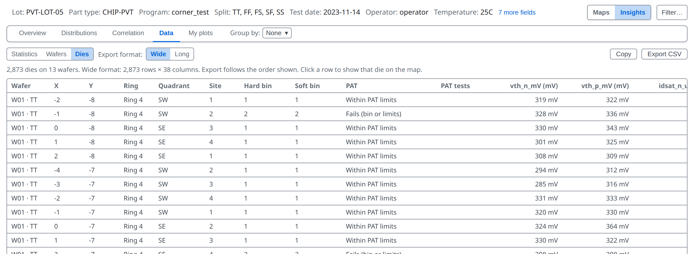

---

<!-- _class: lab -->

# Try it yourself

1. In the [web app](https://wafertools.github.io/tsmap/app/), **Load sample data**, then switch to **Insights**
2. **Sort: yield**: which two wafers are lowest, and what do they share?
3. **Group by → Split**: which split has the lowest yield?
4. On **Distributions**, pick **ioff_nA** and turn on **Clip outliers**
5. On **Data → Dies**, export the table

---

# Recap

- **Overview** shows where yield is lost; **Group by** compares groups
- **Distributions** shows how values spread and where tests sit against their limits
- **Data** holds every number as a table you can export

More in the [wafer map guide](https://wafertools.github.io/wafermap/user-guide/#8-insights-tab)

---

<!-- _class: next -->
<!-- _paginate: false -->

# Next lesson

[06 · Correlation →](06-correlation.md)

Which tests move together.
