<!-- _class: title -->
<!-- _paginate: false -->

# Insights: distributions and data

## Lesson 06

Learn tsmap

---

# In this lesson

- Read how values spread, and where tests sit against their limits
- Compare groups of wafers and see where on the wafer they differ
- Export the numbers behind every chart

---

<!-- _class: divider -->

# Distributions

---

<!-- covers: Distributions; Capability, Ppk and the goal plot; chart › Test value distribution; chart › Value histogram -->

# The Distributions tab

How values spread: process capability, a box plot per wafer, a histogram and the trend across wafers.

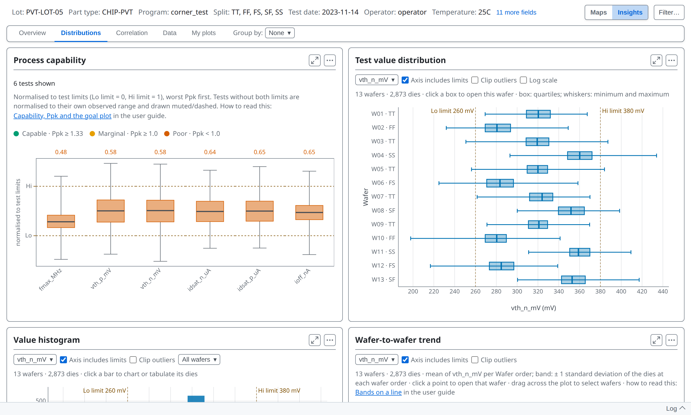

---

<!-- _class: split -->
<!-- covers: chart › Process capability; glossary › Process capability (Cp / Cpk / Pp / Ppk) -->

# Process capability

Each test is rescaled against its own limits: the low limit becomes 0 and the high limit becomes 1. That puts tests in different units on one scale.

---

<!-- covers: wmap guide › Capability, Ppk and the goal plot -->

# Reading the colours

- A box centred between 0 and 1, whiskers inside, has room; one against 0 or 1 does not
- Lowest [**Ppk**](https://wafertools.github.io/tsmap/learn/glossary/#ppk) first: 1.33 or more is capable, under 1.0 poor
- Ppk is the gap from the mean to the nearest limit, in units of 3σ

---

<!-- _class: split -->

# Tests with no limits

A test without both limits still appears, drawn muted and dashed on its own range, with no Ppk. Its place says how its values spread, not how near a limit they are.

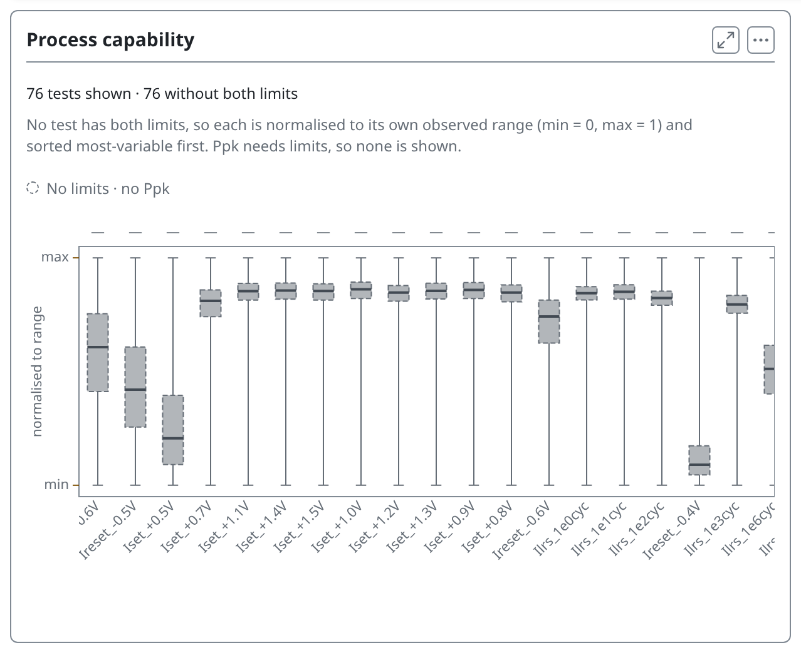

---

<!-- _class: split -->
<!-- covers: Test; Test menu › (one per test) -->

# One test at a time

Each card has a **Test** menu, and changing it on one changes the box plot, the histogram and the trend together. Clicking a test in the capability chart does the same.

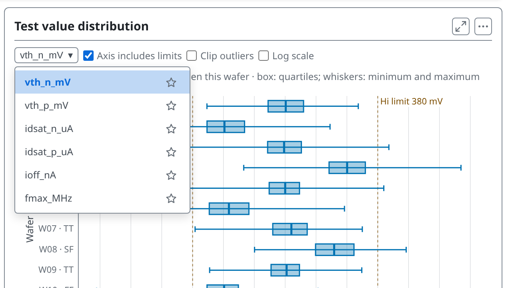

---

<!-- covers: Axis includes limits; Clip outliers; Log scale -->

# Axis controls

1 **Axis includes limits** widens the axis to the limits. 2 **Clip outliers** narrows it to the bulk of the data. 3 **Log scale**, on the box plot only, uses a log axis once every value is positive.

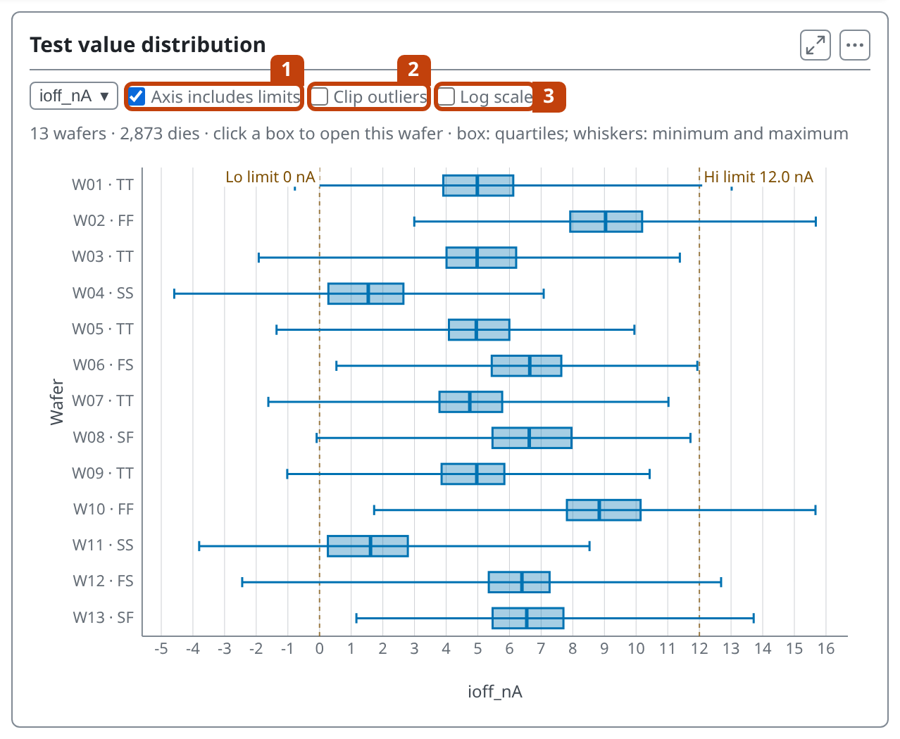

---

# Clipping changes only the axis

The chart states how many values fall outside the axis, and every statistic still includes them.

---

<!-- _class: split -->

# Which limits are drawn

When a test has both kinds, a **Limits** choice appears on the box plot, histogram, trend and scatter: **Test + spec** (the default), **Test limits**, **Spec limits** or **None**. A limit off the edge of the axis is marked with an arrow.

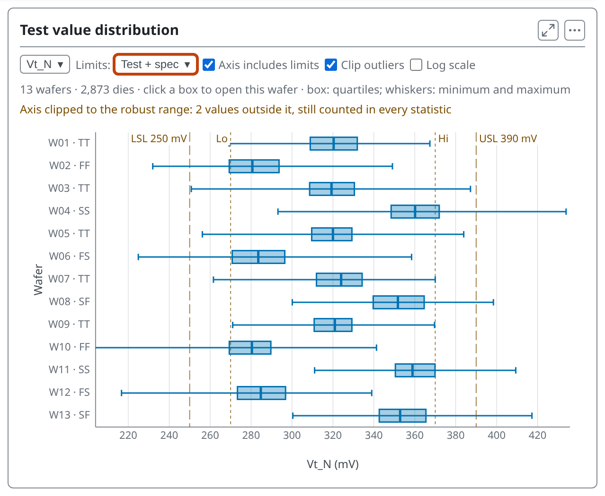

---

<!-- _class: split -->
<!-- covers: Wafer; Wafer menu › (one per wafer) -->

# One wafer or all

The histogram has a **Wafer** menu: all wafers pooled, or one wafer. Type to filter the list.

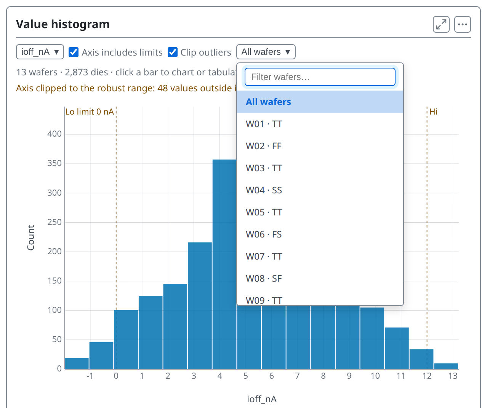

---

<!-- covers: Bands on a line; chart › Wafer-to-wafer trend; wmap guide › Bands on a line -->

# Wafer-to-wafer trend

Each wafer's mean in slot order, with a band of ±1 standard deviation. There is no sort: a drift only shows in sequence.

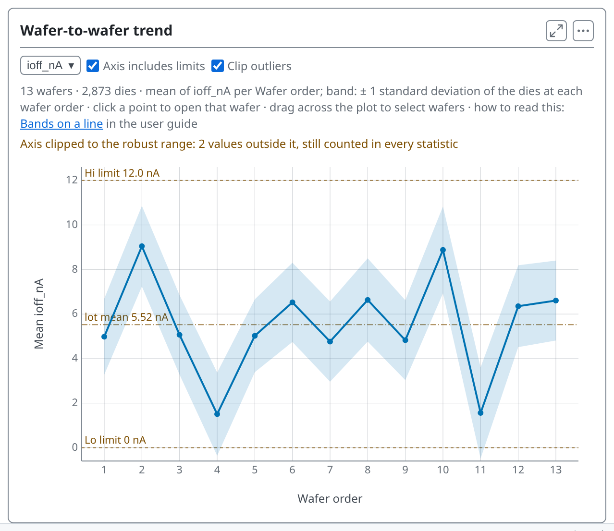

---

<!-- covers: wmap guide › Why wafers are counted, not dies; wmap guide › The statistics, explained -->

# Why each wafer counts once

- Dies on one wafer went through the same processing, so they are not independent
- Counted die by die, thousands of dies make a tiny difference between two wafers look certain
- So a comparison of groups takes each wafer's mean as one value: n is wafers

---

<!-- covers: Comparing groups of wafers; wmap guide › Comparing groups of wafers; chart › Comparison by group; glossary › Welch test, Kruskal–Wallis and q-value -->

# Comparing groups

- [**Welch p**](https://wafertools.github.io/tsmap/learn/glossary/#welch-p), [**Rank p**](https://wafertools.github.io/tsmap/learn/glossary/#rank-p): how likely a difference this large is by chance
- [**q**](https://wafertools.github.io/tsmap/learn/glossary/#q) corrects p for many tests: read q
- **Largest shift** is the size; **Control** compares each group with one

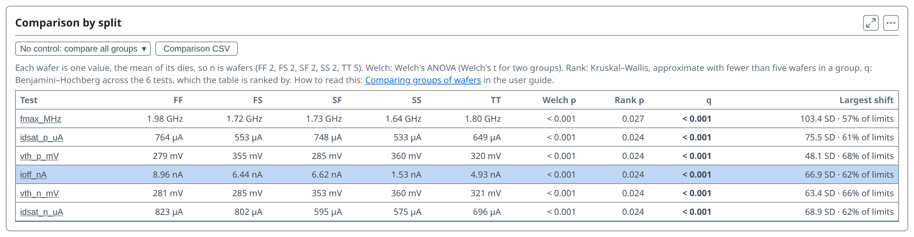

---

<!-- covers: chart › Difference map -->

# Where on the wafer

The difference map shows where on the wafer two groups differ, not whether the difference is significant.

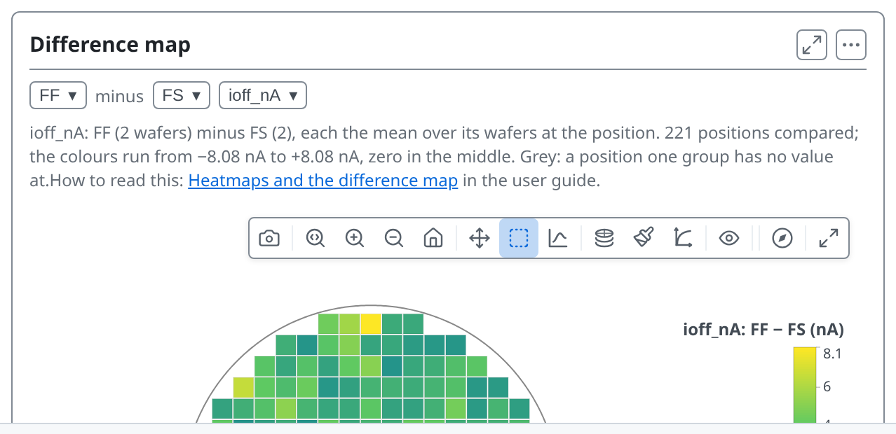

---

<!-- _class: divider -->

# The numbers behind it

---

<!-- covers: Data tab; wmap guide › Data tables; tsmap guide › Tables and exports -->

# The Data tab

**Data**, the tab after Correlation, holds every number behind the charts as tables. The foot of the Overview links to it too.

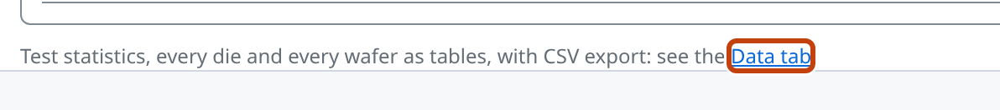

---

<!-- covers: Data; Statistics; Test values CSV; Functional CSV; chart › Statistics table -->

# Statistics

The **Data** tab holds the same numbers as tables, in three sub-tabs: Statistics, Wafers and Dies. Statistics has two tables, each with its own CSV button: 1 **Test values CSV** and 2 **Functional CSV**.

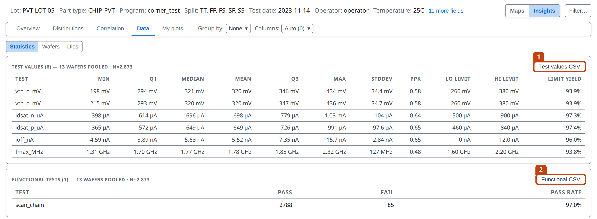

---

<!-- covers: Wafers; chart › Wafers table -->

# Wafers

One row per wafer: its lot fields, die counts, yield and the mean of each test.

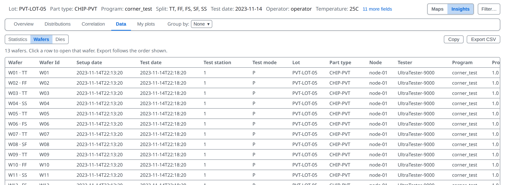

---

<!-- covers: Dies; chart › Dies table -->

# Dies

One row per die: position, ring, quadrant, site, bins, every test and the PAT verdict. **Copy** puts it on the clipboard and **Export CSV** saves a file; **Wide** has a column per test, **Long** a row per die and test.

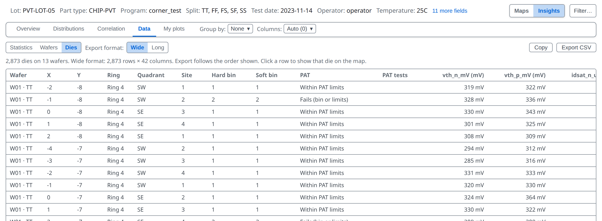

---

<!-- _class: lab -->

# Try it yourself

1. In the [web app](https://wafertools.github.io/tsmap/app/), **Load sample data**, then switch to **Insights**
2. On **Distributions**, pick **ioff_nA** and turn on **Clip outliers**
3. On **Data → Dies**, export the table

---

# Recap

- **Distributions** shows how values spread and where tests sit against their limits
- With **Group by** on, the same tab compares groups of wafers
- **Data** holds every number as a table you can export

More in the [wafer map guide](https://wafertools.github.io/wafermap/user-guide/#8-insights-tab)

---

<!-- _class: next -->
<!-- _paginate: false -->

# Next lesson

[07 · Correlation →](07-correlation.md)

Which tests move together.
