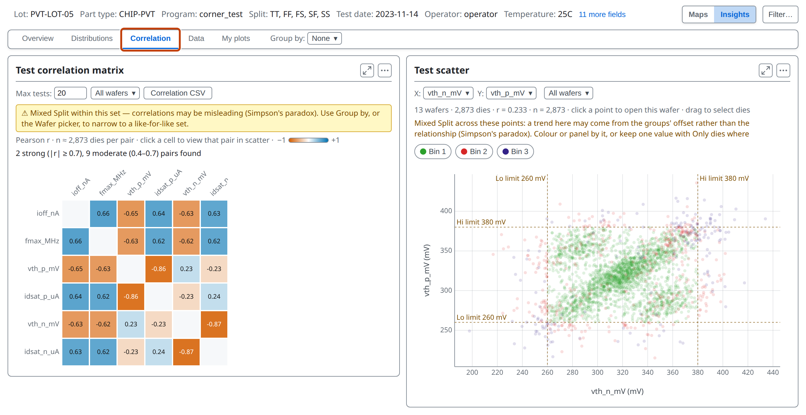
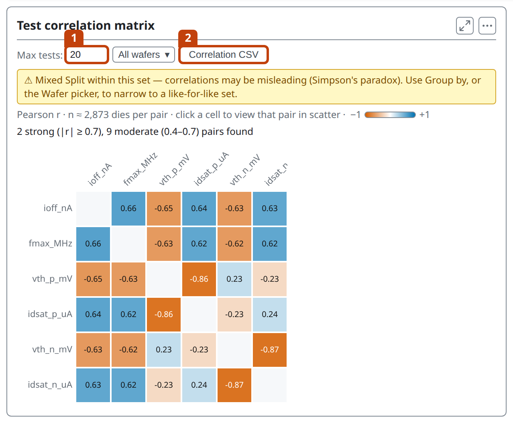
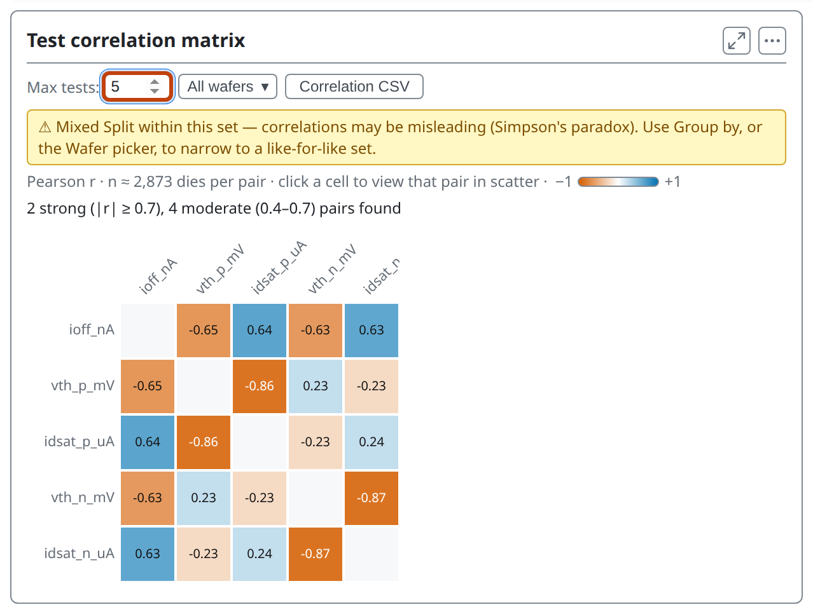
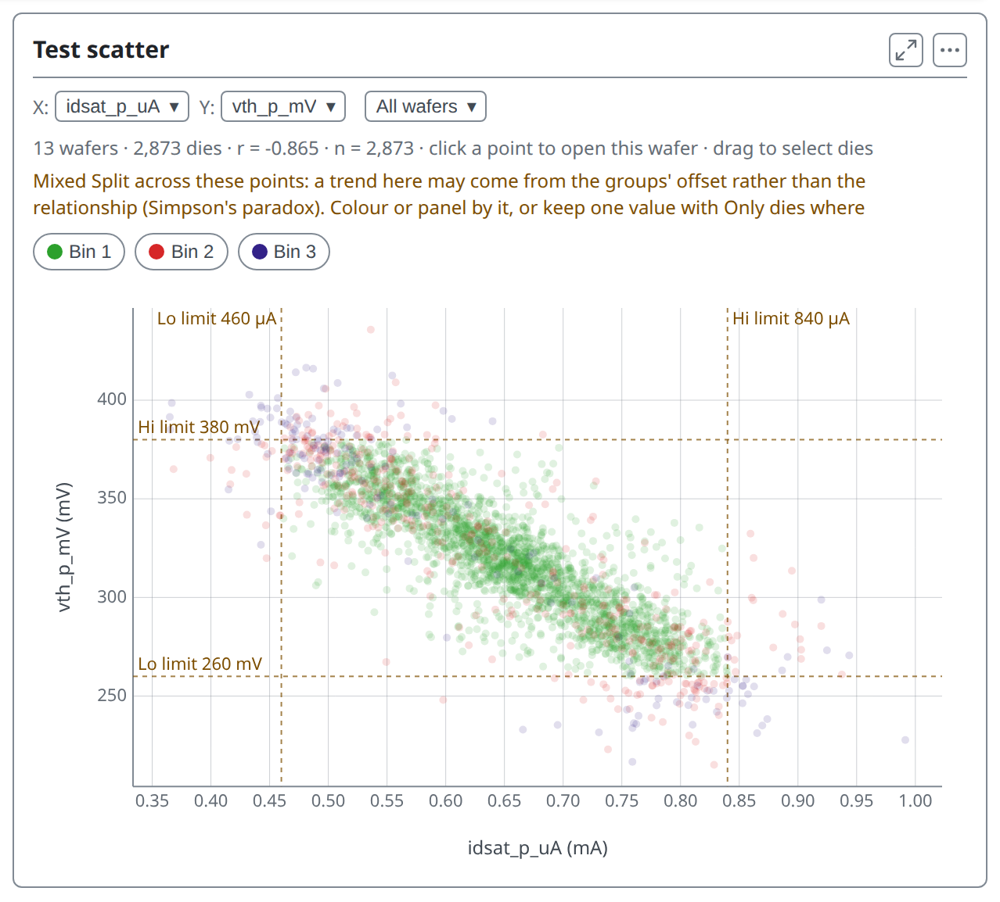
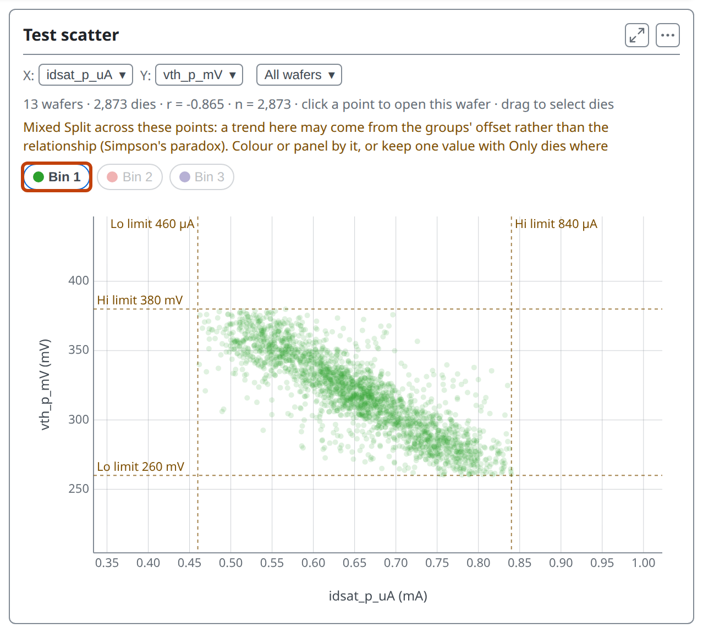
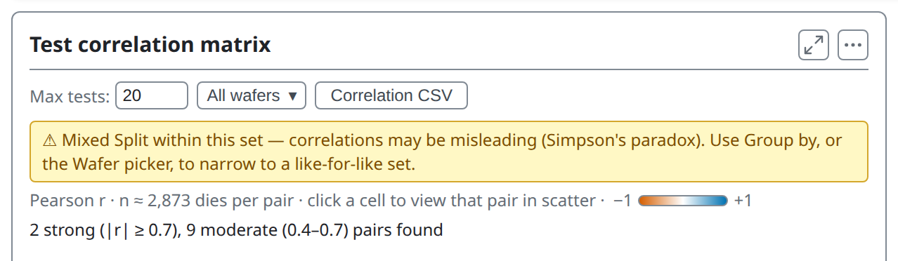
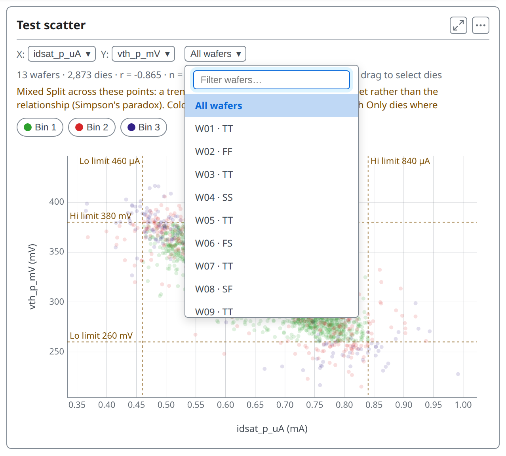
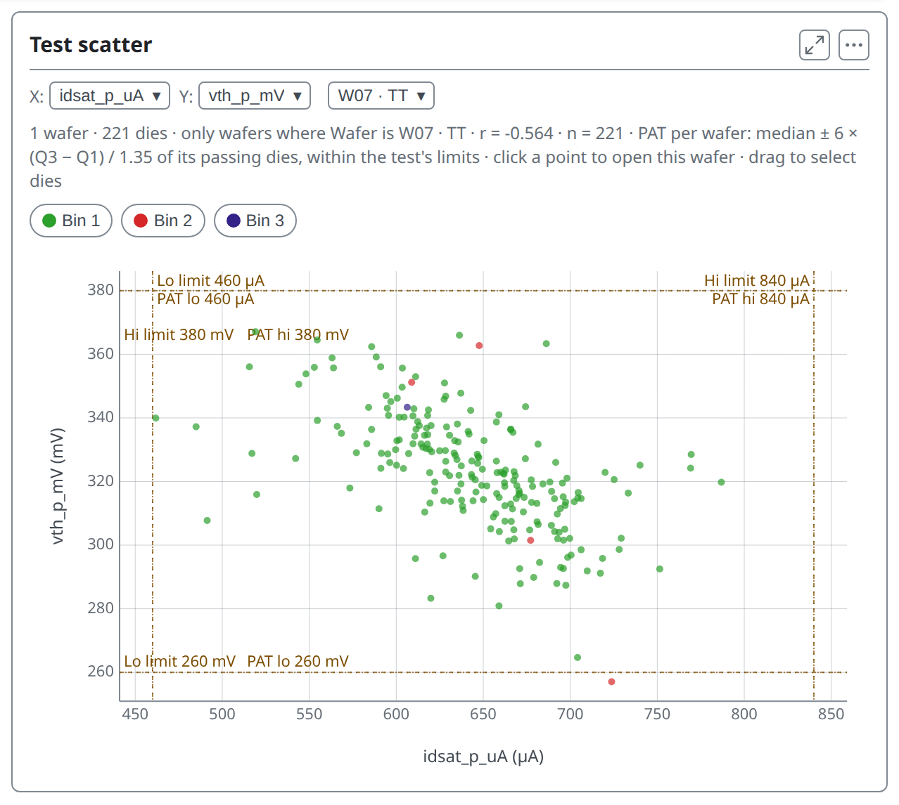
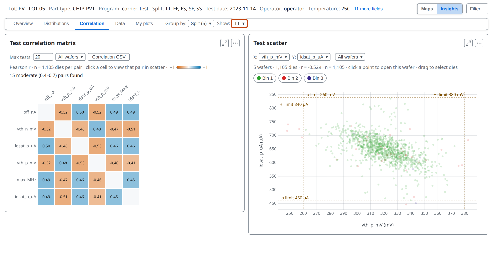
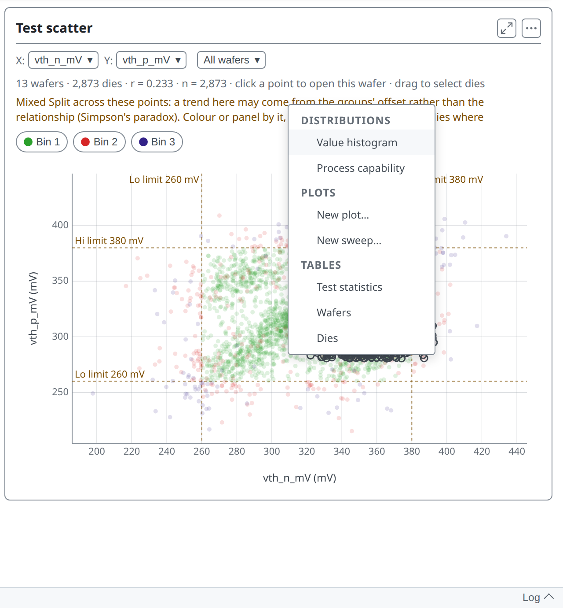

<!-- _class: title -->
<!-- _paginate: false -->

# Correlation

## Lesson 07

Learn tsmap

---

# In this lesson

- Read the correlation matrix and open a pair as a scatter
- Check a relationship wafer by wafer and group by group
- Chart just the dies you drag a box around

---

<!-- _class: divider -->

# The matrix and the scatter

---

<!-- covers: Correlation -->

# The Correlation tab

A matrix of the correlation between pairs of tests on the left, and a scatter of one pair on the right, a point per die.

---

<!-- _class: split -->
<!-- covers: Max tests:; Correlation CSV; chart › Test correlation matrix -->

# The matrix

Each cell is r for two tests. Blue: they rise together; orange: one falls as the other rises. Stronger colour, stronger link. 1 sets how many tests; 2 saves a table.

---

# Fewer tests

You can set **Max tests** between 5 and 100 (default 20). The card counts pairs with |r| of 0.7 or more as strong and 0.4 to 0.7 as moderate. With five tests it finds 2 strong and 4 moderate.

---

<!-- _class: split -->

<!-- covers: chart › Test scatter -->

# Open a pair

Click a cell and the scatter shows that pair, with **r** and **n**, the number of dies, above it. Here `idsat_p_uA` falls as `vth_p_mV` rises, r = −0.865. Click a point to open its wafer's map.

---

<!-- _class: divider -->

# Is it real?

---

<!-- covers: Correlation bin chip -->

# Bin buttons

The **Bin 1**, **Bin 2** and **Bin 3** buttons above the plot show or hide the dies of each bin. Click one to switch it off or on, so you can see whether failing dies sit at one end of the relationship.

---

<!-- _class: split -->

# The Mixed Split warning

Pooling splits can make a trend that is only the groups sitting at different levels, not a link inside each group (Simpson's paradox). The card warns when the dies mix a field.

---

<!-- covers: Wafer; Test -->

# One wafer at a time

The **Wafer** menu narrows the scatter to one wafer. The **X** and **Y** menus pick the tests, as the matrix cells do.

---

# Inside one wafer

On W07 alone, r is −0.564, not −0.865. Part of the pooled figure may come from the splits sitting at different levels. The warning is gone because only one wafer is left.

---

<!-- covers: Group by › Split -->

# Group by

**Group by → Split**, then **Show → TT**: the matrix and scatter use only TT's dies. `idsat_p_uA` against `vth_p_mV` reads r = −0.529 inside TT, not −0.865 pooled.

---

<!-- _class: divider -->

# Dies from the scatter

---

# Drag a box

Drag a rectangle over the scatter: the dies inside it, on any wafer, open the menu of charts and tables for just those dies.

*(The same menu is the subject of lesson 08.)*

---

<!-- _class: lab -->

# Try it yourself

1. In the [web app](https://wafertools.github.io/tsmap/app/), **Load sample data**, then **Insights → Correlation**
2. Click the cell for **idsat_p_uA** and **vth_p_mV**: what is r?
3. Pick **W07 · TT** in the **Wafer** menu: how does r change?
4. **Group by → Split**, then **Show → TT**, and pick the same two tests again in **X** and **Y**: does it still hold?
5. Drag a box over the scatter: how many dies does the menu say you have selected?

---

<!-- _class: answers -->

# Check your results

2. **`idsat_p_uA`** against **`vth_p_mV`** reads r = −0.865: when one rises the other falls. (`vth_n_mV` against `idsat_n_uA` is a little stronger, at −0.870.)
3. On W07 · TT alone r is **−0.564**, weaker than the pooled −0.865. The warning has gone, because one wafer is not a mix of splits.
4. Inside TT, r is **−0.529**: still clearly negative, but weaker than pooled. Some of the pooled figure came from the splits sitting at different levels.
5. The menu names how many dies you selected; it depends on the box you drag.

---

# Recap

- The matrix shows every pair; a cell opens that pair as a scatter
- r says two tests move together, not why
- Check it wafer by wafer and group by group before trusting a pooled figure

More in the [wafer map guide](https://wafertools.github.io/wafermap/user-guide/#8-insights-tab)

---

<!-- _class: next -->
<!-- _paginate: false -->

# Next lesson

[08 · Drilling into any population →](08-drilling-down.md)

Filter, select and chart just the dies you care about.
