<!-- _class: title -->
<!-- _paginate: false -->

# Drilling into any population

## Lesson 08

Learn tsmap

---

# In this lesson

- Keep only the wafers and dies that meet your conditions
- Chart and tabulate any selection, bin or wafer
- Know what each entry of the right-click menu opens

---

<!-- _class: divider -->

# Filtering

---

<!-- covers: Filter…; wmap guide › Filtering wafers and dies; glossary › Filter -->

# Filter…

The button at the right of the toolbar, beside Maps and Insights. It keeps only the wafers and dies that meet conditions you set, in the gallery, on a single map and on every Insights tab.

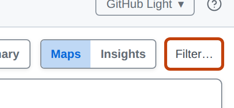

---

<!-- _class: split -->

# The Filter window

Add conditions; every one must hold. At the bottom of the window, **Apply** filters and **Cancel** leaves things as they were.

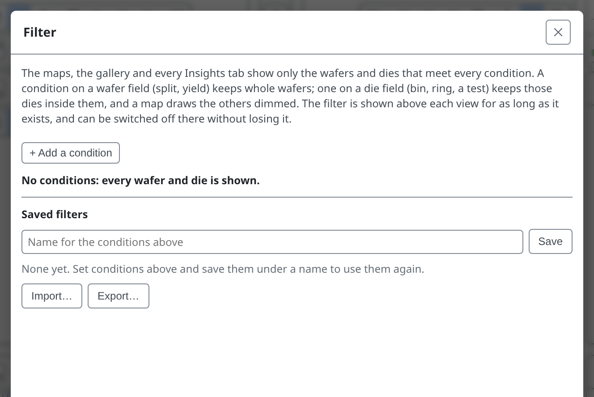

---

<!-- _class: split -->

# Choose a field

A condition starts with a field: a test, a die field such as bin, ring or site, or a wafer field such as split, lot or yield. Type to search the list.

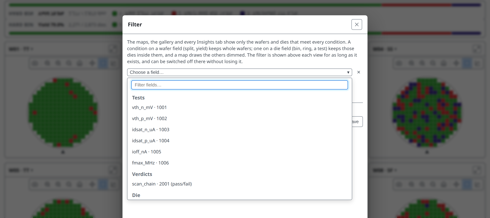

---

<!-- _class: split -->

# Category and number fields

A category field, such as the split, lists its values to tick; **is not** keeps everything except the ticked values. A number field, such as a test or a wafer's yield, keeps a range.

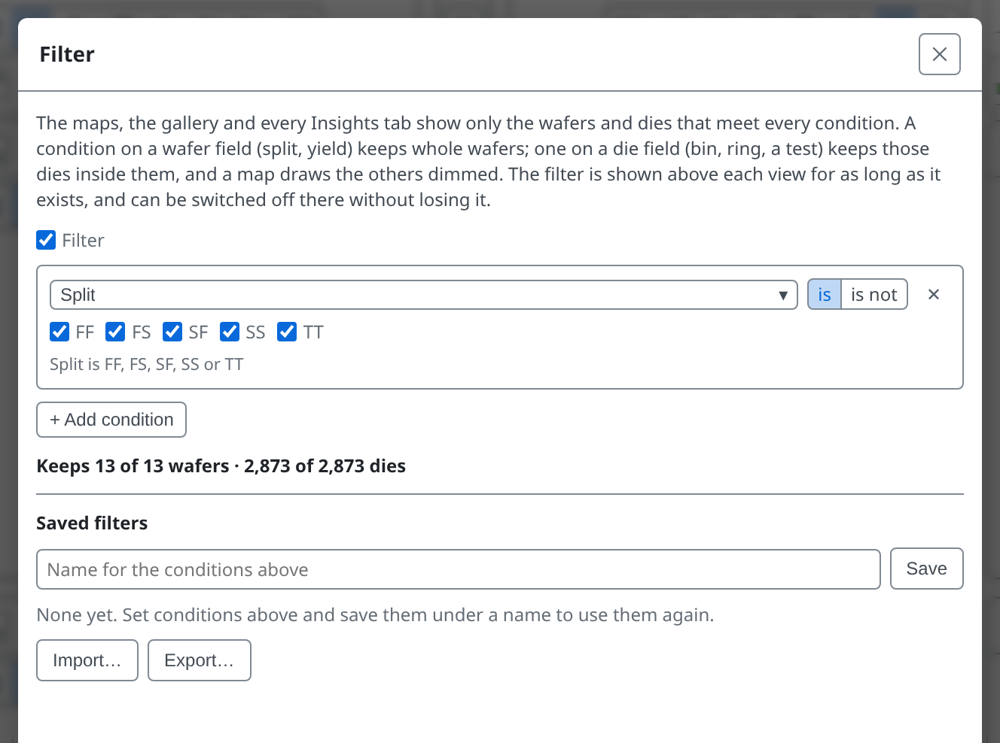

---

<!-- _class: split -->

# What it would keep

Untick every split except SS. As you edit, the window shows how many wafers and dies the conditions would keep.

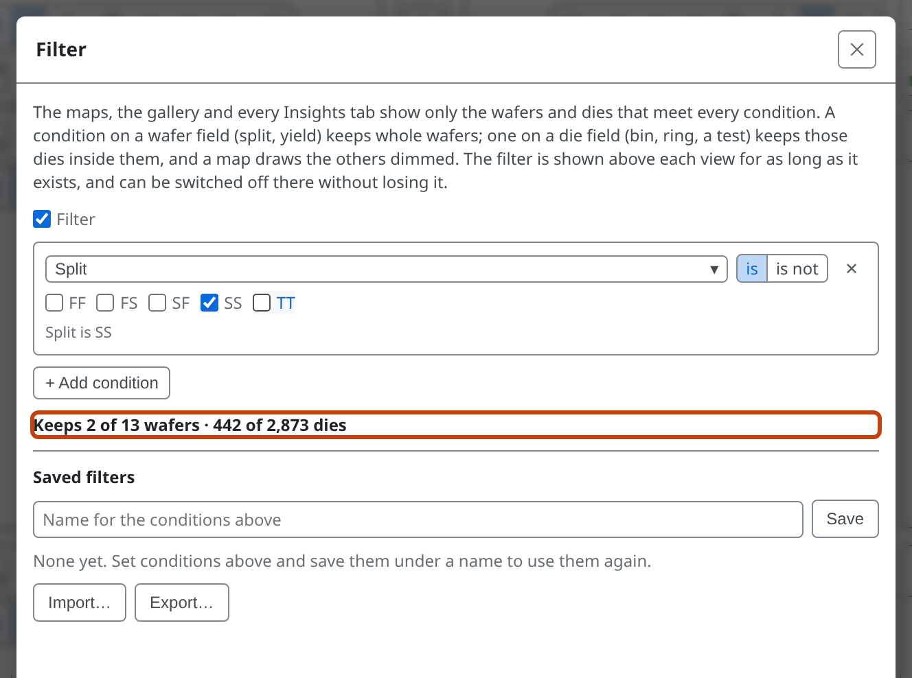

---

# Wafer or die

- A **wafer** condition keeps whole wafers; the rest leave the gallery
- A **die** condition keeps matching dies; the rest are drawn faded
- The Summary panel and findings are worked out again over what is kept

---

<!-- _class: split -->
<!-- covers: wmap guide › Saved filters -->

# Saved filters

- **Save** keeps the conditions under a name
- **Load** puts them in the window to check; **Apply** uses them
- **Export…** writes the list to a file; **Import…** reads one back in

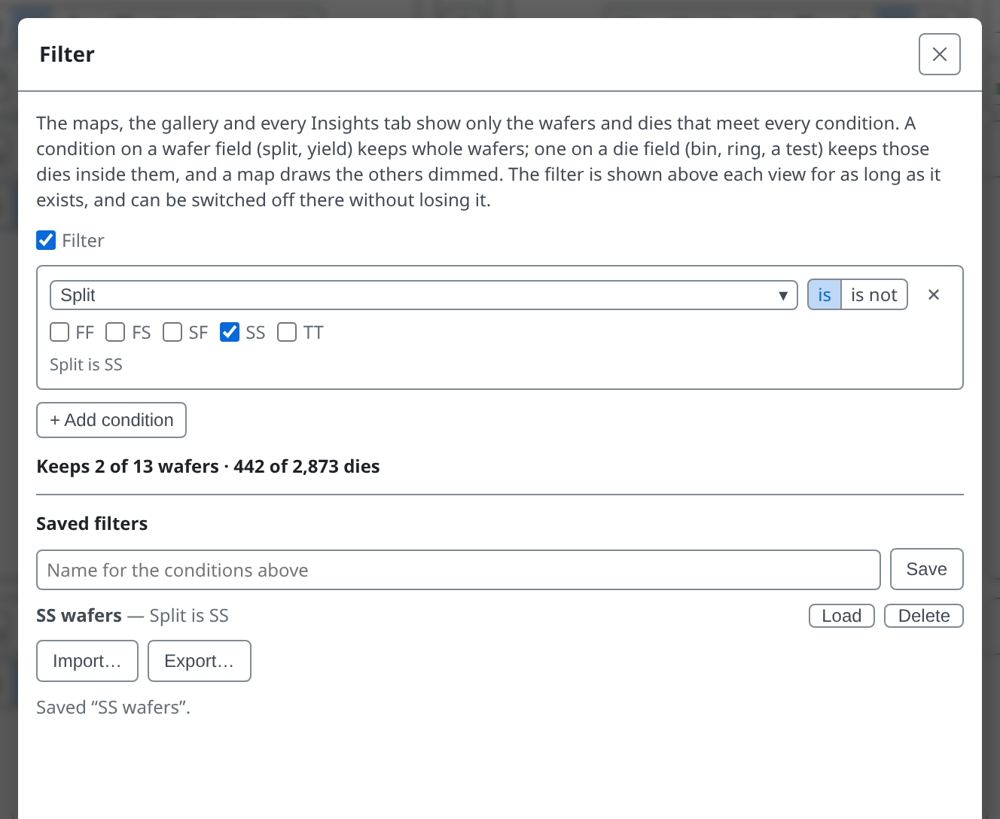

---

# Applied

Two cards remain, and the legend and yield describe only those wafers.

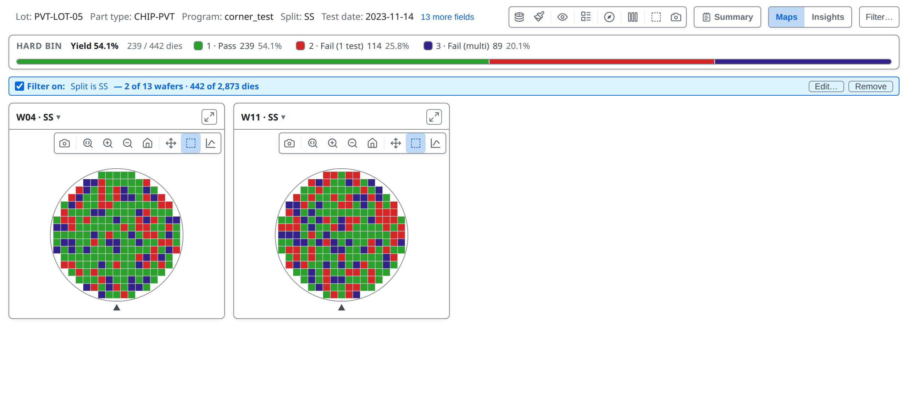

---

# The filter line

A line above the view always states the filter and what it keeps. Its checkbox switches the filter off and on without losing it. 1 **Edit…** reopens the window; 2 **Remove** deletes the filter.

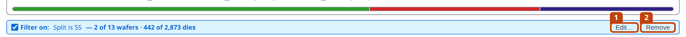

---

# Insights follows

It is one filter for everything you are looking at, so Insights shows the same two wafers, and its charts and the **Group by** control work on what is kept.

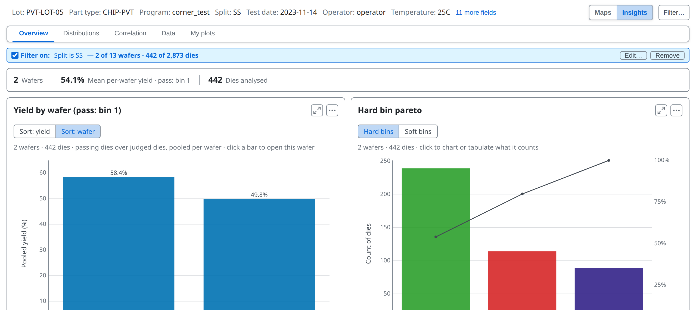

---

# The filter stays

tsmap remembers the filter, and whether it is on, for the next lot and the next start. The line above the view always states it, so a carried-over filter is never applied unseen. **Remove** forgets it.

---

<!-- _class: divider -->

# Charting a population

---

# Select dies

Drag a box on a map: the selected dies keep their colour and the rest fade, with an outline round them. Ctrl or Cmd + click adds or removes a die; **Esc** clears.

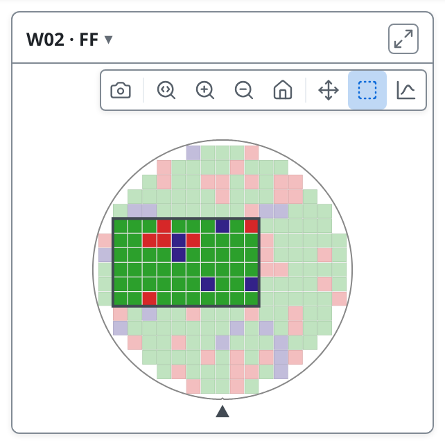

---

<!-- _class: side -->
<!-- covers: Charts and tables for this wafer (or right-click); wmap guide › Charting dies and wafers -->

# Right-click

Right-click the selection for charts and tables of just those dies: **Distributions**, your **Plots**, and **Tables**.

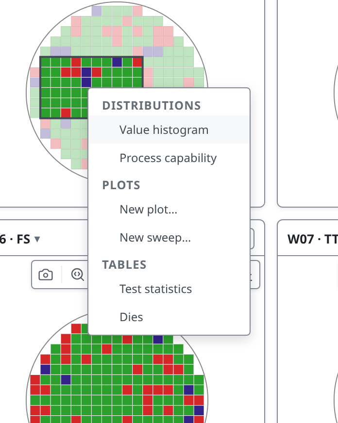

---

<!-- covers: Charts and tables for this wafer (or right-click) › Value histogram; chart › Histogram of the dies picked -->

# Value histogram

How one test is distributed over just those dies. The title and the line above state the population, so it cannot be mistaken for the whole wafer. The PAT lines are outlier limits worked out per wafer (lesson 05).

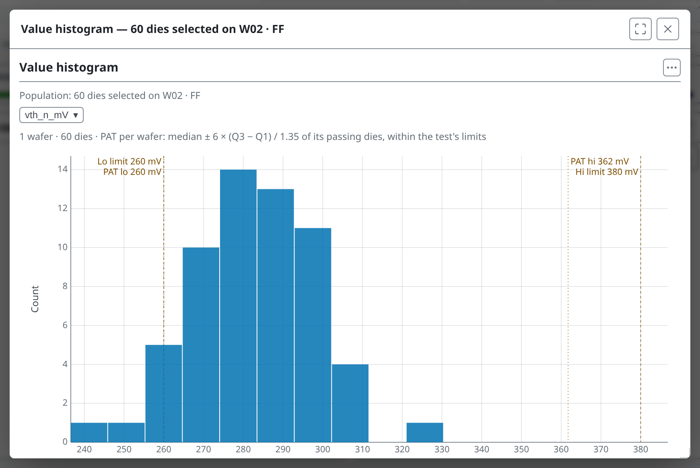

---

<!-- covers: Charts and tables for this wafer (or right-click) › Process capability -->

# Process capability

Each test's spread over the selected dies only, drawn against its limits and ordered worst Ppk first. Lesson 06 explains Ppk and charts the whole lot's capability to compare it with.

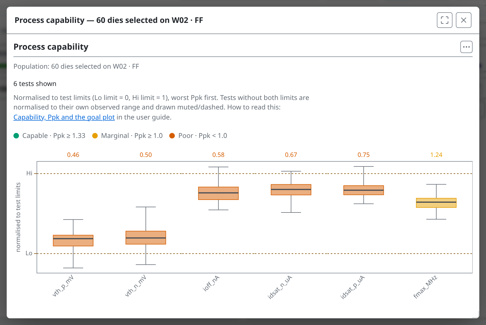

---

<!-- covers: Charts and tables for this wafer (or right-click) › Test statistics -->

# Test statistics

The Test Values and Functional Tests tables, over the same dies.

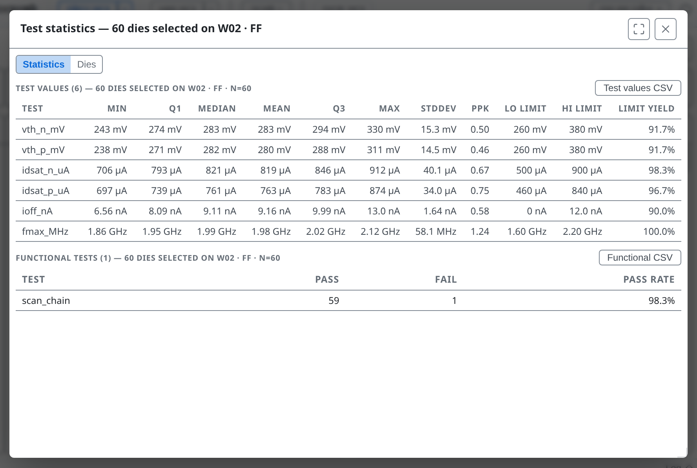

---

<!-- covers: Charts and tables for this wafer (or right-click) › Dies -->

# Dies

One row per selected die, with its position, bins and every test value. **Export CSV** writes the table to a file and **Copy** puts it on the clipboard. Choose **Wide** (a column per test) or **Long** (a row per die and test) first.

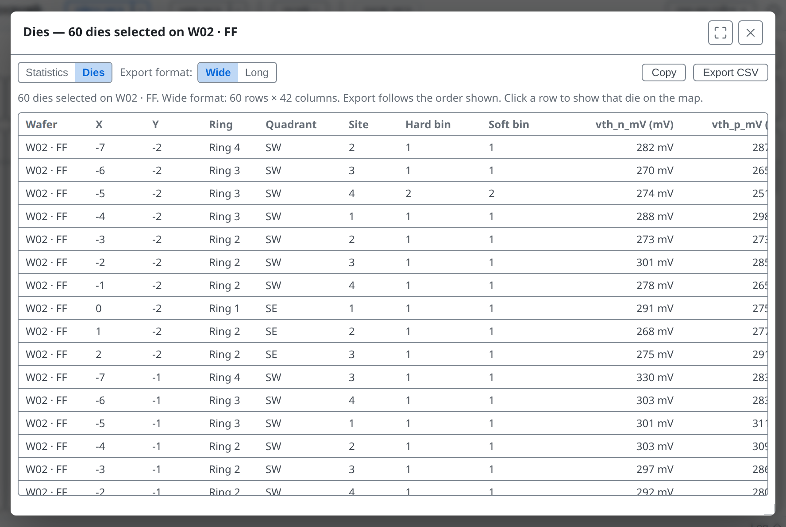

---

# A snapshot of its dies

- Each chart states its population, so it is never taken for the whole lot
- A chart already open keeps its dies when the selection changes
- An entry that cannot be drawn stays, greyed, with the reason

---

# What you right-click decides the population

| If you right-click… | the charts and tables cover… |
| --- | --- |
| dies you have selected | just those selected dies |
| empty map space, with nothing selected | every die on that wafer |
| a card's header | every die on that wafer |
| a bin in the legend | every die in that bin, on every wafer |
| a finding in the Summary panel | the dies the finding is about |
| a bar, box or point in an Insights chart | that wafer, or the dies the mark counts |

---

# A bin

Right-click a bin in the gallery's legend: the menu opens on that bin's dies on every wafer of the lot. It leaves your selection as it is; the legend only changes what is drawn.

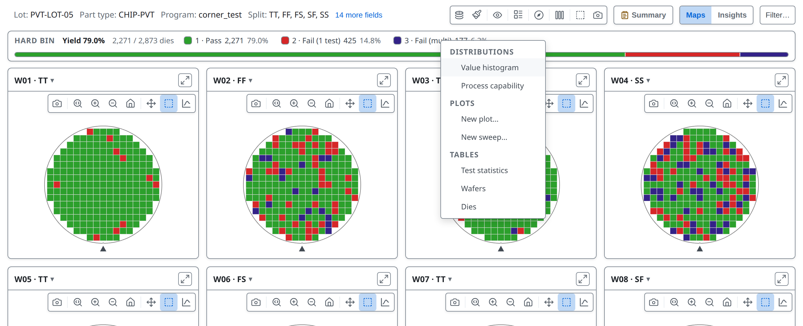

---

# A whole wafer

Each card's **Charts and tables** button, the small chart icon in its toolbar, opens the same menu for that wafer.

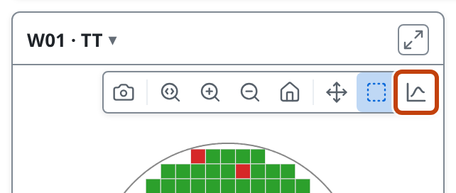

---

<!-- _class: lab -->

# Try it yourself

1. In the [web app](https://wafertools.github.io/tsmap/app/), **Load sample data**
2. **Filter…**, add **Split**, keep only **SS**, **Apply**
3. **Remove** the filter. Drag a box on W04 · SS and right-click it
4. Open **Value histogram**, then **Process capability**: which test has the lowest Ppk?
5. Right-click bin **3** in the legend and open **Dies**
6. Open **Filter…** and check no filter is left set, as filters are kept between lots

---

<!-- _class: answers -->

# Check your results

4. **`fmax_MHz`** has the lowest Ppk, about 0.2. SS is the slow corner, so its `fmax_MHz` sits close to the lower limit.

---

# Recap

- **Filter…** keeps wafers and dies by condition, in every view
- Select dies, then right-click for charts and tables of just those dies
- A bin, a wafer or a finding each opens the same menu on its own dies

More in the [wafer map guide](https://wafertools.github.io/wafermap/user-guide/#44-charting-dies-and-wafers)

---

<!-- _class: next -->
<!-- _paginate: false -->

# Next lesson

[09 · Derived tests and sweeps →](09-derived-tests-and-sweeps.md)

Compute new tests and read a run of tests as a curve.
