<!-- _class: title -->
<!-- _paginate: false -->

# Your own plots

## Lesson 08

Learn tsmap

---

# In this lesson

- Compute new tests from measured ones
- Read a run of tests as a sweep curve
- Build, keep and reuse your own charts

---

<!-- _class: divider -->

# Derived tests

---

<!-- covers: tsmap guide › Derived tests; wmap guide › Derived tests (†) -->

# What a derived test is
- A test computed from others on the same die, such as a ratio or a margin
- Defined by an **expression** in a row of the test definitions file
- Then an ordinary test: map it, chart it, set limits

These slides use RRAM-LOT-06, a resistive-memory lot.

---

<!-- _class: split -->

# Load the definitions

**Setup ▾ → Tests…**, then **Load definitions**. The file renames the tests and adds derived ones: the footer counts them, here 7.

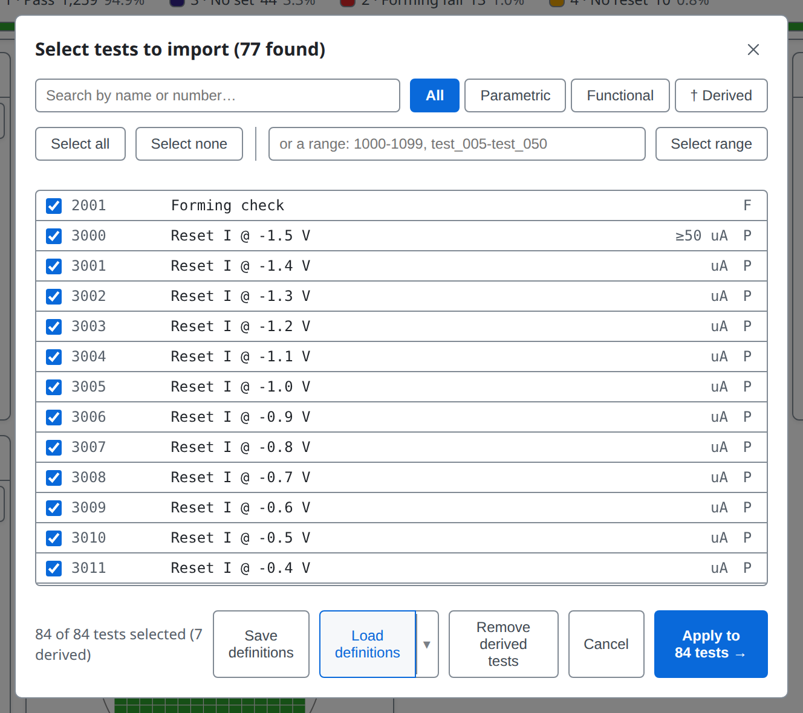

---

<!-- _class: split -->
<!-- covers: † Derived -->

# The † Derived filter

**† Derived** shows only the derived tests, each marked †. Give each a number no measured test uses: a derived row with a measured test's number is ignored, and the log says so. 900001 and up is safe.

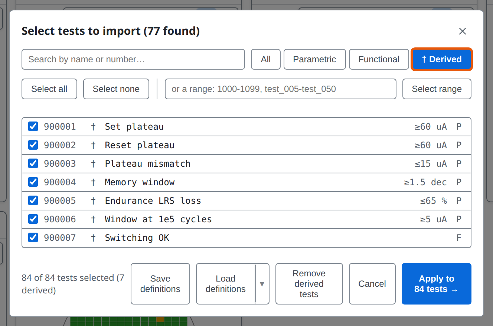

---

# Expressions: what they read

| Write | It gives |
| --- | --- |
| `t[3126]` | the measured value of test 3126 |
| `testPass[2001]` | the pass or fail result stored in the data file |
| `specPass[3126]` | whether the value is inside its limits |
| `diePass()` | whether the die's bin counts as a pass |
| `dieX()`, `dieY()` | the die's position |
| `hbin()`, `sbin()`, `site()` | the die's hard bin, soft bin and probe site |

A derived test can use the value of another derived test.

---

# Expressions: what you can do with them

- **Arithmetic** `+ - * / % ^` and **comparisons** `< <= > >= == !=`, with `and or not`
- **Choosing**: `if(condition, a, b)`, a when true, b when false
- **Functions**: `abs sqrt ln log10 exp floor ceil round sign pow min max`

For example `abs(t[1020] - t[1010])`, or `if(dieX() < 5, t[1010], 0 - 1)`. A true-or-false expression needs **F** as its test type.

---

# Expressions: ranges and missing data

- `3126..3130` is every test in that range that exists, combined into one value:
  `mean sum min max` for numbers, `all any none countTrue countFalse` for verdicts, `countKnown` for either; blanks are skipped
- A missing input leaves the die blank, never zero
- A test that cannot be computed is left out, with the reason in the log

More in the [user guide](../user-guide.md#derived-tests)

---

<!-- _class: split -->

# Derived tests in the map's test list

In the map toolbar's test list, derived tests are marked †, with the note Derived, not measured. Type in the box to search.

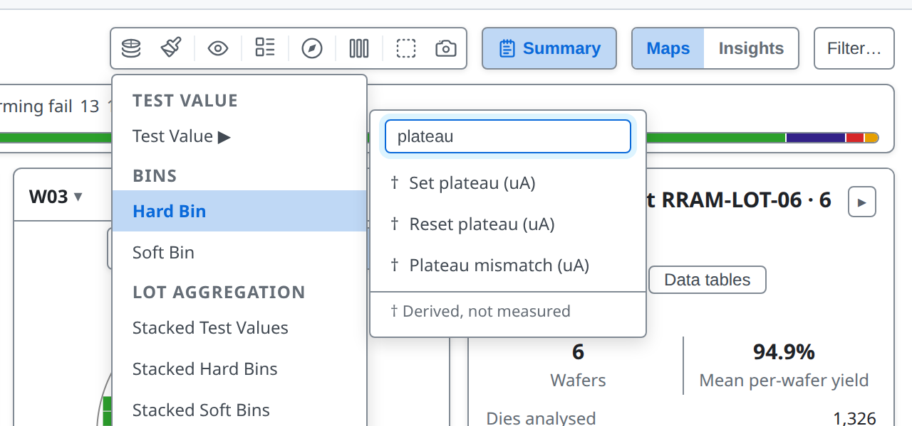

---

# Mapped like any test

Choosing **† Set plateau** colours every die by its computed value.

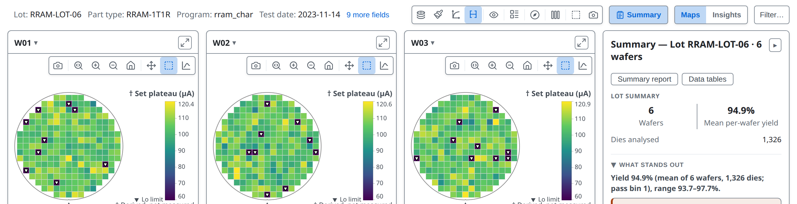

---

# Kept for the next lot

- Derived tests stay defined from one load to the next, ready for the next lot of the same program
- A lot from another program can reuse the same test numbers: the log warns, with examples
- **Remove derived tests**, in the selector's footer, drops them all

---

<!-- _class: divider -->

# Sweeps

---

<!-- covers: My plots; + New sweep; tsmap guide › Sweeps; chart › Sweep -->

# My plots

In Insights, the **My plots** tab holds charts you build. **+ New sweep** starts a sweep: a run of tests measuring one quantity at a series of levels, such as voltages, drawn as one curve.

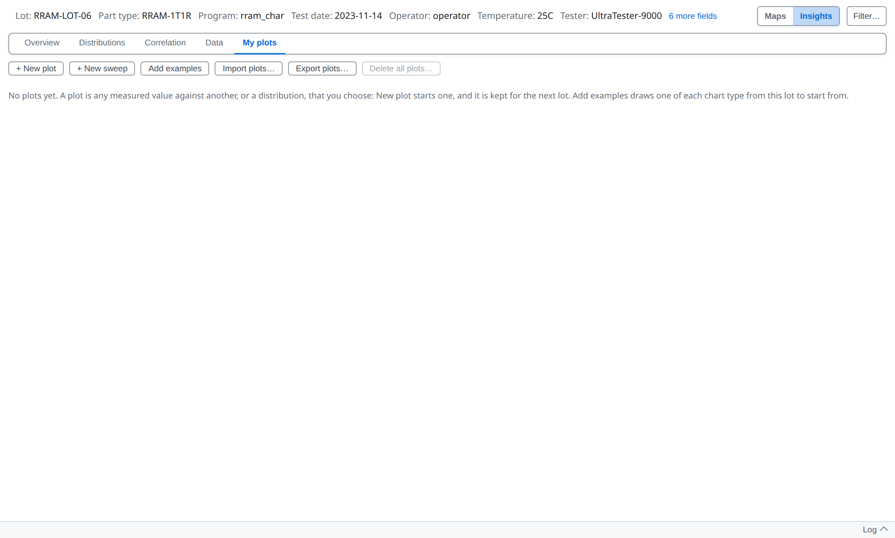

---

<!-- covers: Import plots… -->

# Import plots…

Reads a plots file and adds its plots. RRAM-LOT-06's plots file brings two sweeps. Each line is the median across the dies, with a shaded band from the 10th to the 90th percentile.

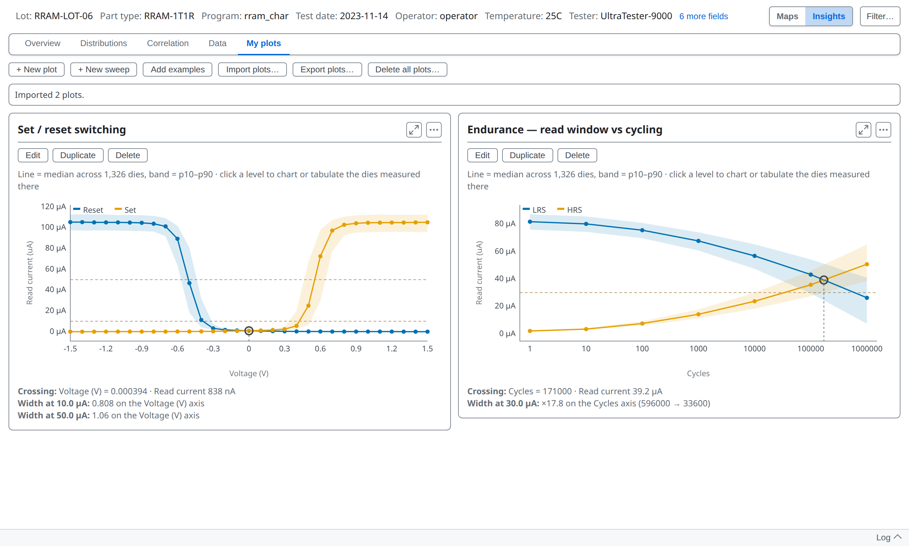

---

<!-- covers: wmap guide › Sweep cards -->

# What the card measures
A sweep card reports two results for its first two curves. **Crossing** is where they meet. **Width** is how far apart they are at levels set in the sweep, drawn as dashed lines. On a log axis the width is a ratio, such as ×17.8.

---

<!-- _class: split -->
<!-- covers: Test order; Values; From test name; + Add series; Linear; Log -->

# The sweep editor

**Edit** opens the sweep beside a live copy of its curve. For each series, type its tests in sweep order, then say where each test's X comes from.

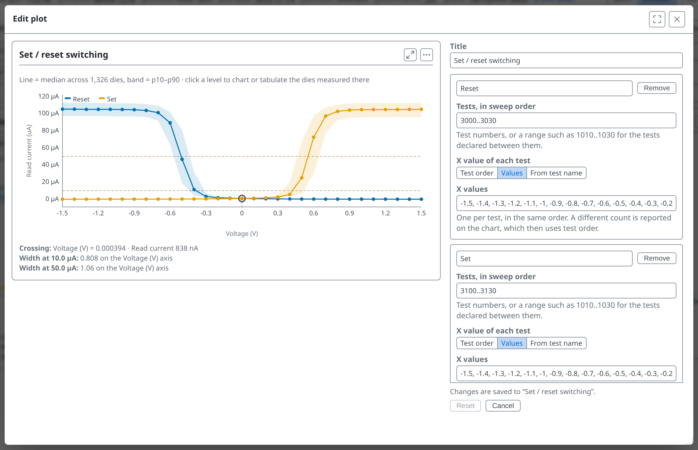

---

<!-- _class: split -->

# From test name

Each test's X comes from its **Test order**, typed **Values**, or **From test name**: here the cycle count in "LRS read I @ 1e2 cycles". **+ Add series** adds a curve.

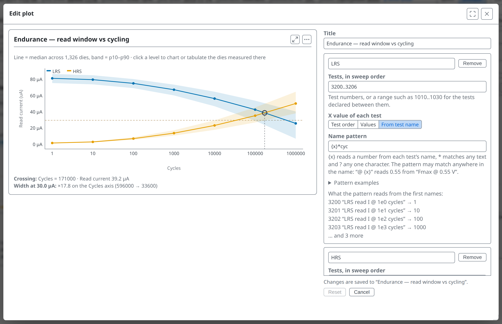

---

# A sweep remembers its tests' names

If a later lot uses the same test numbers for other measurements, the sweep does not draw them and says so on its card, instead of drawing another quantity as the same curve.

---

<!-- _class: divider -->

# Plots

---

<!-- covers: Add examples; + New plot; wmap guide › Example plots; tsmap guide › Your own plots; wmap guide › Plots -->

# Add examples

On the sample lot, **Add examples** adds a set of example plots chosen from the lot's data, covering every chart type it can show. **+ New plot** opens a scatter already set to the lot's first two tests.

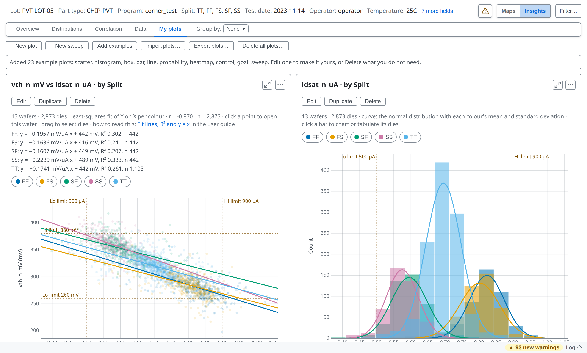

---

<!-- covers: Edit; Duplicate; Delete -->

# Edit, Duplicate, Delete

Each card has three buttons. **Delete** can be undone straight afterwards. Changes in the editor are drawn at once and kept as you make them.

---

<!-- _class: split -->
<!-- covers: Setup; Reset; Cancel; Maximize (F); Close (Esc) -->

# The plot editor

**Setup** chooses what the chart shows, **Customise** how it looks. **Reset** undoes this visit's changes; **Cancel** undoes and closes; ✕ keeps them.

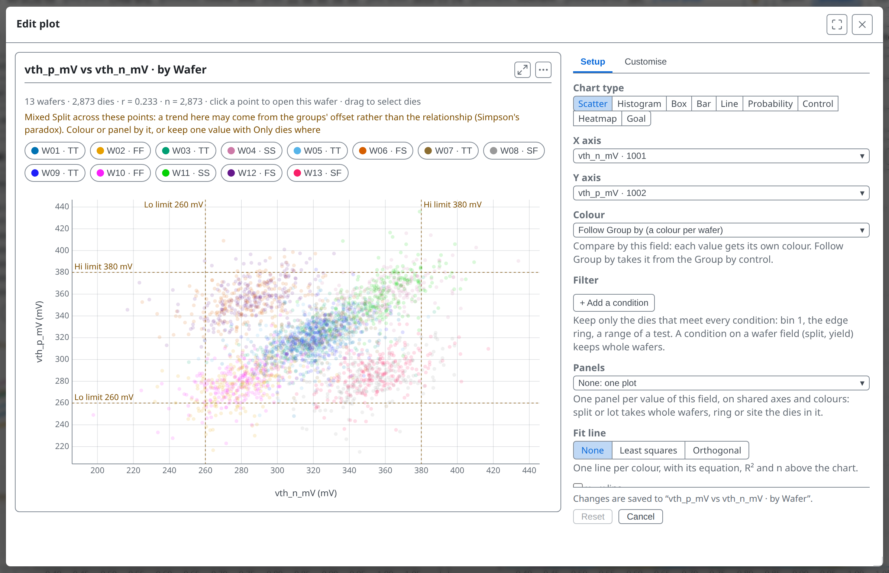

---

<!-- covers: Scatter; Histogram; Box; Bar; Line; Probability; Control; Heatmap; Goal -->

# Chart types

Nine types, each taking different fields: a histogram takes one set of values, a box or bar takes categories.

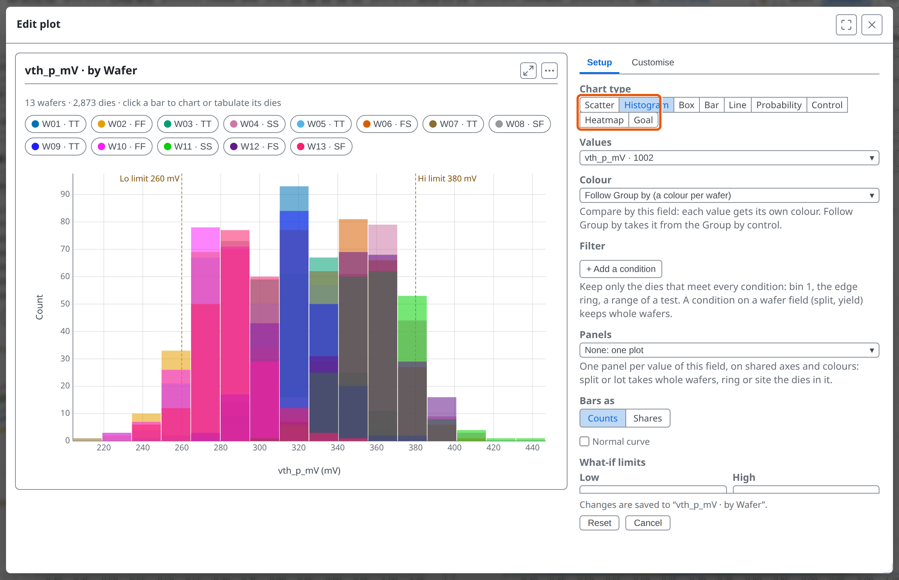

---

<!-- covers: chart › Scatter plot; chart › Histogram; chart › Box plot; chart › Bar chart; chart › Line chart -->

# The everyday five

| Type | Shows |
| --- | --- |
| Scatter | one field against another, a point per die or wafer |
| Histogram | how often each value occurs |
| Box | the spread in each category: middle half, median, extremes |
| Bar | one value or count per category |
| Line | a value in order, such as across wafers |

---

<!-- covers: chart › Probability plot; chart › Control chart; chart › Heatmap; chart › Capability goal plot; glossary › Probability plot; glossary › Western Electric rules; wmap guide › The cumulative probability plot; wmap guide › Control charts; wmap guide › Heatmaps and the difference map -->

# Four for closer reading

| Type | Shows |
| --- | --- |
| Probability | each group's values on a scale where a normal spread is a straight line |
| Control | one value per wafer in order, with rule breaks marked |
| Heatmap | a colour for every pair of two categories, such as tests by wafer |
| Goal | each test placed by how off-centre and how wide it sits in its limits |

---

<!-- _class: split -->
<!-- covers: X axis; Y axis; Colour; X axis menu entry; Y axis menu entry; Colour menu entry; Plot editor wafer row -->

# X, Y and Colour

Each opens a list of fields: any test, a die's position, ring, bin or site, a wafer's yield, or a wafer field such as split. Colour separates the data into groups, each with its own button above the chart.

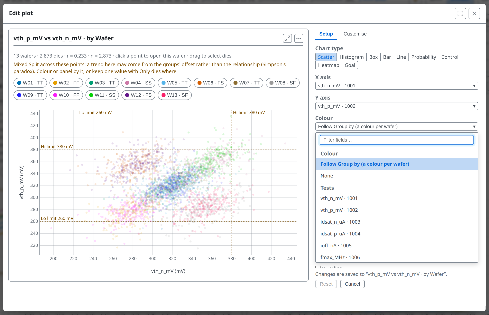

---

<!-- _class: split -->

# Colour by Split

One colour per split. **Follow Group by** is the default: the colours follow the Group by control above the charts, so changing it recolours every plot that is set to **Follow Group by**.

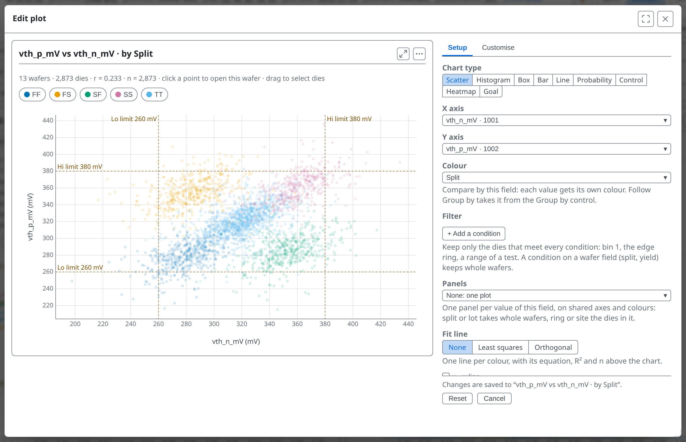

---

<!-- covers: glossary › Compare by; glossary › Die region; glossary › Verdict -->

# Group by or Compare by

- **Group by** pools whole wafers by a wafer field, for every chart
- A plot's **Colour** and **Categories** can also split dies: by ring, bin, site or a pass/fail test
- A ring is never a Group by choice: every wafer has dies in every ring

---

<!-- covers: + Add a condition; Panels; None; Least squares; Orthogonal; y = x line; Automatic; Die; Wafer -->

<!-- covers: wmap guide › Fit lines, R² and y = x -->

# More settings
- **Filter**: keep only the dies that meet conditions
- **Panels**: one small plot per value of a field
- **Fit line**: least squares, or orthogonal for two measures of one thing
- **One mark per**: a point per die or per wafer

---

<!-- covers: wmap guide › Rescaling values; chart › Nested categories; chart › Panels (small multiples) -->

# Many tests, many groups

- **Several tests…** puts a list or range of tests in one plot; **Rescale values** puts them on one scale (to limits, or as z-scores)
- **In ranges** cuts a number into bands, such as Idsat deciles
- **+ Add a level** nests categories, such as wafers inside each split

---

<!-- covers: wmap guide › Ranges, panels and what-if limits; chart › Stacked bars and shares; chart › Pareto -->

# Reading against limits and totals

- **What-if limits** draw proposed limits on a histogram and say how many dies would change
- **Colours**: stacked, 100%, or each colour's share, to compare groups of different sizes
- **Cumulative line** turns a bar sorted largest first into a pareto

---

# A plot's filter and the page filter
- **Filter…** in the toolbar narrows every view, and is not saved with a plot
- A plot's own **Filter** is saved with it and narrows that plot only
- A plot shows the dies that pass both; neither changes the other

---

<!-- _class: split -->
<!-- covers: Customise; Linear; Reverse direction; Test + spec; Spec -->

# Customise

On the **Customise** page you can set titles, each axis's minimum and maximum, its **Linear** or **Log** scale, **Reverse direction**, reference lines, and which limits are drawn (**Test + spec**, **Test**, **Spec** or **None**).

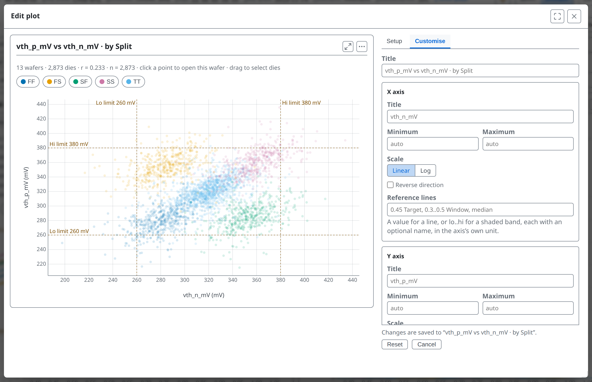

---

# Reference lines

Your own target, guard band or customer limit on a value axis, to see how the data sits against a number that matters to you. In **Customise**, write a value or a `lo..hi` band, each with an optional name:

`0.45 Target, 0.3..0.5 Window, median`

---

# Your plots are kept

A plot is a recipe, not a picture, so tsmap keeps your plots and draws them on the next lot. One that needs a missing test stays, dimmed, with the reason.

---

<!-- covers: Export plots…; Delete all plots… -->

# Export, import, delete all

**Export plots…** writes every plot to a file and **Import plots…** adds the plots of such a file, so a set can move to a colleague. **Delete all plots…** asks first.

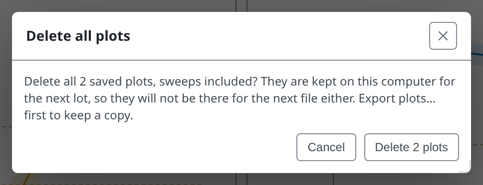

---

# Undo

Right after deleting, **Undo** brings the whole list back.

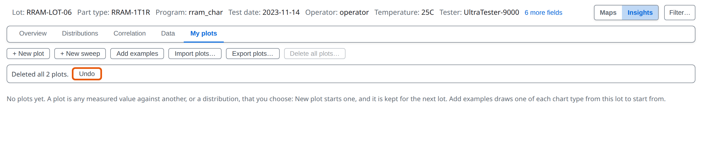

---

<!-- _class: split -->
<!-- covers: Charts and tables for this wafer (or right-click) › New plot…; Charts and tables for this wafer (or right-click) › New sweep… -->

# From the right-click menu

Every saved plot is a row in the menu on a selection, drawn over just those dies. **New plot…** and **New sweep…** at the end of its Plots section start a draft on them.

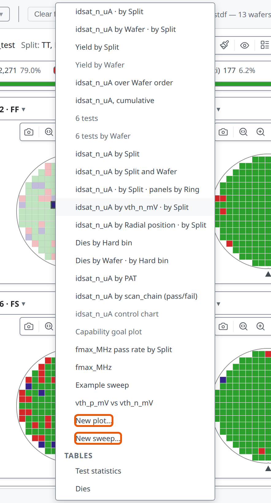

---

<!-- _class: split -->

# A draft

A draft is kept only if you press **Add to my plots**. **Cancel** discards it.

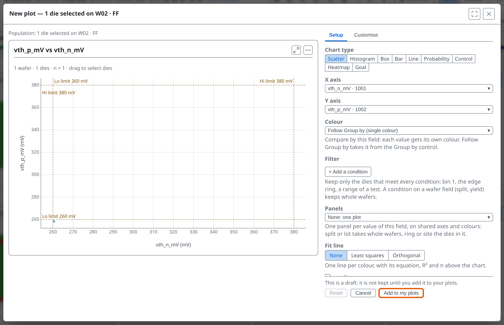

---

<!-- _class: lab -->

# Try it yourself

1. In the [web app](https://wafertools.github.io/tsmap/app/), **Load sample data**, then **Insights → My plots → Add examples**
2. **Edit** the first plot and set **Chart type** to **Box**
3. Set **X axis** to **Split**: which split differs most?
4. Open **Customise** and put a reference line on the value axis
5. **Export plots…**, then **Delete all plots…** and **Undo**

---

# Recap

- A **derived test** is computed from others and marked †
- A **sweep** reads a run of tests as a curve and measures where its first two curves cross
- **My plots** are recipes kept on this machine and redrawn on the next lot

More in the [wafer map guide](https://wafertools.github.io/wafermap/user-guide/#plots)

---

<!-- _class: next -->
<!-- _paginate: false -->

# Next lesson

[09 · Unusual wafers →](09-unusual-wafers.md)

Multi-project wafers, no positions, retests and multi-site testing.
