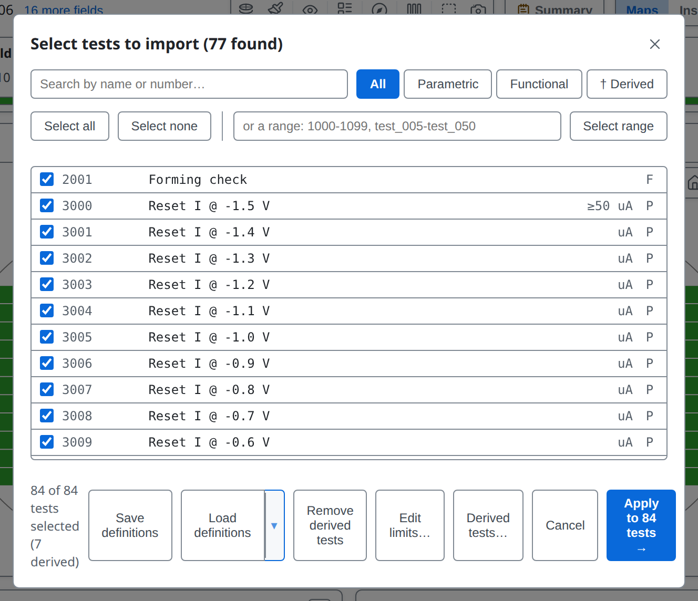
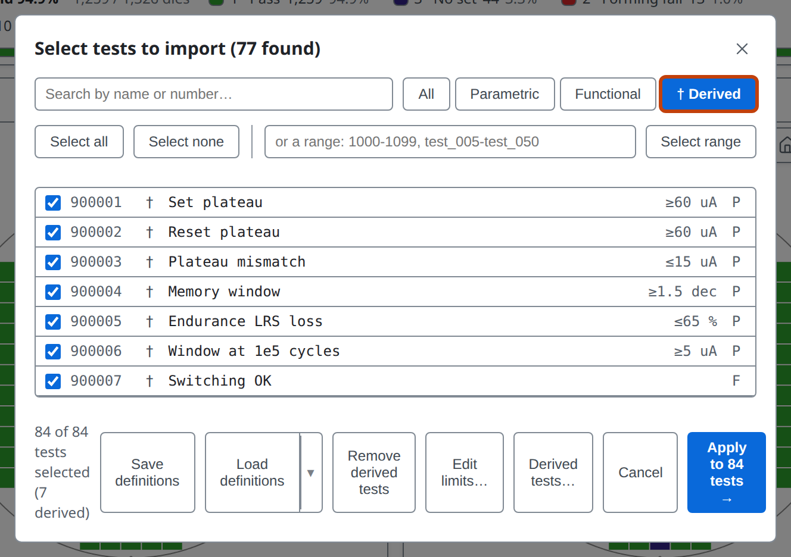
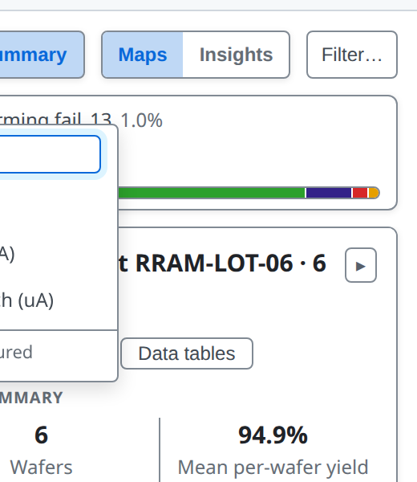
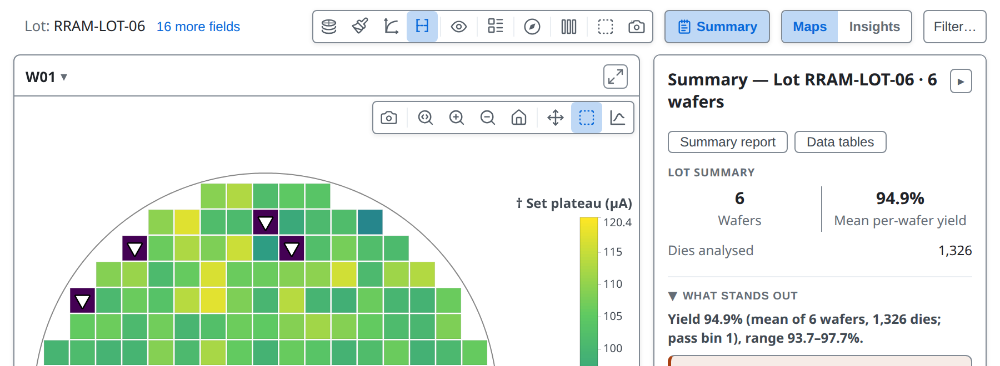
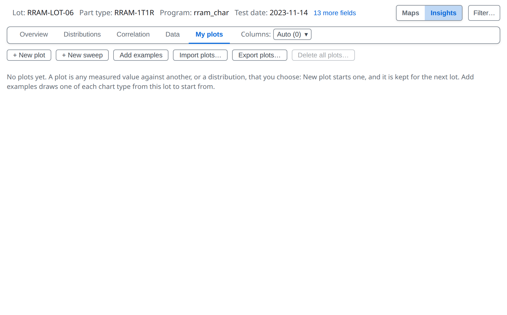
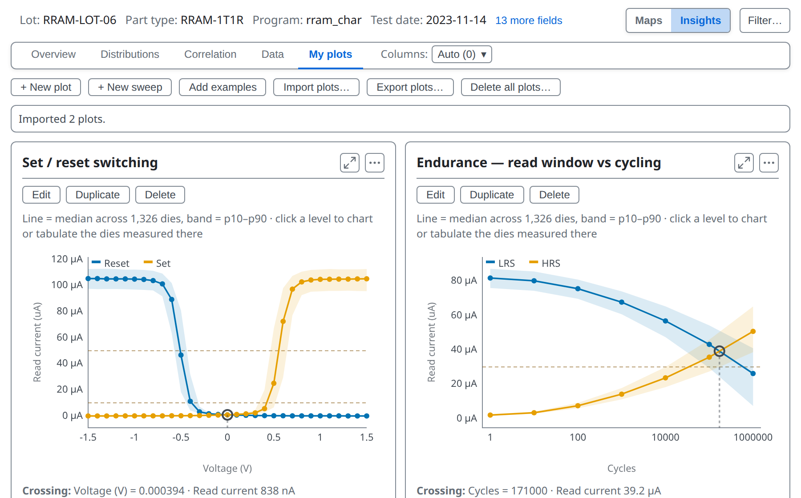
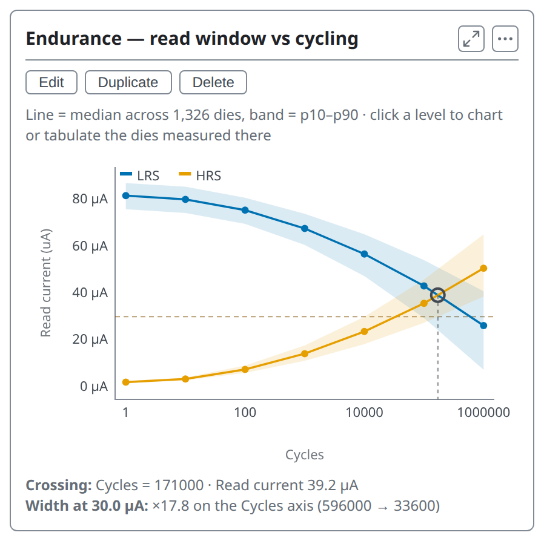
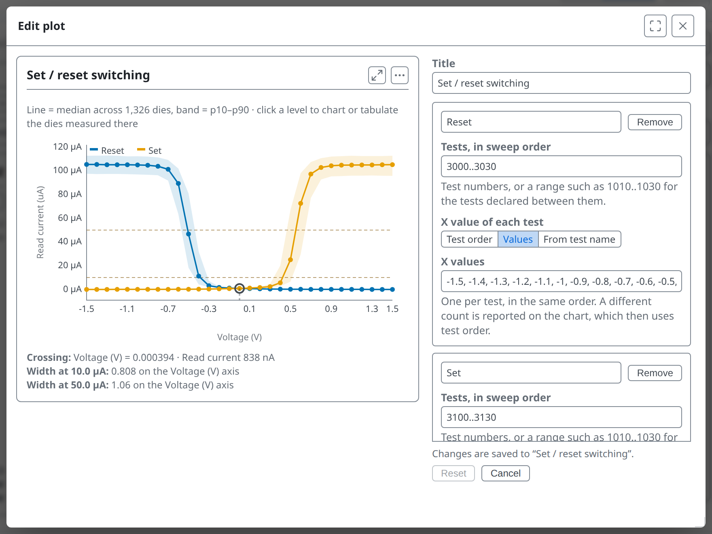
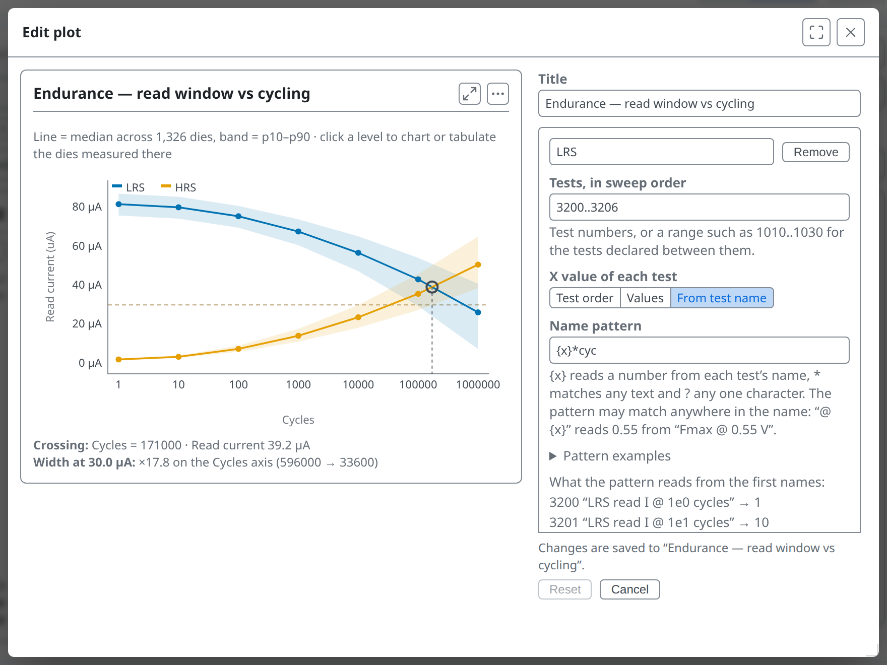

<!-- _class: title -->
<!-- _paginate: false -->

# Derived tests and sweeps

## Lesson 09

Learn tsmap

---

# In this lesson

- Compute new tests from measured ones
- Read a run of tests as a sweep curve

---

<!-- _class: divider -->

# Derived tests

---

<!-- covers: tsmap guide › Derived tests; wmap guide › Derived tests (†) -->

# What a derived test is
- A test computed from others on the same die, such as a ratio or a margin
- Defined by an **expression** in a row of the test definitions file
- Then an ordinary test: map it, chart it, set limits

<!-- covers: Derived tests… -->

**Derived tests…** in the test selector adds, edits and deletes them in a table. Each expression is checked as you type: ✓ with what it produces, or ✗ with the reason and where, and a **Reads** column lists the tests it depends on. Apply is refused while a test would be dropped.

These slides use [`RRAM-LOT-06`](https://wafertools.github.io/tsmap/app/?dataUrl=https%3A%2F%2Fwafertools.github.io%2Ftsmap%2Fsamples%2Ftsmap-rram-lot.stdf&dataFormat=stdf), a resistive-memory lot. Its [test definitions](https://wafertools.github.io/tsmap/samples/tsmap-rram-testdefs.csv) and [plots file](https://wafertools.github.io/tsmap/samples/tsmap-rram-plots.json) are on the [sample files page](https://wafertools.github.io/tsmap/web/#try-it-with-sample-data).

---

<!-- _class: split -->

# Load the definitions

**Setup ▾ → Tests…**, then **Load definitions**. The file renames the tests and adds derived ones: the footer counts them, here 7.

---

<!-- _class: split -->
<!-- covers: † Derived -->

# The † Derived filter

**† Derived** shows only the derived tests, each marked †. Give each a number no measured test uses: a derived row with a measured test's number is ignored, and the log says so. 900001 and up is safe.

---

<!-- _class: plain-table -->

# Expressions: what they read

| Write | It gives |
| --- | --- |
| `t[3126]` | the measured value of test 3126 |
| `testPass[2001]` | the pass or fail result stored in the data file |
| `specPass[3126]` | whether the value is inside its limits |
| `diePass()` | whether the die's bin counts as a pass |
| `dieX()`, `dieY()` | the die's position |
| `hbin()`, `sbin()`, `site()` | the die's hard bin, soft bin and probe site |

A derived test can use the value of another derived test.

---

# Expressions: what you can do with them

- **Arithmetic** `+ - * / % ^` and **comparisons** `< <= > >= == !=`, with `and or not`
- **Choosing**: `if(condition, a, b)`, a when true, b when false
- **Functions**: `abs sqrt ln log10 exp floor ceil round sign pow min max`

For example `abs(t[1020] - t[1010])`, or `if(dieX() < 5, t[1010], -1)`. A true-or-false expression needs **F** as its test type.

---

# Expressions: ranges and missing data

- `3126..3130` is every test in that range that exists, combined into one value:
  `mean sum min max` for numbers, `all any none countTrue countFalse` for verdicts, `countKnown` for either; blanks are skipped
- A missing input leaves the die blank, never zero
- A test that cannot be computed is left out, with the reason in the log

More in the [user guide](../user-guide.md#derived-tests)

---

<!-- _class: split -->

# Derived tests in the map's test list

In the map toolbar's test list, derived tests are marked †, with the note Derived, not measured. Type in the box to search.

---

# Mapped like any test

Choosing **† Set plateau** colours every die by its computed value.

---

# Kept for the next lot

- Derived tests stay defined from one load to the next, ready for the next lot of the same program
- A lot from another program can reuse the same test numbers: the log warns, with examples
- **Remove derived tests**, in the selector's footer, drops them all

---

<!-- _class: divider -->

# Sweeps

---

<!-- covers: My plots; + New sweep; tsmap guide › Sweeps; chart › Sweep -->

# My plots

In Insights, the **My plots** tab holds charts you build. **+ New sweep** starts a sweep: a run of tests measuring one quantity at a series of levels, such as voltages, drawn as one curve.

---

<!-- covers: Import plots… -->

# Import plots…

Reads a plots file and adds its plots. `RRAM-LOT-06`'s plots file brings two sweeps. Each line is the median across the dies, with a shaded band from the 10th to the 90th percentile.

---

<!-- covers: wmap guide › Sweep cards -->

<!-- _class: split -->

# What the card measures
- A sweep card reports two results for its first two curves
- **Crossing** is where they meet
- **Width** is how far apart they are at the sweep's set levels (dashed lines)
- On a log axis the width is a ratio, such as ×17.8

---

<!-- _class: split -->
<!-- covers: Test order; Values; From test name; + Add series; Linear; Log -->

# The sweep editor

**Edit** opens the sweep beside a live copy of its curve. For each series, type its tests in sweep order, then say where each test's X comes from.

---

<!-- _class: split -->

# From test name

Each test's X comes from its **Test order**, typed **Values**, or **From test name**: here the cycle count in "LRS read I @ 1e2 cycles". **+ Add series** adds a curve.

---

# A sweep remembers its tests' names

If a later lot uses the same test numbers for other measurements, the sweep does not draw them and says so on its card, instead of drawing another quantity as the same curve.

---

<!-- _class: lab -->

# Try it yourself

1. Open [`RRAM-LOT-06`](https://wafertools.github.io/tsmap/app/?dataUrl=https%3A%2F%2Fwafertools.github.io%2Ftsmap%2Fsamples%2Ftsmap-rram-lot.stdf&dataFormat=stdf) in the web app, then **Setup ▾ → Tests…**
2. **Load definitions** and choose `tsmap-rram-testdefs.csv` from the [sample files page](https://wafertools.github.io/tsmap/web/#try-it-with-sample-data), then **† Derived**: how many derived tests are there?
3. **Apply**, then **Plot mode → † Set plateau**
4. **Insights → My plots → Import plots…** and choose `tsmap-rram-plots.json`
5. **Edit** the **Endurance** plot and read where its X values come from

---

<!-- _class: answers -->

# Check your results

2. **7** derived tests, each marked †. The selector counts them next to **† Derived**.

---

# Recap

- A **derived test** is computed from others and marked †
- A **sweep** reads a run of tests as a curve and measures where its first two curves cross

More in the [wafer map guide](https://wafertools.github.io/wafermap/user-guide/#plots)

---

<!-- _class: next -->
<!-- _paginate: false -->

# Next lesson

[10 · Your own plots →](10-your-own-plots.md)

Build, keep and reuse your own charts.
