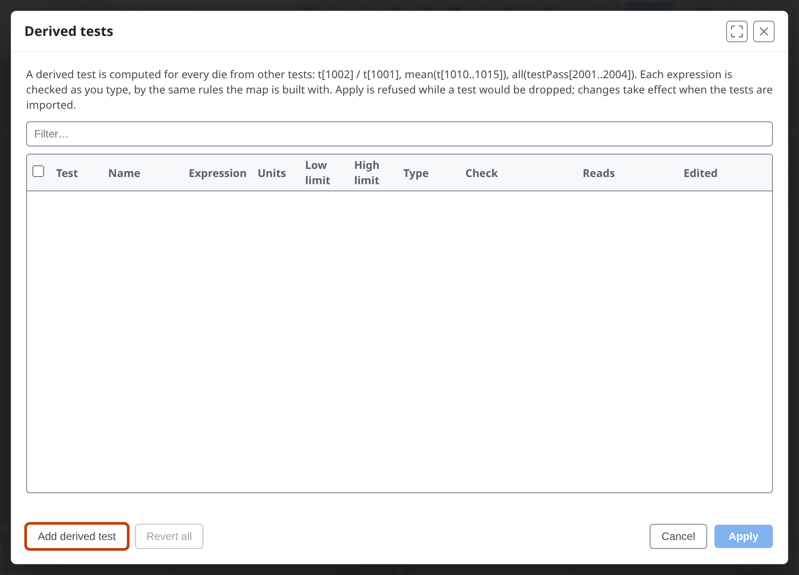
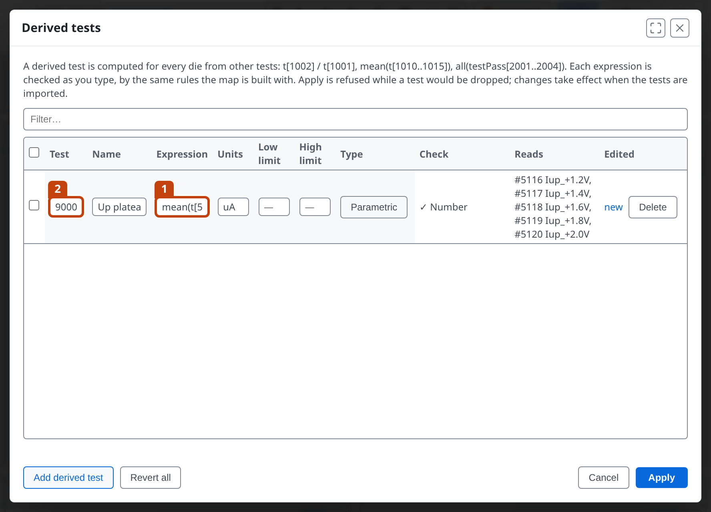
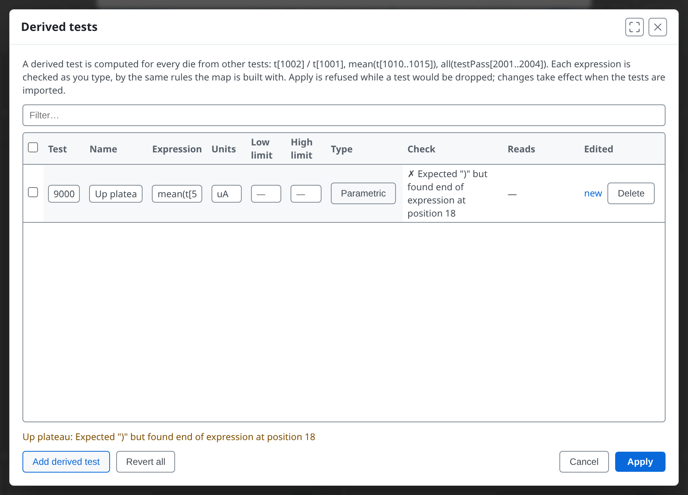
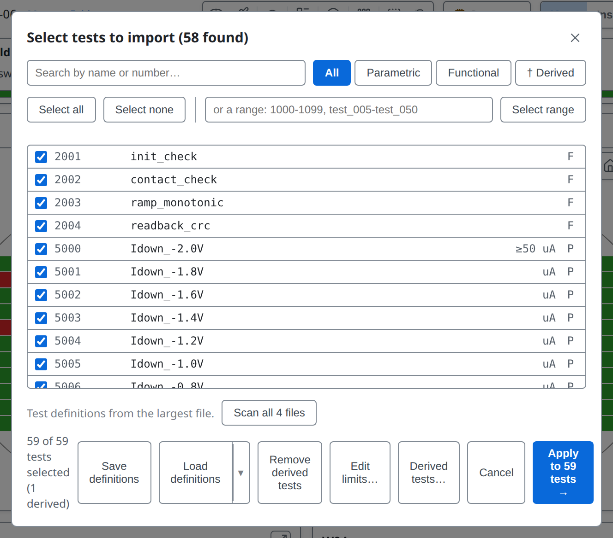
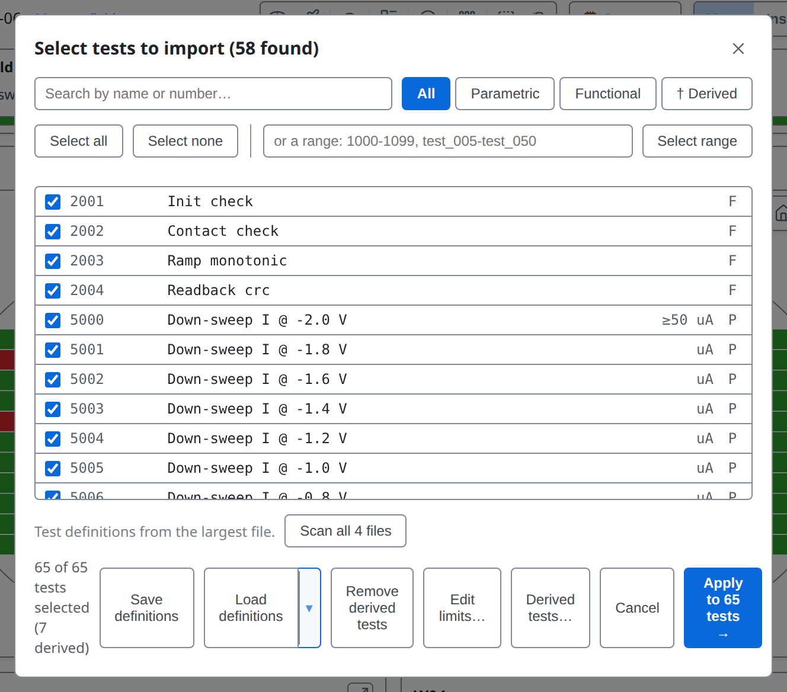
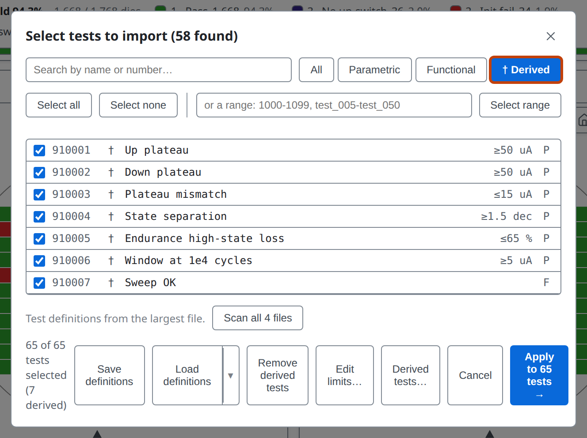
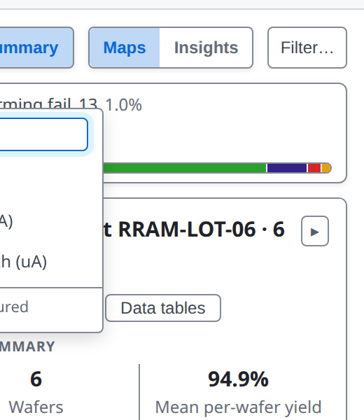
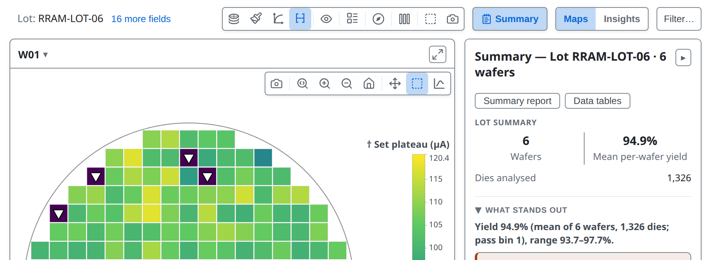

<!-- _class: title -->
<!-- _paginate: false -->

# Derived tests

## Lesson 09

Learn tsmap

---

# In this lesson

The tester measures what it was told to measure, but the question you have may be about a ratio, a margin, or the average of a run of tests. This lesson shows how to compute a new test from existing ones, and then use it like any other.

- Add a derived test in the **Derived tests…** editor
- Read the expression language and the live check
- Load derived tests from a definitions file
- Map and chart a derived test

---

<!-- covers: tsmap guide › Derived tests; wmap guide › Derived tests (†) -->

# What a derived test is
Sometimes the number you want was never measured. A derived test computes it.

- A test computed from others on the same die, such as a ratio or a margin
- Defined by an **expression**, which you type in the editor or write in a definitions file
- Then an ordinary test: map it, chart it, set limits

---

<!-- covers: Derived tests… -->

# The Derived tests… editor

Open the test selector with **Setup ▾ → Tests…**, then press **Derived tests…** in its footer. The editor is a table with a row for each derived test: its number, name, expression, units, limits and type. It starts empty.

These slides use [`SWEEP-LOT-06`](https://wafertools.github.io/tsmap/app/?dataUrl=https%3A%2F%2Fwafertools.github.io%2Ftsmap%2Fsamples%2Ftsmap-sweep-lot.zip&dataFormat=zip), a two-state switching lot.

---

<!-- _class: split -->

# Add a derived test

**Add derived test** starts a row on the next free number 2, 900001 here, with the cursor in its expression 1., and here `mean(t[5116..5120])` averages five currents. The number cannot be a measured test's.

---

# Checked as you type

The **Check** column judges every expression as you type it, by the same rules the map is built with.

- **✓ Number** means the test is parametric. **✓ Verdict** means a true-or-false test, which needs the **Functional** type
- **Reads** lists the tests the expression depends on, by number and name
- Units that do not match across a `+` or `-` are flagged, not refused: give the derived test its own units

---

<!-- _class: split -->

# A mistake shows at once

A mistake gives **✗**, the reason and the position. Here the closing bracket is missing, at position 18.

**Apply** is refused while any row has a ✗, so what you apply is what gets computed.

---

<!-- _class: split -->

# Apply

**Apply** puts the test in the selector, where the footer counts it, here "1 derived". Like every change in the selector, it takes effect when you press **Apply to N tests →** and the tests are imported.

**Save definitions** writes them to a definitions file.

---

<!-- _class: divider -->

# What an expression can say

---

<!-- _class: plain-table -->

# Expressions: what they read

| Write | It gives |
| --- | --- |
| `t[5116]` | the measured value of test 5116 |
| `testPass[2001]` | the pass or fail result stored in the data file |
| `specPass[5116]` | whether the value is inside its limits |
| `diePass()` | whether the die's bin counts as a pass |
| `dieX()`, `dieY()` | the die's position |
| `hbin()`, `sbin()`, `site()` | the die's hard bin, soft bin and probe site |

A derived test can use the value of another derived test, so you can build up a calculation in steps.

---

# Expressions: what you can do with them

An expression can calculate and it can choose.

- **Arithmetic** `+ - * / % ^` and **comparisons** `< <= > >= == !=`, with `and or not`
- **Choosing**: `if(condition, a, b)`, a when true, b when false
- **Functions**: `abs sqrt ln log10 exp floor ceil round sign pow min max`

For example `abs(t[1020] - t[1010])`, or `if(dieX() < 5, t[1010], -1)`. A true-or-false expression needs **F** as its test type.

---

# Expressions: ranges and missing data

A run of tests can be combined into one value.

- `5116..5120` is every test in that range that exists, combined into one value:
  `mean sum min max` for numbers, `all any none countTrue countFalse` for verdicts, `countKnown` for either; blanks are skipped
- A missing input leaves the die blank, never zero
- A test that cannot be computed is left out, with the reason in the log

More in the [user guide](../user-guide.md#derived-tests)

---

<!-- _class: divider -->

# From a definitions file

---

<!-- _class: split -->

# Load the definitions

A definitions file can carry derived tests in an **expression** column. Open **Setup ▾ → Tests…**, then **Load definitions** and choose `SWEEP-LOT-06`'s [test definitions](https://wafertools.github.io/tsmap/samples/tsmap-sweep-testdefs.csv). It renames the tests and adds 7 derived ones, counted in the footer, and replaces any derived tests you had.

---

<!-- _class: split -->
<!-- covers: † Derived -->

# The † Derived filter

**† Derived** shows only the derived tests, each marked †. In a file, give each a number no measured test uses: a derived row with a measured test's number is ignored, and the log says so.

---

<!-- _class: split -->

# Derived tests in the map's test list

Once defined, a derived test appears in the map toolbar's test list. It is marked †, with the note Derived, not measured, so nobody mistakes it for a tester reading. Type in the box to search.

---

# Mapped like any test

Choosing **† Up plateau** colours every die by its computed value, exactly as it would for a measured test.

---

# Kept for the next lot

You do not have to redefine your derived tests each time.

- Derived tests stay defined from one load to the next, ready for the next lot of the same program
- A lot from another program can reuse the same test numbers: the log warns, with examples
- **Remove derived tests**, in the selector's footer, drops them all, for data they do not apply to

---

<!-- _class: lab -->

# Try it yourself

1. Open [`SWEEP-LOT-06`](https://wafertools.github.io/tsmap/app/?dataUrl=https%3A%2F%2Fwafertools.github.io%2Ftsmap%2Fsamples%2Ftsmap-sweep-lot.zip&dataFormat=zip), then **Setup ▾ → Tests… → Derived tests…**
2. **Add derived test**, name it `Up plateau`, expression `mean(t[5116..5120])`: what do **Check** and **Reads** say?
3. Delete the closing bracket: what does the check say now? Put it back
4. **Apply**, **Apply to 59 tests →**, then **Plot mode → † Up plateau**
5. **Load definitions** with `tsmap-sweep-testdefs.csv` ([sample files](https://wafertools.github.io/tsmap/web/#try-it-with-sample-data)), then **† Derived**: how many derived tests?

---

<!-- _class: answers -->

# Check your results

2. **✓ Number**, and **Reads** lists the five tests 5116 to 5120 by number and name.
3. **✗**, with the reason and the position: `Expected ")" but found end of expression at position 18`.
4. The map colours each die by its computed Up plateau current.
5. **7** derived tests, each marked †. The file's tests replace the one you wrote.

---

# Recap

- A **derived test** is computed from others and marked †
- The **Derived tests…** editor checks each expression as you type, and **Apply** is refused while one has a ✗
- A definitions file can carry derived tests too, and they stay defined for the next lot

With derived tests you can ask questions the tester never recorded. The next lesson builds your own charts, including charts of a run of tests read as a curve.

More in the [user guide](../user-guide.md#derived-tests)

---

<!-- _class: next -->
<!-- _paginate: false -->

# Next lesson

[10 · Your own plots and sweeps →](10-your-own-plots.md)

Build, keep and reuse your own charts, and read a run of tests as a curve.
