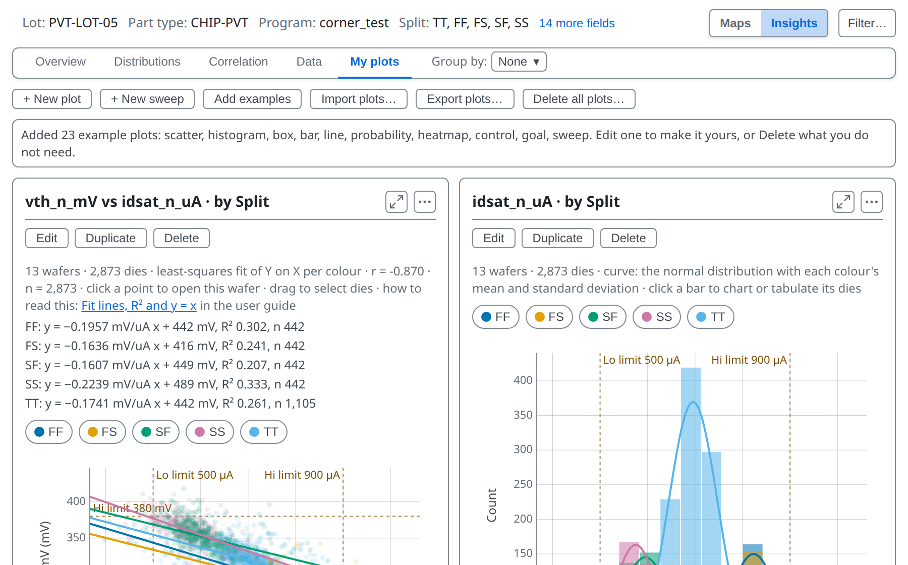
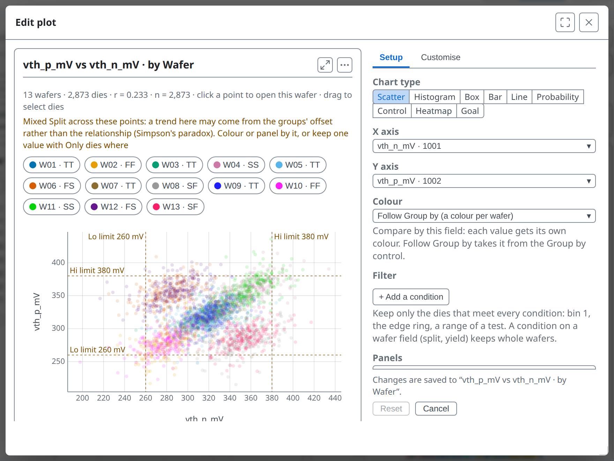
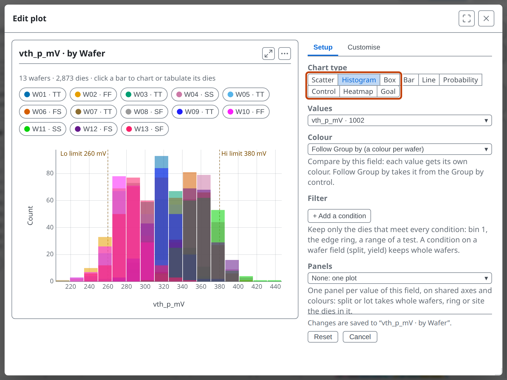
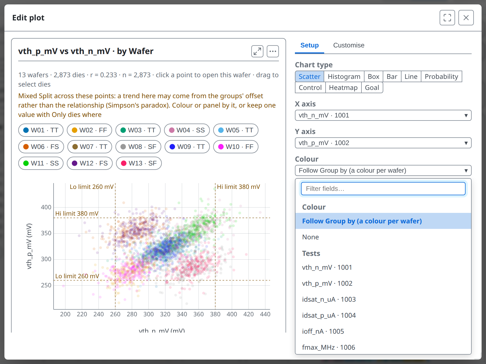
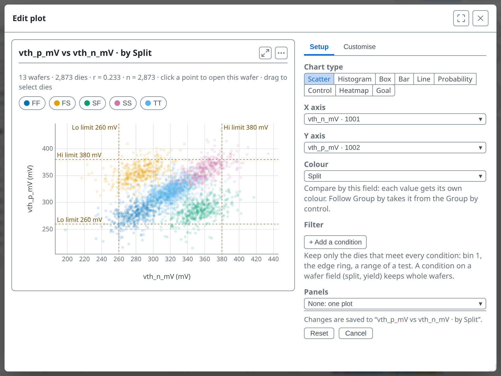
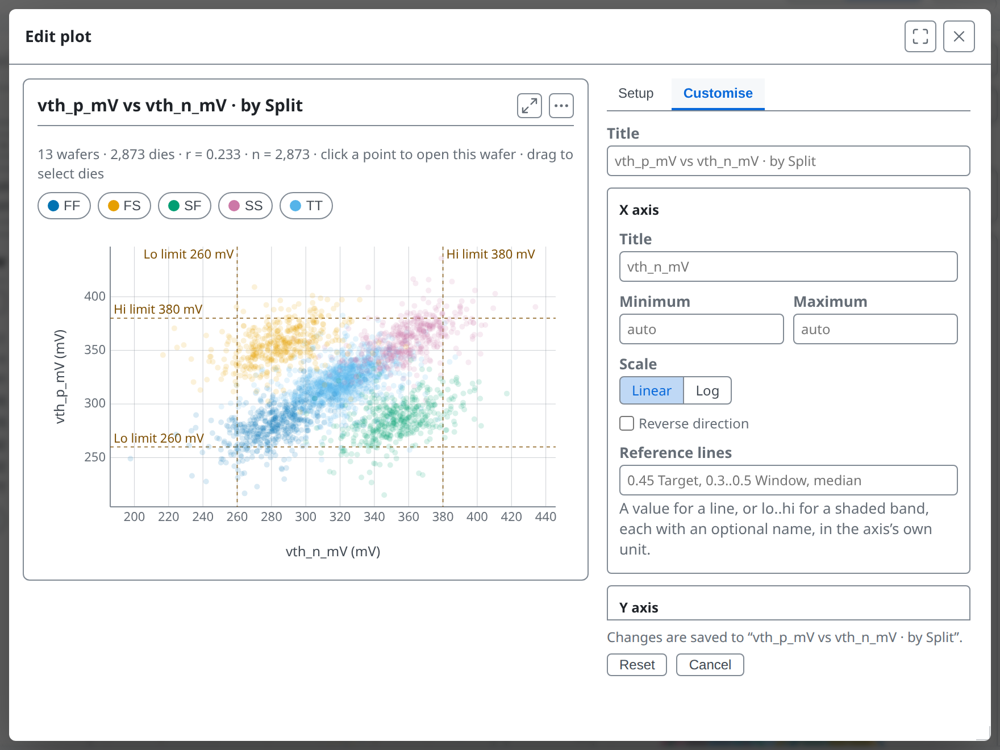
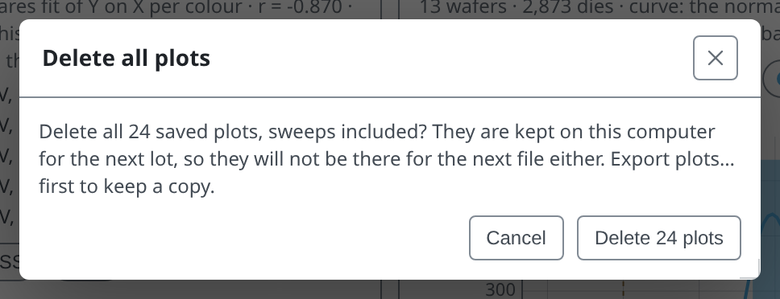
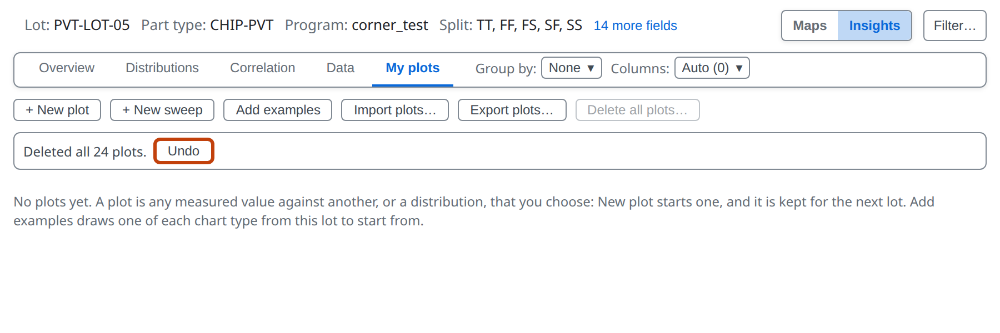
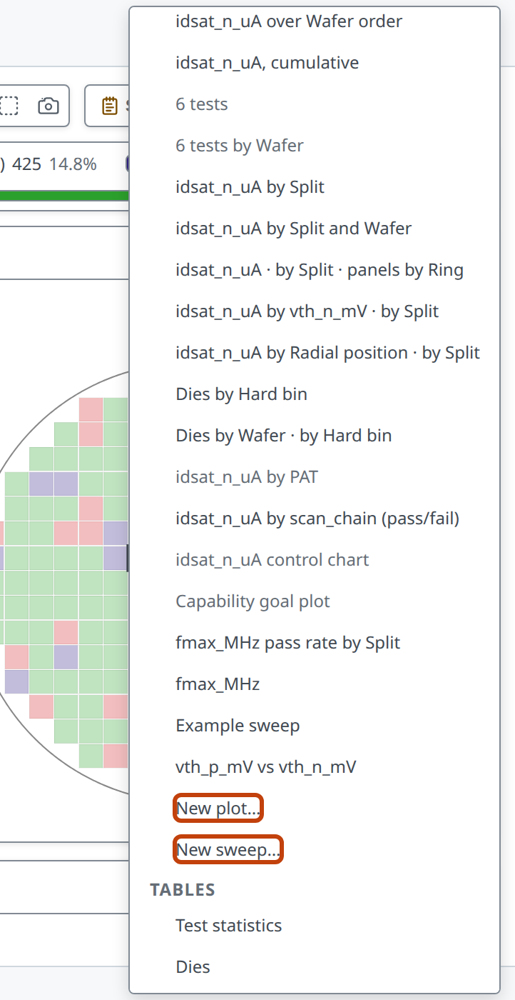
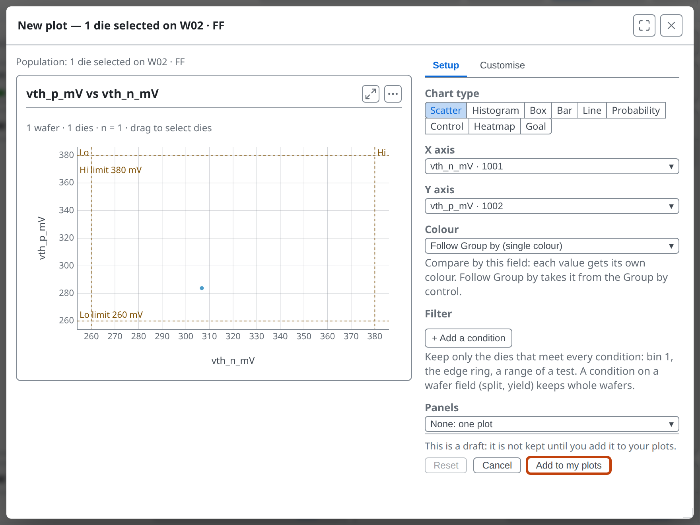

<!-- _class: title -->
<!-- _paginate: false -->

# Your own plots

## Lesson 10

Learn tsmap

---

# In this lesson

- Build your own charts in the plot editor
- Keep them, export them and reuse them on the next lot

---

<!-- _class: divider -->

# Plots

---

<!-- covers: Add examples; + New plot; wmap guide › Example plots; tsmap guide › Your own plots; wmap guide › Plots -->

# Add examples

On the sample lot, **Add examples** adds a set of example plots chosen from the lot's data, covering every chart type it can show. **+ New plot** opens a scatter already set to the lot's first two tests.

---

<!-- covers: Edit; Duplicate; Delete -->

# Edit, Duplicate, Delete

Each card has three buttons. **Delete** can be undone straight afterwards. Changes in the editor are drawn at once and kept as you make them.

---

<!-- _class: split -->
<!-- covers: Setup; Reset; Cancel; Maximize (F); Close (Esc) -->

# The plot editor

**Setup** chooses what the chart shows, **Customise** how it looks. **Reset** undoes this visit's changes; **Cancel** undoes and closes; ✕ keeps them.

---

<!-- covers: Scatter; Histogram; Box; Bar; Line; Probability; Control; Heatmap; Goal -->

# Chart types

Nine types, each taking different fields: a histogram takes one set of values, a box or bar takes categories.

---

<!-- covers: chart › Scatter plot; chart › Histogram; chart › Box plot; chart › Bar chart; chart › Line chart -->

<!-- _class: plain-table -->

# The everyday five

| Type | Shows |
| --- | --- |
| Scatter | one field against another, a point per die or wafer |
| Histogram | how often each value occurs |
| Box | the spread in each category: middle half, median, extremes |
| Bar | one value or count per category |
| Line | a value in order, such as across wafers |

---

<!-- covers: chart › Probability plot; chart › Control chart; chart › Heatmap; chart › Capability goal plot; glossary › Probability plot; glossary › Western Electric rules; wmap guide › The cumulative probability plot; wmap guide › Control charts; wmap guide › Heatmaps and the difference map -->

<!-- _class: plain-table -->

# Four for closer reading

| Type | Shows |
| --- | --- |
| Probability | each group's values on a scale where a normal spread is a straight line |
| Control | one value per wafer in order, with rule breaks marked |
| Heatmap | a colour for every pair of two categories, such as tests by wafer |
| Goal | each test placed by how off-centre and how wide it sits in its limits |

---

<!-- _class: split -->
<!-- covers: X axis; Y axis; Colour; X axis menu entry; Y axis menu entry; Colour menu entry; Plot editor wafer row -->

# X, Y and Colour

Each opens a list of fields: any test, a die's position, ring, bin or site, a wafer's yield, or a wafer field such as split. Colour separates the data into groups, each with its own button above the chart.

---

<!-- _class: split -->

# Colour by Split

One colour per split. **Follow Group by** is the default: the colours follow the Group by control above the charts, so changing it recolours every plot that is set to **Follow Group by**.

---

<!-- covers: glossary › Compare by; glossary › Die region; glossary › Verdict -->

# Group by or Compare by

- **Group by** pools whole wafers by a wafer field, for every chart
- A plot's **Colour** and **Categories** can also split dies: by ring, bin, site or a pass/fail test
- A ring is never a Group by choice: every wafer has dies in every ring

---

<!-- covers: + Add a condition; Panels; None; Least squares; Orthogonal; y = x line; Automatic; Die; Wafer -->

<!-- covers: wmap guide › Fit lines, R² and y = x -->

# More settings
- **Filter**: keep only the dies that meet conditions
- **Panels**: one small plot per value of a field; a **Columns** control above them, or the keys **1** to **5** while the pointer is over the plot, sets how many sit side by side
- **Fit line**: least squares, or orthogonal for two measures of one thing
- **One mark per**: a point per die or per wafer

---

<!-- covers: wmap guide › Rescaling values; chart › Nested categories; chart › Panels (small multiples) -->

# Many tests, many groups

- **Several tests…** puts a list or range of tests in one plot; **Rescale values** puts them on one scale (to limits, or as z-scores)
- **In ranges** cuts a number into bands, such as Idsat deciles
- **+ Add a level** nests categories, such as wafers inside each split

---

<!-- covers: wmap guide › Ranges, panels and what-if limits; chart › Stacked bars and shares; chart › Pareto -->

# Reading against limits and totals

- **What-if limits** draw proposed limits on a histogram and say how many dies would change
- **Colours**: stacked, 100%, or each colour's share, to compare groups of different sizes
- **Cumulative line** turns a bar sorted largest first into a pareto

---

# A plot's filter and the page filter
- **Filter…** in the toolbar narrows every view, and is not saved with a plot
- A plot's own **Filter** is saved with it and narrows that plot only
- A plot shows the dies that pass both; neither changes the other

---

<!-- _class: split -->
<!-- covers: Customise; Linear; Reverse direction; Test + spec; Spec -->

# Customise

On the **Customise** page you can set titles, each axis's minimum and maximum, its **Linear** or **Log** scale, **Reverse direction**, reference lines, and which limits are drawn (**Test + spec**, **Test**, **Spec** or **None**).

---

# Reference lines

Your own target, guard band or customer limit on a value axis, to see how the data sits against a number that matters to you. In **Customise**, write a value or a `lo..hi` band, each with an optional name:

`0.45 Target, 0.3..0.5 Window, median`

---

# Your plots are kept

A plot is a recipe, not a picture, so tsmap keeps your plots and draws them on the next lot. One that needs a missing test stays, dimmed, with the reason.

---

<!-- covers: Export plots…; Delete all plots… -->

# Export, import, delete all

**Export plots…** writes every plot to a file and **Import plots…** adds the plots of such a file, so a set can move to a colleague. **Delete all plots…** asks first.

---

# Undo

Right after deleting, **Undo** brings the whole list back.

---

<!-- _class: side -->
<!-- covers: Charts and tables for this wafer (or right-click) › New plot…; Charts and tables for this wafer (or right-click) › New sweep… -->

# From the right-click menu

Every saved plot is a row in the menu on a selection, drawn over just those dies. **New plot…** and **New sweep…** at the end of its Plots section start a draft on them.

---

<!-- _class: split -->

# A draft

A draft is kept only if you press **Add to my plots**. **Cancel** discards it.

---

<!-- _class: lab -->

# Try it yourself

1. In the [web app](https://wafertools.github.io/tsmap/app/), **Load sample data**, then **Insights → My plots → Add examples**
2. **Edit** the first plot and set **Chart type** to **Box**
3. Set **X axis** to **Split**: which split differs most?
4. Open **Customise** and put a reference line on the value axis
5. **Export plots…**, then **Delete all plots…** and **Undo**

---

<!-- _class: answers -->

# Check your results

3. **FF** and **SS** sit furthest apart, at opposite ends, with TT between them. FS and SF fall between, depending on the test.

---

# Recap

- **My plots** are recipes kept on this machine and redrawn on the next lot
- The editor offers nine chart types; X, Y and Colour take tests, die fields or wafer fields
- **Export plots…** keeps a copy; **Undo** brings back a delete for ten seconds

More in the [wafer map guide](https://wafertools.github.io/wafermap/user-guide/#plots)

---

<!-- _class: next -->
<!-- _paginate: false -->

# Next lesson

[11 · Unusual wafers →](11-unusual-wafers.md)

Multi-project wafers, no positions, retests and multi-site testing.
