<!-- _class: title -->
<!-- _paginate: false -->

# Unusual wafers

## Lesson 11

Learn tsmap

---

# In this lesson

- Read multi-project wafers and wafers with missing positions
- Set the reticle, diameter and edge exclusion
- Handle clamped values and repeated dies

---

<!-- _class: divider -->

# Layouts

---

<!-- _class: split -->

<!-- covers: tsmap guide › Multi-project wafers -->

# A multi-project wafer
Each reticle holds only a few of one product's dies, so the map is mostly empty and every die is tiny. This is [`MPW-LOT-08`](https://wafertools.github.io/tsmap/app/?dataUrl=https%3A%2F%2Fwafertools.github.io%2Ftsmap%2Fsamples%2Ftsmap-multi-project.csv&dataFormat=csv).

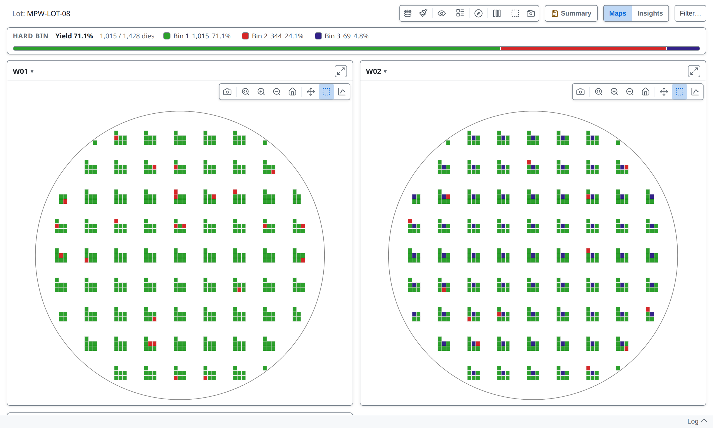

---

<!-- _class: split -->
<!-- covers: Overlays › ✓Compact layout; Overlays › Layout diagnostics -->

# Compact layout

When the occupied columns and rows repeat at a regular pitch, **Overlays** offers **Compact layout** and **Layout diagnostics** at the top.

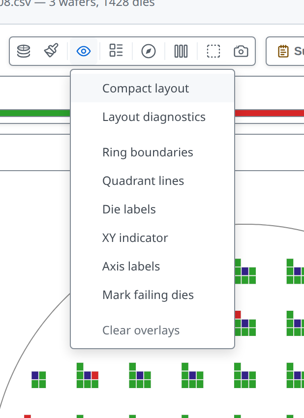

---

<!-- covers: wmap guide › Compact layout -->

# Compact

Empty rows and columns are removed and each group of dies is outlined. Every die is still counted, so yield and findings do not change, and a die's tooltip keeps its original coordinates.

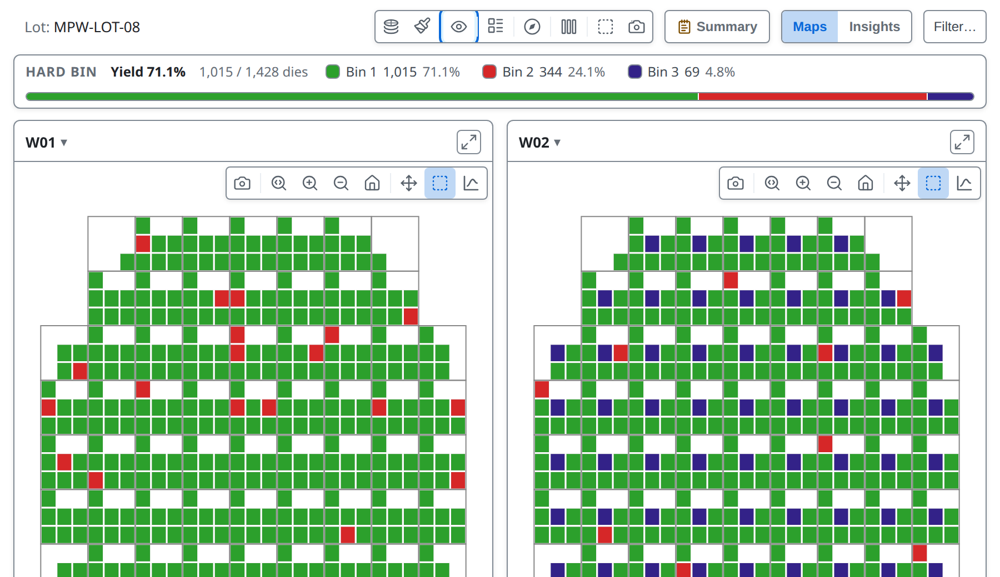

---

<!-- _class: split -->

# Layout diagnostics

If a layout is not recognised as you expect, this window shows what the detector saw: counts and scores only, with no positions, bins or wafer names. Use **Copy** or **Save as file**, then send the result to whoever supports tsmap.

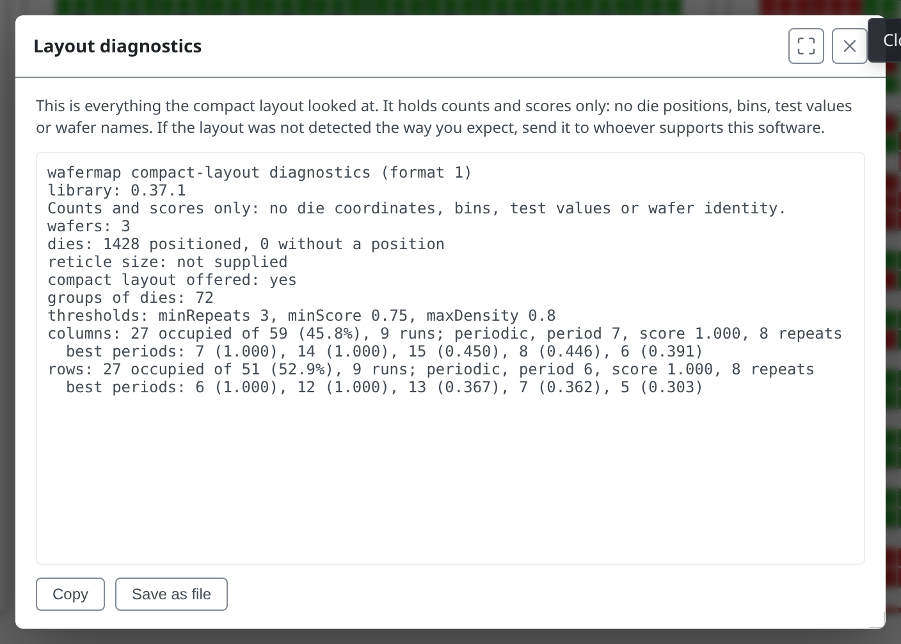

---

<!-- _class: divider -->

# Missing positions

---

<!-- covers: tsmap guide › Dies with no reported position; wmap guide › Wafers and dies with no position data -->

# Three kinds of wafer
In the lot [`COORDLESS-LOT-01`](https://wafertools.github.io/tsmap/app/?dataUrl=https%3A%2F%2Fwafertools.github.io%2Ftsmap%2Fsamples%2Ftsmap-coordless.stdf&dataFormat=stdf), **W01** has an X/Y position for every die. **W02** is mixed: some dies have results but no X/Y position. **W03** has results for its dies but no X/Y positions at all, so there is nowhere to draw them on a map.

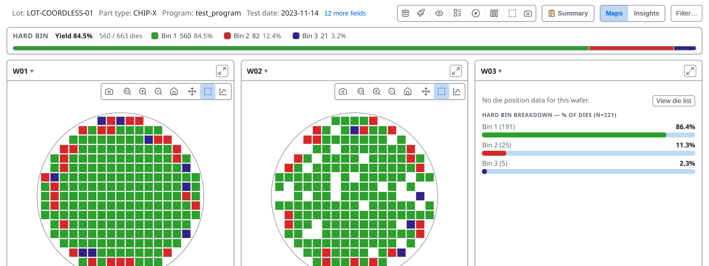

---

<!-- covers: Dies without position -->

# A mixed wafer

It draws the dies that have positions. A footer counts the rest; click it to see them.

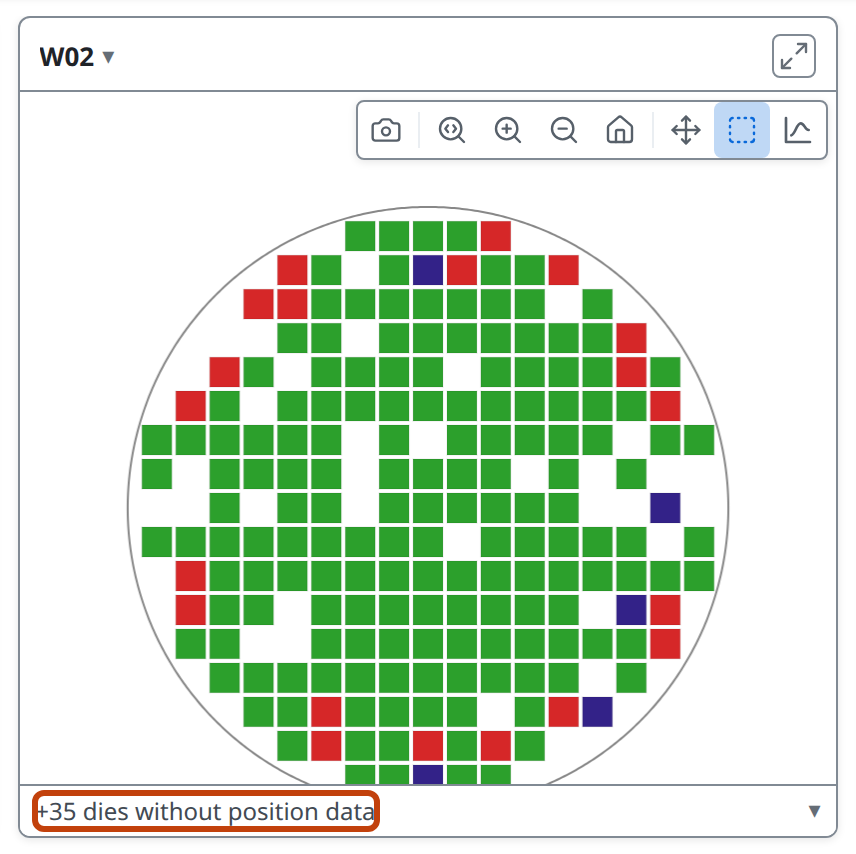

---

<!-- covers: View die list -->

# No positions at all

With no positions there is no map to draw, so the card shows a summary instead: a bin breakdown in the bin colour modes, or a histogram when colouring by a test value. **View die list** shows every die.

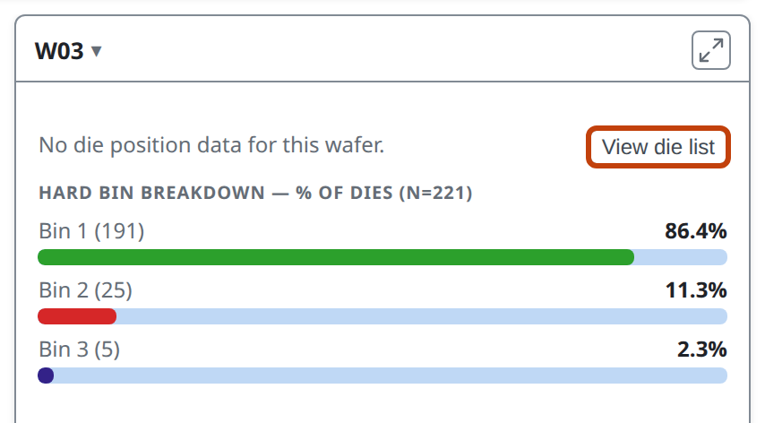

---

# The die list

A row for every die, with its position (blank here), site, bins and every test value. **Export CSV** saves it, and **View chart** switches back.

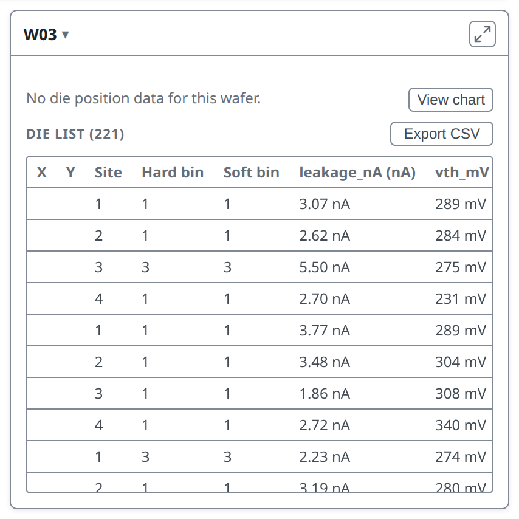

---

# What it changes

Layout findings (edge ring, quadrants, clusters) use only positioned dies. Yield, bin counts and test statistics include every die.

More in the [user guide](../user-guide.md#dies-with-no-reported-position)

---

<!-- _class: divider -->

# Repeats and sites

---

<!-- covers: glossary › Retest / retest policy -->

# Retests

- When the same die position appears more than once, one result has to stand for the die
- By default it is the last
- The die's tooltip says how often it was probed, and the log notes repeated dies

---

# A lot with retests

[`RETEST-LOT-07`](https://wafertools.github.io/tsmap/app/?dataUrl=https%3A%2F%2Fwafertools.github.io%2Ftsmap%2Fsamples%2Ftsmap-retest.csv&dataFormat=csv) has:

- a second pass over most failing dies
- a re-probe of a few passing ones
- a third probe of some

---

<!-- _class: split -->
<!-- covers: Setup ▾ › Retests…; tsmap guide › Retests; Retests… › Last result*; Retests… › First result*; Retests… › Best result*; Retests… › Worst result*; Retests… › Clear; Retests… › Cancel; Retests… › Apply; last; first; best; worst; supersedes -->

# Setup ▾ → Retests…

- **Last** or **First**: the probe by its place in the file
- **Best**: a pass over a fail, then the lower hard bin
- **Worst**: a fail over a pass, then the higher hard bin
- A result the tester marked as replacing an earlier one always counts

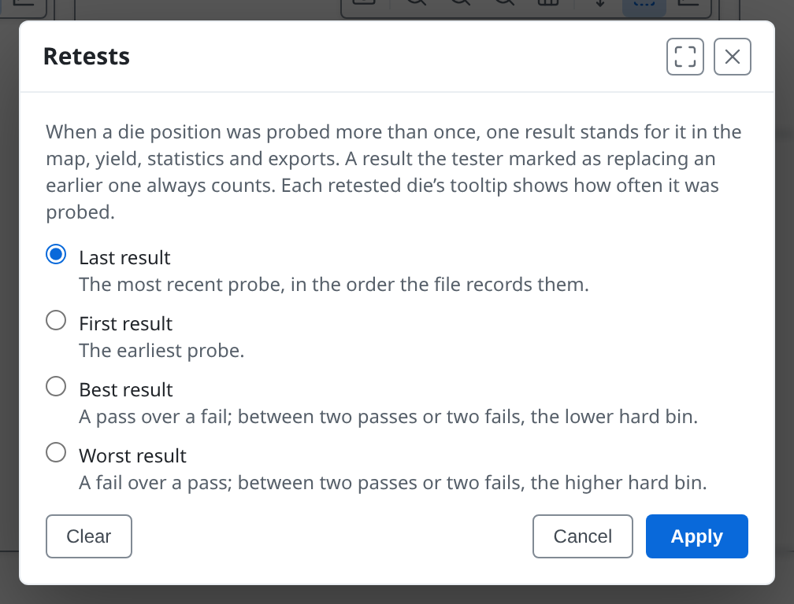

---

# One choice, every figure

The chosen result is the die on the map and in the yield, findings, Insights, tables and exports. `RETEST-LOT-07` yields 86.1% with the last result, 79.2% with the first, 91.2% with the best and 75.8% with the worst.

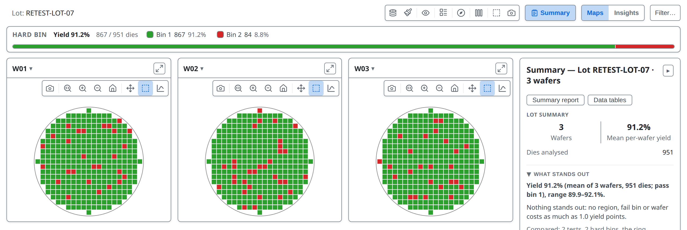

---

# The same wafer twice

If one file holds the same wafer more than once, a column that tells the passes apart (a temperature, say) makes each pass its own map, and the log names the column. With nothing to tell them apart the repeats are treated as retests.

---

<!-- covers: Column mapping › Subdivide file by this column -->

# Test site

- Many testers probe several dies at the same time, each through its own numbered **site** (1, 2, 3…)
- STDF and ATDF record each die's site. In a CSV, JSON or Parquet file, map the site-number column to **Test site**
- All sites share one wafer map; the tooltip shows a die's site, the findings compare sites, and a plot can be split by site

---

# Sites are not separate wafers

**Subdivide file by this column** makes one wafer per value of a column, for files that pack several wafers with no wafer column. Never use it for sites: they share one wafer.

---

<!-- _class: divider -->

# Geometry and limits

---

<!-- _class: split -->
<!-- covers: tsmap guide › Reticle; glossary › Reticle; Setup ▾ › Reticle…; Reticle… › Field width (dies); Reticle… › Field height (dies); Reticle… › Corner die X; Reticle… › Corner die Y; Reticle… › Clear; Reticle… › Cancel; Reticle… › Apply -->

# Reticle…

The group of dies exposed in one stepper shot. Files don't record its size, so enter its width and height in dies. Set the corner die only if a field doesn't start at (0, 0).

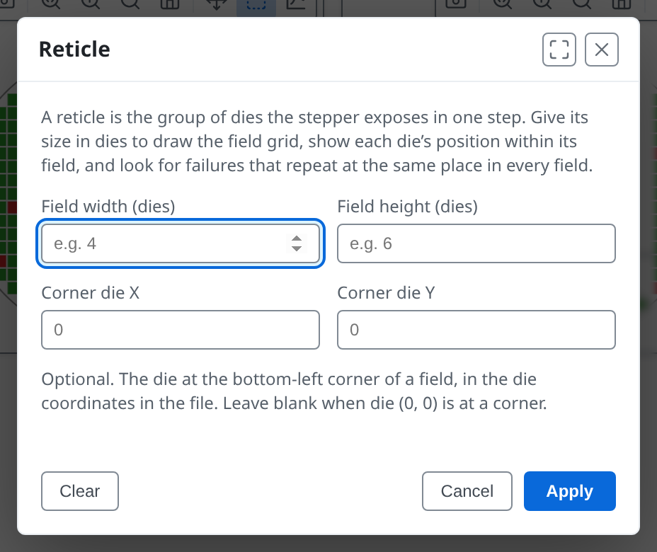

---

<!-- _class: split -->

# A field of 4 by 3

Here the field is 4 dies wide and 3 high. **Apply** takes effect at once. **Clear** removes the reticle. The reticle applies to every wafer and is remembered.

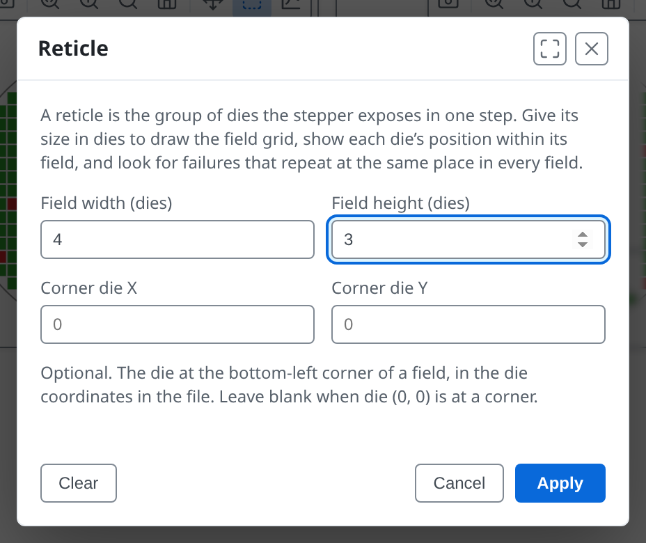

---

<!-- covers: wmap guide › Reticle overlay; glossary › Reticle cell; chart › Reticle cell yield -->

# The field grid

- The grid is drawn and the tooltip gives each die's cell
- Findings look for a cell that fails in every field
- **Reticle cell** yield joins the Summary and the Overview: low everywhere points at the mask

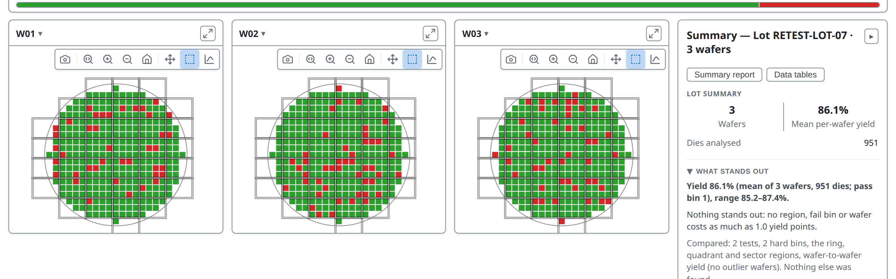

---

<!-- _class: side -->
<!-- covers: Overlays › ✓Reticle grid; glossary › Reticle shot -->

# Reticle grid

**Overlays ▾ → Reticle grid** hides or shows it. Plots gain two fields: **Reticle cell**, a die's place inside the field, and **Reticle shot**, which exposure it came from.

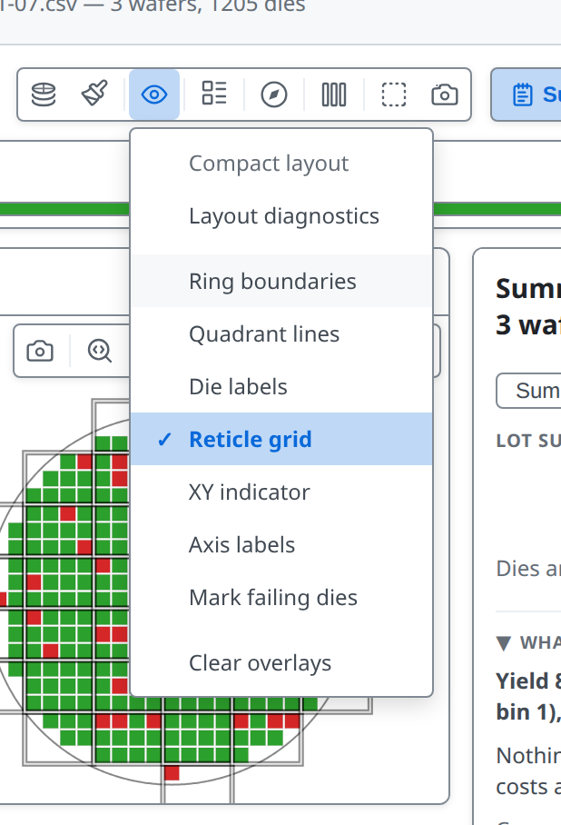

---

<!-- _class: split -->
<!-- covers: tsmap guide › Wafer diameter and edge exclusion; glossary › Edge exclusion; Setup ▾ › Diameter & edge exclusion…; Diameter & edge exclusion… › Wafer diameter (mm); Diameter & edge exclusion… › Edge exclusion width (mm); Diameter & edge exclusion… › Clear; Diameter & edge exclusion… › Cancel; Diameter & edge exclusion… › Apply -->

# Diameter and edge exclusion

- Enter the diameter when there are too few dies to work it out
- **Edge exclusion**: a band at the rim, in mm, left out of yield and drawn dimmed
- The band needs a diameter first

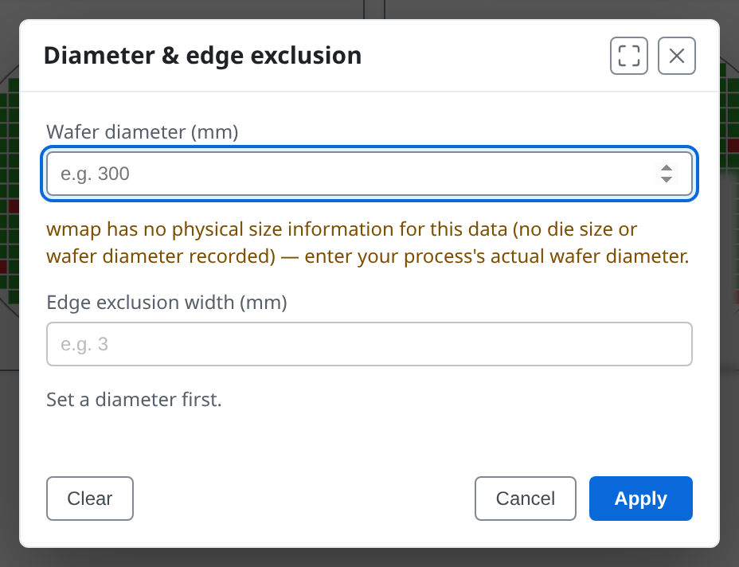

---

# A band at the edge

With 300 mm and 10 mm entered, dies within 10 mm of the edge are left out of yield and drawn dimmed. Both values are remembered.

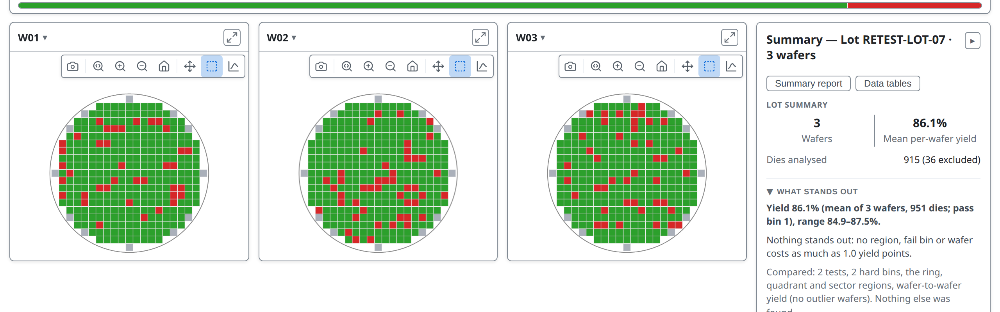

---

<!-- _class: split -->
<!-- covers: Setup ▾ › Exclude values outside limits…; tsmap guide › Excluding values outside limits; wmap guide › Values outside a limit set; glossary › Validity limit; glossary › Excluded value -->

# Exclude values outside limits…

- A tester out of range records its rail, such as a compliance clamp, not a reading
- Values outside a test's **validity limits** count as missing: grey, and out of the statistics
- Or choose spec limits, test limits, or Off

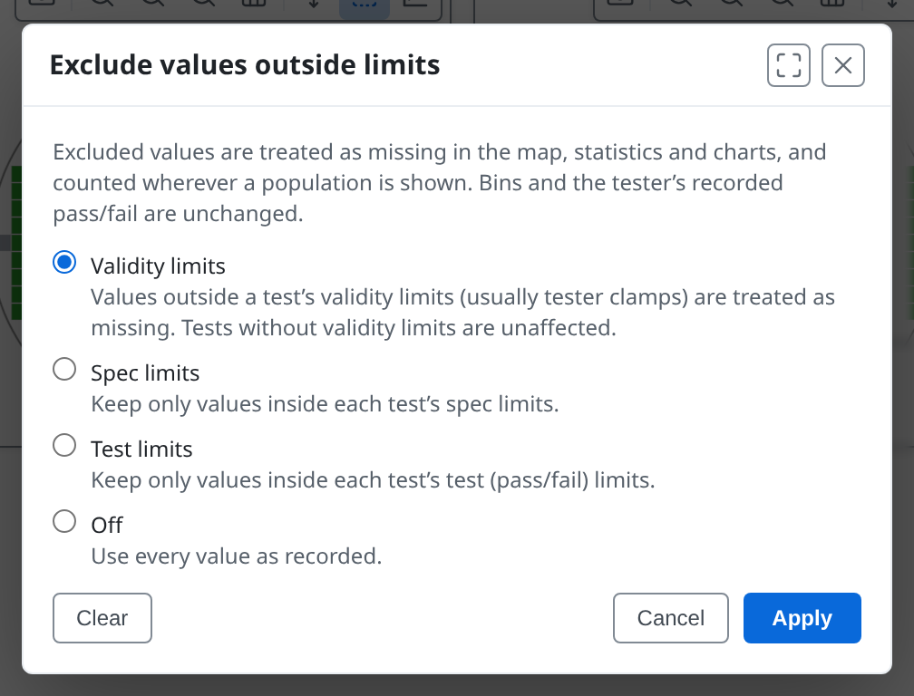

---

# Nothing is hidden

The tooltip on a grey die names the excluded value, and the Summary panel's Test Values table shows an **Excl.** column. Bins and the tester's pass or fail are unchanged, so yield is the same.

---

<!-- _class: lab -->

# Try it yourself

1. Open the [multi-project wafer](https://wafertools.github.io/tsmap/app/?dataUrl=https%3A%2F%2Fwafertools.github.io%2Ftsmap%2Fsamples%2Ftsmap-multi-project.csv&dataFormat=csv), **Continue →**, then **Overlays → Compact layout**
2. Open the [wafers without positions](https://wafertools.github.io/tsmap/app/?dataUrl=https%3A%2F%2Fwafertools.github.io%2Ftsmap%2Fsamples%2Ftsmap-coordless.stdf&dataFormat=stdf): open W03's **View die list**
3. Open the [clamped readings](https://wafertools.github.io/tsmap/app/?dataUrl=https%3A%2F%2Fwafertools.github.io%2Ftsmap%2Fsamples%2Ftsmap-validity.csv&dataFormat=csv) and switch **Exclude values outside limits…** between **Validity limits** and **Off**
4. Open the [retested lot](https://wafertools.github.io/tsmap/app/?dataUrl=https%3A%2F%2Fwafertools.github.io%2Ftsmap%2Fsamples%2Ftsmap-retest.csv&dataFormat=csv), **Continue →**, then try each choice in **Setup ▾ → Retests…** and watch the yield
5. On the sample lot, **Setup ▾ → Reticle…**, enter 4 by 3 and **Apply**

---

# Recap

- **Compact layout** shows multi-project wafers at a readable size
- Wafers with missing positions keep every die in the numbers
- **Retests…** chooses which probe stands for a die tested more than once
- **Reticle…** and **Diameter & edge exclusion…** supply what the file does not say, and **Exclude values outside limits…** removes tester clamp values

More in the [user guide](../user-guide.md#analysing-your-data)

---

<!-- _class: next -->
<!-- _paginate: false -->

# Next lesson

[12 · Automation and integration →](12-automation.md)

The command line, links, and definitions files.
