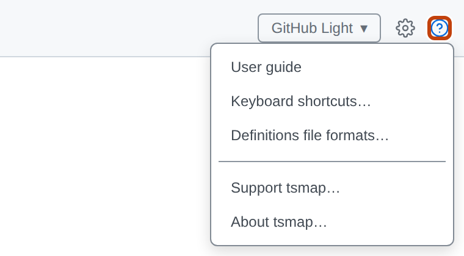
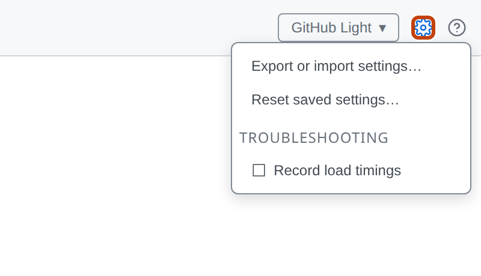
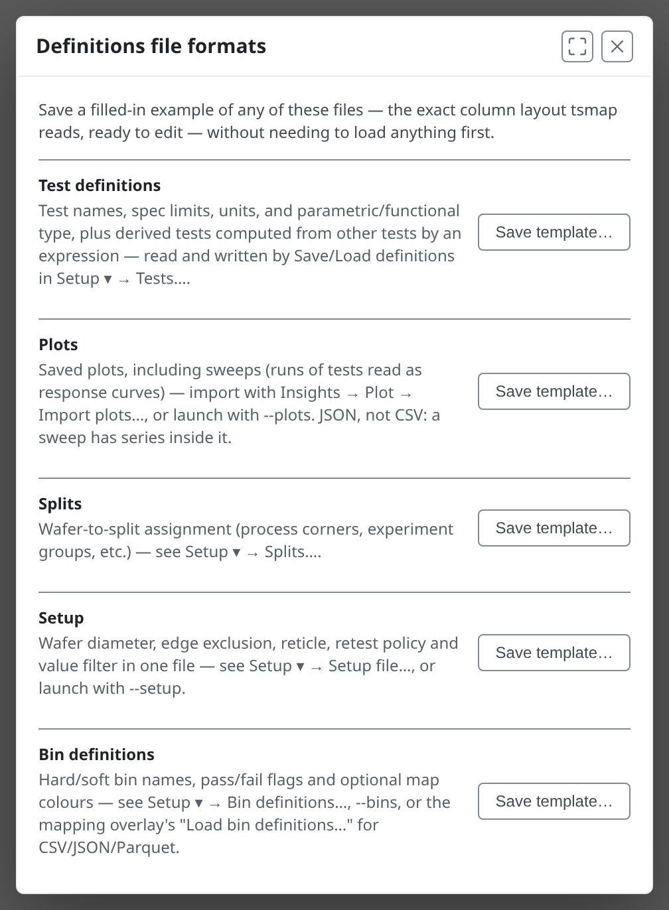
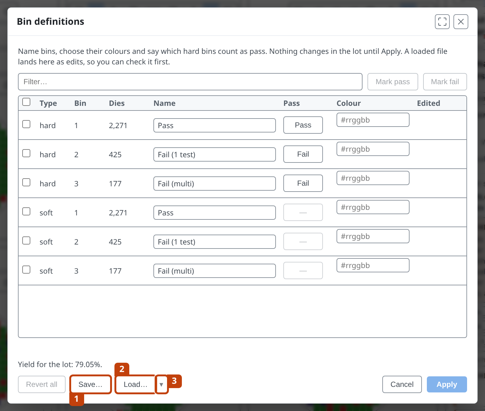
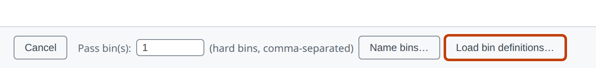
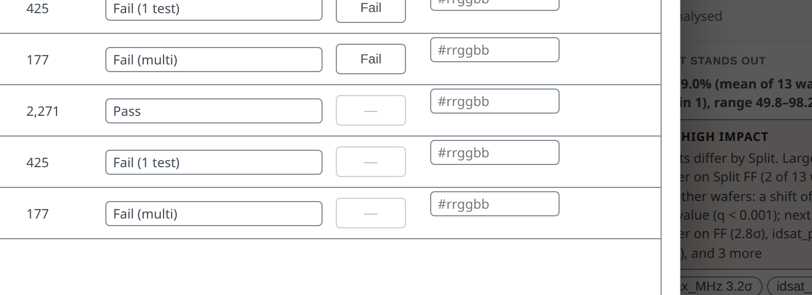
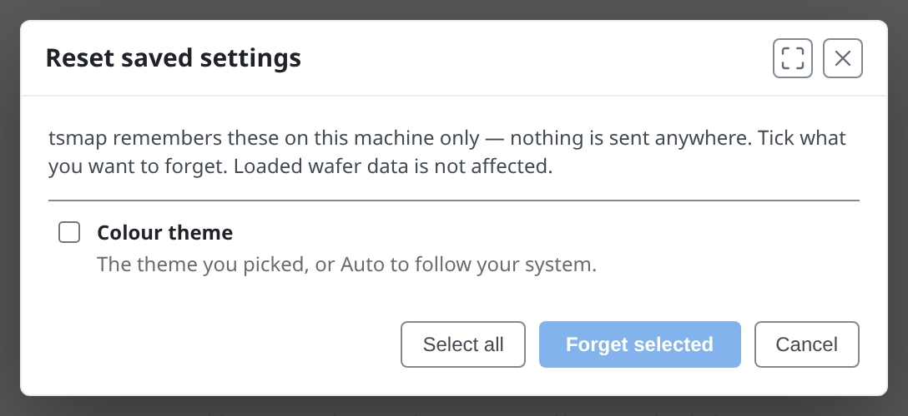

<!-- _class: title -->
<!-- _paginate: false -->

# Automation and integration

## Lesson 12

Learn tsmap

---

# In this lesson

- Open data from a link or the command line
- Use the definitions files: tests, splits, bins and plots
- See and reset what tsmap remembers

---

<!-- _class: divider -->

# Opening data automatically

---

<!-- covers: tsmap guide › Opening data from a URL -->

# From a link
Another application can open the web app on a data file:

`…/app/?dataUrl=<encoded URL>&dataFormat=csv`

Name the format: `stdf`, `atdf`, `csv`, `json`, `parquet` or `zip`.

---

<!-- covers: tsmap guide › Browser build: the data server must allow cross-origin requests (CORS) -->

# The lab link
The labs in these lessons use it. This opens the sample CSV:

[Open the sample CSV](https://wafertools.github.io/tsmap/app/?dataUrl=https%3A%2F%2Fwafertools.github.io%2Ftsmap%2Fsamples%2Ftsmap-sample.csv&dataFormat=csv)

The data server must allow pages from other websites to read the file (this is called CORS). If the fetch fails, the log says so.

More in the [user guide](../user-guide.md#opening-data-from-a-url)

---

<!-- covers: tsmap guide › Command line -->

# The command line
On the desktop app, name files when you launch it:

`tsmap lot1.stdf lot2.stdf`
`tsmap lot1.stdf --splits my-splits.csv`
`tsmap lot1.stdf --plots my-plots.json`
`tsmap --url https://… --url-format stdf`

`tsmap --help` lists everything. Launching again hands the files to the running window.

---

# More options

- `--wafer-diameter`, `--edge-exclusion`, `--reticle`: the dialogs' values, for that launch
- `--tests` fills in the test selector; `--list` reads a list of paths
- A `tsmap://open?url=…` link opens the desktop app from a web page

More in the [user guide](../user-guide.md#command-line)

---

<!-- covers: tsmap guide › Authentication -->

# Data behind a login

- A link carries no password: use a presigned URL
- `--url-headers auth.txt` sends a token from a file (desktop)
- See the [integration guide](../integrating-data-selection.md) and a [live demo](../demos/open-from-link.html)

---

<!-- covers: tsmap guide › File associations (desktop) -->

# File associations
On the desktop app, **Preferences → File associations…** opens `.stdf`, `.atdf` and `.parquet` files in tsmap by double-click. Nothing is associated until you tick it. It is not available in the browser.

---

<!-- _class: split -->
<!-- covers: Help › User guide; Help › Keyboard shortcuts…; Help › Definitions file formats…; Help › Support tsmap…; Help › About tsmap… -->

# The Help menu

- **User guide** opens the full guide
- **Keyboard shortcuts…** lists the keys; **?** opens it from anywhere
- **Definitions file formats…** is covered in the next section
- **Support tsmap…** opens the page on how to support the project
- **About tsmap…** shows the version

---

<!-- _class: split -->
<!-- covers: Preferences; Preferences › Export or import settings…; Preferences › Reset saved settings…; Preferences › ☐Record load timings; tsmap guide › Taking settings to another machine; Export or import settings… › Export…; Export or import settings… › Import…; Export or import settings… › Close -->

# The Preferences menu

The gear works with nothing loaded.

- **Export or import settings…** carries your column mappings and preferences to another machine. **Export…** writes a file and **Import…** reads one. Column mappings merge at once; the other settings are chosen from a list, and tsmap then reloads. Recent files, split assignments and the setup values are never included
- **Reset saved settings…** is covered after the definitions files
- **Record load timings** is for bug reports only: it adds timing lines to the log. Leave it off otherwise

---

<!-- _class: divider -->

# Definitions files

---

<!-- _class: split -->
<!-- covers: tsmap guide › Definitions files; Definitions file formats… › Save a test definitions template; Definitions file formats… › Save a plots template; Definitions file formats… › Save a splits template; Definitions file formats… › Save a bin definitions template; Definitions file formats… › Save a setup template -->

# Definitions file formats…

Five kinds of file, each with a **Save template…** button that writes a filled-in example in the exact layout tsmap reads. You can save a template and edit it before you have any data.

---

<!-- covers: tsmap guide › Test definitions file; tsmap guide › Splits file; tsmap guide › Bin definitions file; tsmap guide › Sweeps in a plots file -->

# Four CSV files and one JSON
- CSV: test definitions (lesson 01), splits (04), bin definitions and the setup file (here)
- JSON: plots and sweeps (09 and 10)
- Every format is in the [user guide](../user-guide.md#definitions-files)

---

<!-- covers: tsmap guide › Saving the setup; tsmap guide › Setup file; Setup ▾ › Setup file…; Setup file… › Save…; Setup file… › Load…; Setup file… › Load a recently used definitions file; Setup file… › Close -->

# Setup file…

The last rows of **Setup ▾** (diameter, edge exclusion, reticle, retests, value filter) can be saved as one file for a product or a site, and loaded again from **Setup ▾ → Setup file…**: **Save…** writes it, **Load…** reads one, and the **▾** lists recent files. On the command line, `--setup` applies one for a single launch.

---

<!-- _class: split -->
<!-- covers: tsmap guide › Bin definitions; Setup ▾ › Bin definitions…; Bin definitions… › Save…; Bin definitions… › Load…; Bin definitions… › Load a recently used definitions file; Bin definitions… › Mark pass; Bin definitions… › Mark fail; Bin definitions… › Tick every row that matches the filter; Bin definitions… › Revert all; Bin definitions… › Cancel; Bin definitions… › Apply -->

# Bin definitions…

A table of every hard and soft bin with its die count, a name, whether a hard bin passes, and optionally its map colour. Tick rows for **Mark pass** or **Mark fail**; **Revert all** undoes the edits. Changing a pass flag shows the lot's yield before and after, and **Apply** asks you to confirm. 1 **Save…** writes them to a CSV file. 2 **Load…** reads one. 3 The **▾** lists recently used files.

---

<!-- covers: Colour scheme › ✓Use colours from bin definitions -->

# STDF, ATDF and the rest

STDF and ATDF name their bins; in a table every bin is a bare number until you load definitions. Bin colours from a file can be switched off under **Colour scheme**.

---

<!-- covers: Load bin definitions…; Name bins… -->

# In the column mapping

For those formats, name the bins in the column mapping before you continue: **Name bins…** opens the bin table over the bins in the sample of rows it holds (add a rare one by number), and **Load bin definitions…** reads a file. Both are next to **Pass bin(s)**.

---

<!-- _class: split -->
<!-- covers: tsmap guide › Recently used definitions files -->

# Recent definitions files

- The **▾** beside **Load…** lists recent files of that kind
- In the browser an entry is a copy from when you last used it
- Changed since? Use **Choose a file…** to pick it again

---

<!-- _class: divider -->

# What tsmap remembers

---

<!-- _class: split -->
<!-- covers: tsmap guide › What tsmap remembers, and how to forget it; Reset saved settings… › stored item; Reset saved settings… › Select all; Reset saved settings… › Forget selected; Reset saved settings… › Cancel -->

# Reset saved settings…

- Theme, splits, mappings, plots, filters, geometry: kept on this machine
- The window lists what is stored now
- Tick items, then **Forget selected**
- It is also the way to undo anything an earlier lab left behind

---

# Nothing is sent anywhere

Loaded wafer data is not affected by a reset. Saved settings stay on this machine, and tsmap does not upload your data.

---

<!-- _class: lab -->

# Try it yourself

1. Open **Help → Definitions file formats…** and save the splits template
2. On the sample lot, open **Setup ▾ → Bin definitions…** and **Save…**
3. *Optional, desktop app only:* in a terminal run `tsmap --help`, then `tsmap sample.stdf` with any STDF file to open it from the command line
4. Open **Preferences → Reset saved settings…** and read the list of what is stored, then **Cancel**

---

# Recap

- A link or the command line opens data with no clicking
- Templates show the exact layout of every definitions file
- **Reset saved settings…** shows and forgets what tsmap remembers

More in the [user guide](../user-guide.md#reference)

---

<!-- _class: next -->
<!-- _paginate: false -->

# That is every lesson

Back to [the start](00-welcome.md), or open the app and try your own data.

wafermap is the library tsmap is built on. To use it in your own application, see the [wafermap documentation](https://wafertools.github.io/wafermap/), [quickstart](https://wafertools.github.io/wafermap/quickstart/) and [developer guide](https://wafertools.github.io/wafermap/guide/).
