<!-- _class: title -->
<!-- _paginate: false -->

# Welcome to tsmap

## Session 00

tsmap training · a self-paced course

---

# In this session

- A quick recap of the terms tsmap uses
- What tsmap is, and the two ways to run it
- A tour of the screen, one area at a time

---

<!-- _class: split -->
<!-- covers: Bin legend entry -->

# A quick recap

- **Wafer map**: one square per die, coloured by bin or by a test value
- **Bin**: the category the tester put a die in. The legend lists them: here bin 1 is Pass, in green
- **Yield**: the share of dies that pass, 79.0% for this lot

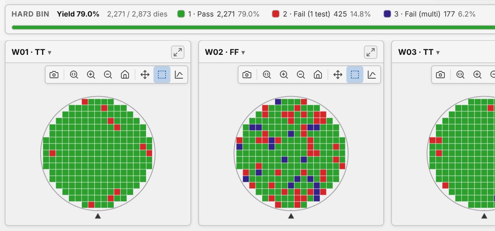

---

<!-- _class: divider -->

# What tsmap is

---

# A viewer for wafer test data

Open STDF, ATDF, CSV, JSON or Parquet files and get interactive wafer maps, findings and charts.

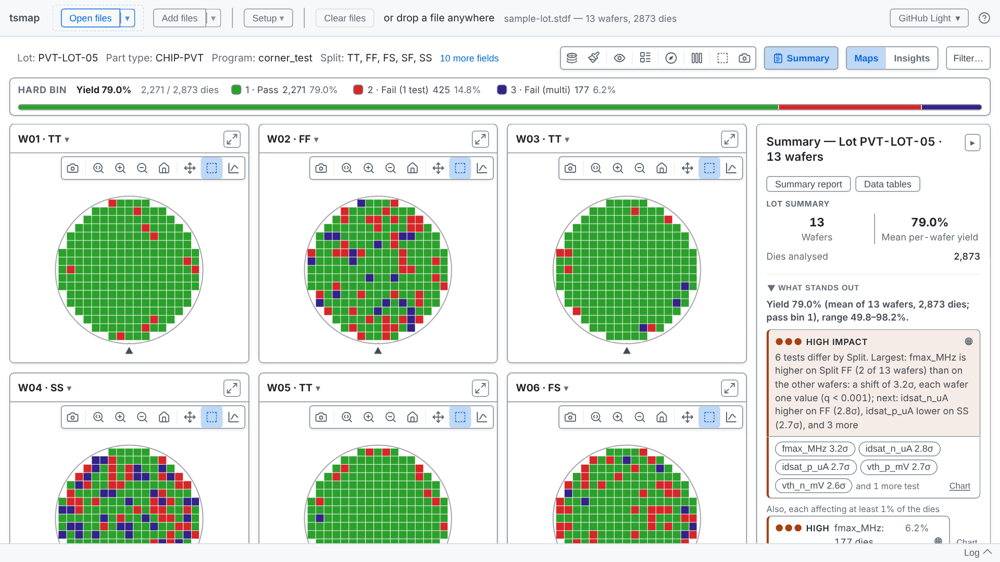

---

# Two ways to run it

- **In the browser** at [wafertools.github.io/tsmap/app](https://wafertools.github.io/tsmap/app/): nothing to install
- **As a desktop app** for Linux, macOS and Windows
- The same parser and the same maps in both

---

# Your files stay with you

- Files are read on your own computer, in the browser or the app
- Nothing is uploaded

---

<!-- _class: divider -->

# Finding your way round

Eight areas, numbered once, then one at a time

---

<!-- covers: Load sample data -->

# Everything starts here

**Load sample data** opens a synthetic lot of 13 wafers. Every lab in this course uses it.

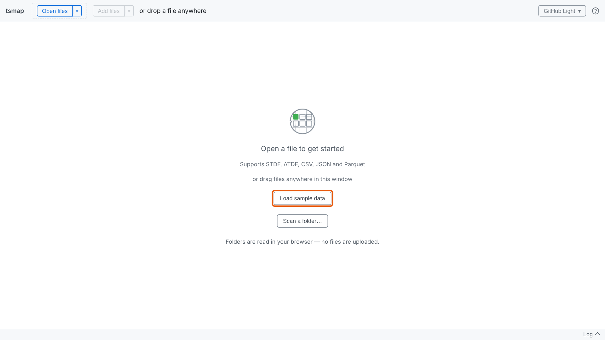

---

# The screen at a glance

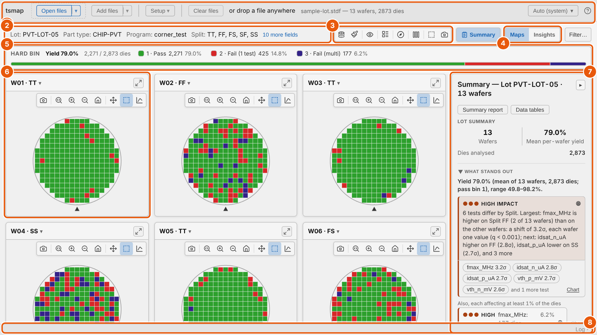

---

<!-- covers: Open files; Add files; Setup ▾; Clear files -->

# 1 The app toolbar

Open and add files, set up the lot, and clear it. Session 01 covers loading.

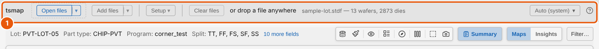

---

<!-- covers: More fields -->

# 2 The lot header

The lot, part type, program and other fields read from the file.

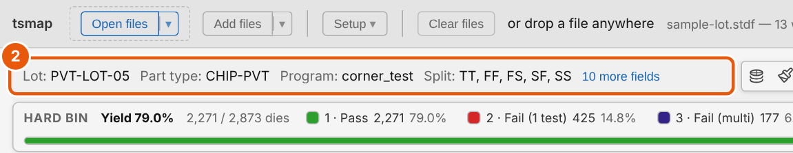

---

# 3 The map toolbar

What the maps show and how they look. Session 02 takes it button by button.

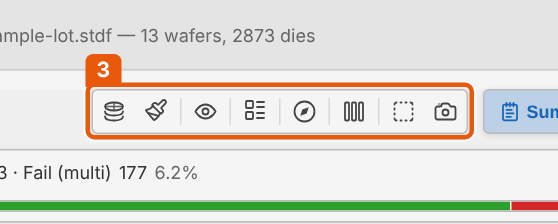

---

<!-- covers: Maps; Insights -->

# 4 Maps and Insights

Switch between the wafer maps and the charts and statistics for the lot.

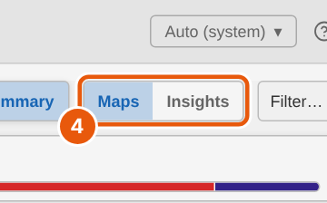

---

# 5 The bin legend

How many dies fell into each bin, with the lot's yield first.

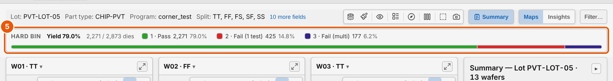

---

<!-- covers: Wafer chip (one per wafer) -->

# 6 One card per wafer

Each wafer gets its own map. The ▾ beside its name shows the wafer's details.

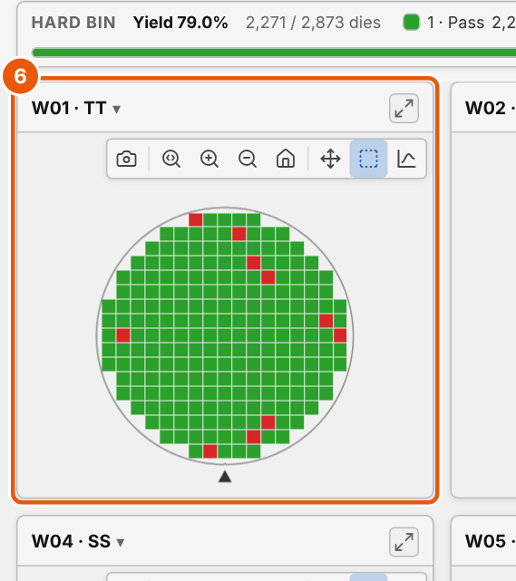

---

<!-- covers: Summary; Close the Summary panel -->

# 7 The Summary panel

What stands out in the lot, the findings, and the yield of every wafer.

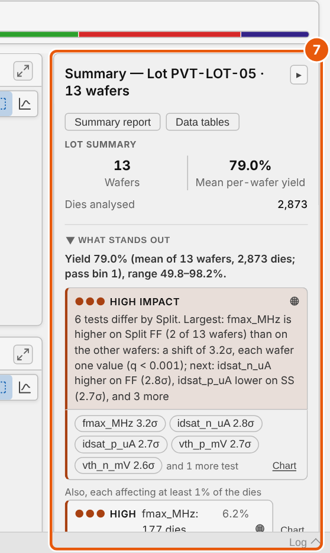

---

<!-- covers: Log -->

# 8 The log

What each load did, with any warnings. Click **Log** to open it.

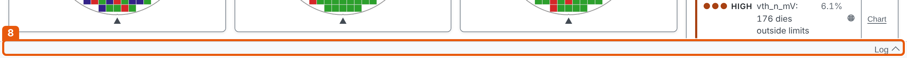

---

<!-- covers: Help -->

# Help is one click away

The **?** button opens the Help menu. **User guide** opens the full guide.

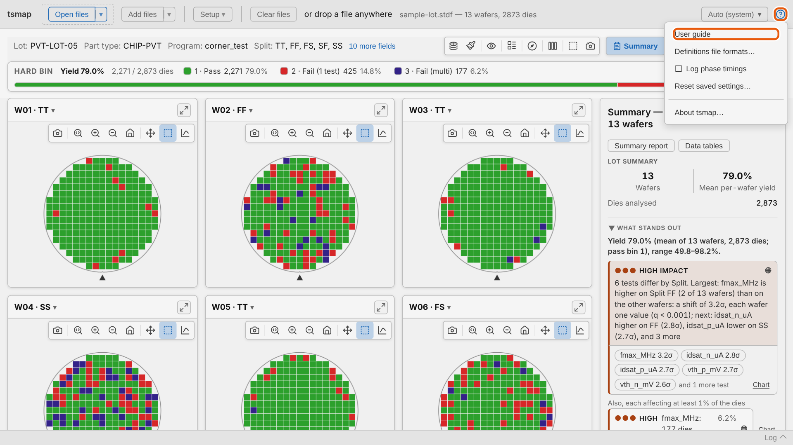

---

<!-- _class: divider -->

# How the course works

---

# Eleven short sessions

- Each session is a short set of slides, then a lab
- Every lab runs in the web app, with the sample data
- For the detail behind a slide, follow the link to the [user guide](../user-guide.md)

---

<!-- _class: lab -->

# Try it yourself

1. Open the web app: [wafertools.github.io/tsmap/app](https://wafertools.github.io/tsmap/app/)
2. Click **Load sample data**
3. Find all eight areas from the tour
4. Click **Insights**, then **Maps** to come back

---

# Recap

- A wafer map shows every die of a wafer; yield is the share that pass
- tsmap runs in the browser or as a desktop app, and keeps your files local
- Toolbar, lot header, map toolbar, views, legend, wafers, Summary, log

---

<!-- _class: next -->
<!-- _paginate: false -->

# Next session

[01 · Getting data in →](01-getting-data-in.md)

Every way to load your own files.
