<!-- _class: title -->
<!-- _paginate: false -->

# Getting data in

## Session 01

tsmap training · a self-paced course

---

# In this session

- Open files from inside the app, and build one lot from several files
- Choose and rename tests in the test selector
- Map the columns of a CSV, JSON or Parquet file

---

<!-- _class: divider -->

# Opening files

---

<!-- covers: Load sample data -->

# The quickest start

**Load sample data** opens a synthetic lot: 13 wafers from five process corners.

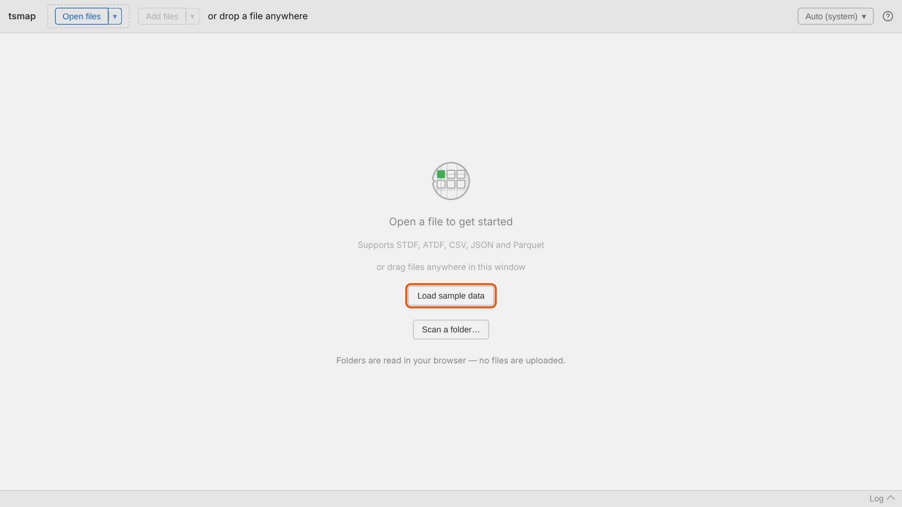

---

# What tsmap reads

- **STDF** and **ATDF**: tester files, read directly
- **CSV**, **JSON** and **Parquet**: tables, after a column mapping step
- **.gz**, **.bz2** and **.zip**: read without unpacking first

---

# Drag and drop

Drop one or more files anywhere in the window. It is the same as picking them.

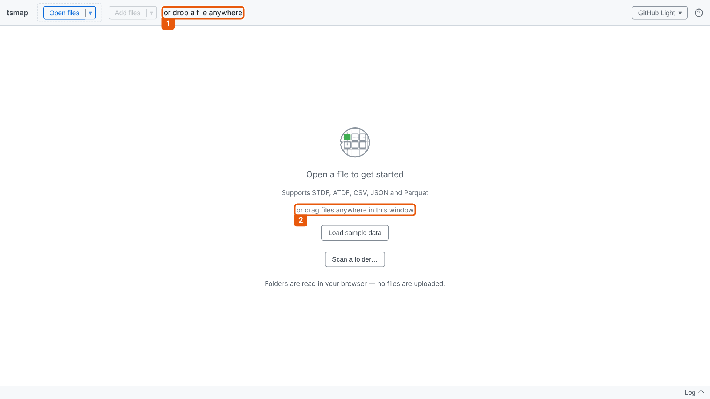

---

<!-- covers: Open files; Choose how to pick files to open; Choose how to pick files to open › Choose files…; Choose how to pick files to open › Scan a folder… -->

# Open files ▾

**Open files** picks files. The **▾** beside it offers **Choose files…** or **Scan a folder…**

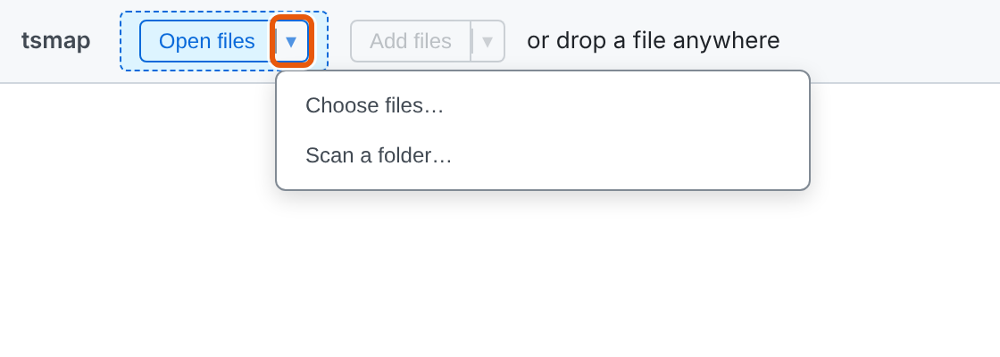

---

# Recent files

*Desktop app only.* The last 8 file sets you opened are listed under **Open files ▾** and on the start screen.

---

<!-- _class: divider -->

# Scanning a folder

Hundreds of files? Let tsmap tell you what is in them.

---

<!-- _class: split -->
<!-- covers: Scan a folder…; Filter files › Sort by column; Filter files › Filter by column; Columns ▾; Clear filters -->

# The file filter

- Reads only each file's header: quick, even for big batches
- Click a heading to sort; **▾** to filter that column
- Search across every column

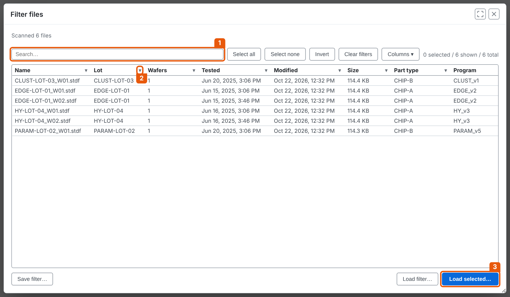

---

<!-- covers: Select all; Select none; Invert; Load selected…; Save filter…; Load filter… -->

# Pick, then load

Search for **EDGE**, **Select all** of what is shown, then **Load selected…**

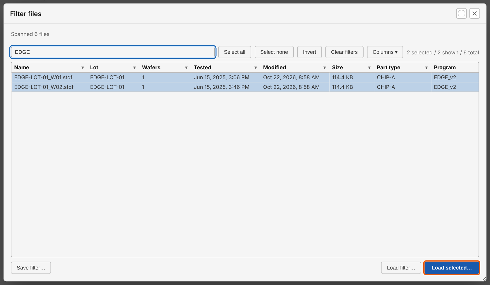

---

# One lot from separate files

The two files hold one wafer each. They load as one lot, EDGE-LOT-01.

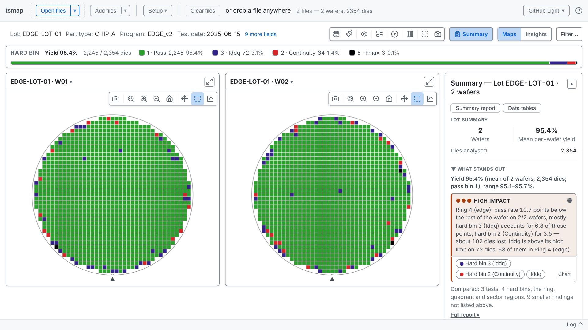

---

<!-- covers: Add files; Choose how to pick files to add; Choose how to pick files to add › * -->

# Add files

**Add files** appends wafers to what is loaded. tsmap checks the new data fits first.

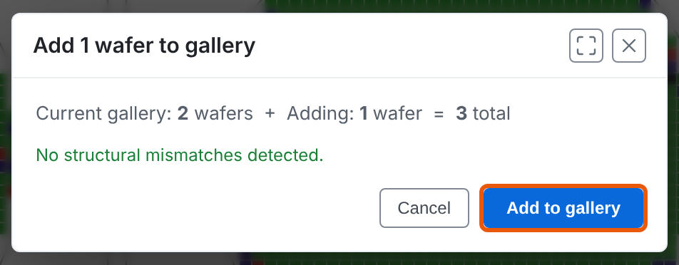

---

# The lot grows

The third wafer joins the same gallery, Summary and yield.

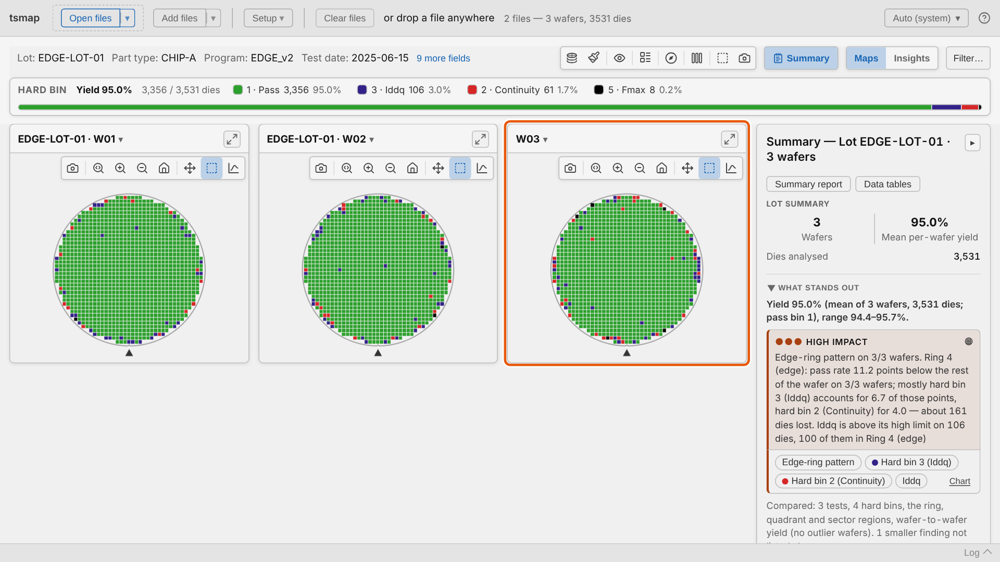

---

# Two more ways to open data

Everything so far opens files from inside the app. Two other routes open data without any clicking:

- **A link**: a web address that tells the web app which file to load
- **The command line**: the desktop app opens files you name when you start it

Both are covered in [session 10](10-automation.md).

---

<!-- _class: divider -->

# Choosing tests

---

<!-- covers: Setup ▾; Setup ▾ › Tests… -->

# The test selector

A small lot imports every test. **Setup ▾ → Tests…** opens the selector at any time.

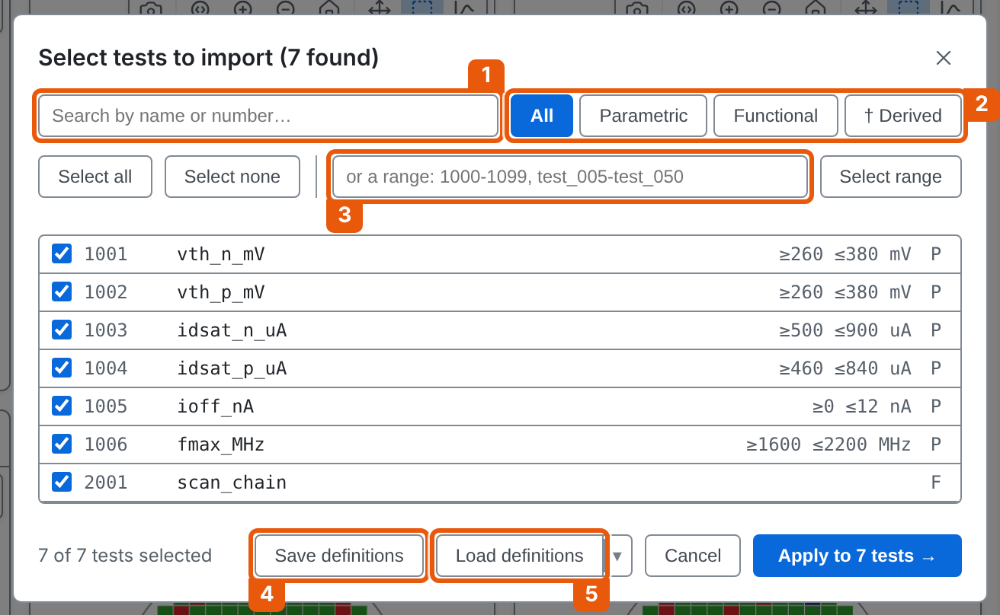

---

<!-- _class: split -->
<!-- covers: All; Parametric; Functional; Select range; Test selector › test row -->

# Narrow, then select

- 1 Search by name or number
- 2 Show one type of test
- 3 Select a range, such as `1001-1004`

---

<!-- covers: Apply to N tests →; Close -->

# Rename a test

Click into a name and type. **Enter** keeps it; only the displayed name changes.

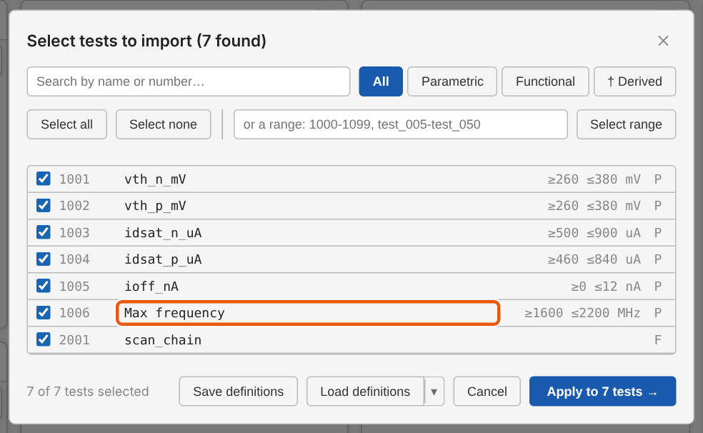

---

<!-- covers: Save definitions; Load definitions; Load a recently used definitions file -->

# Save and load definitions

4 **Save definitions** writes the selection, names and limits to a CSV. 5 **Load definitions** reapplies it.

---

<!-- _class: divider -->

# Mapping columns

CSV, JSON and Parquet only

---

# Not for STDF or ATDF

STDF and ATDF files have a fixed layout: wafer ID, die position, bins and test numbers each have a named record. tsmap reads them directly, so they skip this step and go to the test selector.

CSV and JSON have no fixed schema and Parquet carries its own, so tsmap has to ask which column is which.

---

<!-- covers: Column mapping › Role; Continue → -->

# Column mapping

Every column gets a role. Common names are detected for you; check, then **Continue →**

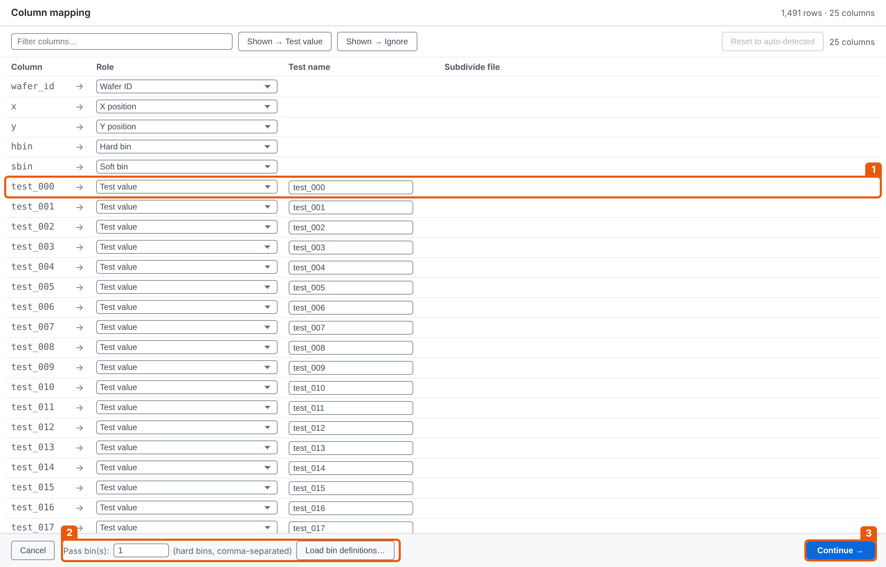

---

# Wide format

One column per test. Each test column takes the **Test value** role 1.

---

# Long format

One row per die per test: a test number or name column, and a result column.

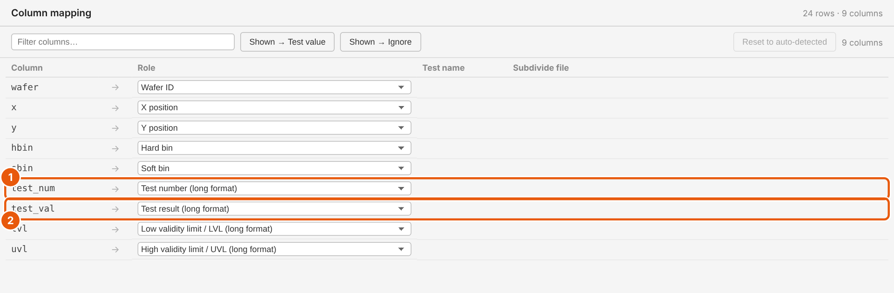

---

<!-- covers: Shown → Test value; Shown → Ignore -->

# Many columns at once

1 Filter the columns by name, then give every shown column one role: 2 **Test value** or 3 **Ignore**.

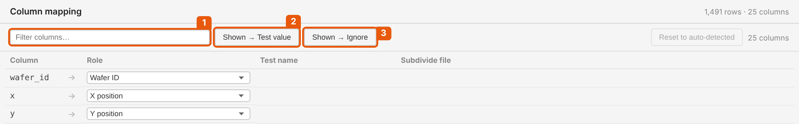

---

# Pass bins

**Pass bin(s)** says which hard bins count as a pass. The default is 1; list several with commas, such as `1,7`.

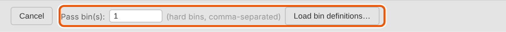

---

<!-- covers: Reset to auto-detected -->

# Saved mappings

The roles you confirm are remembered for that set of columns. **Reset to auto-detected** forgets them.

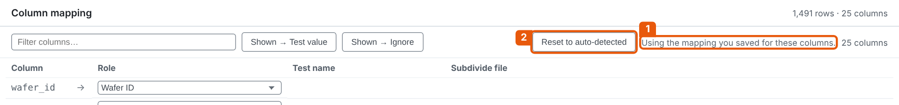

---

<!-- _class: divider -->

# Making it yours

---

<!-- covers: Colour theme -->

# Colour theme

Auto follows your system. Or pick a light or dark theme: it is remembered.

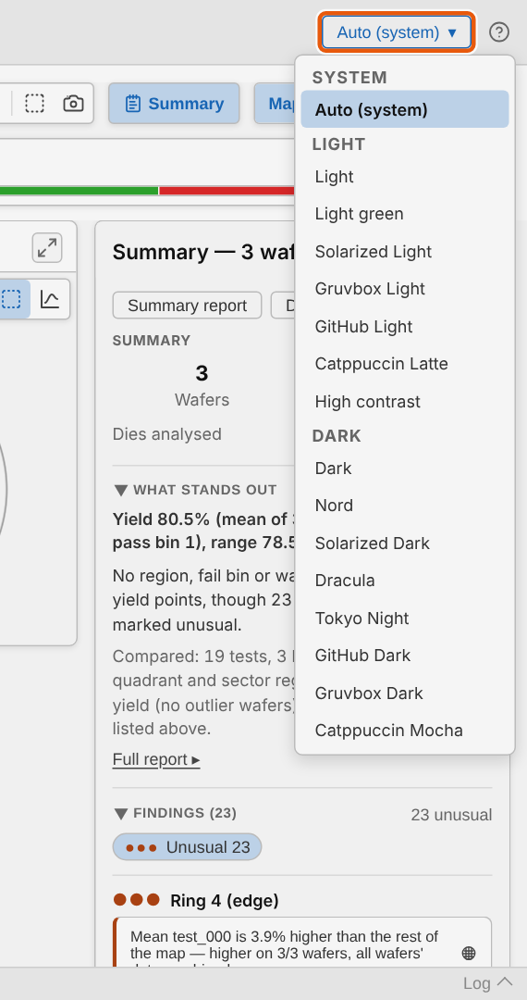

---

# The whole app follows

Maps, charts and panels all take the theme's colours.

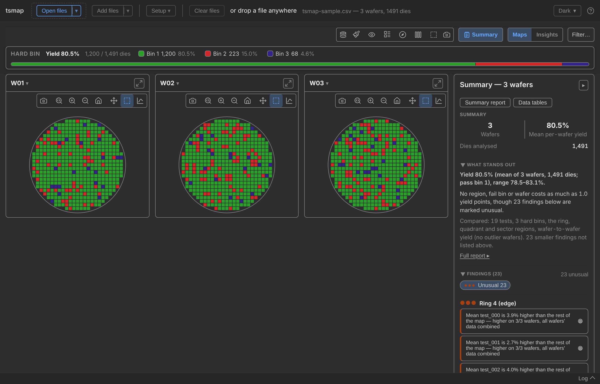

---

<!-- covers: Log; Log (with new-warning count) -->

# The log panel

What each load did. Warnings are counted on the **Log** button until you open it.

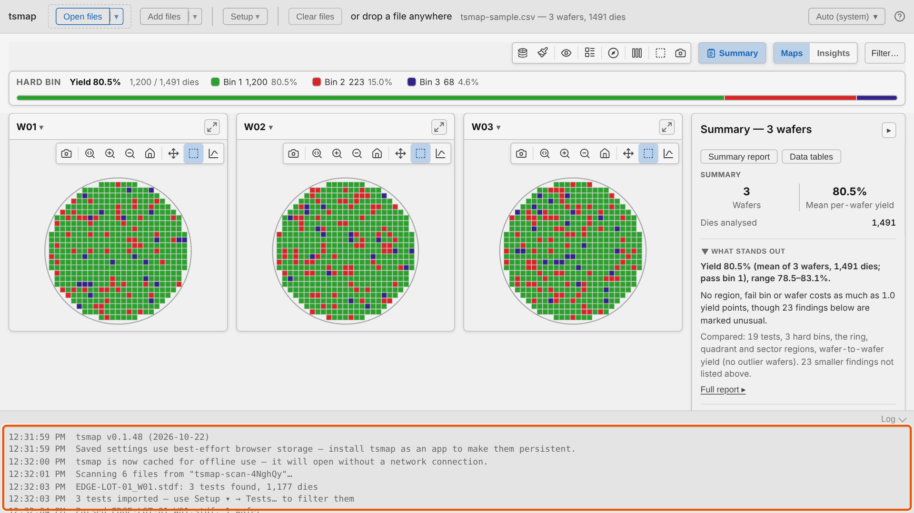

---

<!-- _class: lab -->

# Try it yourself

1. Open the [sample CSV in the web app](https://wafertools.github.io/tsmap/app/?dataUrl=https%3A%2F%2Fwafertools.github.io%2Ftsmap%2Fsamples%2Ftsmap-sample.csv&dataFormat=csv): check the roles, then **Continue →**
2. **Clear files**, then **Load sample data**
3. **Setup ▾ → Tests…**: rename a test, then apply
4. Switch to a dark theme, then open the log

---

# Recap

- Drop files, **Open files**, or scan a folder and filter by lot
- **Add files** grows the lot; **Setup ▾ → Tests…** chooses and renames tests
- Tables need a column mapping, and tsmap remembers it

More in the user guide: [Loading your data](../user-guide.md#loading-your-data)

---

<!-- _class: next -->
<!-- _paginate: false -->

# Next session

[02 · Reading a map and the toolbar →](02-reading-a-map.md)

Plot modes, colours, overlays and zoom.
