<!-- _class: title -->
<!-- _paginate: false -->

# Reading a map and the toolbar

## Session 02

tsmap training · a self-paced course

---

# In this session

- Change what the maps show: bins or a test's values
- Add overlays and turn the wafer to your convention
- Zoom into one wafer and read a single die

---

<!-- _class: divider -->

# What the map shows

---

<!-- covers: Download gallery PNG -->

# The gallery toolbar

Every button here acts on all the wafers at once. The camera saves the whole gallery as one PNG.

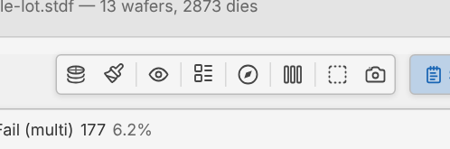

---

<!-- covers: Plot mode; Plot mode › Test Value ▶; Plot mode › Hard Bin; Plot mode › Soft Bin -->

# Plot mode

Colour each die by its hard bin, its soft bin, or one test's value. The stacked modes come in session 04.

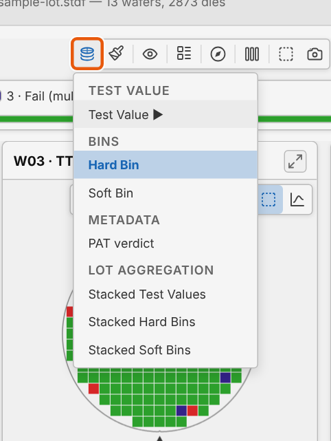

---

# Soft Bin

The test program's failure category for each die, with its own legend.

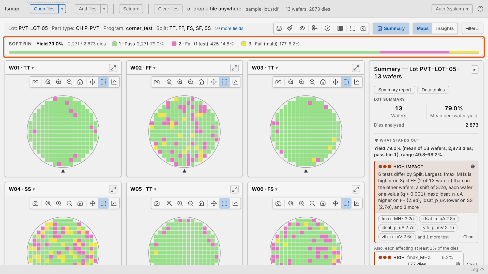

---

# Test Value

Each die coloured by its reading. ▽ and △ mark dies below and above the test limits.

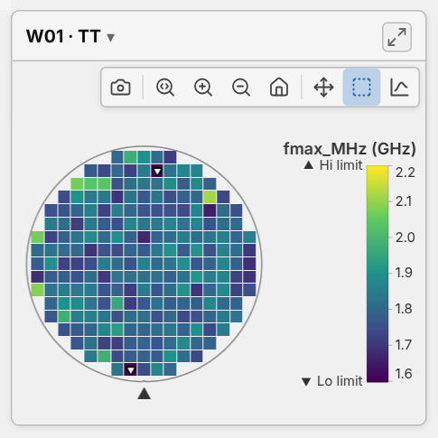

---

<!-- covers: Toggle log scale; Colorbar range: test limits (click for data range) -->

# Two more buttons for values

1 Log scale. 2 Colorbar range: the test limits, the same on every wafer, or the data's own range.

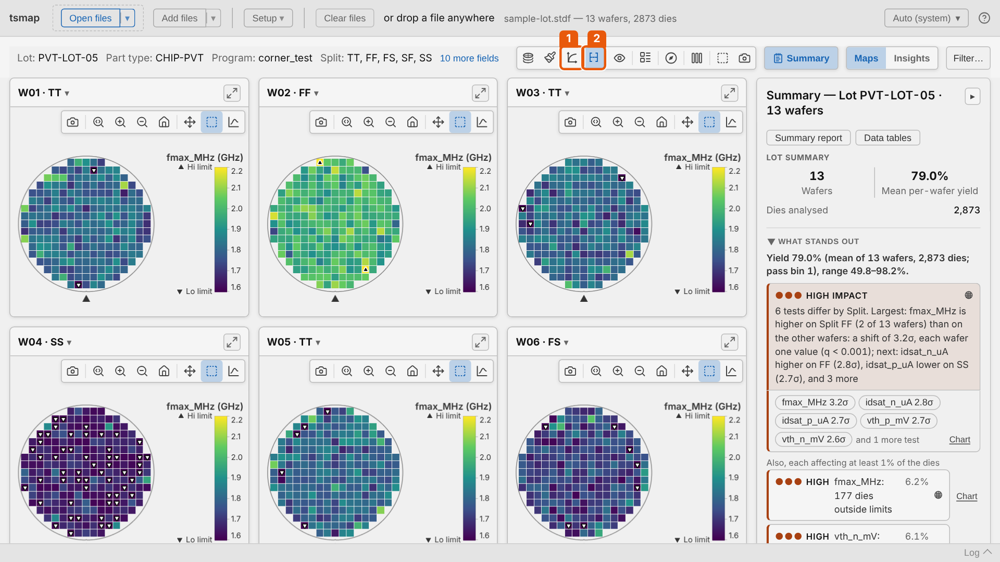

---

<!-- covers: Colour scheme; Colour scheme › ✓Default; Colour scheme › ✓Colour-blind safe -->

# Colour scheme

Default or colour-blind safe bin colours. Passing bins are always shades of green.

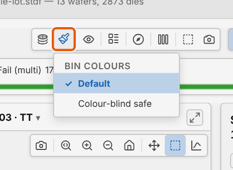

---

# Highlight a bin

Click a bin in the legend and the others grey out. Click it again to clear.

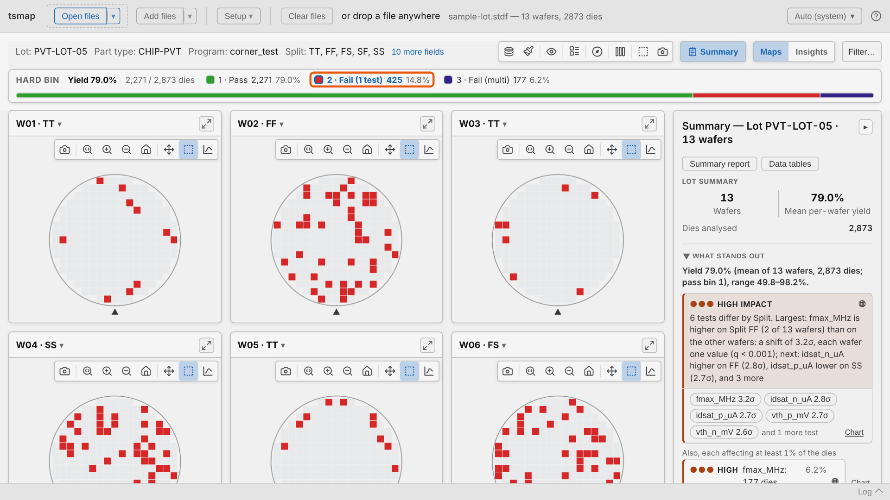

---

<!-- _class: divider -->

# Overlays and orientation

---

<!-- covers: Overlays; Overlays › ✓Ring boundaries; Overlays › ✓Quadrant lines; Overlays › ✓Die labels; Overlays › ✓XY indicator; Overlays › ✓Axis labels; Overlays › ✓Mark failing dies; Overlays › Clear overlays -->

# Overlays

Layers drawn over every map. **Clear overlays** turns them all off, and is greyed when none are on.

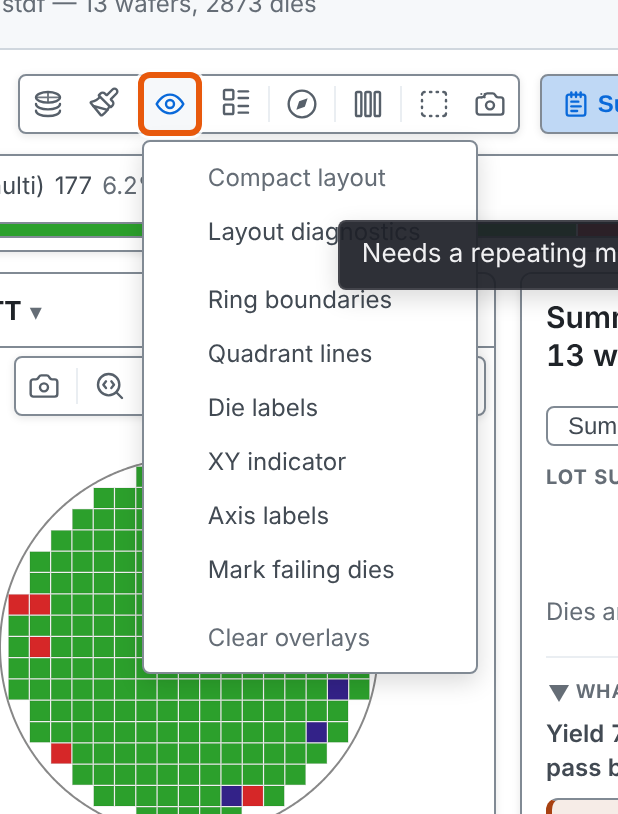

---

# Rings and quadrants

Ring boundaries match the zones the findings use. Quadrant lines split the wafer N, S, E and W.

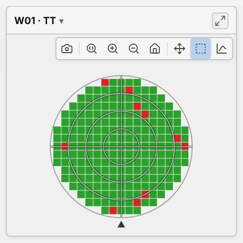

---

<!-- covers: Orientation; Orientation › * -->

# Orientation

Rotate or flip how the wafer is drawn. Die coordinates never change.

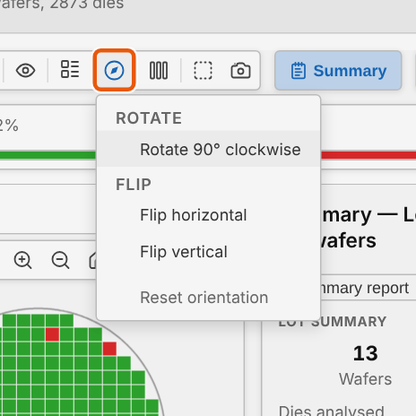

---

# Turned to your convention

The first turn also shows the XY indicator. **Reset orientation** goes back to the start.

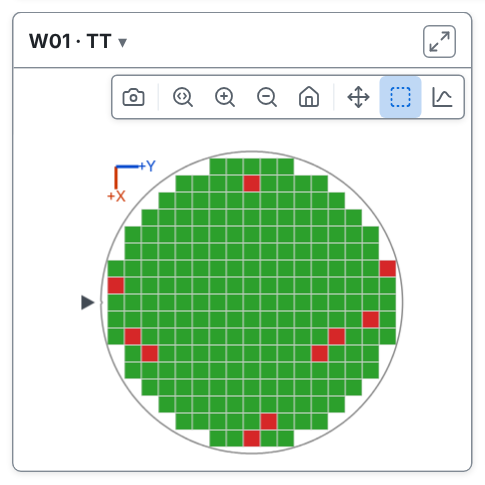

---

<!-- covers: Legend style; Legend style › * -->

# Legend style

**Legend on each map** adds a legend to every card, then lets you choose where it sits.

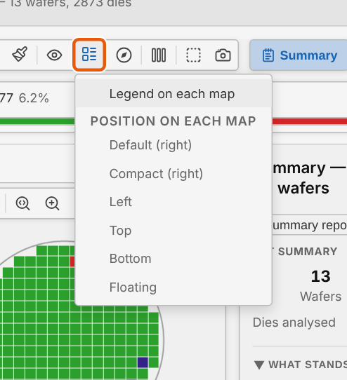

---

<!-- covers: Columns; Columns › * -->

# Columns

**Auto** fits as many readable cards as it can. A number shares the width between that many.

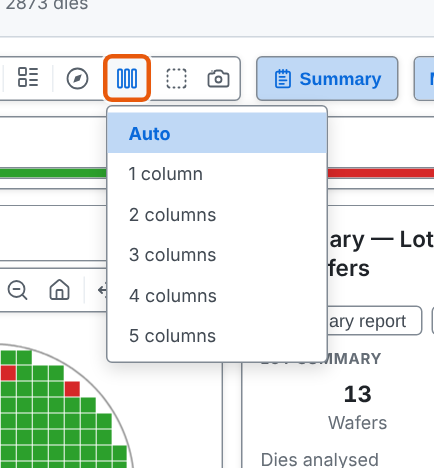

---

<!-- _class: divider -->

# One wafer close up

---

<!-- _class: split -->
<!-- covers: Download PNG; Zoom (drag to zoom region); Zoom in; Zoom out; Reset zoom (double-click); Pan (drag to move); Select (drag to select dies) -->

# Each wafer's toolbar

- 1 Save this map as a PNG
- 2 Zoom to a region, in, out, reset
- 3 Pan &nbsp;4 Select dies (session 07)

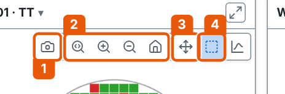

---

# Zoom in

The mouse wheel zooms at the cursor, arrow keys pan, and Ctrl + 0 resets.

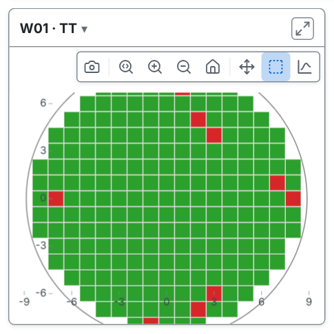

---

# Read one die

Hover a die for its coordinates, bins, site and part ID.

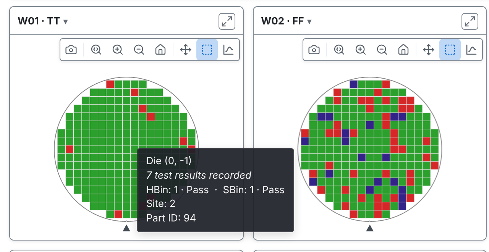

---

# The wafer's details

The **▾** beside a wafer's name lists everything the file says about that wafer.

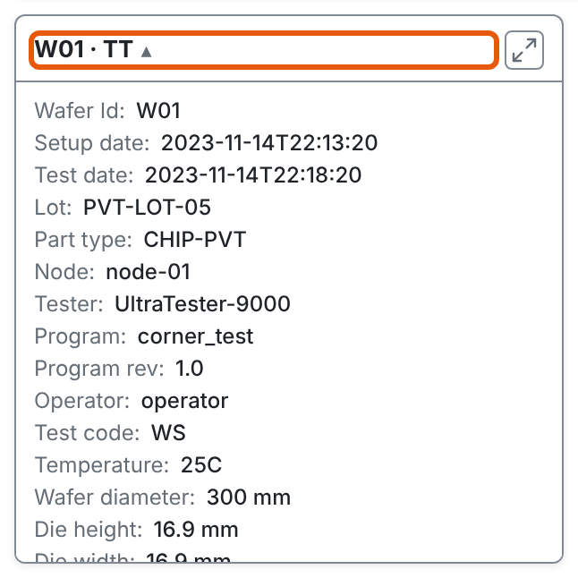

---

<!-- _class: lab -->

# Try it yourself

1. In the [web app](https://wafertools.github.io/tsmap/app/), **Load sample data**
2. **Plot mode → Test Value → fmax_MHz**: which corner reads lowest?
3. **Overlays → Ring boundaries**, then back to **Hard Bin**
4. Zoom into W04 · SS and hover a failing die

---

# Recap

- **Plot mode** picks bins or a test; the legend highlights one bin
- **Overlays** and **Orientation** change how every map is drawn
- Each card zooms, pans and saves on its own

More in the [wafer map guide](https://wafertools.github.io/wafermap/user-guide/#3-toolbar-controls)

---

<!-- _class: next -->
<!-- _paginate: false -->

# Next session

03 · Findings

What tsmap noticed in the lot, and how to read it.
