<!-- _class: title -->
<!-- _paginate: false -->

# Findings

## Session 03

tsmap training · a self-paced course

---

# In this session

- Read **What stands out** and show any row on the map
- Read the **Findings** list and the patterns behind it
- Use the Summary panel's tables and reports

---

<!-- _class: divider -->

# The headline items

---

<!-- _class: split -->
# The Summary panel

It docks beside the maps and describes the lot you are looking at. A **Filter…** narrows it to what is kept.

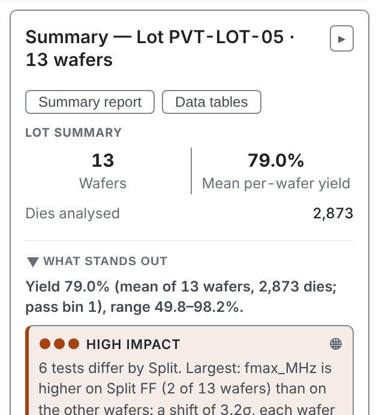

---

<!-- _class: split -->

# Open and close it

1 **Summary** opens and closes the panel. The **▸** at the end of the panel's title closes it too.

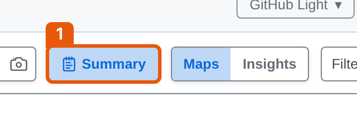

---

<!-- _class: split -->
<!-- covers: What stands out -->

# What stands out

The headline is the yield. Below it, the items that cost the lot most, largest first.

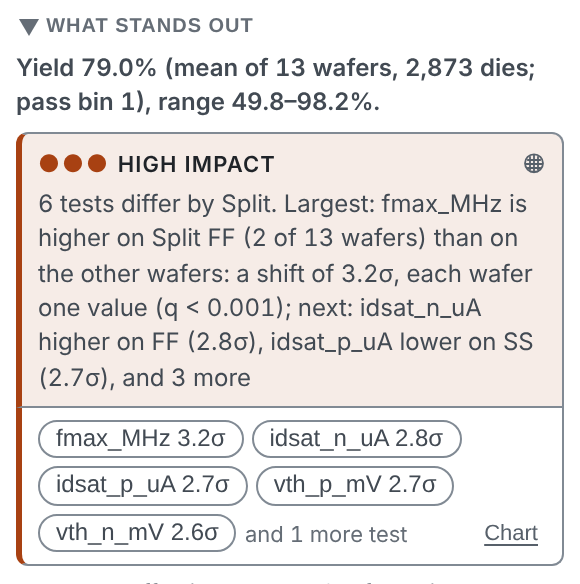

---

<!-- covers: Finding row -->

# Every row shows the affected dies

Click a row and the map shows the affected dies. Click it again to clear.

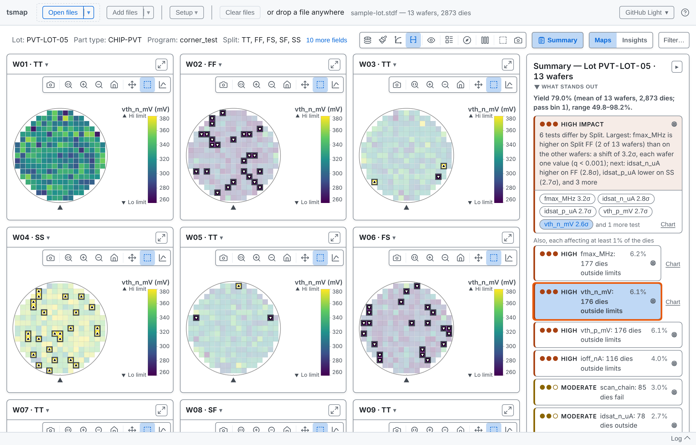

---

# Losses and signals

A **loss** costs dies: a weak region, a low wafer, a test outside its limits. A **signal** moves values without costing dies, as the split item on top does here.

Three dots and a word say how much of the lot it affects. Items under 1% of the dies stay in the Findings list.

---

<!-- _class: split -->
<!-- covers: fmax_MHz 3.2σ; idsat_n_uA 2.8σ; idsat_p_uA 2.7σ; vth_p_mV 2.7σ; vth_n_mV 2.6σ; Finding chip (test) -->

# The parts of an item

Under the top item, small rounded buttons each name one part of it. Here each is a test that differs by split, with its shift in σ.

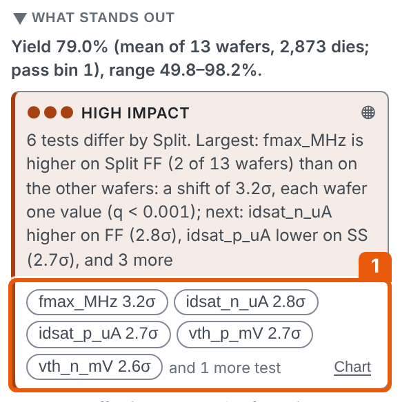

---

# Show one part

Click a part button to show that part alone. This is fmax_MHz, with the dies outside its limits marked ▽ and △.

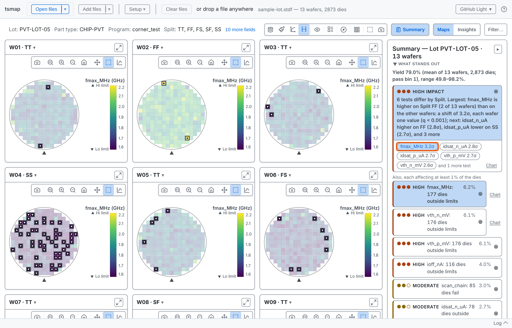

---

<!-- _class: split -->
<!-- covers: Finding chart link -->

# Chart links

**Chart** opens Insights at this item's card, under **Worth a look**. Insights is session 05.

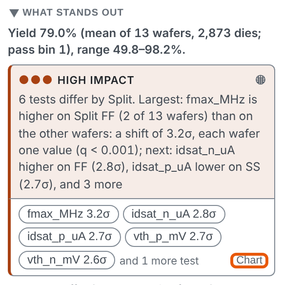

---

<!-- covers: Full report ▸ -->

# Full report

**Full report ▸** at the foot of the section opens the report, which begins with the same items.

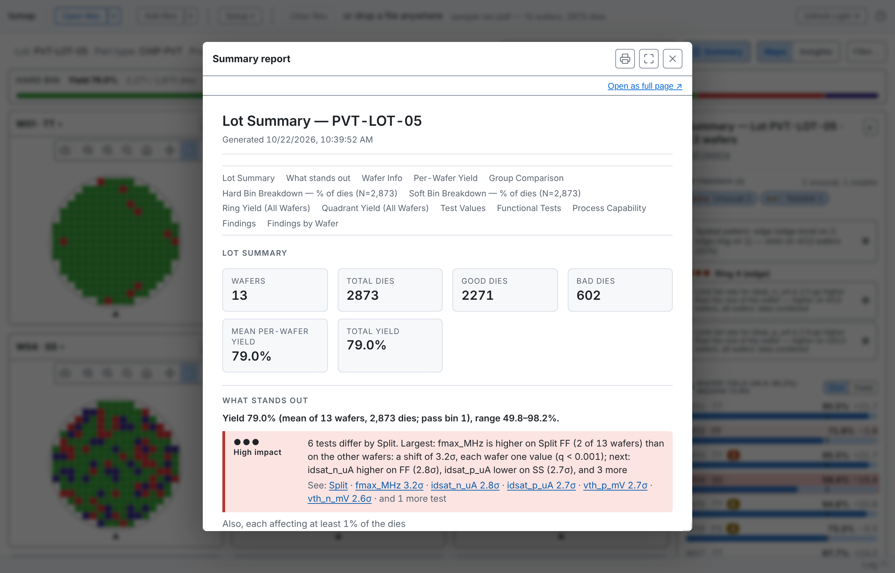

---

<!-- _class: split -->
# A lot with nothing to report

When no region, bin or wafer costs about a yield point, the panel says so and lists what it compared.

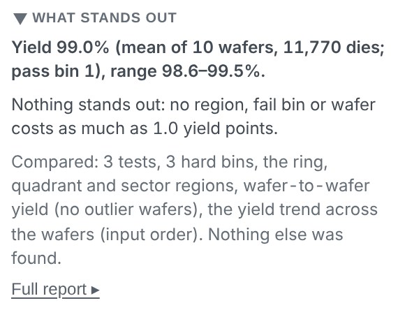

---

# Bigger lots

Findings on the test values of one region take longer to compute. A large load shows a row with an **Analyse** button instead, and the findings stay while the load is open.

More in the [user guide](../user-guide.md#test-value-findings)

---

<!-- _class: divider -->

# The Findings list

---

<!-- _class: split -->
<!-- covers: Summary › Findings; Findings severity group; Finding detail row -->

# The Findings section

Each anomaly is ranked by severity, shown as three dots: Unusual, Notable or Minor. The **Unusual** and **Notable** buttons narrow the list.

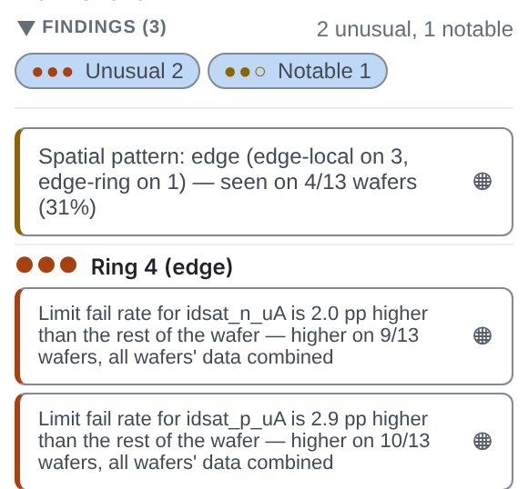

---

# A finding on the map

Click a finding to show it on the map. Click it again to clear.

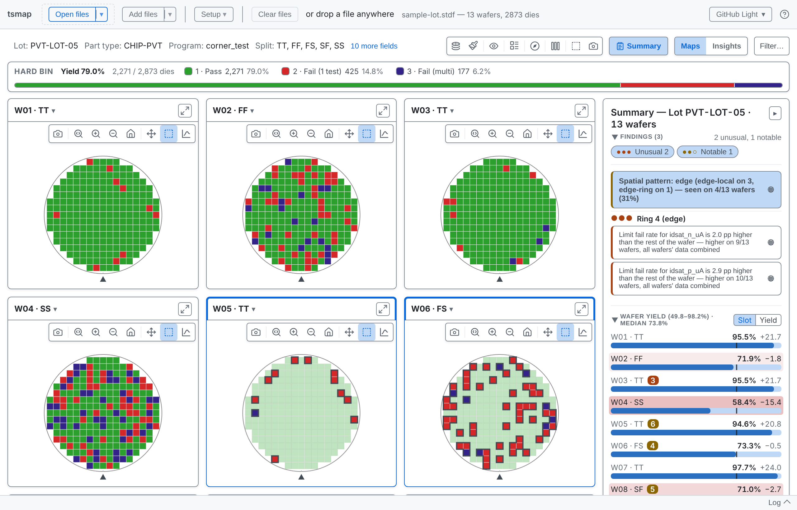

---

<!-- _class: split -->
<!-- covers: Show supporting findings -->

# A pattern and what backs it

A spatial pattern can have a **Show N supporting findings** line. This is EDGE-LOT-01.

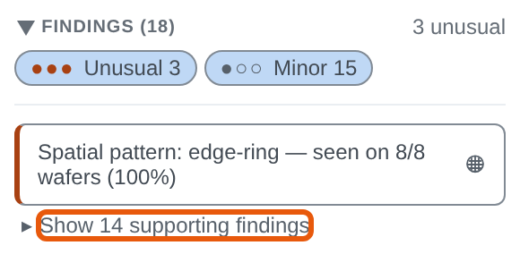

---

<!-- _class: split -->
# The supporting findings

Opened, it lists the regional findings the pattern explains.

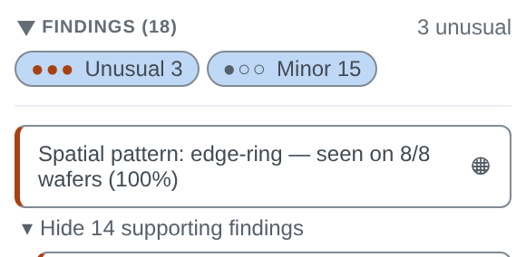

---

<!-- _class: split -->
# An edge ring

The item names the pattern, the bins that make up the loss, and the test behind it.

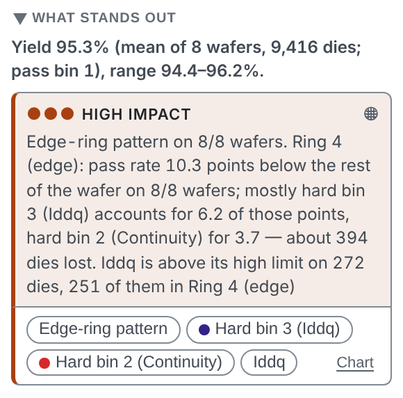

---

<!-- covers: Finding chip (bin) -->

# A bin part

A bin's button carries its legend colour and shows only those dies. This is hard bin 3.

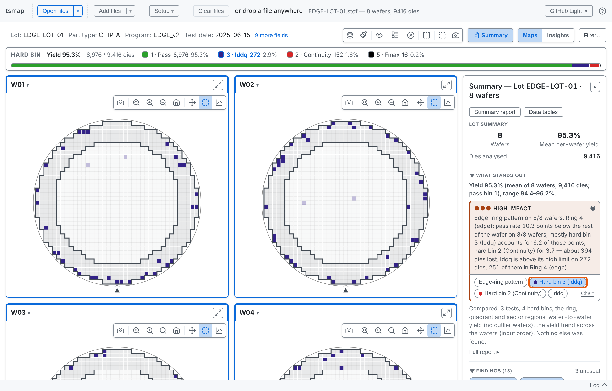

---

<!-- _class: divider -->

# The tables

---

<!-- covers: Summary › Wafer Yield; Slot; Wafer yield row -->

# Wafer Yield

One bar per wafer, in slot order, so a slot-related pattern shows. A badge counts the wafer's findings; click a row to open that wafer.

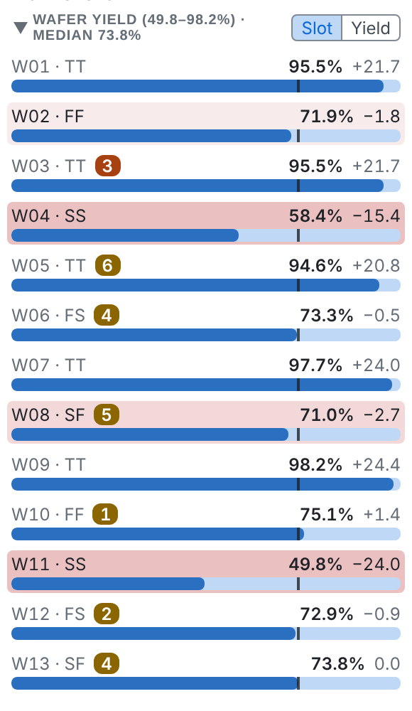

---

<!-- covers: Yield -->

# Sorted by yield

**Yield** re-sorts the wafers from lowest to highest. A row a point or more below the median is tinted, darker as the gap grows.

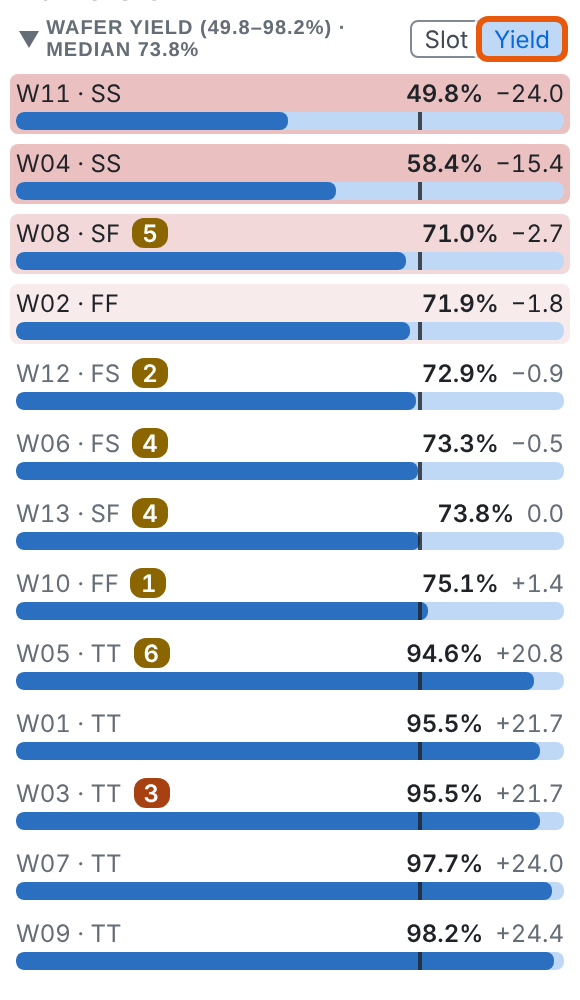

---

<!-- covers: Summary › Hard Bin Breakdown; Hard -->

# Hard Bin Breakdown

Bars as a share of dies: pass bins first, then failing bins from the most dies to the fewest.

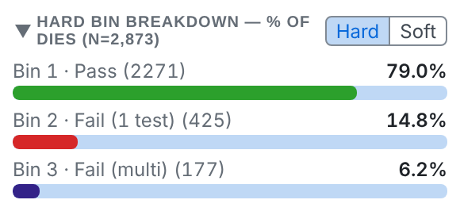

---

<!-- covers: Soft -->

# Soft bins

**Soft** switches the breakdown to soft bins, with their own colours. By default it follows the map's plot mode.

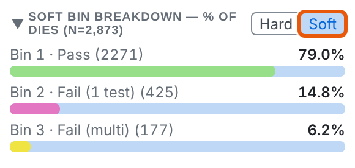

---

<!-- covers: Ring Yield; Ring -->

# Ring Yield

Yield by ring from the centre out, each row with its difference from the wafer's yield. Ring is the default because edge roll-off dominates real wafer maps.

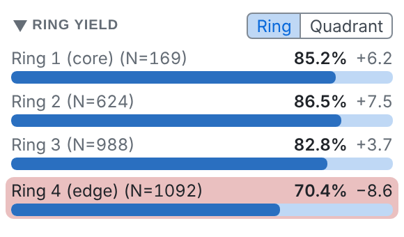

---

<!-- covers: Quadrant -->

# Quadrant

**Quadrant** splits the wafer into NE, NW, SE and SW instead of rings.

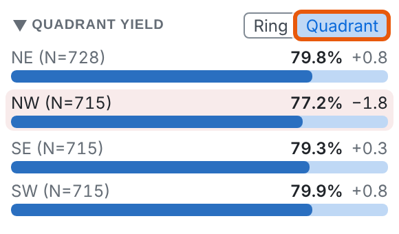

---

<!-- covers: Summary › Test Values -->

# Test Values

Per test: the mean, **Ppk** and the share of dies within limits. Ppk uses the overall spread, wafer-to-wafer variation included.

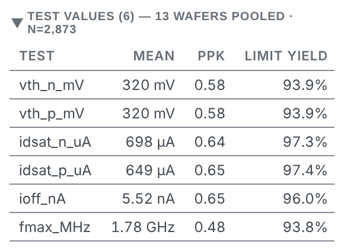

---

<!-- covers: Summary › Functional Tests -->

# Functional Tests

Pass and fail counts and the pass rate for each functional test.

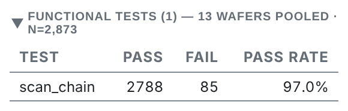

---

<!-- covers: Summary report -->

# Summary report

1 opens a printable report: the findings, bins, regions and the full per-test table. It is the report **Full report ▸** opens. Save it as a PDF from the print dialog.

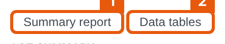

---

<!-- covers: Data tables -->

# Data tables

2 opens statistics, every die, and one row per wafer, each with **Copy** and **Export CSV**. Insights does not need to be on.

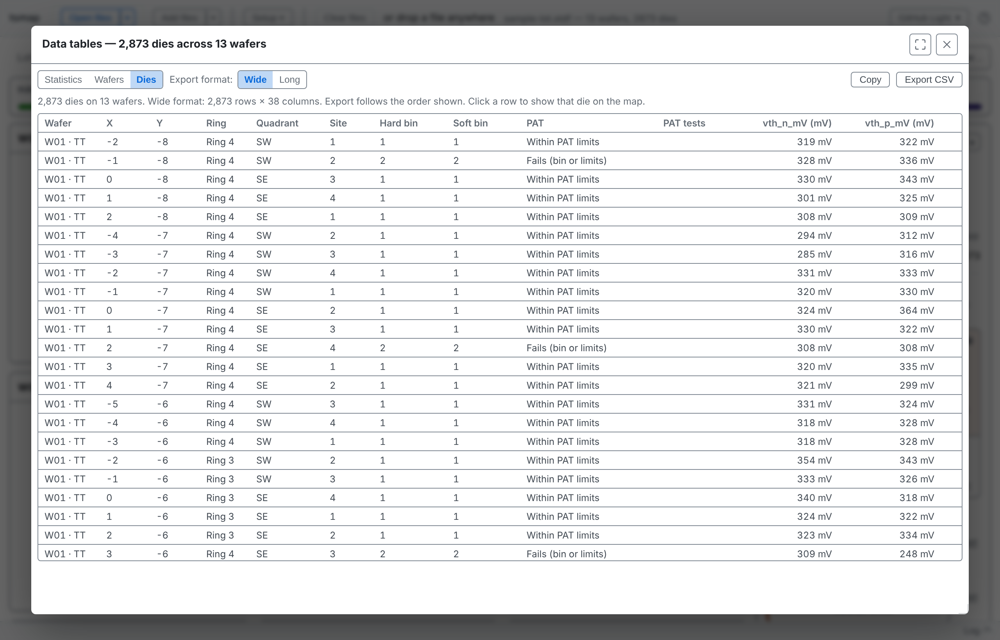

---

<!-- _class: lab -->

# Try it yourself

1. In the [web app](https://wafertools.github.io/tsmap/app/), **Load sample data**
2. Click the **fmax_MHz** button under the top item: which wafer has the most marked dies?
3. Open **Findings** and click the spatial pattern: which wafers does it mark?
4. In **Wafer Yield**, choose **Yield**: which wafer is lowest?
5. Open **Data tables** and look at the **Wafers** table

---

# Recap

- **What stands out** ranks losses and signals; every row shows the affected dies
- **Findings** lists anomalies by severity; patterns carry their supporting findings
- The tables, **Summary report** and **Data tables** carry the numbers

More in the [wafer map guide](https://wafertools.github.io/wafermap/user-guide/#6-summary-panel)

---

<!-- _class: next -->
<!-- _paginate: false -->

# Next session

04 · The lot view

Gallery, stack and splits.
