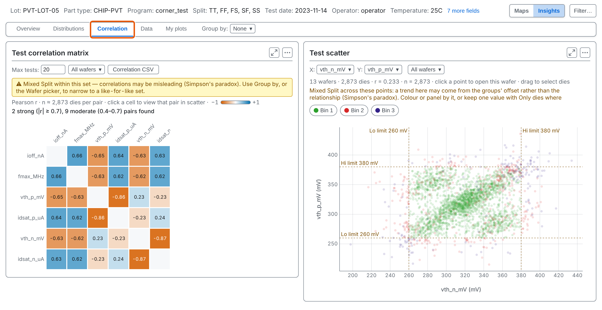
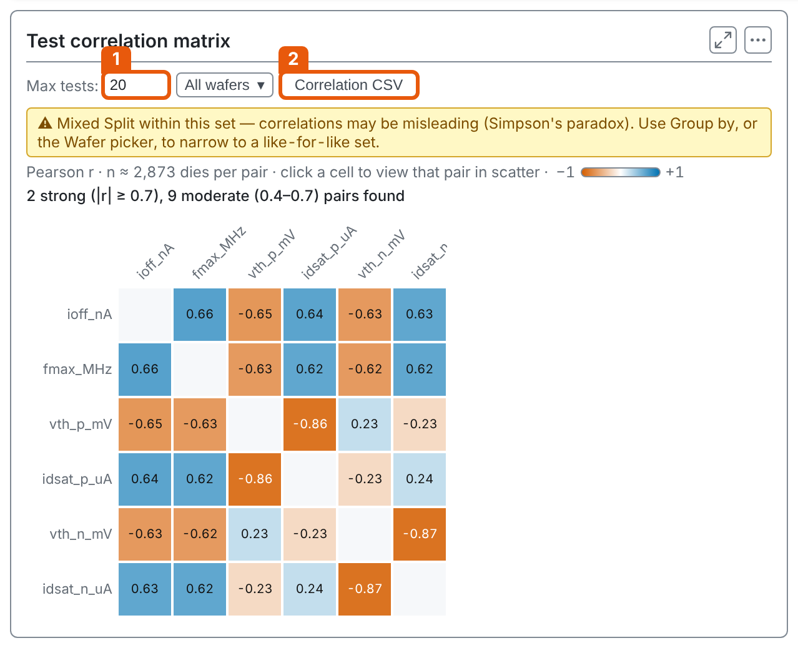
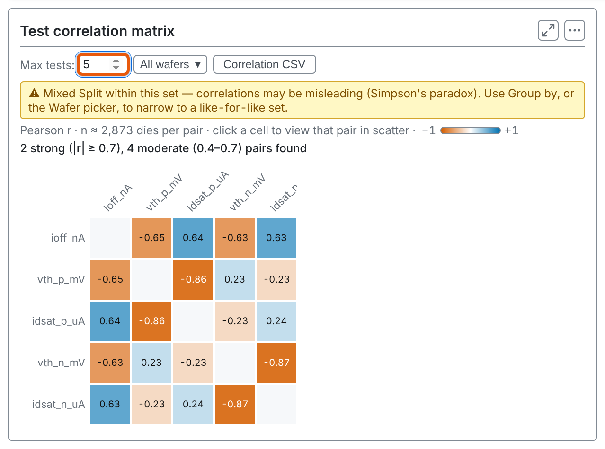
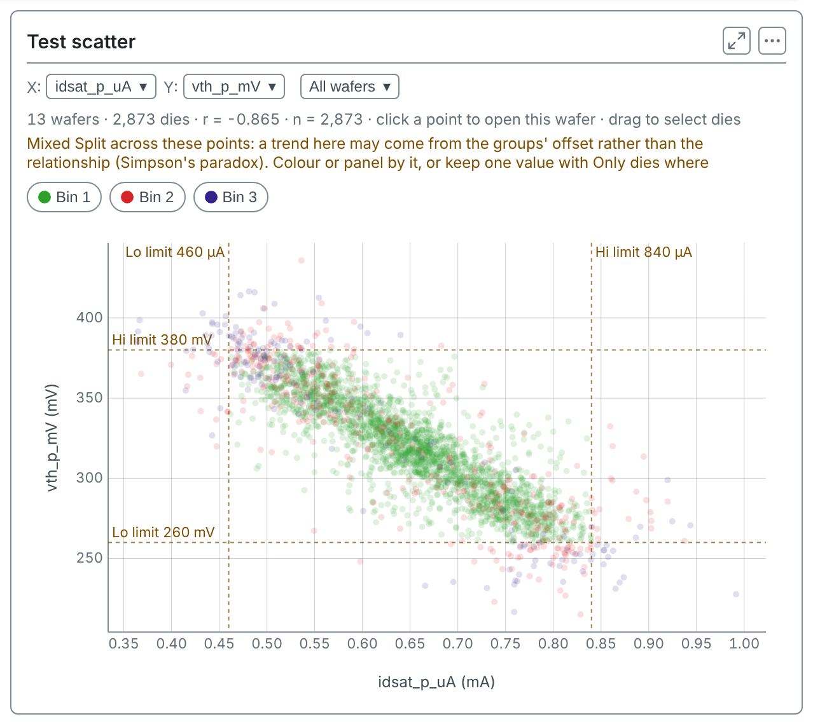
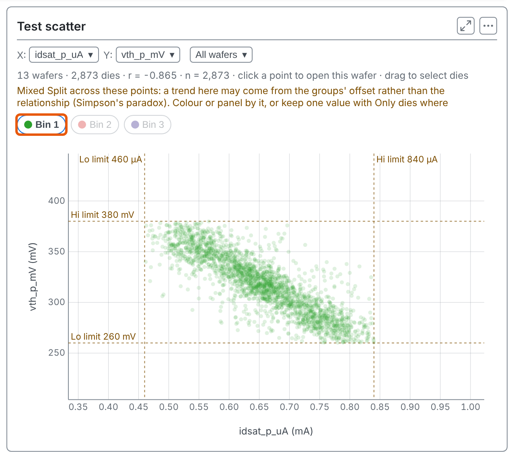
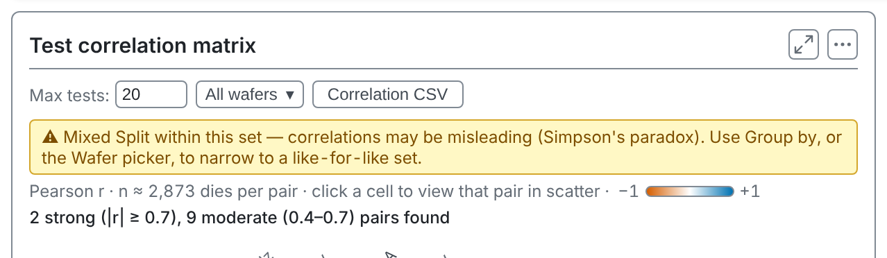
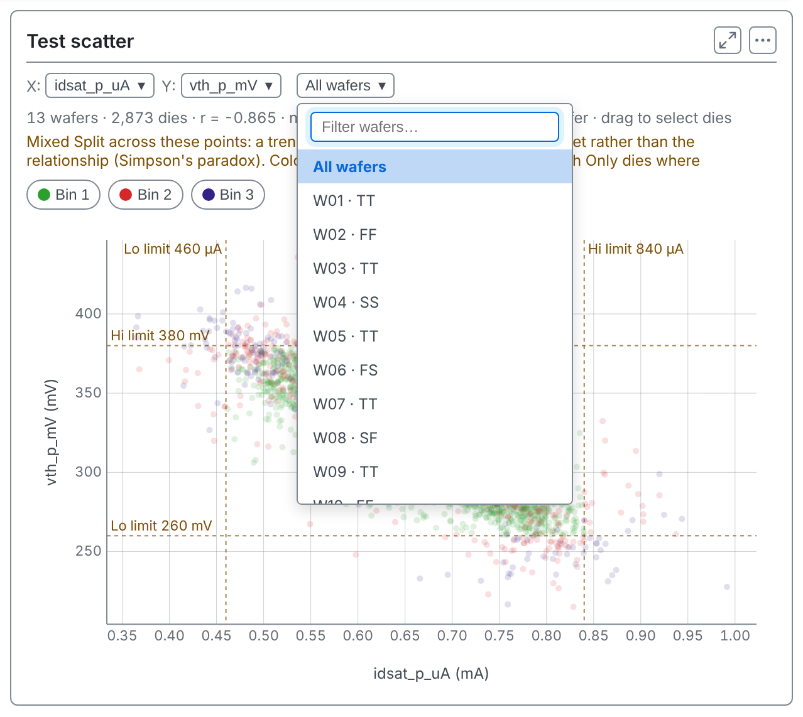
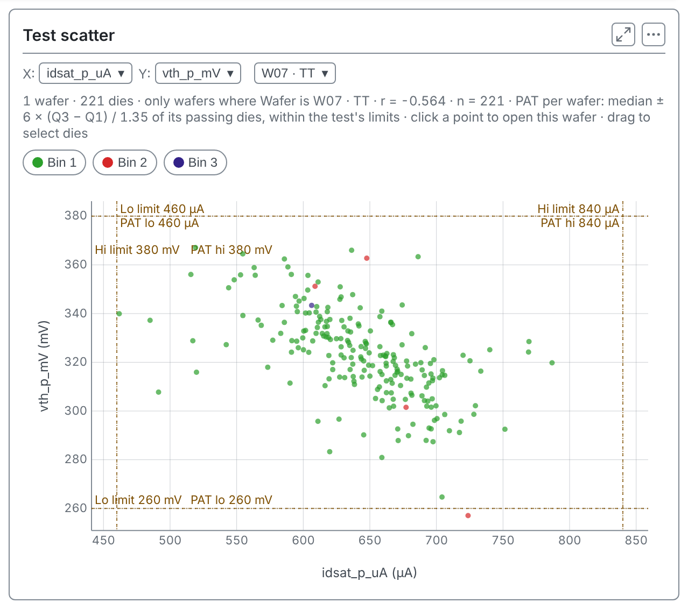
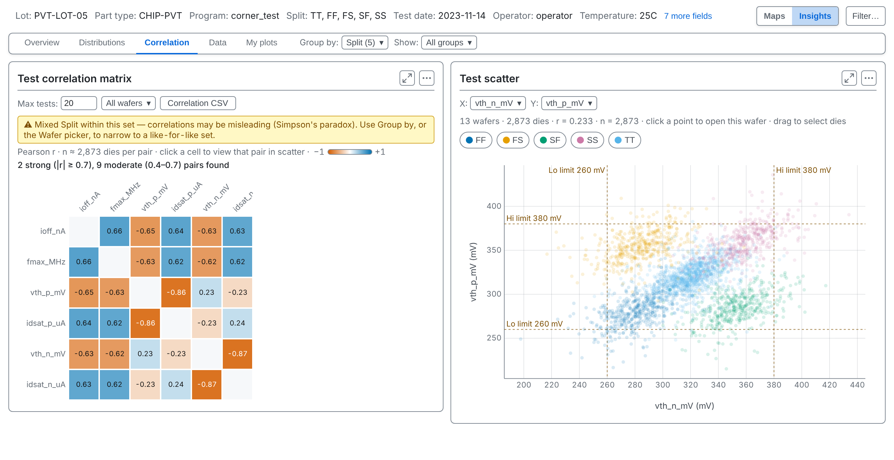
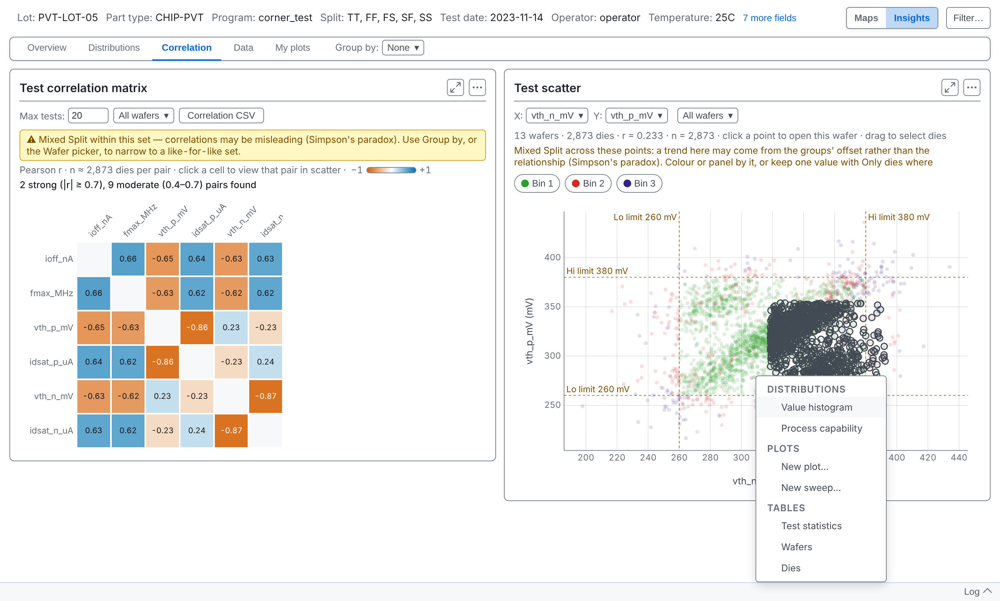

<!-- _class: title -->
<!-- _paginate: false -->

# Correlation

## Session 06

tsmap training · a self-paced course

---

# In this session

- Read the correlation matrix and open a pair as a scatter
- Check a relationship wafer by wafer and group by group
- Chart just the dies you drag a box around

---

<!-- _class: divider -->

# The matrix and the scatter

---

<!-- covers: Correlation -->

# The Correlation tab

A matrix of every pair of tests on the left, and a scatter of one pair on the right, a point per die.

---

<!-- _class: split -->
<!-- covers: Max tests:; Correlation CSV -->

# The matrix

Each cell is the Pearson correlation, r, of two tests over the dies. Strong colours move together (blue) or against each other (orange). 1 sets how many tests it shows; 2 saves it as a table.

---

# Fewer tests

**Max tests** runs from 5 to 100, 20 by default. With five, the card counts the strong and moderate pairs among them.

---

<!-- _class: split -->

# Open a pair

Click a cell and the scatter shows that pair. Above the scatter, **r** is the correlation and **n** the number of dies. Here idsat_p_uA falls as vth_p_mV rises, r = −0.865.

---

<!-- _class: divider -->

# Is it real?

---

<!-- covers: Correlation bin chip -->

# Bin buttons

The buttons under the scatter show or hide the dies of each bin, so you can see whether failing dies sit at one end of the relationship.

---

<!-- _class: split -->

# A warning to heed

When the dies pool several values of a field such as the split, the card warns that the correlation may mislead: a trend can come from the groups' offsets, not from the relationship inside each group.

---

<!-- covers: Wafer; Test -->

# One wafer at a time

The **Wafer** menu narrows the scatter to one wafer. The **X** and **Y** menus pick the tests, as the matrix cells do.

---

# Inside one wafer

On W07 alone, r is −0.564, not −0.865. Part of the pooled figure came from the splits sitting at different levels. The warning is gone because only one wafer is left.

---

<!-- covers: Group by › Split -->

# Group by

With **Group by** on, the matrix shows one group at a time, and the scatter colours its points by group.

---

<!-- _class: divider -->

# Dies from the scatter

---

# Drag a box

Drag a rectangle over the scatter to select the dies inside it, across as many wafers as they fall on. A menu opens with charts and tables of just those dies: a histogram, capability, new plots, statistics, wafers and dies.

*(The same menu is the subject of session 07.)*

---

<!-- _class: lab -->

# Try it yourself

1. In the [web app](https://wafertools.github.io/tsmap/app/), **Load sample data**, then **Insights → Correlation**
2. Click the strongest orange cell: which two tests, and what is r?
3. Pick **W07 · TT** in the **Wafer** menu: does r change?
4. Set **Group by** to **Split**: does the relationship hold in each group?
5. Drag a box over the scatter and open **Test statistics**

---

# Recap

- The matrix shows every pair; a cell opens that pair as a scatter
- r says two tests move together, not why
- Check it wafer by wafer and group by group before trusting a pooled figure

More in the [wafer map guide](https://wafertools.github.io/wafermap/user-guide/#8-insights-tab)

---

<!-- _class: next -->
<!-- _paginate: false -->

# Next session

07 · Drilling into any population

Filter, select and chart just the dies you care about.
