<!-- _class: title -->
<!-- _paginate: false -->

# Drilling into any population

## Session 07

tsmap training · a self-paced course

---

# In this session

- Keep only the wafers and dies that meet your conditions
- Chart and tabulate any selection, bin or wafer
- Know what each entry of the right-click menu opens

---

<!-- _class: divider -->

# Filtering

---

<!-- covers: Filter… -->

# Filter…

The last button in the toolbar row. It keeps only the wafers and dies that meet conditions you set, in the gallery, on a single map and on every Insights tab.

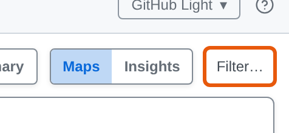

---

<!-- _class: split -->

# The Filter window

Add conditions; every one must hold. **Apply** filters, **Cancel** leaves things as they were.

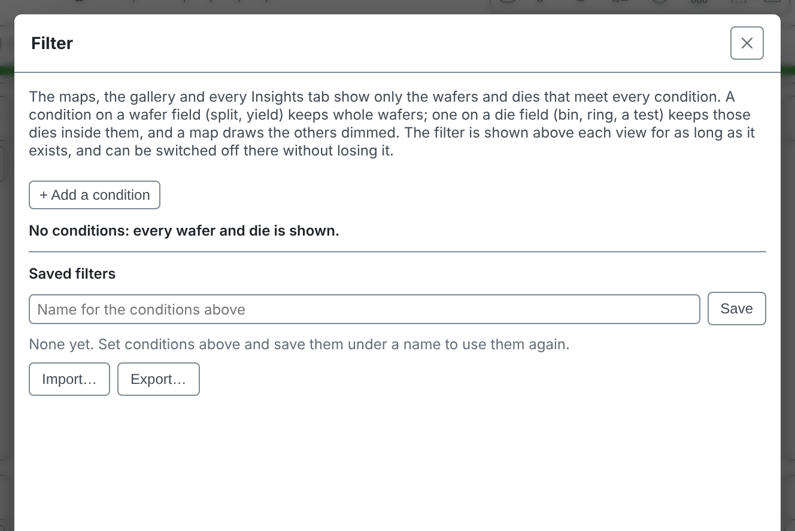

---

<!-- _class: split -->

# Choose a field

A condition starts with a field: a test, a die field such as bin, ring or site, or a wafer field such as split, lot or yield. Type to search the list.

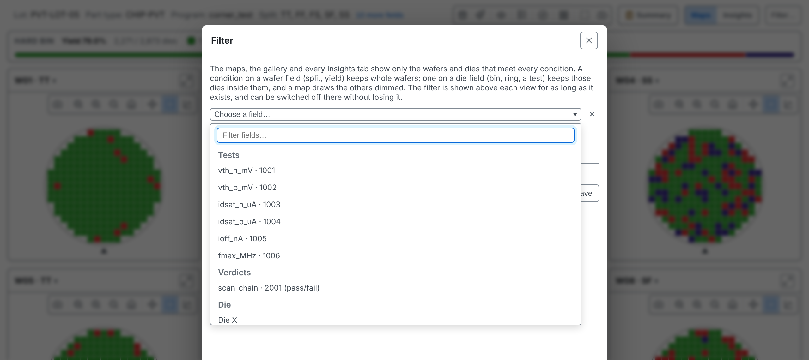

---

<!-- _class: split -->

# A wafer field

A category field, such as the split, lists its values to tick. **is not** keeps everything else. A number field, such as a test or yield, keeps a range.

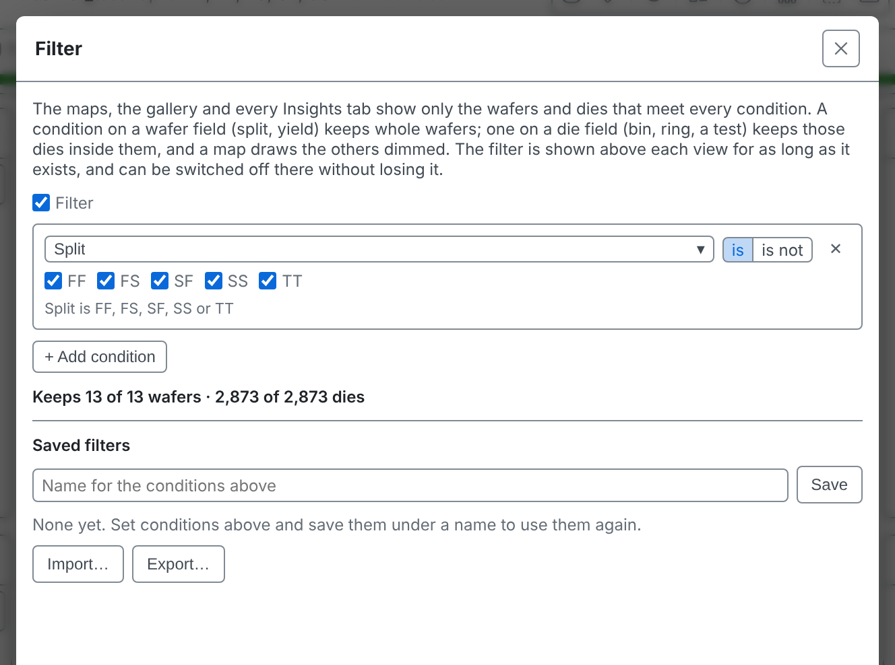

---

<!-- _class: split -->

# What it would keep

Untick all but SS. The window says as you edit how many wafers and dies the conditions would keep.

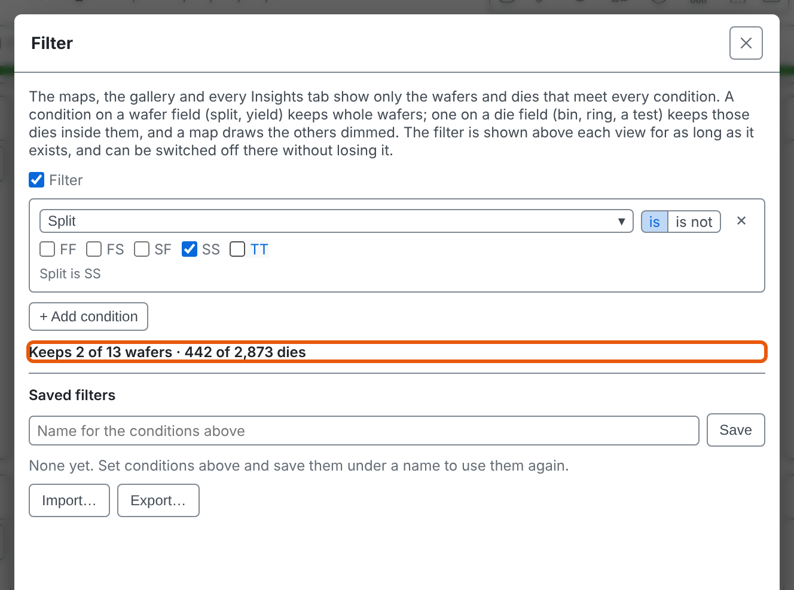

---

# Wafer or die

A condition on a **wafer** field keeps whole wafers: the others' cards leave the gallery. A condition on a **die** field keeps those dies inside the wafers kept, and a map draws the dies it drops faded.

Everything beside the map, the Summary panel and its findings included, is analysed again over what is kept.

---

<!-- _class: split -->

# Saved filters

Name the conditions and **Save** them to use again. **Load** applies one; **Export…** and **Import…** move the list to another machine.

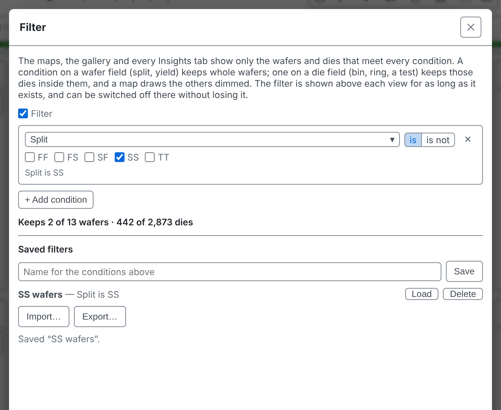

---

# Applied

Two cards remain, and the legend and yield describe only those wafers.

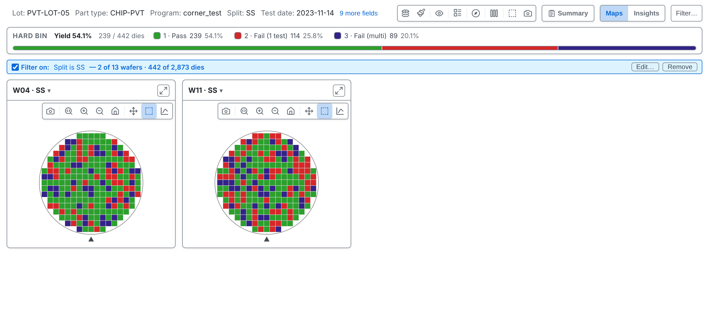

---

# The filter line

A line above the view always states the filter and what it keeps. Its tick switches the filter off and on without losing it. 1 **Edit…** reopens the window; 2 **Remove** forgets it.

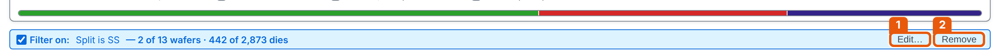

---

# Insights follows

It is one filter for everything you are looking at, so Insights shows the same two wafers, and Group by and the charts work on what is kept.

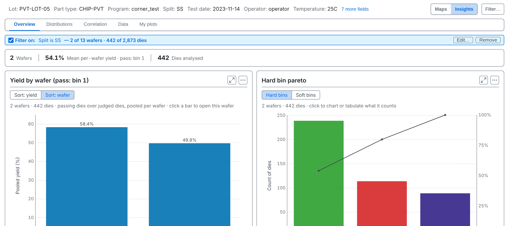

---

<!-- _class: divider -->

# Charting a population

---

# Select dies

Drag a box on a map: the selected dies keep their colour and the rest fade, with an outline round them. Ctrl or Cmd + click adds or removes a die; **Esc** clears.

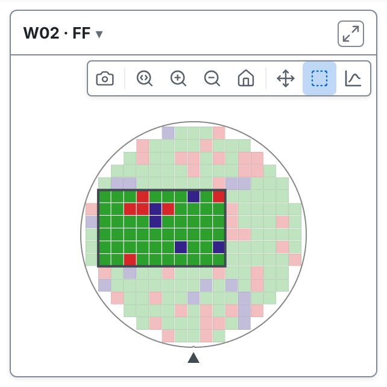

---

<!-- covers: Charts and tables for this wafer (or right-click) -->

# Right-click

Right-click the selection for a menu of charts and tables drawn from just those dies. It offers distributions, your plots, and tables.

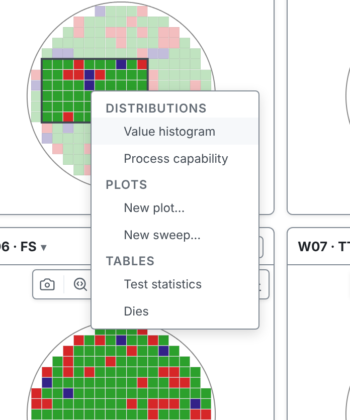

---

<!-- covers: Charts and tables for this wafer (or right-click) › Value histogram -->

# Value histogram

How one test is distributed over just those dies. The title and the line above state the population, so it cannot be mistaken for the whole wafer.

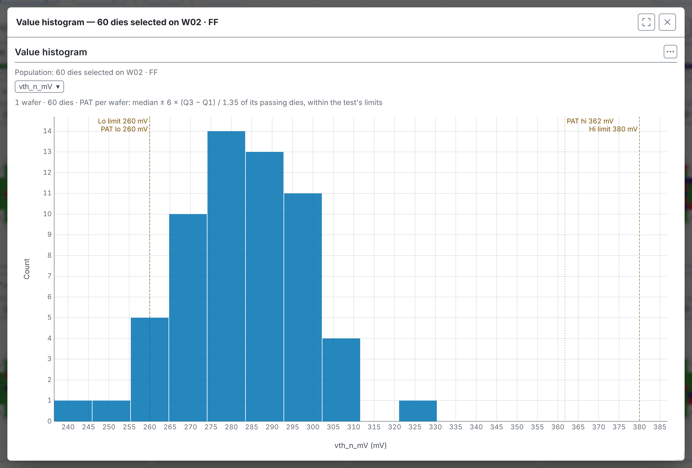

---

<!-- covers: Charts and tables for this wafer (or right-click) › Process capability -->

# Process capability

Every test with limits, over the selected dies only. Compare it with the whole lot's capability in session 05.

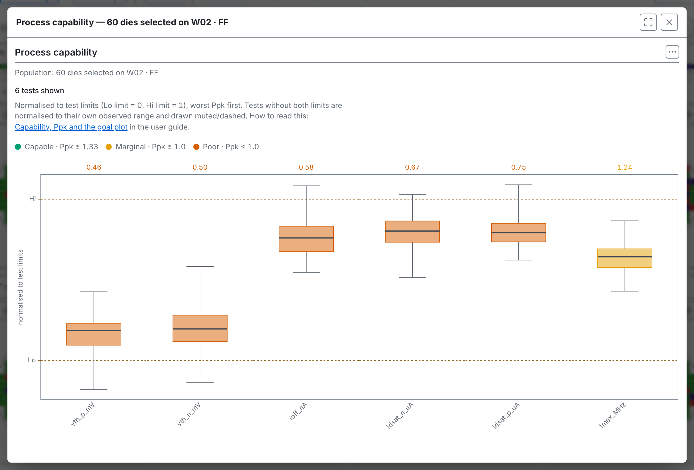

---

<!-- covers: Charts and tables for this wafer (or right-click) › Test statistics -->

# Test statistics

The Test Values and Functional Tests tables, over the same dies.

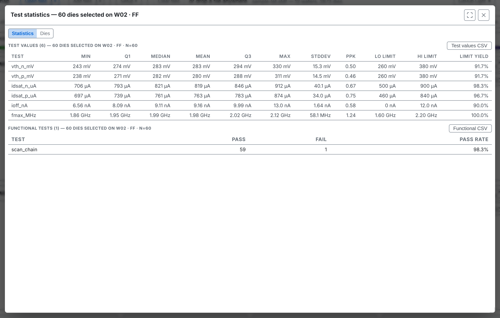

---

<!-- covers: Charts and tables for this wafer (or right-click) › Dies -->

# Dies

One row per selected die, with its position, bins and every test value. **Export CSV** and **Copy** save it.

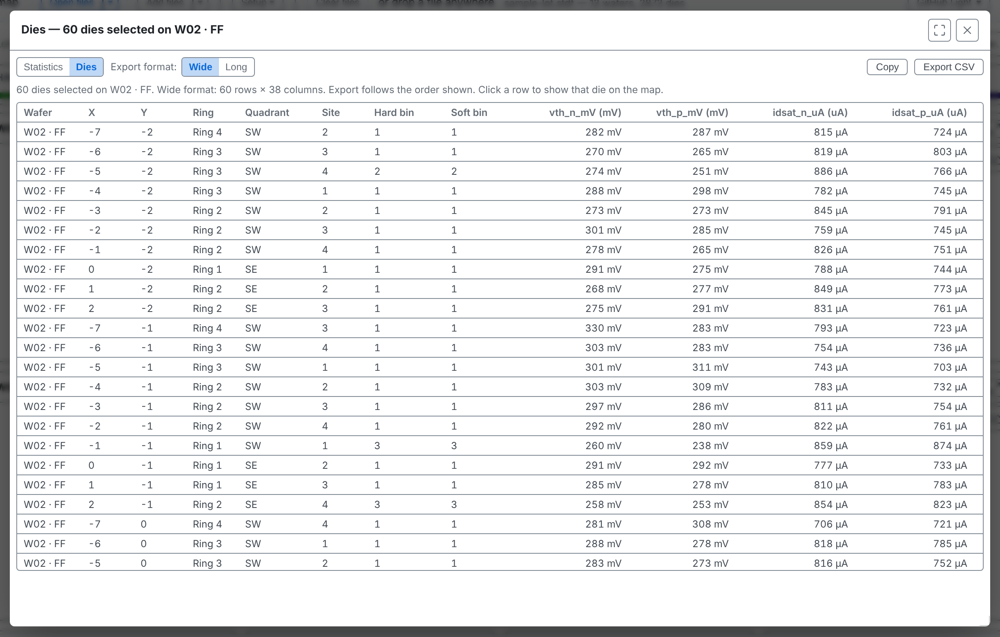

---

# What you right-click decides the population

| Right-click | Opens on |
| --- | --- |
| selected dies | those dies |
| empty map space | the whole wafer |
| a card's header | that wafer |
| a bin in the legend | that bin's dies |
| a finding | the finding's dies |

---

# A bin

Right-click a bin in the legend: the menu opens on that bin's dies, on every wafer of the lot. Nothing is selected; the legend only changes what is drawn.

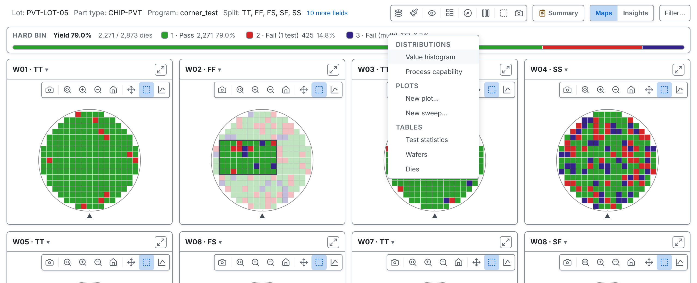

---

# A whole wafer

Each card's chart button opens the same menu for that wafer. Right-clicking a finding in the Summary panel opens it on the finding's dies.

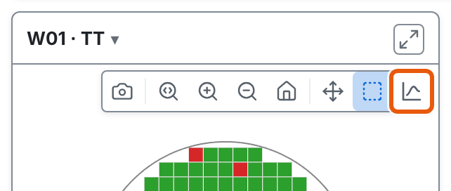

---

<!-- _class: lab -->

# Try it yourself

1. In the [web app](https://wafertools.github.io/tsmap/app/), **Load sample data**
2. **Filter…**, add **Split**, keep only **SS**, **Apply**
3. **Remove** the filter. Drag a box on W04 · SS and right-click it
4. Open **Value histogram**, then **Process capability**: which test is closest to its limit?
5. Right-click bin **3** in the legend and open **Dies**

---

# Recap

- **Filter…** keeps wafers and dies by condition, in every view
- Select dies, then right-click for charts and tables of just those dies
- A bin, a wafer or a finding each opens the same menu on its own dies

More in the [wafer map guide](https://wafertools.github.io/wafermap/user-guide/#44-charting-dies-and-wafers)

---

<!-- _class: next -->
<!-- _paginate: false -->

# Next session

08 · Your own plots

Build charts, sweeps and derived tests.
