<!-- _class: title -->
<!-- _paginate: false -->

# Your own plots

## Session 08

tsmap training · a self-paced course

---

# In this session

- Compute new tests from measured ones
- Read a run of tests as a sweep curve
- Build, keep and reuse your own charts

---

<!-- _class: divider -->

# Derived tests

---

# What a derived test is

A derived test is computed from other tests on the same die, such as a ratio or a margin, instead of being measured. You define one by giving a row of your test definitions file, the CSV that names and describes the tests, an **expression**.

Once defined it is an ordinary test: map it, colour it against limits, chart it. These slides use RRAM-LOT-06, a resistive-memory lot with its definitions file.

---

<!-- _class: split -->

# Load the definitions

**Setup ▾ → Tests…**, then **Load definitions**. The file renames the tests and adds derived ones: the footer counts them, here 7.

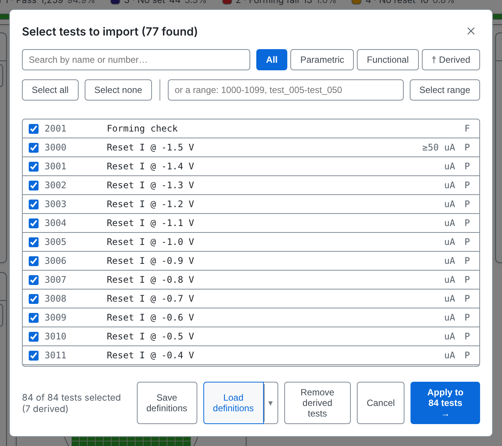

---

<!-- _class: split -->
<!-- covers: † Derived -->

# The † Derived filter

**† Derived** shows only the derived tests. Each has a † before its name.

Give every derived test a test number that no measured test uses. If it matches a measured test, the derived row is ignored and the log says so. Numbers from 900001 up are a safe choice.

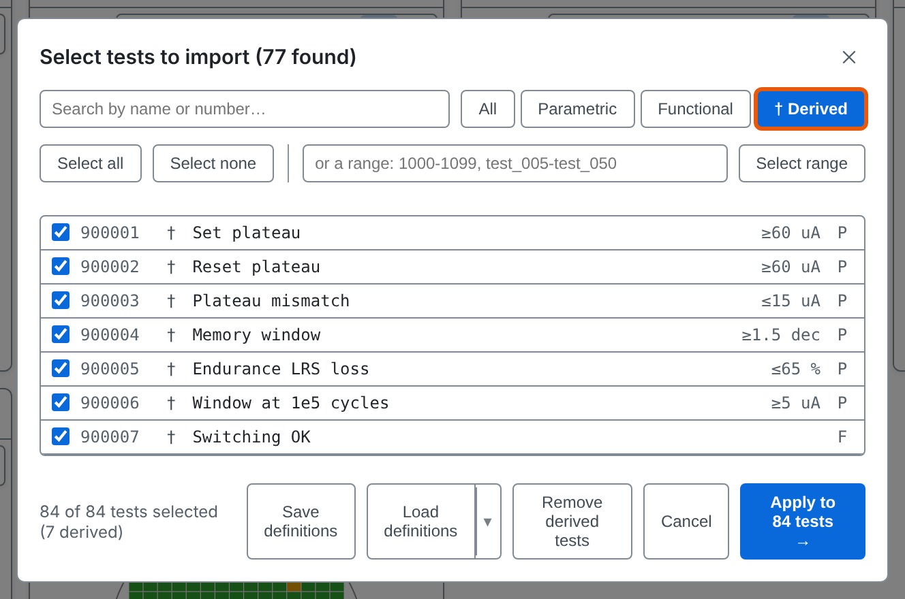

---

# Expressions: what they read

| Write | It gives |
| --- | --- |
| `t[3126]` | the measured value of test 3126 |
| `testPass[2001]` | the pass or fail result stored in the data file |
| `specPass[3126]` | whether the value is inside its limits |
| `diePass()` | whether the die's bin counts as a pass |
| `dieX()`, `dieY()` | the die's position |
| `hbin()`, `sbin()`, `site()` | the die's hard bin, soft bin and probe site |

A derived test can use the value of another derived test.

---

# Expressions: what you can do with them

- **Arithmetic:** `+ - * / % ^`
- **Comparisons:** `< <= > >= == !=`, joined with `and`, `or`, `not`
- **Choosing:** `if(condition, a, b)`
- **Functions:** `abs sqrt ln log10 exp floor ceil round sign pow min max`

For example `abs(t[1020] - t[1010])`, or `if(dieX() < 5, t[1010], 0 - 1)`: the second and third values are the result when the condition is true and when it is false.

A true or false expression must have **F** in the **testType** column of the definitions file, because its result is a pass or fail, not a number.

---

# Expressions: ranges and missing data

`3126..3130` names every test in that range that exists. A range must be combined into one number or one verdict with `mean sum min max` (numbers), `all any none countTrue countFalse` (verdicts) or `countKnown` (either). These functions skip blank values.

If a die lacks a value the expression needs, the derived value is blank for that die, never zero. A result such as 0/0 is blank too.

A derived test that cannot be computed is left out with the reason in the log, never half-computed.

More in the [user guide](../user-guide.md#derived-tests)

---

<!-- _class: split -->

# Derived tests in the map's test list

In the map toolbar's test list, derived tests are marked †, with the note Derived, not measured. Type in the box to search.

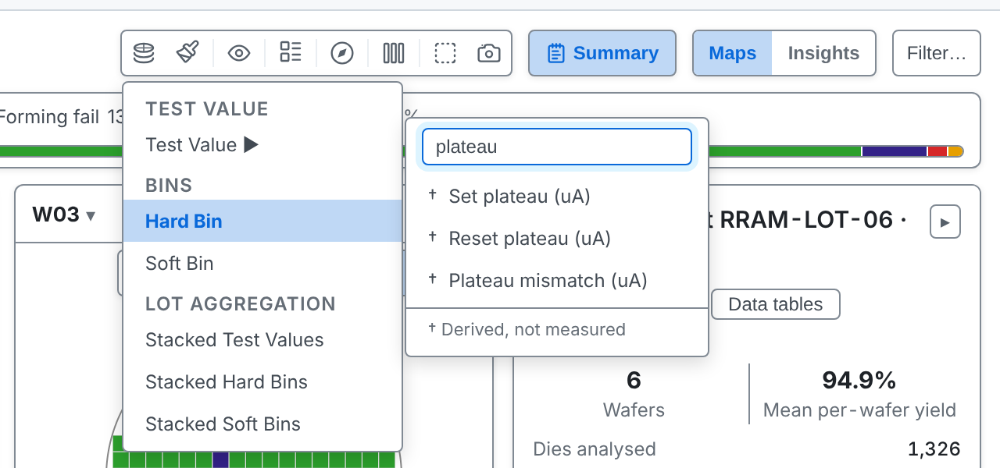

---

# Mapped like any test

Choosing **† Set plateau** colours every die by its computed value.

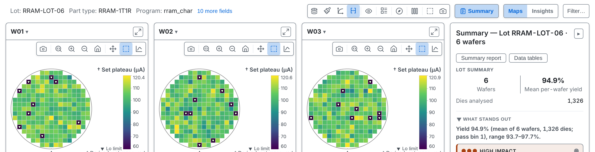

---

<!-- _class: divider -->

# Sweeps

---

<!-- covers: My plots; + New sweep -->

# My plots

In Insights, the **My plots** tab holds charts you build. **+ New sweep** starts a sweep: a series of tests with consecutive numbers, such as one quantity measured at a series of voltages, drawn as a curve.

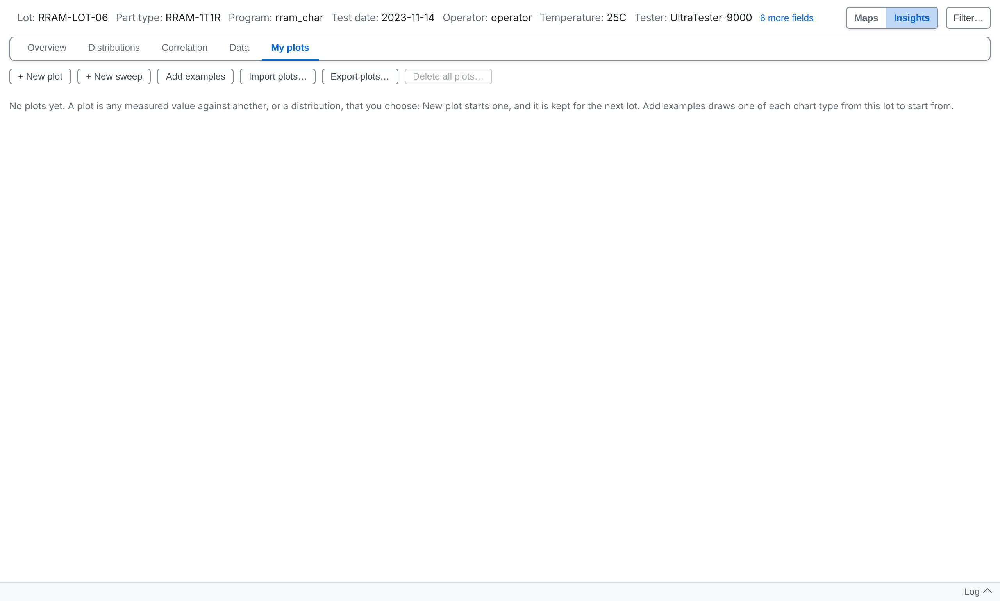

---

<!-- covers: Import plots… -->

# Import plots…

Reads a plots file and adds its plots. RRAM-LOT-06's plots file brings two sweeps. Each line is the median across the dies, with a shaded band from the 10th to the 90th percentile.

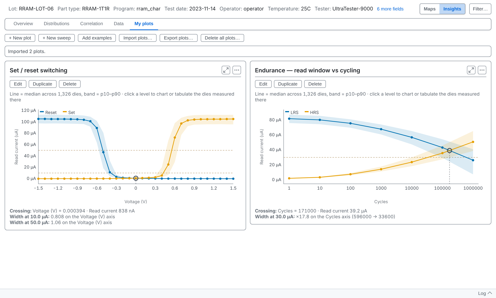

---

# What the card measures

A sweep card reports two results for its first two curves. **Crossing** is where they meet. **Width** is how far apart they are at levels set in the sweep, drawn as dashed lines. On a log axis the width is a ratio, such as ×17.8.

---

<!-- _class: split -->
<!-- covers: Test order; Values; From test name; + Add series; Linear; Log -->

# The sweep editor

**Edit** opens the sweep beside a live copy of its curve. For each series, type its tests in sweep order, then say where each test's X comes from.

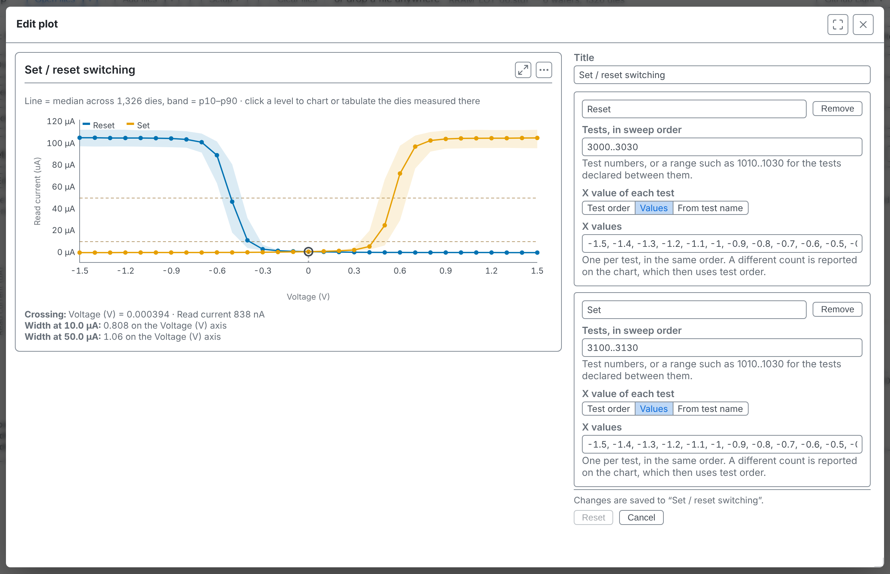

---

<!-- _class: split -->

# From test name

For each series, choose where each test's X value comes from. **Test order** uses its position in the series. **Values** lets you type one number per test. **From test name** reads the number from the test's name, here the cycle counts in names like "LRS read I @ 1e2 cycles". The editor lists what it read from the first names. **+ Add series** adds a curve.

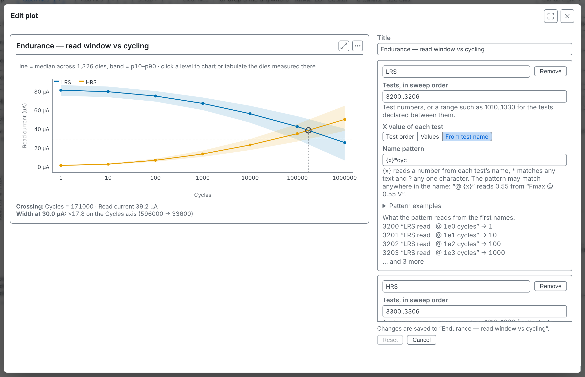

---

# A sweep remembers its tests' names

If a later lot uses the same test numbers for other measurements, the sweep does not draw them and says so on its card, instead of drawing another quantity as the same curve.

---

<!-- _class: divider -->

# Plots

---

<!-- covers: Add examples; + New plot -->

# Add examples

On the sample lot, **Add examples** adds a set of example plots chosen from the lot's data, covering every chart type it can show. **+ New plot** opens a scatter already set to the lot's first two tests.

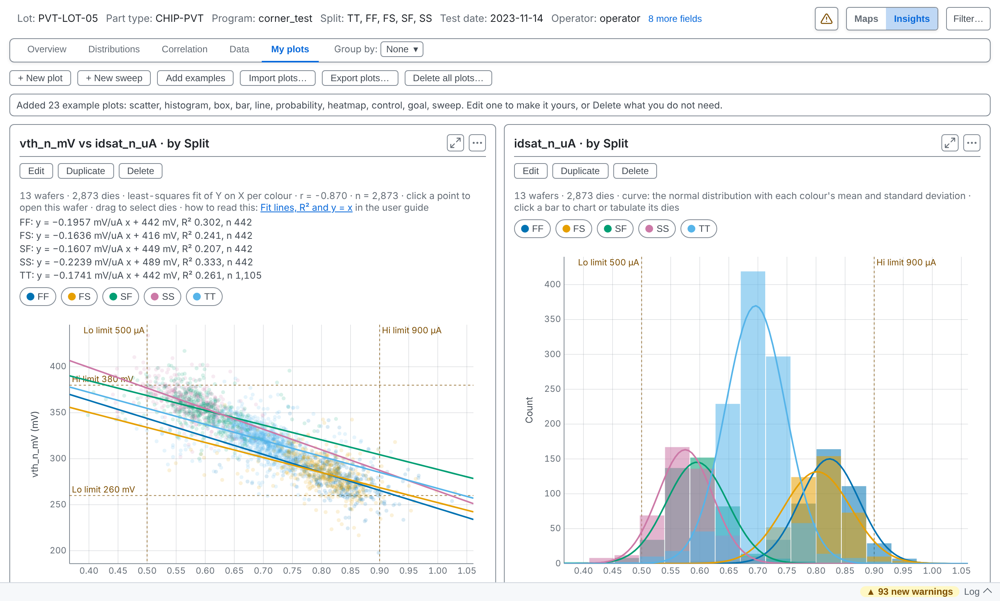

---

<!-- covers: Edit; Duplicate; Delete -->

# Edit, Duplicate, Delete

Each card has three buttons. **Delete** can be undone straight afterwards. Changes in the editor are drawn at once and kept as you make them.

---

<!-- _class: split -->
<!-- covers: Setup; Reset; Cancel; Maximize (F); Close (Esc) -->

# The plot editor

The chart on the left, its settings on the right. **Setup** chooses what the chart shows, **Customise** how it looks. **Reset** puts the plot back as it was when you opened it. **Cancel** does the same and closes the editor. Closing with ✕ keeps your changes.

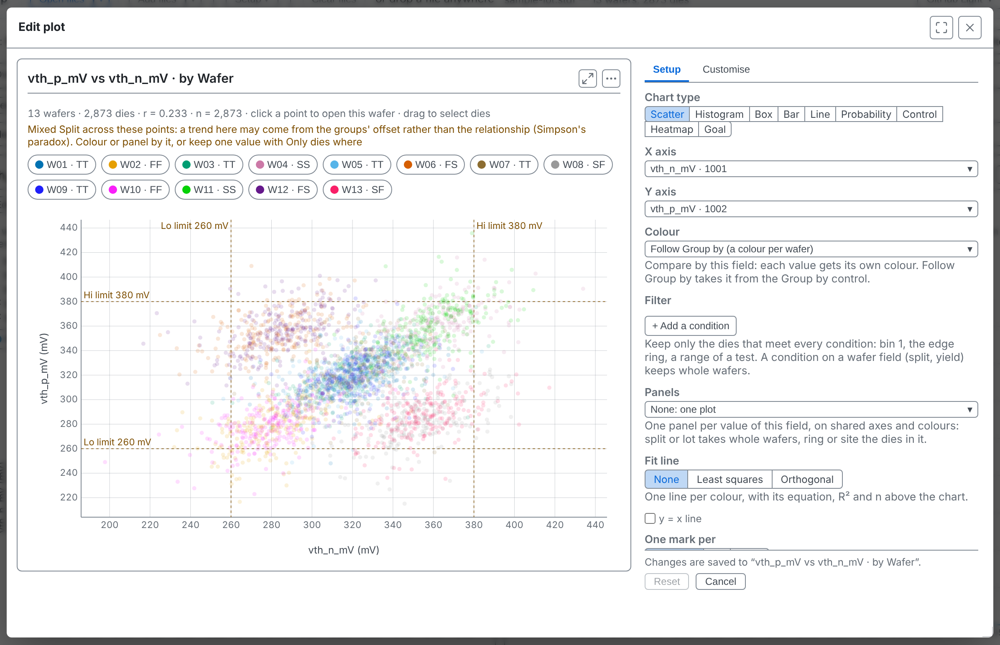

---

<!-- covers: Scatter; Histogram; Box; Bar; Line; Probability; Control; Heatmap; Goal -->

# Chart types

Scatter, histogram, box, bar, line, probability, control, heatmap and goal. Each needs different fields: a histogram takes one set of values, a box or bar takes categories.

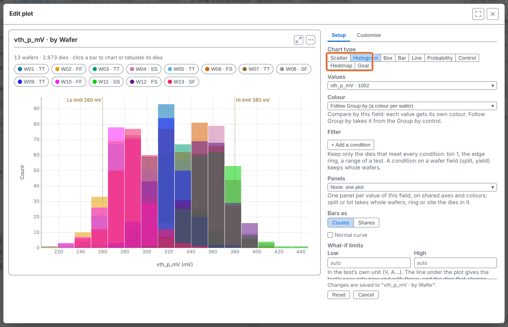

---

<!-- _class: split -->
<!-- covers: X axis; Y axis; Colour; X axis menu entry; Y axis menu entry; Colour menu entry; Plot editor wafer row -->

# X, Y and Colour

Each opens a list of fields: any test, a die's position, ring, bin or site, a wafer's yield, or a wafer field such as split. Colour separates the data into groups, each with its own button above the chart.

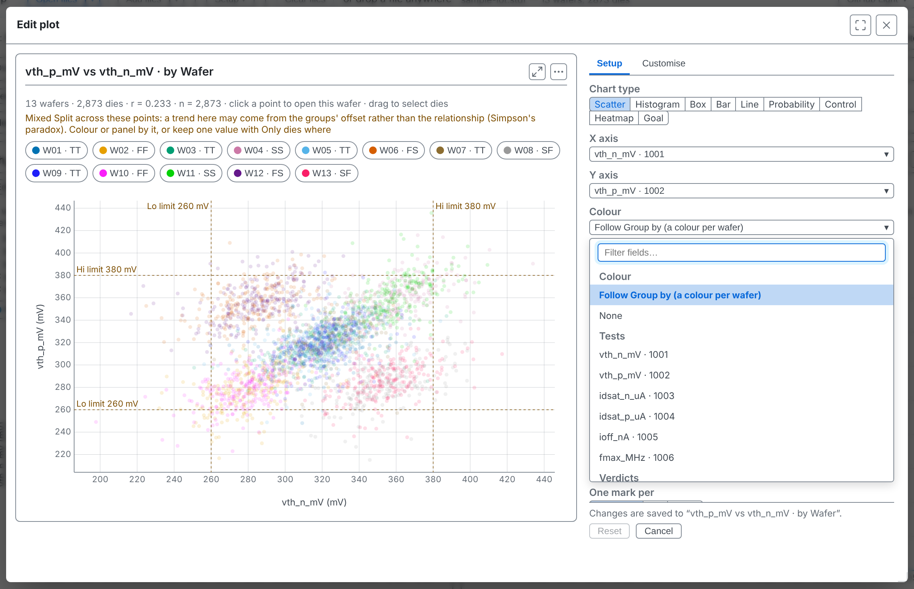

---

<!-- _class: split -->

# Colour by Split

One colour per split. **Follow Group by** is the default: the colours follow the Group by control above the charts, so changing it recolours every plot that is set to **Follow Group by**.

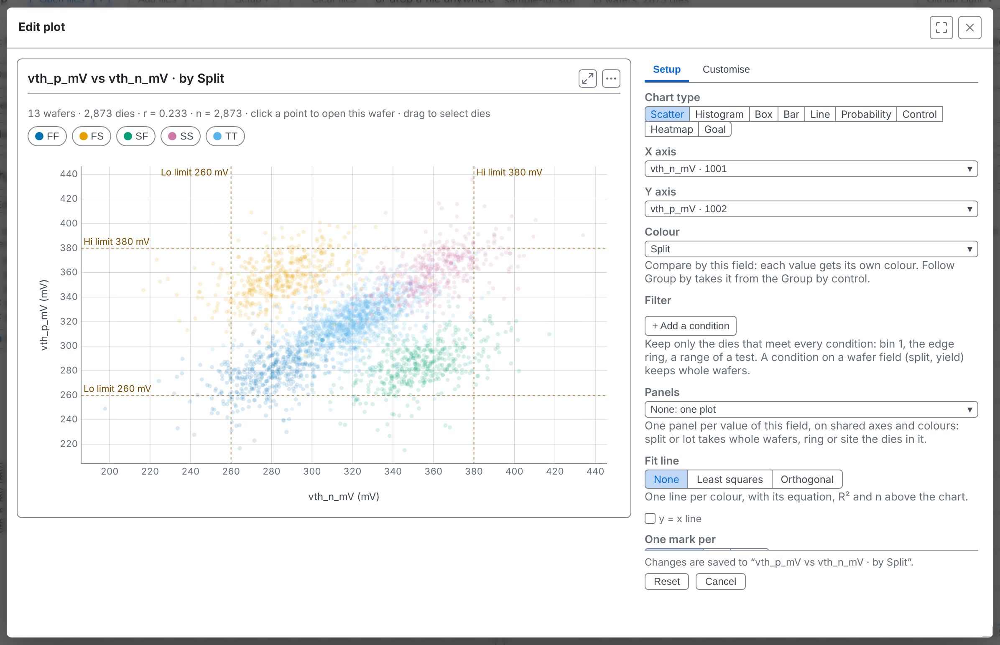

---

<!-- covers: + Add a condition; Panels; None; Least squares; Orthogonal; y = x line; Automatic; Die; Wafer -->

# More settings

**Filter** (**+ Add a condition**) keeps only the dies that meet every condition you add. **Panels** draws one small plot per value of a field. A scatter's **Fit line** is **None**, **Least squares** or **Orthogonal**, and **y = x line** draws the line where X equals Y. **One mark per** sets what each point stands for: a die, a whole wafer, or Automatic, the finest level the fields allow.

---

# A plot's filter and the page filter

There are two filters, and they are separate.

- **The page filter**, **Filter…** in the toolbar, is a view setting. It narrows every tab, plot, map and table at once, and is not saved with a plot.
- **A plot's own Filter** belongs to that plot and is saved with it. It narrows that plot only.

A plot shows the dies that pass both. Changing one never edits the other, and switching one off leaves the other in force. A plot's filter can therefore only narrow what the page filter lets through, never widen it.

---

<!-- _class: split -->
<!-- covers: Customise; Linear; Reverse direction; Test + spec; Spec -->

# Customise

On the **Customise** page you can set titles, each axis's minimum and maximum, its **Linear** or **Log** scale, **Reverse direction**, reference lines, and which limits are drawn (**Test + spec**, **Test**, **Spec** or **None**).

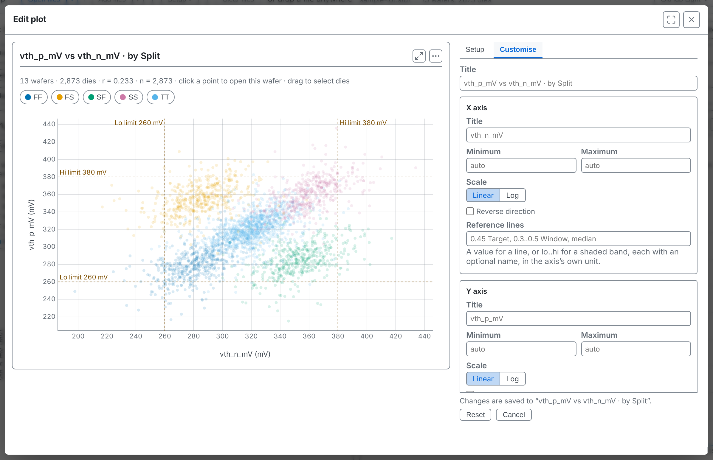

---

# Reference lines

A reference line marks a value of your own on a value axis: a target, a guard band, a customer's limit. It lets you see at a glance how the data sits against a number that matters to you but isn't one of the test's own limits.

In **Reference lines** on the Customise page, write a value for a line, or `lo..hi` for a shaded band. Each can have a name, and they are separated by commas:

`0.45 Target, 0.3..0.5 Window`

`median` or `mean` draws a line at that statistic of what the plot shows, the same on every panel: `median, 0.45 Target`. Values are in the axis's own unit.

---

# Your plots are kept

A plot is a recipe, not a picture: which fields go where, and nothing about the lot. tsmap remembers the list on this machine and draws it on the next lot you open. A plot that needs a test the lot lacks stays in the list, dimmed, with the reason.

---

<!-- covers: Export plots…; Delete all plots… -->

# Export, import, delete all

**Export plots…** writes every plot to a file and **Import plots…** adds the plots of such a file, so a set can move to a colleague. **Delete all plots…** asks first.

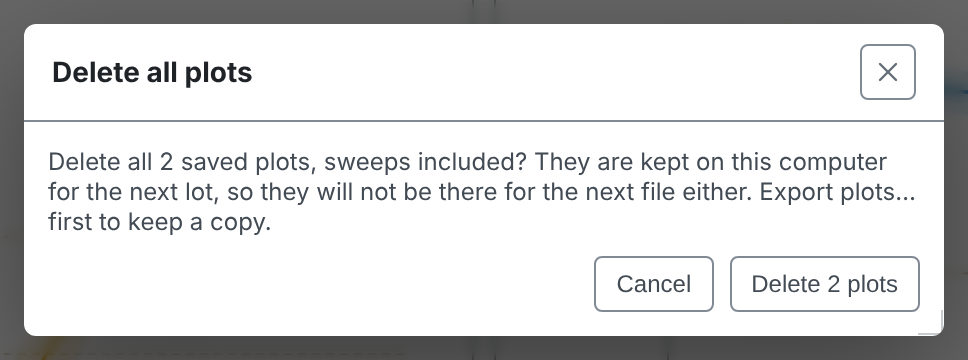

---

# Undo

Right after deleting, **Undo** brings the whole list back.

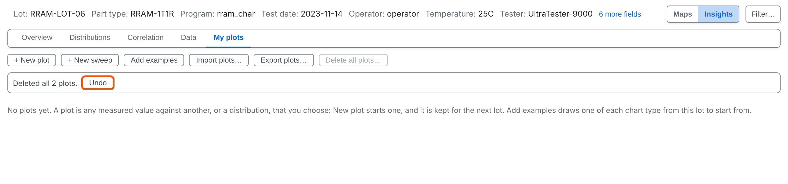

---

<!-- _class: split -->
<!-- covers: Charts and tables for this wafer (or right-click) › New plot…; Charts and tables for this wafer (or right-click) › New sweep… -->

# From the right-click menu

Every saved plot is a row in the menu on a selection, drawn over just those dies. **New plot…** and **New sweep…** at the end of its Plots section start a draft on them.

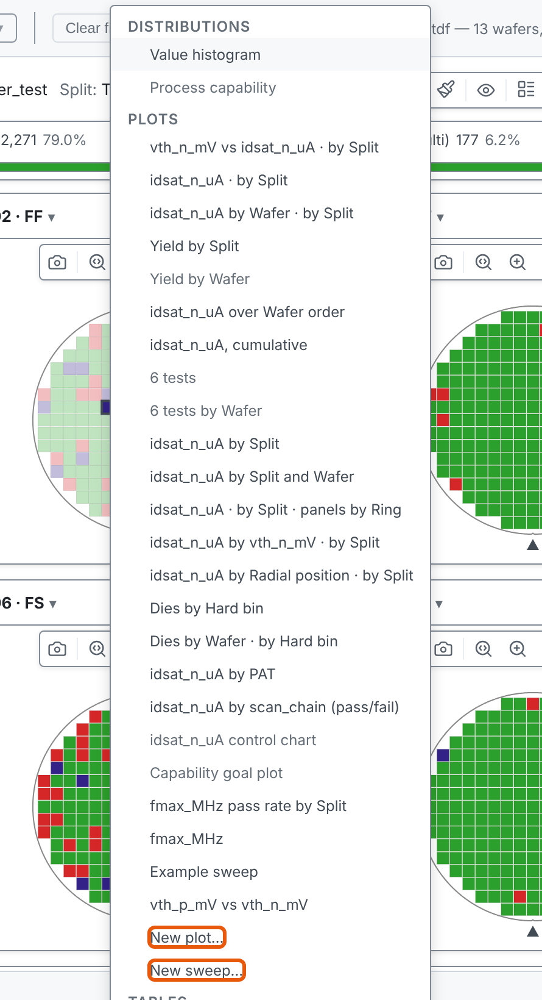

---

<!-- _class: split -->

# A draft

A draft is kept only if you press **Add to my plots**. **Cancel** discards it.

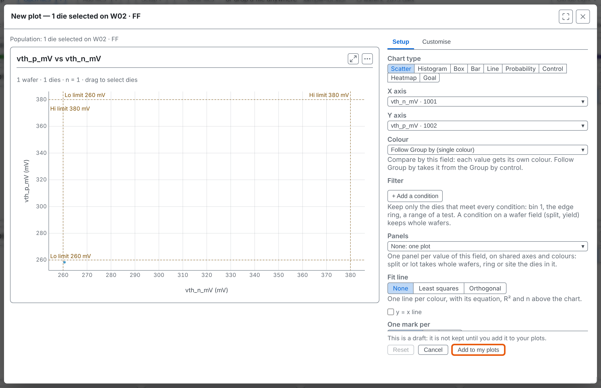

---

<!-- _class: lab -->

# Try it yourself

1. In the [web app](https://wafertools.github.io/tsmap/app/), **Load sample data**, then **Insights → My plots → Add examples**
2. **Edit** the first plot and set **Chart type** to **Box**
3. Set **X axis** to **Split**: which split differs most?
4. Open **Customise** and put a reference line on the value axis
5. **Export plots…**, then **Delete all plots…** and **Undo**

---

# Recap

- A **derived test** is computed from others and marked †
- A **sweep** reads a run of tests as a curve and measures where its first two curves cross
- **My plots** are recipes kept on this machine and redrawn on the next lot

More in the [wafer map guide](https://wafertools.github.io/wafermap/user-guide/#plots)

---

<!-- _class: next -->
<!-- _paginate: false -->

# Next session

09 · Unusual wafers

Multi-project wafers, no positions, retests and multi-site testing.
