<!-- _class: title -->
<!-- _paginate: false -->

# Unusual wafers

## Session 09

tsmap training · a self-paced course

---

# In this session

- Read multi-project wafers and wafers with missing positions
- Set the reticle, diameter and edge exclusion
- Handle clamped values and repeated dies

---

<!-- _class: divider -->

# Layouts

---

<!-- _class: split -->

# A multi-project wafer

Each reticle holds only a few of one product's dies, so the map is mostly empty and every die is tiny. This is MPW-LOT-08.

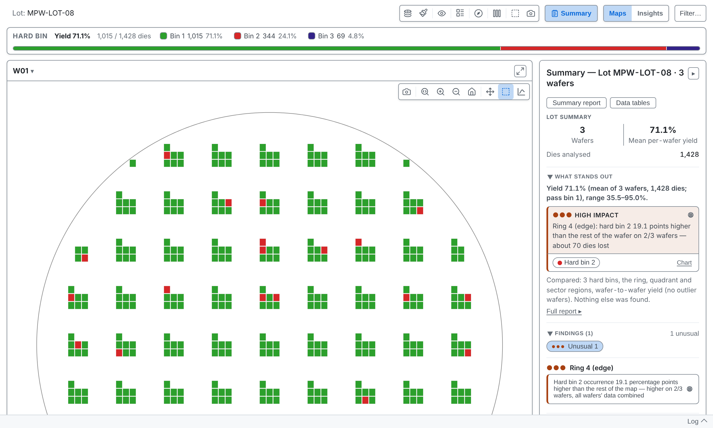

---

<!-- _class: split -->
<!-- covers: Overlays › ✓Compact layout; Overlays › Layout diagnostics -->

# Compact layout

When the occupied columns and rows repeat at a regular pitch, **Overlays** offers **Compact layout** and **Layout diagnostics** at the top.

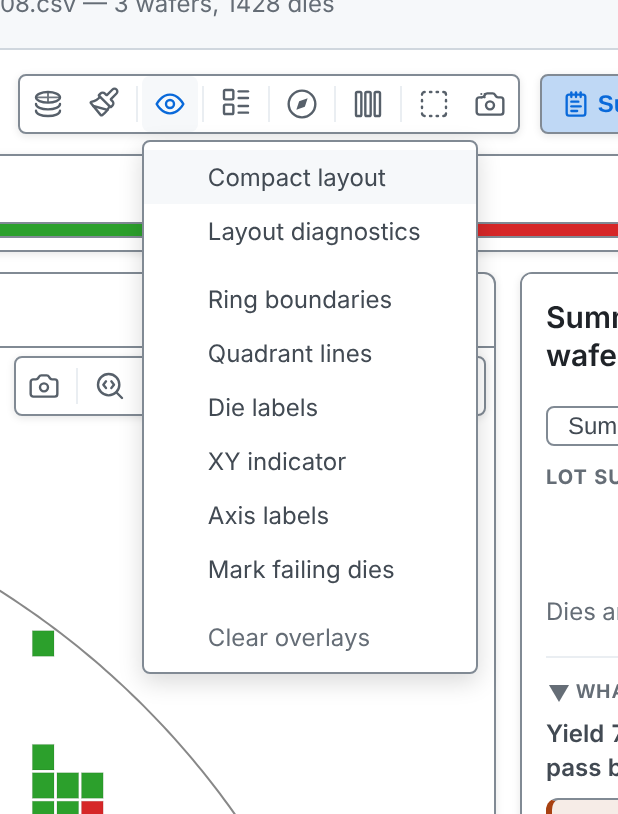

---

# Compact

Empty rows and columns are removed and each group of dies is outlined. Every die is still counted, so yield and findings do not change, and labels give the original coordinates.

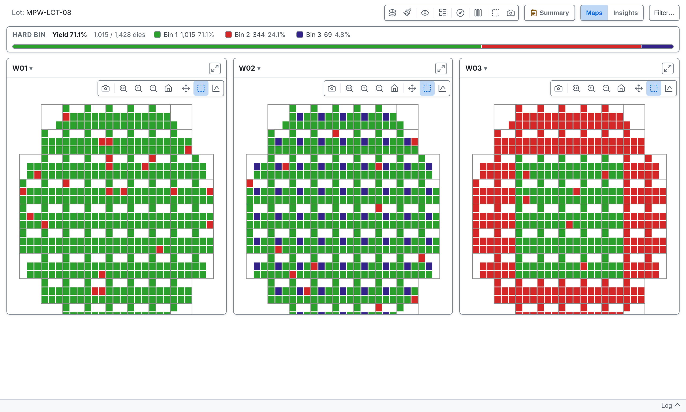

---

<!-- _class: split -->

# Layout diagnostics

If a layout is not recognised as you expect, this window shows what the detector saw: counts and scores only, with no positions, bins or wafer names. Use **Copy** or **Save as file**, then send the result to whoever supports tsmap.

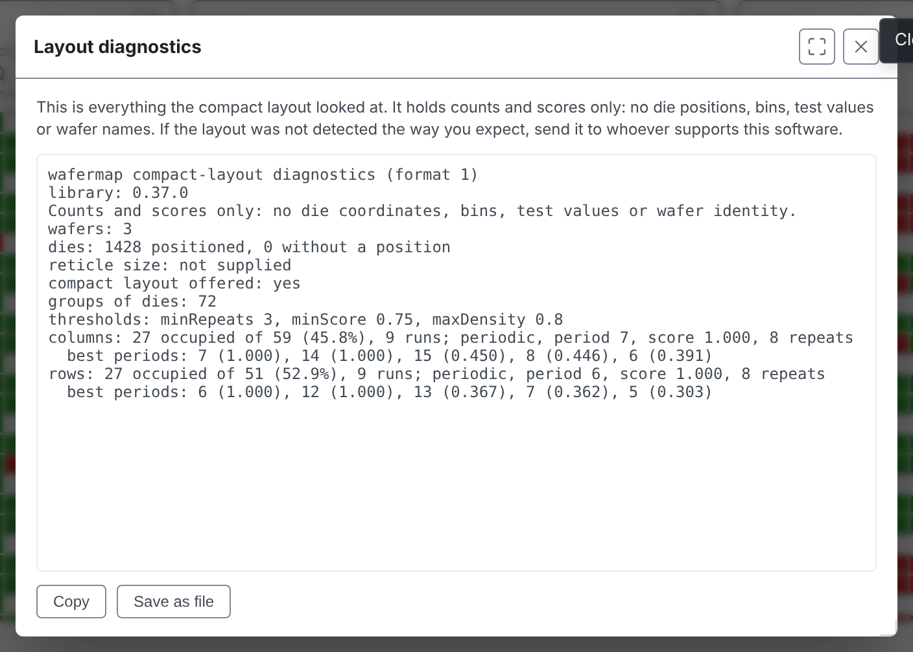

---

<!-- _class: divider -->

# Missing positions

---

# Three kinds of wafer

In the lot COORDLESS-LOT-01, **W01** has an X/Y position for every die. **W02** is mixed: some dies have results but no X/Y position. **W03** has results for its dies but no X/Y positions at all, so there is nowhere to draw them on a map.

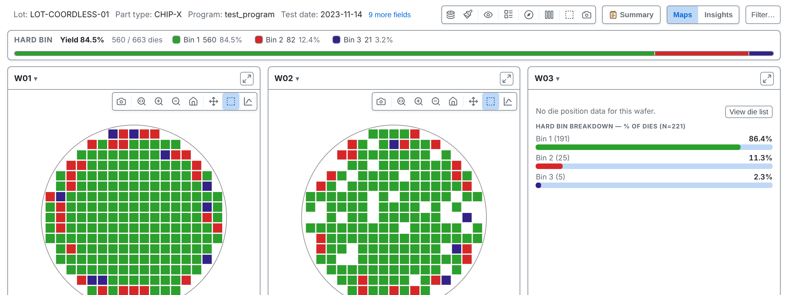

---

<!-- covers: Dies without position -->

# A mixed wafer

It draws the dies that have positions. A footer counts the rest; click it to see them.

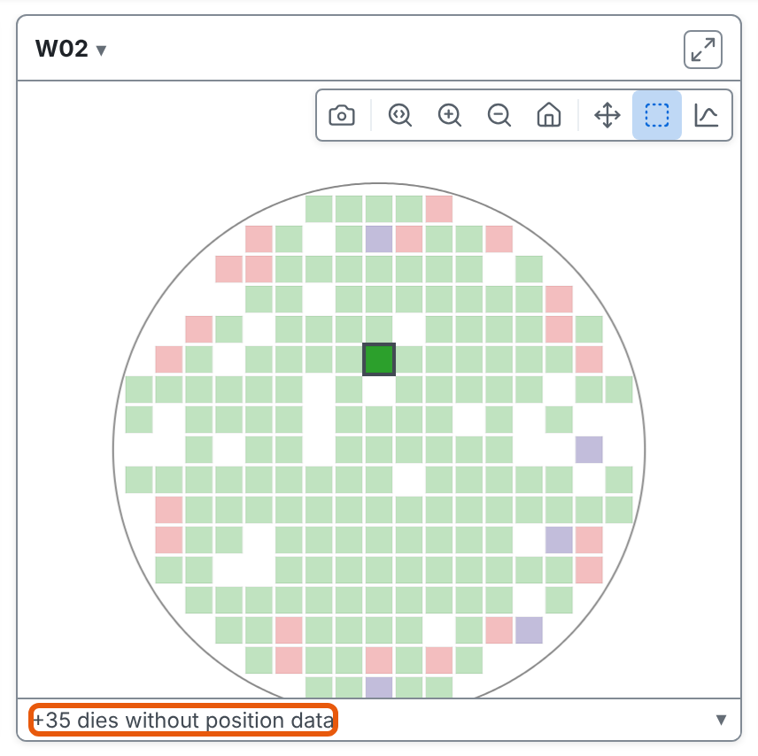

---

<!-- covers: View die list -->

# No positions at all

With no positions there is no map to draw, so the card shows a summary instead: a bin breakdown in the bin colour modes, or a histogram when colouring by a test value. **View die list** shows every die.

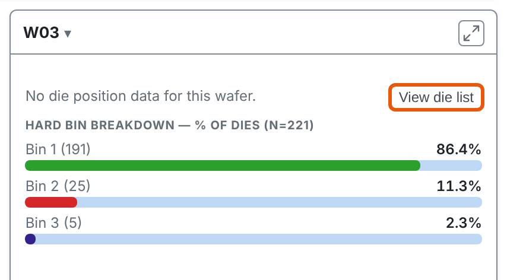

---

# The die list

A row for every die, with its position (blank here), site, bins and every test value. **Export CSV** saves it, and **View chart** switches back.

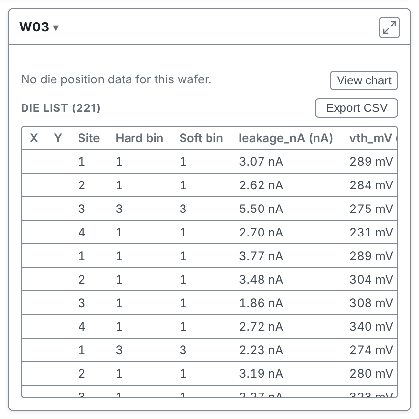

---

# What it changes

Layout findings (edge ring, quadrants, clusters) use only positioned dies. Yield, bin counts and test statistics include every die.

More in the [user guide](../user-guide.md#dies-with-no-reported-position)

---

<!-- _class: divider -->

# Repeats and sites

---

# Retests

When the same die position appears more than once, tsmap keeps the last result. The die's tooltip says how often it was probed, and the log notes repeated dies. RETEST-LOT-07 has a second pass over most failing dies.

---

# The same wafer twice

If one file holds the same wafer more than once, a column that tells the passes apart (a temperature, say) makes each pass its own map, and the log names the column. With nothing to tell them apart the repeats are treated as retests.

---

<!-- covers: Column mapping › Subdivide file by this column -->

# Test site

Some testers probe several dies at the same time, each through its own numbered site (1, 2, 3…). If your file has a column with that number, assign it to **Test site** in the column mapping.

All sites stay on one wafer map. The site shows in each die's tooltip, and you can colour or group a chart by it, for example to see whether one probe site fails more often.

The column must hold numbers.

Do not use **Subdivide file by this column** for sites. That option splits the file into one wafer per value, and is meant only for flat files that put several wafers in one file with no wafer column.

---

<!-- _class: divider -->

# Geometry and limits

---

<!-- _class: split -->
<!-- covers: Setup ▾ › Reticle…; Reticle… › Field width (dies); Reticle… › Field height (dies); Reticle… › Corner die X; Reticle… › Corner die Y; Reticle… › Clear; Reticle… › Cancel; Reticle… › Apply -->

# Reticle…

A reticle, or stepper field, is the group of dies exposed in one step. A wafer file doesn't record its size, so enter its width and height as numbers of dies. Change **Corner die X** and **Corner die Y** only if a field's bottom-left die is not at X 0, Y 0.

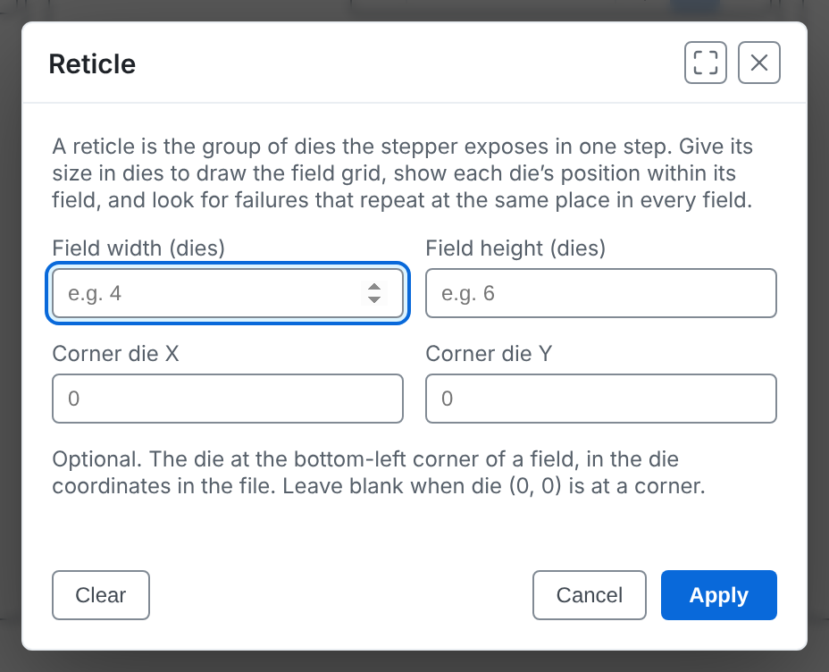

---

<!-- _class: split -->

# A field of 4 by 3

Here the field is 4 dies wide and 3 high. **Apply** takes effect at once. **Clear** removes the reticle. The reticle applies to every wafer and is remembered.

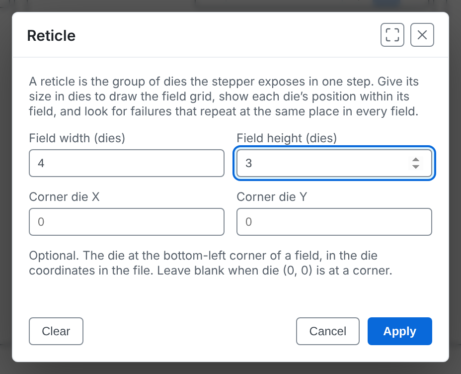

---

# The field grid

The grid is drawn on every map, a die's tooltip gives its position within its field, and the Summary panel looks for findings that repeat at the same position within every field. That points to the stepper or its mask rather than to the wafer itself.

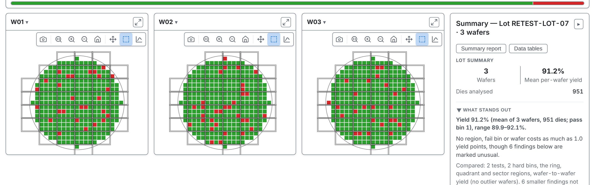

---

<!-- covers: Overlays › ✓Reticle grid -->

# Reticle grid

**Overlays ▾ → Reticle grid** hides or shows it.

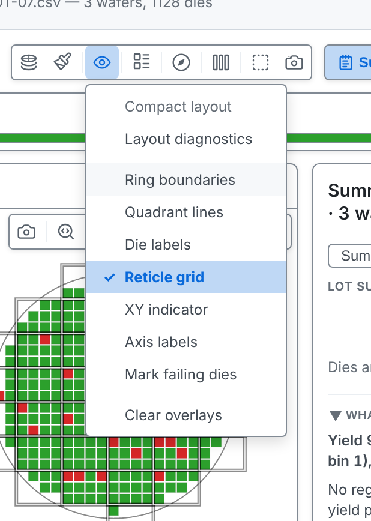

---

<!-- _class: split -->
<!-- covers: Setup ▾ › Diameter & edge exclusion…; Diameter & edge exclusion… › Wafer diameter (mm); Diameter & edge exclusion… › Edge exclusion width (mm); Diameter & edge exclusion… › Clear; Diameter & edge exclusion… › Cancel; Diameter & edge exclusion… › Apply -->

# Diameter and edge exclusion

tsmap normally works out the wafer diameter from the data. Enter it yourself when there are too few dies to work it out. You can also set an **edge exclusion**: a band of the width you give, in mm, at the rim. Dies in the band are left out of yield and drawn grey. Enter the diameter before the band's width.

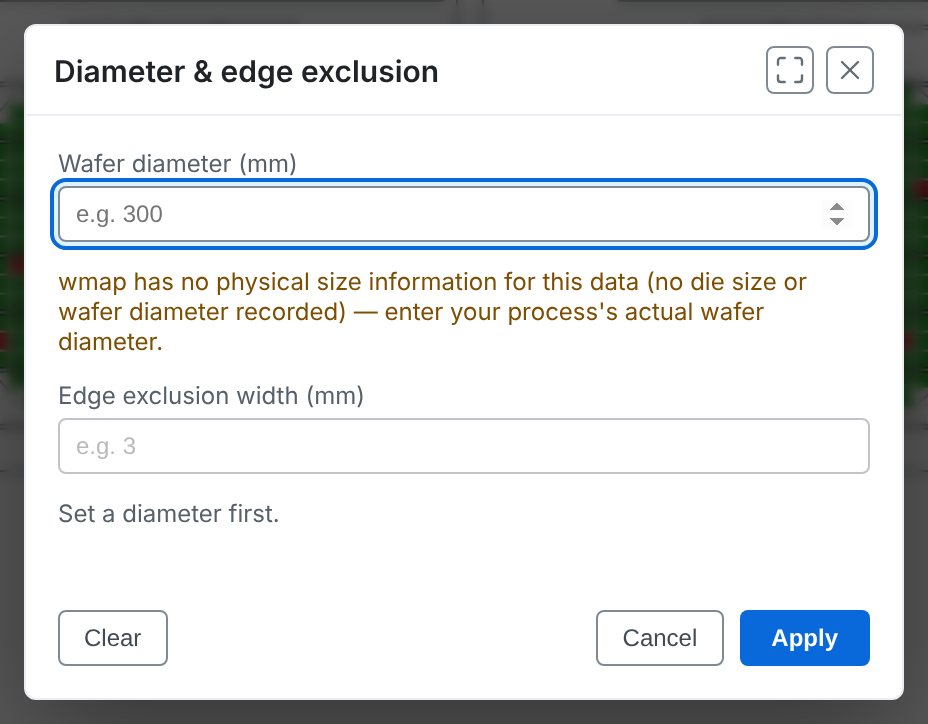

---

# A band at the edge

With 300 mm and 10 mm entered, dies within 10 mm of the edge are left out of yield and drawn grey. Both values are remembered.

---

<!-- _class: split -->
<!-- covers: Setup ▾ › Exclude values outside limits… -->

# Exclude values outside limits…

When a tester runs out of range it records its maximum or minimum instead of a real reading, for example a current stuck at its compliance clamp. One such value stretches the colour scale and moves the mean. By default tsmap treats any value outside a test's validity limits as missing: grey on the map and left out of statistics. The window also offers spec limits, test limits, or Off.

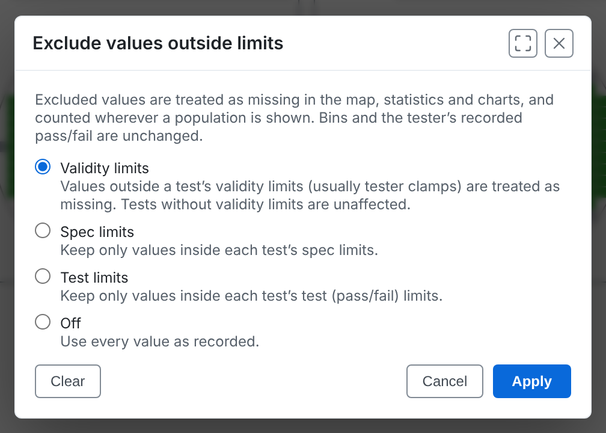

---

# Nothing is hidden

The tooltip on a grey die names the excluded value, and the Summary panel's Test Values table shows an **Excl.** column. Bins and the tester's pass or fail are unchanged, so yield is the same. Open `VALID-LOT-09.csv` and switch between **Validity limits** and **Off** to see it.

---

<!-- _class: lab -->

# Try it yourself

1. In the [web app](https://wafertools.github.io/tsmap/app/), load `MPW-LOT-08.csv` and turn on **Overlays → Compact layout**
2. Load `COORDLESS-LOT-01.stdf`: open W03's **View die list**
3. On the sample lot, **Setup ▾ → Reticle…**, enter 4 by 3 and **Apply**
4. Open **Diameter & edge exclusion…** and try 300 and 3

---

# Recap

- **Compact layout** shows multi-project wafers at a readable size
- Wafers with missing positions keep every die in the numbers
- **Reticle…** and **Diameter & edge exclusion…** supply what the file does not say, and **Exclude values outside limits…** removes tester clamp values

More in the [user guide](../user-guide.md#analysing-your-data)

---

<!-- _class: next -->
<!-- _paginate: false -->

# Next session

10 · Automation and integration

The command line, links, and definitions files.
