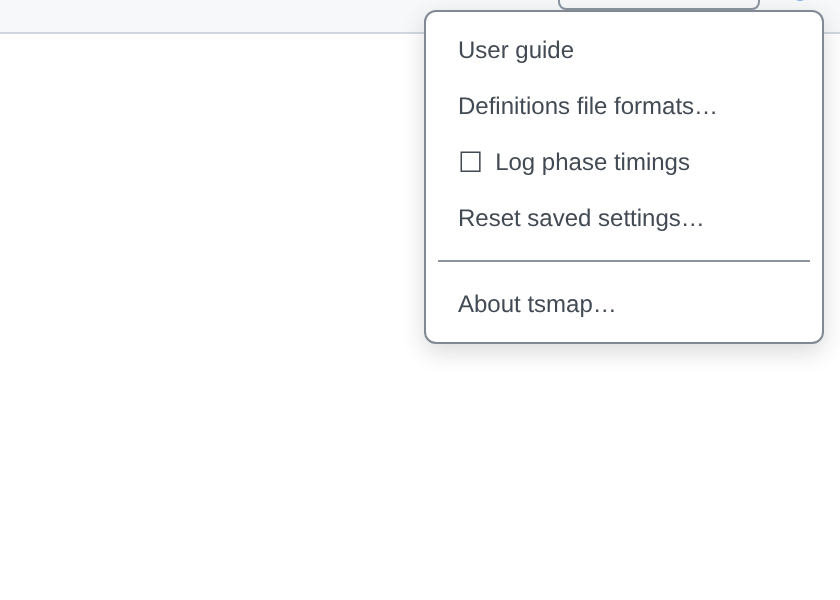
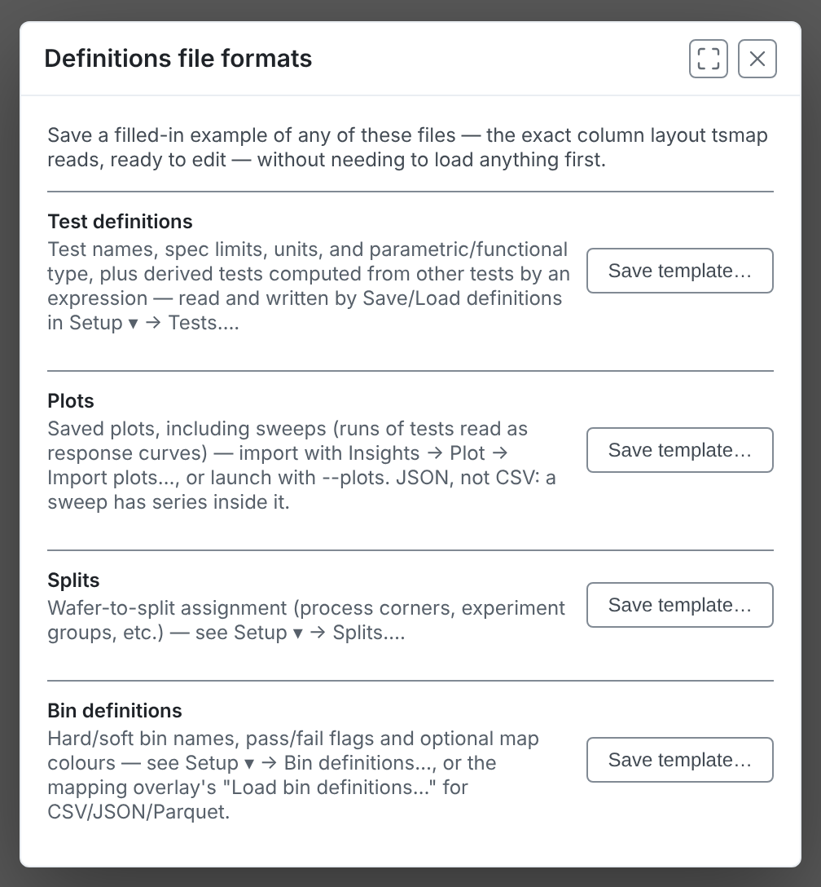
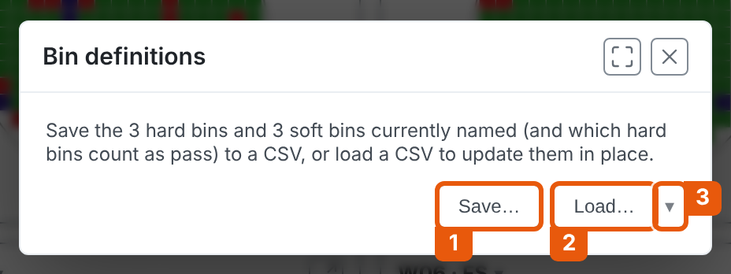
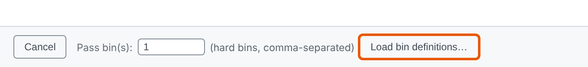
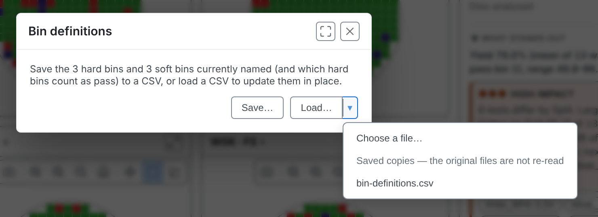
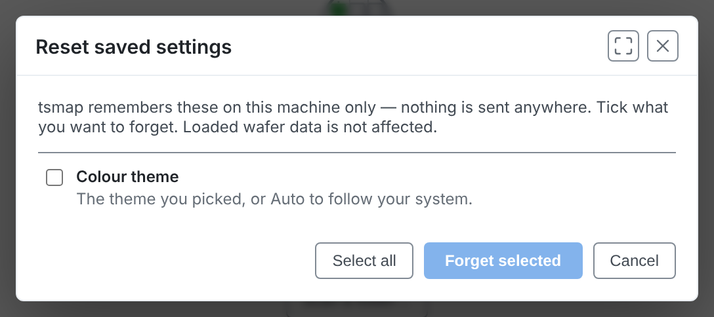

<!-- _class: title -->
<!-- _paginate: false -->

# Automation and integration

## Session 10

tsmap training · a self-paced course

---

# In this session

- Open data from a link or the command line
- Use the definitions files: tests, splits, bins and plots
- See and reset what tsmap remembers

---

<!-- _class: divider -->

# Opening data automatically

---

# From a link

Another application can open tsmap with a link to a data file. In the browser, add the file's address to the page address:

`…/app/?dataUrl=<encoded URL>&dataFormat=csv`

You must name the format: `stdf`, `atdf`, `csv`, `json`, `parquet` or `zip`. tsmap does not work it out from the address. The file then loads as if you had opened it locally.

---

# The lab link

The course's own labs use it. This opens the sample CSV:

[Open the sample CSV](https://wafertools.github.io/tsmap/app/?dataUrl=https%3A%2F%2Fwafertools.github.io%2Ftsmap%2Fsamples%2Ftsmap-sample.csv&dataFormat=csv)

The data server must allow pages from other websites to read the file (this is called CORS). If the fetch fails, the log says so.

More in the [user guide](../user-guide.md#opening-data-from-a-url)

---

# The command line

On the desktop app, name files when you launch it:

`tsmap lot1.stdf lot2.stdf`
`tsmap lot1.stdf --splits my-splits.csv`
`tsmap lot1.stdf --plots my-plots.json`
`tsmap --url https://… --url-format stdf`

`tsmap --help` lists everything. Launching again hands the files to the running window.

---

# More options

`--wafer-diameter`, `--edge-exclusion` and `--reticle` set the same values as their dialogs, for that launch. `--tests` fills in the test selector, which is still shown. `--list files.txt` reads a list of paths.

A `tsmap://open?url=…&format=…` link opens the desktop app from a web page, once the app has run on that machine.

More in the [user guide](../user-guide.md#command-line)

---

# File associations

On the desktop app, **Help → File associations…** opens `.stdf`, `.atdf` and `.parquet` files in tsmap by double-click. Nothing is associated until you tick it. It is not available in the browser.

---

<!-- _class: divider -->

# Definitions files

---

<!-- _class: split -->
<!-- covers: Help › User guide; Help › Definitions file formats…; Help › ☐Log phase timings; Help › Reset saved settings…; Help › About tsmap… -->

# The Help menu

**User guide** opens this documentation. **Log phase timings** adds timing lines to the log while a file loads, which helps when reporting a slow load. **About tsmap…** shows the version. The other two entries are covered on the next slides.

---

<!-- _class: split -->
<!-- covers: Definitions file formats… › Save a test definitions template; Definitions file formats… › Save a plots template; Definitions file formats… › Save a splits template; Definitions file formats… › Save a bin definitions template -->

# Definitions file formats…

Four kinds of file, each with a **Save template…** button that writes a filled-in example in the exact layout tsmap reads. You can save a template and edit it before you have any data.

---

# Three CSV files and one JSON

Test definitions (with derived tests), splits and bin definitions are CSV. Plots, sweeps included, are JSON because a sweep has series inside it. Test definitions come up in session 01, splits in session 04, and derived tests and plots in session 08. Bin definitions are new in this session.

---

<!-- _class: split -->
<!-- covers: Setup ▾ › Bin definitions…; Bin definitions… › Save…; Bin definitions… › Load…; Bin definitions… › Load a recently used definitions file -->

# Bin definitions…

A name for each hard or soft bin, whether a hard bin passes, and optionally its map colour. 1 **Save…** writes them to a CSV file. 2 **Load…** reads one. 3 The **▾** lists recently used files.

---

<!-- covers: Colour scheme › ✓Use colours from bin definitions -->

# STDF, ATDF and the rest

STDF and ATDF carry bin names and pass flags themselves. CSV, JSON and Parquet carry none, so every bin is a bare number until you supply definitions.

When a definitions file carries bin colours, **Colour scheme → Use colours from bin definitions** turns them on and off.

---

<!-- covers: Load bin definitions… -->

# In the column mapping

For those formats, load the file in the column mapping before you continue, next to **Pass bin(s)**.

---

<!-- _class: split -->

# Recent definitions files

The **▾** beside a Load button lists the definitions files you loaded or saved recently, so you can reapply one without finding it again. Each kind of file keeps its own list.

In the browser, a recent entry is a saved copy of the file as it was when you last loaded or saved it. The original file is not read again. If the file may have changed, choose **Choose a file…** and pick it again.

---

<!-- _class: divider -->

# What tsmap remembers

---

<!-- _class: split -->
<!-- covers: Reset saved settings… › stored item; Reset saved settings… › Select all; Reset saved settings… › Forget selected; Reset saved settings… › Cancel -->

# Reset saved settings…

tsmap keeps some choices on this machine only: your colour theme, wafer split assignments, column mappings, saved plots, filters, and any diameter, edge exclusion or reticle you set. The window lists only what is stored at the moment (here, just the theme). Tick what you want to forget, then choose **Forget selected**.

---

# Nothing is sent anywhere

Loaded wafer data is not affected by a reset. Saved settings stay on this machine, and tsmap does not upload your data.

---

<!-- _class: lab -->

# Try it yourself

1. Open **Help → Definitions file formats…** and save the splits template
2. On the sample lot, open **Setup ▾ → Bin definitions…** and **Save…**
3. Open the [sample CSV link](https://wafertools.github.io/tsmap/app/?dataUrl=https%3A%2F%2Fwafertools.github.io%2Ftsmap%2Fsamples%2Ftsmap-sample.csv&dataFormat=csv)
4. Open **Help → Reset saved settings…** and read the list of what is stored, then **Cancel**

---

# Recap

- A link or the command line opens data with no clicking
- Templates show the exact layout of every definitions file
- **Reset saved settings…** shows and forgets what tsmap remembers

More in the [user guide](../user-guide.md#reference)

---

<!-- _class: next -->
<!-- _paginate: false -->

# That is the course

Back to [the start](00-welcome.md), or open the app and try your own data.

wafermap is the library tsmap is built on. To use it in your own application, see the [wafermap documentation](https://wafertools.github.io/wafermap/), [quickstart](https://wafertools.github.io/wafermap/quickstart/) and [developer guide](https://wafertools.github.io/wafermap/guide/).
